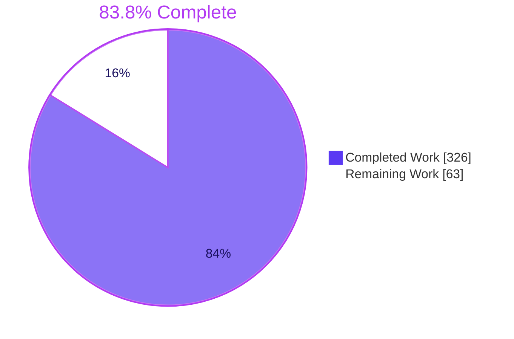
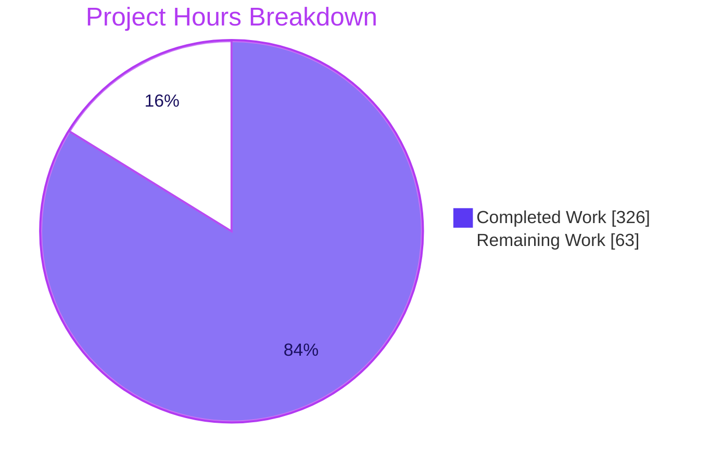
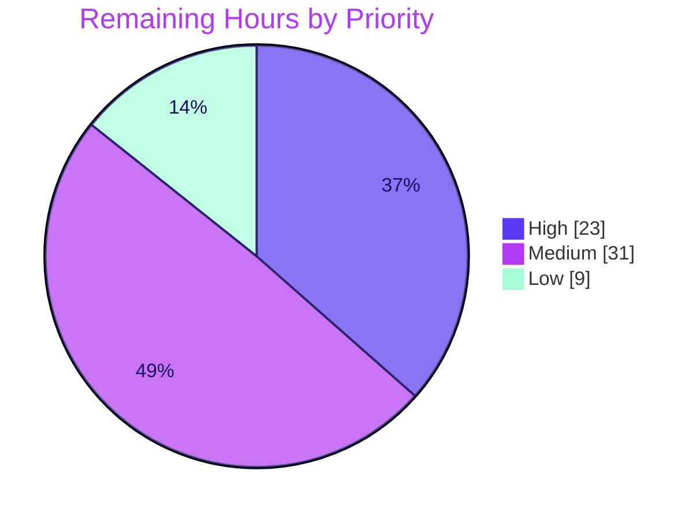
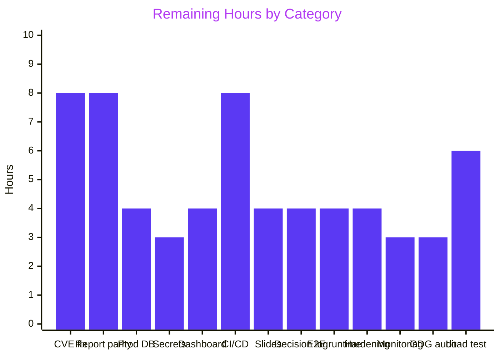

# 1. Executive Summary

## 1.1 Project Overview

This project migrates the AWS CardDemo mainframe credit-card management system from COBOL/CICS/VSAM/JCL to a headless **Java 25 LTS + Spring Boot 3.5.11 + PostgreSQL 16** service. All 28 COBOL programs (17 online CICS programs, 10 batch programs and a shared date utility) become Spring services, REST controllers and Spring Batch jobs; the 10 VSAM datasets become Flyway-managed tables with `BigDecimal` arithmetic throughout. It serves financial-services teams decommissioning mainframe workloads who need transactional parity, an audit trail back to the original source (preserved under `legacy/app/`) and a build that verifies locally. The branch stands unchanged at commit `4ad8563`, as the latest review instruction required.

## 1.2 Completion Status

**326 hours completed out of 389 total hours = 83.8% complete** — calculated as 326 ÷ (326 + 63) × 100.



| Metric | Value |
|--------|-------|
| **Total Hours** | 389 |
| **Completed Hours (AI + Manual)** | 326 (326 AI + 0 manual) |
| **Remaining Hours** | 63 |
| **Completion Percentage** | 83.8% |

## 1.3 Key Accomplishments

- ✅ 28 COBOL programs translated into 17 online and 10 batch services plus `DateConversionUtil`, all 527 paragraphs mapped in `docs/traceability-matrix.md`
- ✅ 1,011 tests (977 unit, 34 integration) pass with 80.65% line coverage under the enforced JaCoCo 80% gate
- ✅ Zero-warning Java 25 build under `-Xlint:all -Werror`
- ✅ 11 JPA entities on PostgreSQL 16 via Flyway V1/V2/V100, seeded from the 9 legacy fixtures, `BigDecimal` + `HALF_UP` for every monetary field
- ✅ 7 REST controllers verified live: sign-on, account, card, transaction, bill payment, reports and admin user CRUD
- ✅ Spring Security with BCrypt-hashed passwords and ADMIN/USER role enforcement
- ✅ 7 Spring Batch jobs; posting (reject codes 100–103), interest, sort and statement jobs integration-tested on PostgreSQL
- ✅ JSON logs with trace IDs, Prometheus metrics, liveness/readiness probes; original COBOL tree preserved under `legacy/app/`

## 1.4 Critical Unresolved Issues

All 4 directives of the latest review instruction are satisfied (**0 of 4 open**). Of the **38** discrete AAP requirements tracked in this assessment, **8 remain open or partially met**:

| Issue | Impact | Owner | ETA |
|-------|--------|-------|-----|
| OWASP gate fails: 14 runtime dependencies carry CVSS ≥ 7.0 findings (Tomcat 10.1.52, Spring Framework 6.2.16, Spring Security 6.5.8; max 9.8) — left unchanged under the no-change instruction | `./mvnw -B -ntp verify` fails; blocks security sign-off | Human Developer | 8 h |
| `POST /api/reports` launches the statement job, not the COBOL TRANREPT transaction report; `TransactionProcessService` (CBTRN03C) is never invoked | Business-logic parity gap (AAP 0.7.1) | Product Owner + Developer | 8 h |
| No dashboard template (Grafana JSON or equivalent) | Observability rule (AAP 0.7.3, Rule 3) unmet | Human Developer | 4 h |
| No CI/CD pipeline | Quality gates enforced only when run by hand | DevOps | 8 h |
| Executive presentation departs from the Rule 5 specification | Brand and format non-compliance | Human Developer | 4 h |
| Rationale embedded in code comments; several design departures lack decision-log entries | Rule 1 non-compliance | Human Developer | 4 h |
| GDG replacement: audit columns promised in DEC-025 do not exist | AAP 0.3.1 archival strategy partial | Human Developer | 3 h |
| `application-local.yml` defaults `DB_PASSWORD` to `cardemo` | Hardcoded credential, local profile only | Human Developer | within 3 h secrets task |

## 1.5 Access Issues

| System/Resource | Type of Access | Issue Description | Resolution Status | Owner |
|----------------|---------------|-------------------|-------------------|-------|
| NVD (National Vulnerability Database) | API key | The scan runs against the local NVD cache without a key; a fresh CI runner without that cache needs `NVD_API_KEY` for a practical download time | Open — request a key at https://nvd.nist.gov/developers/request-an-api-key | DevOps |
| Non-local PostgreSQL | Database credentials | No staging or production `DB_URL` / `DB_USERNAME` / `DB_PASSWORD` provisioned | Open | DevOps |

## 1.6 Recommended Next Steps

1. **[High]** Upgrade dependencies until `./mvnw -B -ntp verify` passes the OWASP CVSS 7 gate
2. **[High]** Decide report-submission parity and wire a TRANREPT job to `TransactionProcessService`
3. **[High]** Provision PostgreSQL 16, move credentials to a secrets manager and drop the local default password
4. **[Medium]** Add a CI pipeline running the full `verify` gate, and commit a dashboard template
5. **[Medium]** Close the Rule 1 and Rule 5 documentation gaps

# 2. Project Hours Breakdown

## 2.1 Completed Work Detail

| Component | Hours | Description |
|-----------|-------|-------------|
| Build Configuration & Maven Setup | 16 | `pom.xml` (Spring Boot 3.5.11 parent; compiler `-Xlint:all -Werror`, JaCoCo 0.80 line gate, OWASP `failBuildOnCVSS` 7), Maven wrapper, `application.yml` / `-local` / `-test`, `logback-spring.xml` |
| Application Entry Point & Config Classes | 11 | `CardDemoApplication`, `SecurityConfig`, `BatchConfig`, `JpaConfig`, `ObservabilityConfig`, `AppProperties`, `CardDemoContextFilter`, `CardDemoUserDetailsService` |
| JPA Entity Layer (12 files) | 18 | 11 entities + `UserTypeConverter`: copybook layouts as JPA with `BigDecimal` money, `@Version` on Account/Card/UserSecurity, `@Index` for AIX paths |
| Repository Interfaces (11 files) | 6 | Spring Data repositories replicating keyed READ, STARTBR/READNEXT browse, AIX lookups and browse-last ID generation |
| Online Service Layer (17 files) | 56 | `SignonService` through `UserDeleteService`: CICS program logic at paragraph level, including field validation and optimistic locking |
| Batch Service Layer (10 files) | 32 | `AccountRefreshService` through `StatementIoService`: batch program logic preserving PERFORM UNTIL loops and file-status semantics |
| Spring Batch Job Configs (7 files) | 16 | `DailyPostingJobConfig`, `InterestCalcJobConfig`, `TransactionSortJobConfig`, `StatementGenJobConfig`, Account/Customer/Transaction load jobs |
| Batch Infrastructure (7 files) | 12 | `FixedWidthFileReader`, `DailyTransactionReader`, `TransactionPostingProcessor` (reject codes 100–103), `InterestCalculationProcessor`, `StatementProcessor`, `RejectFileWriter`, `StatementFileWriter` |
| REST Controllers (8 files) | 14 | Auth, Account, Card, Transaction, Report, BillPayment and UserAdmin controllers plus `GlobalExceptionHandler` |
| Common Library | 27 | 14 DTOs, 4 enums (88-level conditions), 6 exceptions (VSAM status mapping), 4 utilities, `FieldValidator`, `CardDemoContext`, 2 message classes |
| Database Migrations (3 SQL files) | 8 | `V1__create_schema.sql` (11 tables), `V2__create_indexes.sql` (AIX equivalents), `V100__seed_data.sql` (seed from 9 fixtures, BCrypt passwords) |
| Test Suite (56 files, 1,011 tests) | 78 | Unit, MockMvc, Testcontainers repository and Spring Batch integration tests; 80.65% line coverage |
| Documentation Suite | 18 | `docs/architecture/diagrams.md` (8 Mermaid diagrams), `docs/traceability-matrix.md` (527 paragraphs), `docs/decision-log.md` (25 decisions), `docs/onboarding.md`, `docs/slides/executive-summary.html` (17 slides), `README.md` |
| Legacy Preservation & Test Fixtures | 3 | 100 original files under `legacy/app/`; 9 fixed-width fixtures under `src/test/resources/fixtures/` |
| Integration Verification & Quality-Gate Hardening | 11 | Actuator access rules, `BigDecimal` JSON serialization, SSN masking, authentication wiring, statement output paths and coverage-gate enforcement verified end to end |
| **Total Completed** | **326** | |

## 2.2 Remaining Work Detail

| Category | Hours | Priority |
|----------|-------|----------|
| Dependency CVE upgrades so the OWASP CVSS 7 gate passes (Boot patch upgrade, Micrometer alignment, false-positive suppression, full regression) | 8 | High |
| Report-submission parity: TRANREPT job wired to `TransactionProcessService`, `ReportService` retargeted, integration test | 8 | High |
| Production PostgreSQL 16 provisioning and configuration | 4 | High |
| Secrets management and removal of the local default DB password | 3 | High |
| Dashboard template (Grafana JSON over `/actuator/prometheus`) verified against a local Prometheus scrape | 4 | Medium |
| CI/CD pipeline running `verify` with Testcontainers and the OWASP gate | 8 | Medium |
| Executive presentation brought to the Rule 5 specification | 4 | Medium |
| Explainability: decision-log entries for unlogged departures; rationale moved out of code comments | 4 | Medium |
| End-to-end runtime verification of account/card updates, the batch chain and seed load jobs | 4 | Medium |
| Production security hardening (PII at rest, actuator exposure, trace sampling) | 4 | Medium |
| Production monitoring and alerting (trace exporter, alert rules) | 3 | Medium |
| GDG replacement: audit columns migration or corrected DEC-025 | 3 | Low |
| Performance and load baseline, including concurrent transaction-ID generation | 6 | Low |
| **Total Remaining** | **63** | |

# 3. Test Results

Results of `./mvnw -B -ntp verify -Ddependency-check.skip=true` on commit `4ad8563` (exit 0, 61 s): Surefire ran 977 tests and Failsafe ran 34, with no failures, errors or skips. Compilation under `-Xlint:all -Werror` passed and the JaCoCo check reported "All coverage checks have been met". Coverage figures are line coverage of the main package each area targets.

| Area / Category | Framework | Tests | Passed | Failed | Coverage | What This Proves |
|---|---|---|---|---|---|---|
| Online services (17 CICS programs) | JUnit 5 + Mockito | 182 | 182 | 0 | 76.3% `service.online` | Sign-on, menus, account/card/transaction flows, bill payment, reports and user admin follow the COBOL paragraph logic |
| Batch services & batch components | JUnit 5 + Mockito | 183 | 183 | 0 | 91.8% `service.batch`; 74.4% readers/processors/writers | 10 batch programs, fixed-width parsing, reject codes 100–103, interest and statement formatting behave as specified |
| Batch job integration | Spring Batch Test + Testcontainers (Failsafe) | 34 | 34 | 0 | 66.9% `batch.job` | POSTTRAN, INTCALC, COMBTRAN and CREASTMT jobs run end to end against PostgreSQL 16 |
| Repository integration | Spring Data JPA + Testcontainers | 60 | 60 | 0 | n/a (interfaces) | Keyed reads, AIX-equivalent lookups, pagination and browse-last queries work on real PostgreSQL |
| REST controllers & security | MockMvc (`@WebMvcTest`) | 78 | 78 | 0 | 88.5% `controller` | Endpoint contracts, validation errors, HTTP status mapping and role checks hold |
| Date & field validation parity | JUnit 5 parameterized | 292 | 292 | 0 | 83.6% `common.util` + `common.validation` | CCYYMMDD, MM/DD/YYYY and 26-character timestamp conversions and COBOL field-edit rules match |
| Model, configuration & context load | JUnit 5 + Spring Boot Test | 182 | 182 | 0 | 91.6% `entity`; 73.8% `common.dto`; 68.9% `config` | Entities, DTOs, enums and configuration bind correctly and the application context starts |
| **Total** | **Surefire 977 + Failsafe 34** | **1,011** | **1,011** | **0** | **80.65% line (6,261 / 7,763); 60.40% branch** | **Whole suite green against the enforced ≥ 80% line gate** |

**Not Covered** — delivered but not exercised by any test; test these before release:

- Seed load jobs `AccountLoadJobConfig`, `CustomerLoadJobConfig`, `TransactionLoadJobConfig` have no integration test (26–35% line coverage)
- `TransactionProcessService` (CBTRN03C) is unit-tested only; no job or endpoint invokes it, so the transaction-detail report never runs end to end
- `ObservabilityConfig` (11.5%): custom health indicator and metric beans carry no assertions; no test scrapes Prometheus or exports a trace
- `StatementProcessor` (20.3%): the statement job exercises the `StatementEngineService` path, leaving the processor path largely untested
- Concurrent transaction adds and bill payments (browse-last ID generation, optimistic-lock conflicts under contention)
- Byte-for-byte comparison of DALYREJS and statement output against mainframe-produced files
- Dependency security: the OWASP scan exits 1 (CVSS ≥ 7.0), so no passing vulnerability scan exists

# 4. Runtime Validation & UI Verification

The packaged JAR was run against a fresh PostgreSQL 16 container on non-default ports, and each flow below was driven over HTTP with `curl`.

- ✅ **Startup & schema** — started in 5.2 s; Flyway applied V1, V2 and V100; `/actuator/health`, `/health/liveness` and `/health/readiness` all `UP`
- ✅ **Authentication** — `USER0001` and `ADMIN001` sign on (200, role returned); wrong password 401; anonymous API call 401; logout 200; stored passwords are 60-character BCrypt hashes
- ✅ **Account view** — `GET /api/accounts/00000000001` 200 with seeded balances at 2-decimal scale and masked SSN; unknown account 404
- ✅ **Cards** — paginated list, `?accountId=` filter and `GET /api/cards/{num}` all 200
- ✅ **Transactions** — `POST /api/transactions` 201 (ID `0000000000000001`, 26-character timestamp); list and detail 200
- ✅ **Bill payment** — preview then confirm: balance 194.00 → 0.00, payment transaction `0000000000000002`, account version 0 → 1
- ✅ **Admin user CRUD** — create 201, read 200, update 200, delete 204, read-after-delete 404; `USER0001` receives 403
- ⚠ **Reports** — `GET /api/reports` 200; confirmed submission 200 with job `COMPLETED`, but it runs statement generation (`statements.txt` / `statements.html`) rather than the COBOL transaction report
- ⚠ **Observability** — JSON logs carry `traceId`; `/actuator/prometheus`, `/metrics` and `/info` return 200 for ADMIN, 403 for USER, 401 anonymous; one Spring Batch meter (`spring.batch.job.active`) fails Prometheus registration on a tag-key conflict; no dashboard
- ❌ **Dependency security gate** — `dependency-check-maven:12.1.0:check` exits 1 on CVSS ≥ 7.0 findings

**Never exercised at runtime:** `PUT /api/accounts/{id}` and `PUT /api/cards/{num}` (covered by MockMvc tests only); the POSTTRAN → INTCALC → COMBTRAN → CREASTMT chain and the three seed load jobs outside integration tests; trace export to a collector; a Prometheus server scrape. There is no UI to verify: BMS maps are delivered as REST data contracts, per AAP 0.3.2.

# 5. Compliance & Quality Review

## 5.1 Compliance Matrix

| AAP Deliverable | Benchmark | Status | Progress | Evidence |
|---|---|---|---|---|
| Program translation, traceability & legacy preservation | 28 programs, every paragraph mapped, source retained | ✅ Pass | 100% | `docs/traceability-matrix.md` (527 paragraphs, 0 TBD); `legacy/app/` (17 BMS, 28 COBOL, 28 + 17 copybooks, catalog, 9 data files) |
| Business-logic parity | Identical behaviour for identical inputs | ⚠ Partial | 95% | All flows except report submission match; SSN shown masked (`AccountViewService.java:626-635`) |
| Monetary precision & data integrity | `BigDecimal` `HALF_UP`; browse-last IDs; 26-char timestamps; reject codes 100–103 | ✅ Pass | 100% | Runtime IDs `…001`/`…002`; `DateConversionUtil.java:66`; 292 parity tests |
| Build quality gates | `-Xlint:all -Werror`; JaCoCo ≥ 80% line | ✅ Pass | 100% | `pom.xml:289-290, 333-335`; 80.65% measured |
| Dependency security | OWASP `failBuildOnCVSS` 7, zero high/critical | ❌ Fail | 0% | Plugin at `pom.xml:355-358`; scan exits 1 |
| Credential externalization | `${DB_URL}`, `${DB_USERNAME}`, `${DB_PASSWORD}` | ⚠ Partial | 90% | `application.yml:51-53`; `application-local.yml:61` default |
| Security model | BCrypt; ADMIN/USER role separation | ✅ Pass | 100% | 403 on admin and metrics endpoints for USER at runtime |
| PII handling | SSN, government ID, CVV marked sensitive | ✅ Pass | 100% | `@JsonIgnore` on `Customer.ssn`, `Card` CVV (`Card.java:126`) |
| Observability | Logs + correlation IDs, tracing, metrics, health, dashboard | ⚠ Partial | 80% | All present and exercised except the dashboard template |
| Delivery pipeline | JCL → Spring Batch + CI/CD | ⚠ Partial | 50% | 7 batch jobs; no pipeline definition |
| Documentation (Rules 1, 2, 4) | Decision log, diagrams, onboarding | ⚠ Partial | 85% | Diagrams and onboarding pass; rationale in comments and unlogged departures |
| Executive presentation (Rule 5) | Branded reveal.js, pinned CDNs, Lucide, no emoji | ⚠ Partial | 60% | 17 slides with Mermaid; specification departures listed in 5.2 |

## 5.2 AAP & Rule Divergences and Gaps

| What the AAP/Rule Required | What Was Delivered Instead | Why It Diverged | Impact | Remediation |
|---|---|---|---|---|
| Zero critical/high CVEs, `failBuildOnCVSS` 7 (AAP 0.1.1, 0.3.1, 0.7.1) | Plugin configured and bound to `verify` (`pom.xml:355-358`); scan fails on 14 dependencies at CVSS ≥ 7.0 | Versions fixed by AAP 0.6.1 (Spring Boot 3.5.11 line) now carry published CVEs; fixing them means editing `pom.xml`, which the instruction "Do not make any changes to this PR" forbids — **Sanctioned** for this review | `verify` fails without `-Ddependency-check.skip=true`; blocks security sign-off | Upgrade and re-scan (8 h, High) |
| Dashboard template, Grafana JSON or equivalent (AAP 0.3.1, 0.7.3; Rule 3) | None in the repository; only Javadoc mentions Grafana (`ObservabilityConfig.java:46, 70`) | Not implemented; no decision-log entry; reason not recorded | Rule 3 treats the deliverable as incomplete; operators have no ready view | Commit and verify a dashboard (4 h, Medium) |
| "JCL → Spring Batch jobs + CI/CD pipeline" (AAP 0.7.2) | Spring Batch jobs only; `docs/onboarding.md:633` lists CI/CD as an out-of-scope next task | Classified with production deployment (AAP 0.3.2) as out of scope; no decision-log entry | Gates run only when invoked by hand | Add a pipeline (8 h, Medium) |
| 100% business-logic parity for CORPT00C report submission (AAP 0.7.1) | `ReportService.java:152-170` launches `statementGenJob` (CREASTMT); COBOL submits TRANREPT (`legacy/app/cbl/CORPT00C.cbl:84-94`); `TransactionProcessService` is never invoked | AAP 0.2.5 and 0.5.1 list no TRANREPT job, so no target job existed; the substitution is not recorded in the decision log | Report requests produce statements, not the transaction-detail report | Product decision, then TRANREPT job (8 h, High) |
| Rule 5 presentation specification | `docs/slides/executive-summary.html`: unpinned `reveal.js@5` / `mermaid@11`, no Lucide, 58 emoji, no `slide-title`/`slide-divider`/`slide-closing` classes, no Blitzy CSS variables or fonts, 1200×700 canvas, no `controlsTutorial: false`, default Mermaid theme | Reason not recorded | Brand non-compliance; unpinned CDNs can change rendering | Rework to specification (4 h, Medium) |
| "Do not embed rationale in code comments" (Rule 1) | Rationale in comments, e.g. `ReportService.java:162-166`, `AccountViewService.java:630-634`, `pom.xml:362-369` | Reason not recorded | Two sources of "why" drift apart | Move to decision log (part of 4 h, Medium) |
| Deviations need a decision-log entry (Rule 1); parity (AAP 0.7.1) — SSN display | Account view returns `***-**-NNNN` whereas COACTVWC shows the full SSN; no DEC entry | Data-protection choice supported by AAP 0.1.1 PII handling; recorded only in a code comment | Undocumented parity departure | Add DEC entry (part of 4 h) |
| GDG → archival strategy (AAP 0.3.1, 0.3.2) | DEC-025 promises `created_at` / `updated_at` audit columns; none exist in `V1__create_schema.sql` or the entities | Not implemented; reason not recorded | Decision log inaccurate; no row-level audit trail | Add migration or correct DEC-025 (3 h, Low) |
| Seed jobs → Flyway + `CommandLineRunner` loaders (AAP 0.3.1) | `V100__seed_data.sql` plus Account/Customer/Transaction load jobs | Recorded in DEC-021: versioned, exactly-once seeding | None functionally | None required |
| `postgresql` 42.7.5 and `jacoco-maven-plugin` 0.8.12 (AAP 0.6.1) | 42.7.9 (`pom.xml:154`, commit `3b58305`) and 0.8.14 (`pom.xml:70`, commit `b35740d4`) | Driver moved to a patched release; JaCoCo 0.8.12 predates Java 25 class-file support | Beneficial; not logged | Log in decision log (part of 4 h) |
| No hardcoded credentials (AAP 0.7.1) | `application-local.yml:61` `${DB_PASSWORD:cardemo}` | Zero-configuration local start matching the onboarding container | Low — local profile only | Remove default (within 3 h secrets task) |
| `GET/POST /api/transactions/{id}` (AAP 0.5.1) | `POST /api/transactions` (`TransactionController.java:293`) | ID is server-assigned by browse-last, so the collection path is used; not logged | Clients must post to the collection | Log in decision log (part of 4 h) |
| `/actuator/readiness` (AAP 0.3.1) | `/actuator/health/readiness` (200 at runtime); `ObservabilityConfig.java:68` and DEC-020 still cite `/actuator/readiness` | Spring Boot exposes probes under the health group | Documentation mismatch | Correct docs (part of 4 h) |
| Decision-log entry for every deviation (Rule 1) — this review's no-change decision | `docs/decision-log.md` unchanged | **Sanctioned** — "Do not make any changes to this PR" | None | None |
| Refresh observability docs, onboarding, README and slides (Rules 3, 4, 5) | Unchanged at `4ad8563` | **Sanctioned** — same instruction | None | None |
| "No deferred components" (AAP 0.5.3) | Dashboard, pipeline, report trigger, slide specification and GDG audit columns remain open | **Sanctioned** for this review — the instruction forbids changes; the gaps pre-date it | Open work carried in Section 2.2 | Rows above |

**OWASP gate.** The plugin is correctly configured, so the failure is a genuine dependency finding, not a build defect: `tomcat-embed-core` 10.1.52, `spring-web`/`spring-core` 6.2.16 and `spring-security-*` 6.5.8 score up to 9.8, with `jackson-databind` 2.19.4, `postgresql` 42.7.9 and `micrometer-registry-prometheus` 1.14.4 also at or above 7.0. Some matches may be CPE false positives. Upgrade the Boot parent to the newest 3.5.x patch, let Boot manage Micrometer, re-run `org.owasp:dependency-check-maven:12.1.0:check`, and suppress confirmed false positives in a reviewed suppression file. Decide whether the release may ship before the gate passes.

**Report submission parity.** COBOL CORPT00C writes job `TRNRPT00` running `PROC=TRANREPT` to TDQ `JOBS` (`legacy/app/cbl/CORPT00C.cbl:84-94, 518`); TRANREPT runs CBTRN03C, the transaction-detail report. The Java `ReportService` instead launches `statementGenJob`, and the CBTRN03C translation (`TransactionProcessService`, 91.4% unit-covered) has no caller. Confirm with the product owner that the transaction report is the required output, then add a TRANREPT job configuration, retarget `ReportService`, and add an integration test and a decision-log entry.

**Dashboard template and CI/CD pipeline.** Both are named deliverables (AAP 0.3.1/0.7.3 and 0.7.2) and neither exists, and neither omission is recorded in `docs/decision-log.md`. Rule 3 states that observability you cannot exercise locally is not delivered, so the dashboard must be checked against a local Prometheus scrape of `/actuator/prometheus`. The pipeline should run `./mvnw -B -ntp verify` with Docker for Testcontainers and an `NVD_API_KEY` secret. Decide whether CI/CD belongs to this migration or to the deployment effort, and log the decision.

**Executive presentation.** `docs/slides/executive-summary.html` meets the slide count (17) and embeds Mermaid, but departs from Rule 5 on every technical-delivery and visual-identity point listed in the table. Pin reveal.js 5.1.0, Mermaid 11.4.0 and Lucide 0.460.0; replace the emoji with Lucide icons; apply the slide-type classes, the Blitzy CSS custom properties and the Inter / Space Grotesk / Fira Code fonts; set a 1920×1080 canvas with `controlsTutorial: false`; and initialize Mermaid with the brand theme variables.

**Explainability.** Rule 1 makes the decision log the single source of "why" and treats unlogged deviations as defects. Seven departures — SSN masking, the report trigger, the dashboard and pipeline omissions, the readiness path, the transaction POST path and the dependency version changes — have no DEC entry, and DEC-025 describes audit columns that do not exist. Add the missing entries, correct DEC-025, and move the rationale now held in comments (`ReportService.java:162-166`, `AccountViewService.java:630-634`, `pom.xml:362-369`) into the log.

# 6. Risk Assessment

| Risk | Category | Severity | Probability | Mitigation | Status |
|------|----------|----------|-------------|------------|--------|
| Published CVEs (up to CVSS 9.8) in Tomcat 10.1.52, Spring Framework 6.2.16 and Spring Security 6.5.8 are exploitable once the API is exposed | Security | High | High | Upgrade the Boot parent to the newest 3.5.x patch, re-scan, suppress only confirmed false positives | Open |
| Report submission produces statements instead of the transaction-detail report, so users receive the wrong output | Technical | High | Certain | Product decision; TRANREPT job wired to `TransactionProcessService` with an integration test | Open |
| Micrometer version skew — `micrometer-registry-prometheus` 1.14.4 and `micrometer-tracing-bridge-otel` 1.4.3 run on Boot-managed core 1.15.9 / tracing 1.5.9; a Spring Batch meter already fails Prometheus registration | Technical | Medium | Medium | Remove the explicit pins and let Spring Boot manage Micrometer versions | Open |
| No CI pipeline: zero-warning, coverage and OWASP gates run only by hand, and coverage sits 0.65 points above the 80% floor | Operational | Medium | High | Pipeline running `./mvnw -B -ntp verify` on every change | Open |
| SSN and CVV are stored as plaintext columns; protection is API masking and `@JsonIgnore` only | Security | Medium | Medium | Column-level or storage encryption, restricted database roles | Open |
| Observability incomplete for operations: no dashboard, no trace exporter endpoint, trace sampling at 1.0 | Operational | Medium | Medium | Dashboard template, OTLP exporter, production sampling rate, alert rules | Open |
| Browse-last transaction IDs (`findFirstByOrderByTranIdDesc` + 1) can collide under concurrent adds or payments | Technical | Medium | Low | Concurrency test; database sequence or unique-constraint retry if it fails | Open |
| Sign-on uppercases passwords but user add stores them as entered, so admin-created users with lowercase passwords cannot sign on | Operational | Low | Medium | Faithful to COBOL COSGN00C/COUSR01C; document for administrators or decide to normalize | Accepted |

# 7. Visual Project Status



**Remaining hours by priority (63 h):**



**Remaining hours by category:**



# 8. Summary & Recommendations

**Delivered and verified.** The CardDemo migration is **83.8% complete** (326 of 389 hours). Every COBOL program has a Java counterpart traced paragraph by paragraph, the schema and seed data load through Flyway on PostgreSQL 16, and the build compiles with zero warnings on Java 25. All 1,011 tests pass at 80.65% line coverage. A live run confirmed sign-on, account, card, transaction, bill-payment and admin flows, including BCrypt authentication, role enforcement, browse-last transaction IDs, 26-character timestamps and optimistic-lock versioning. The branch stands unchanged at `4ad8563`, as the latest review instruction required.

**Remaining gaps.** The 63 remaining hours fall into three groups. Release blockers (23 h): dependency CVEs that fail the OWASP gate, the report-submission parity gap, and production database and secrets provisioning. Named deliverables still missing or off-specification (23 h): the dashboard template, the CI/CD pipeline, the Rule 5 presentation, the Rule 1 decision-log entries and the GDG audit columns. Path-to-production verification and hardening (17 h): end-to-end runtime checks, PII-at-rest protection, monitoring and a load baseline.

**Critical path to production.**

1. Upgrade dependencies and pass `./mvnw -B -ntp verify` with the OWASP gate on (8 h)
2. Resolve report-submission parity with the product owner and implement TRANREPT (8 h)
3. Provision PostgreSQL 16 and a secrets manager (7 h)
4. Stand up CI running the full gate and add the dashboard template (12 h)
5. Run end-to-end runtime verification and a load baseline against staging (10 h)

| Success Metric | Target | Current |
|---|---|---|
| Test pass rate | 100% | 100% (1,011 / 1,011) |
| Line coverage | ≥ 80% | 80.65% |
| Compiler warnings | 0 | 0 |
| Dependencies with CVSS ≥ 7.0 findings | 0 | 14 |
| AAP requirements open | 0 of 38 | 8 of 38 |

**Production readiness.** The application is functionally ready for a staging deployment: its core online and batch paths are tested and were observed working against a real database. It is not ready for production until the OWASP gate passes, the report-submission behaviour is settled, and credentials come from a secrets manager. The other open items carry no runtime risk to existing flows, but each is a named AAP or Rule deliverable and should be closed before sign-off.

# 9. Development Guide

## System Prerequisites

| Software | Version | Purpose |
|----------|---------|---------|
| Java JDK | 25 LTS (Eclipse Temurin 25.0.5 verified) | Compile and run |
| Maven | 3.9.9 via the bundled wrapper `./mvnw` | Build; no separate install needed |
| Docker | 20.10+ (29.9.3 verified) | PostgreSQL for local runs and Testcontainers integration tests |
| PostgreSQL client (optional) | 16 (`psql` 16.15 verified) | Inspecting the database |
| OS / hardware | Linux or macOS, 4 GB free RAM, ~2 GB disk for the Maven cache | |

## Environment Setup

All commands run from the repository root.

```bash
# Point at a JDK 25 installation (adjust the path for your machine)
export JAVA_HOME=/usr/lib/jvm/temurin-25-jdk-amd64
export PATH="$JAVA_HOME/bin:$PATH"

java -version      # expect: openjdk version "25.0.5" ... LTS
./mvnw -v          # expect: Apache Maven 3.9.9 ... Java version: 25.0.5
docker info --format '{{.ServerVersion}}'   # Docker must be running
```

Environment variables read by the application (see Appendix E):

```bash
export DB_URL=jdbc:postgresql://localhost:55432/cardemo
export DB_USERNAME=cardemo
export DB_PASSWORD=cardemo
export SERVER_PORT=18080
export REJECT_FILE_PATH="$PWD/output/dalyrejs.txt"
# Optional, speeds up OWASP NVD updates on machines without a local NVD cache
export NVD_API_KEY=<your-nvd-api-key>
```

## Build and Test

```bash
# Full gate: zero-warning compile, 977 unit + 34 integration tests, JaCoCo >= 80% (about 60-70 s)
./mvnw -B -ntp verify -Ddependency-check.skip=true
# expect: Tests run: 977 ... Tests run: 34 ... All coverage checks have been met ... BUILD SUCCESS

# One or more classes (also runs *IntegrationTest classes when named; Docker required for those)
./mvnw -B -ntp test -Dtest=AccountControllerTest -Djacoco.skip=true
# expect: Tests run: 6, Failures: 0 ... BUILD SUCCESS

# Security gate on its own (currently fails: CVSS >= 7.0 findings)
./mvnw -B -ntp org.owasp:dependency-check-maven:12.1.0:check

# Full verify including OWASP (currently fails for the same reason); -Plocal equals -Ddependency-check.skip=true
./mvnw -B -ntp verify
```

The JaCoCo HTML report is written to `target/site/jacoco/index.html`.

## Application Startup

```bash
# 1. Start PostgreSQL 16 on a free port
docker run -d --name cardemo-pg -e POSTGRES_DB=cardemo -e POSTGRES_USER=cardemo \
  -e POSTGRES_PASSWORD=cardemo -p 55432:5432 postgres:16-alpine
docker exec cardemo-pg pg_isready -U cardemo -d cardemo   # repeat until "accepting connections"

# 2. Package the executable JAR
./mvnw -B -ntp package -DskipTests -Ddependency-check.skip=true

# 3. Run (Flyway applies V1, V2 and V100 on first start; startup takes about 5 s)
DB_URL=jdbc:postgresql://localhost:55432/cardemo DB_USERNAME=cardemo DB_PASSWORD=cardemo \
SERVER_PORT=18080 REJECT_FILE_PATH="$PWD/output/dalyrejs.txt" \
java -jar target/cardemo-1.0.0-SNAPSHOT.jar
```

The process writes `logs/`, and statement runs write `statements.txt` / `statements.html` to the working directory; all are gitignored.

## Verification Steps

```bash
curl -s http://localhost:18080/actuator/health
# {"status":"UP","groups":["liveness","readiness"]}
curl -s http://localhost:18080/actuator/health/readiness
# {"status":"UP"}

curl -s -X POST http://localhost:18080/api/auth/login \
  -H 'Content-Type: application/json' -d '{"userId":"USER0001","password":"PASSWORD"}'
# {"userType":"USER","message":"Authentication successful","userId":"USER0001"}

curl -s -o /dev/null -w '%{http_code}\n' -u USER0001:PASSWORD http://localhost:18080/api/admin/users
# 403
```

## Example Usage

Every `/api/**` call other than login uses HTTP Basic. The seed users are `ADMIN001`–`ADMIN005` and `USER0001`–`USER0005`, all with password `PASSWORD`. `/api/admin/**` and `/actuator/{metrics,prometheus,info}` require ADMIN.

```bash
# Account view (CAVW)
curl -s -u USER0001:PASSWORD http://localhost:18080/api/accounts/00000000001

# Cards for an account (CCLI) and card detail (CCDL)
curl -s -u USER0001:PASSWORD 'http://localhost:18080/api/cards?accountId=00000000001'
curl -s -u USER0001:PASSWORD http://localhost:18080/api/cards/9680294154603697

# Add a transaction (CT02) — returns 201 with a browse-last ID
curl -s -u USER0001:PASSWORD -X POST http://localhost:18080/api/transactions -H 'Content-Type: application/json' \
  -d '{"accountId":"00000000001","cardNum":"9680294154603697","typeCode":"01","categoryCode":"0001","source":"POS TERM","description":"Purchase","amount":"125.50","origDate":"2025-09-15","procDate":"2025-09-15","merchantId":"123456789","merchantName":"Test Grocery","merchantCity":"Springfield","merchantZip":"62701","confirm":"Y"}'

# Bill payment (CB00): omit "confirm" to preview, send "Y" to pay the full balance
curl -s -u USER0001:PASSWORD -X POST http://localhost:18080/api/billing/pay -H 'Content-Type: application/json' \
  -d '{"accountId":"00000000001","confirm":"Y"}'

# Report submission (CR00)
curl -s -u USER0001:PASSWORD -X POST http://localhost:18080/api/reports -H 'Content-Type: application/json' \
  -d '{"reportType":"MONTHLY","confirmed":true}'

# Admin user CRUD (CU00–CU03); updates take "newPassword"
curl -s -u ADMIN001:PASSWORD -X POST http://localhost:18080/api/admin/users -H 'Content-Type: application/json' \
  -d '{"userId":"NEWUSR01","firstName":"Jane","lastName":"Doe","password":"SECRET01","userType":"U"}'

# Prometheus metrics (ADMIN only)
curl -s -u ADMIN001:PASSWORD http://localhost:18080/actuator/prometheus | head -5

# Tear down
docker rm -f cardemo-pg
```

## Troubleshooting

| Symptom | Cause | Resolution |
|-------|-------|------------|
| Integration tests fail with a Docker or Testcontainers error | Docker daemon not running | Start Docker; check with `docker info` |
| `Connection refused` at startup | PostgreSQL not ready, or wrong port in `DB_URL` | Wait for `pg_isready`; match the `-p` host port |
| `Port 8080 already in use` | Default `SERVER_PORT` taken | Set `SERVER_PORT` to a free port |
| `verify` fails with "CVSS score greater than or equal to '7.0'" | Known dependency CVEs | Add `-Ddependency-check.skip=true` (or `-Plocal`) for local builds until dependencies are upgraded |
| Build fails on a compiler warning | `-Xlint:all -Werror` | Fix the warning; suppression is not permitted by the AAP |
| `verify` fails the JaCoCo check | New code without tests dropped line coverage below 80% | Add tests; the margin is 0.65 points |
| Sign-on returns 401 for a user created with a lowercase password | Sign-on uppercases input, matching COBOL COSGN00C | Create passwords in uppercase |
| `Flyway ... checksum mismatch` | A migration file changed after it was applied to that database | Recreate the database container (`docker rm -f cardemo-pg`, then start it again); never edit an applied migration — add a new version instead |
| Stderr shows "A restricted method in java.lang.System has been called" or `sun.misc.Unsafe` | Maven's own JVM on Java 25 | Harmless; not a javac warning |

# 10. Appendices

## A. Command Reference

| Command | Purpose |
|---------|---------|
| `./mvnw -B -ntp verify -Ddependency-check.skip=true` | Full gate: compile, 977 unit + 34 integration tests, JaCoCo check |
| `./mvnw -B -ntp verify -Plocal` | Same as above (`local` profile skips OWASP) |
| `./mvnw -B -ntp verify` | Full gate including OWASP (currently fails on CVSS ≥ 7.0) |
| `./mvnw -B -ntp test -Dtest=<Class>[,<Class2>] -Djacoco.skip=true` | Run selected test classes, including `*IntegrationTest` |
| `./mvnw -B -ntp org.owasp:dependency-check-maven:12.1.0:check` | Stand-alone dependency scan |
| `./mvnw -B -ntp package -DskipTests -Ddependency-check.skip=true` | Build `target/cardemo-1.0.0-SNAPSHOT.jar` |
| `./mvnw -B -ntp dependency:tree` | Inspect resolved dependency versions |
| `java -jar target/cardemo-1.0.0-SNAPSHOT.jar` | Run the application (set the variables in Appendix E) |
| `java -jar target/cardemo-1.0.0-SNAPSHOT.jar --spring.profiles.active=local` | Run with the local profile (`SERVER_PORT` still overrides the port) |

## B. Port Reference

| Port | Service | Configuration |
|------|---------|---------------|
| 8080 (default) | Spring Boot REST API and Actuator | `SERVER_PORT` (`application.yml:27`) |
| 5432 (default) | PostgreSQL | Host and port inside `DB_URL` |

Choose free ports, as in Section 9, when other services already occupy the defaults.

## C. Key File Locations

| File/Directory | Purpose |
|---------------|---------|
| `pom.xml` | Dependencies and build gates (compiler, JaCoCo, OWASP, Surefire, Failsafe) |
| `src/main/java/com/cardemo/` | 112 main classes: `service/online`, `service/batch`, `batch/`, `controller/`, `entity/`, `repository/`, `common/`, `config/` |
| `src/test/java/com/cardemo/` | 56 test classes |
| `src/main/resources/application.yml` | Datasource, batch, Actuator, tracing and logging configuration |
| `src/main/resources/application-local.yml` / `application-test.yml` | Local and test profiles |
| `src/main/resources/logback-spring.xml` | JSON structured logging with trace correlation |
| `src/main/resources/db/migration/` | `V1__create_schema.sql`, `V2__create_indexes.sql` |
| `src/main/resources/db/seed/V100__seed_data.sql` | Seed data from the 9 legacy fixtures |
| `src/test/resources/fixtures/` | 9 fixed-width fixture files |
| `docs/traceability-matrix.md` | COBOL paragraph ↔ Java method mapping (527 paragraphs) |
| `docs/decision-log.md` | 25 architectural decisions |
| `docs/architecture/diagrams.md` | Before/after Mermaid architecture views |
| `docs/onboarding.md` | Clean-machine setup, domain context, pitfalls, next tasks |
| `docs/slides/executive-summary.html` | reveal.js executive presentation |
| `legacy/app/` | Original COBOL, copybook, BMS, catalog and data files (100 files) |

## D. Technology Versions

| Technology | Version | Notes |
|-----------|---------|-------|
| Java SE | 25 LTS (Temurin 25.0.5) | `-Xlint:all -Werror` |
| Spring Boot | 3.5.11 | Manages Spring Framework 6.2.16, Spring Security 6.5.8, Tomcat 10.1.52, Hibernate, JUnit 5, Mockito |
| PostgreSQL | 16 (`postgres:16-alpine`) | JDBC driver 42.7.9 |
| Flyway | 10.22.0 | Schema and seed migrations |
| Spring Batch Test / Spring Security Test | 5.2.3 / 6.4.4 | Test scope |
| Testcontainers | 2.0.2 | PostgreSQL module |
| Micrometer | Registry Prometheus 1.14.4; tracing bridge OTel 1.4.3; core 1.15.9 (Boot-managed) | See the version-skew risk in Section 6 |
| Logstash Logback Encoder | 8.0 | JSON logging |
| JaCoCo | 0.8.14 | Line gate 0.80 |
| OWASP dependency-check | 12.1.0 | `failBuildOnCVSS` 7 |
| Maven | 3.9.9 (wrapper) | Compiler 3.13.0; Surefire/Failsafe 3.5.2 |

## E. Environment Variable Reference

| Variable | Required | Default | Purpose |
|----------|----------|---------|---------|
| `JAVA_HOME` | Yes | — | JDK 25 installation |
| `DB_URL` | Yes outside local | `jdbc:postgresql://localhost:5432/cardemo` | JDBC URL |
| `DB_USERNAME` | Yes outside local | `cardemo` | Database user |
| `DB_PASSWORD` | Yes outside local | empty (`cardemo` under the `local` profile) | Database password |
| `SERVER_PORT` | No | `8080` | HTTP port |
| `REJECT_FILE_PATH` | No | `./output/dalyrejs.txt` | DALYREJS output of the daily posting job |
| `SPRING_PROFILES_ACTIVE` | No | — | `local` for the local profile |
| `NVD_API_KEY` | For OWASP without a local NVD cache | — | NVD download key |

## F. Developer Tools Guide

| Tool | Command / Location | Purpose |
|------|-------------------|---------|
| Maven Wrapper | `./mvnw <goal>` | Reproducible builds |
| JaCoCo report | `target/site/jacoco/index.html` | Coverage by package and class |
| OWASP report | `target/dependency-check-report.html` | Dependency findings by CVE |
| Flyway | Runs on application start | Applies V1, V2, V100 |
| Actuator | `/actuator/health`, `/actuator/health/{liveness,readiness}` | Health probes |
| Prometheus endpoint | `/actuator/prometheus` (ADMIN) | Metrics scrape |
| Docker | `docker run ... postgres:16-alpine` | Local database |

## G. Glossary

| Term | Definition |
|------|-----------|
| VSAM KSDS | Key-sequenced mainframe dataset, replaced by PostgreSQL tables |
| AIX | VSAM alternate index, replaced by secondary indexes and repository queries |
| CICS | Mainframe transaction monitor, replaced by the Spring Boot REST layer |
| BMS | 3270 screen maps, replaced by request/response DTOs |
| COMMAREA | 1024-byte session area (`COCOM01Y`), replaced by the request-scoped `CardDemoContext` |
| COMP-3 | Packed decimal, replaced by `BigDecimal` |
| 88-level | COBOL condition name, replaced by Java enums such as `UserType.ADMIN` |
| FILE STATUS | Two-byte VSAM result code, mapped to the `FileStatusException` hierarchy |
| JCL | Mainframe job control, replaced by Spring Batch jobs |
| GDG | Generation data group (versioned dataset backups) |
| DALYTRAN / DALYREJS | Daily transaction feed and its reject file (codes 100–103) |
| TRANREPT | JCL procedure that runs CBTRN03C, the transaction-detail report |
| TDQ | CICS transient data queue used to submit batch jobs |
