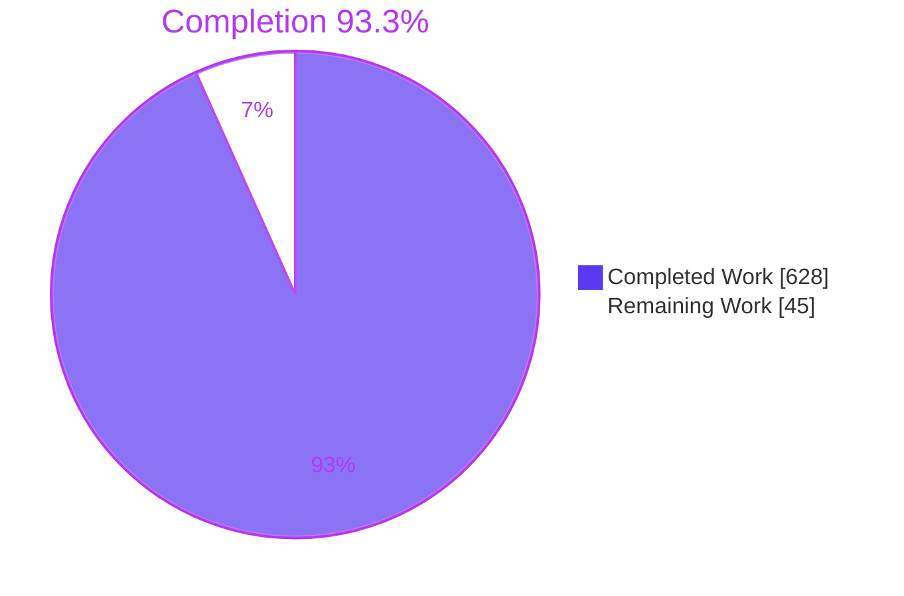
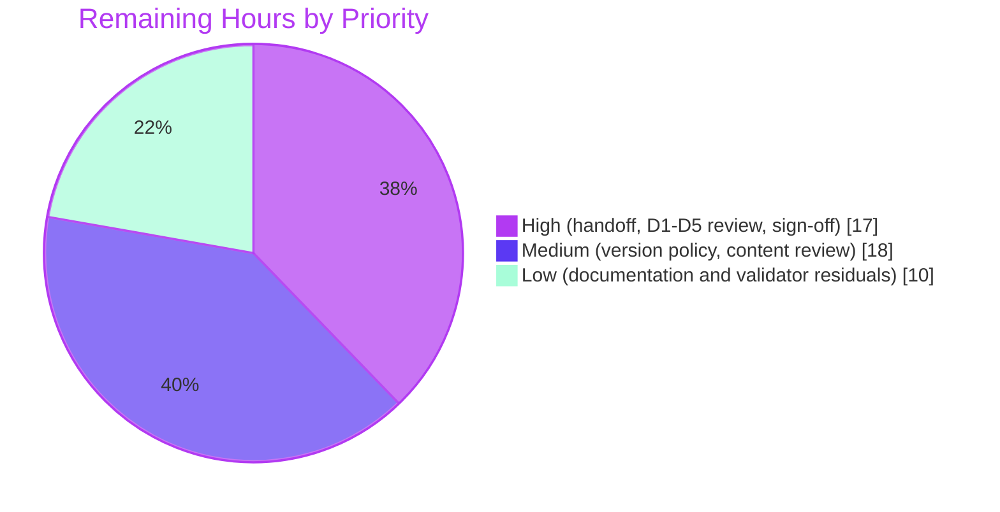

# 1. Executive Summary

## 1.1 Project Overview

This project turns the AWS CardDemo account-view and transaction journeys (COACTVWC, COTRN00C, COTRN01C) into a delivery-ready specification for a Java 25 / Spring Boot "Card Servicing" read service and its UI. It delivers a 13-epic, 58-story, 175-point backlog in four dependency-ordered waves, technical requirements with decisions D1–D5, a PostgreSQL 16 data model, seven architecture views, gRPC and OpenAPI 3.1 contracts for the service and five external systems, and a pinned Node.js validation suite that gates every artefact. The service is specified, not built. It serves the Product Owner, the Delivery Lead and the engineers who will build the stories.

## 1.2 Completion Status



| Metric | Value |
|---|---|
| Total Hours | 673 |
| Completed Hours (AI + Manual) | 628 (628 AI + 0 manual) |
| Remaining Hours | 45 |
| Percent Complete | 93.3% |

628 hours completed out of 673 total hours = 93.3% complete (628 ÷ 673 × 100). Section 2.2 itemises the remaining 45 hours.

## 1.3 Key Accomplishments

- [x] 13 epics and 58 stories (175 points, 224 files touched) with verbatim source bodies, two-option designs and per-AC verdicts
- [x] Implementation plan: four waves, 102 story edges, 37 epic-dependency rows, Recommendations and gap list (`docs/implementation-plan.md`)
- [x] Technical requirements with ranked D1–D5 decisions, resilience, security controls and 14 environment variables
- [x] Six-table data model with ERD, screen-field coverage matrix and fixture rules (`docs/data-model.md`)
- [x] Seven architecture views that render under the pinned Mermaid CLI (`docs/architecture/`)
- [x] 13 contract files covering 14 baseline operations, clean under buf lint and Spectral
- [x] Seven-check validation gate passes on the full tree and a 113-file delivery-only copy, and catches 10 of 10 seeded violations
- [x] No existing CardDemo file changed: 113 files added, 0 modified

## 1.4 Critical Unresolved Issues

15 items remain open. They touch 3 of 58 stories, 9 of 13 contract files and 2 of 7 checks, and include all 3 human delivery gates.

| Issue | Impact | Owner | ETA |
|---|---|---|---|
| Delivery gates (3): handoff to `your-org/carddemo-card-servicing` with rerun; Delivery Lead D1–D5 review; Product Owner sign-off with [INFERRED] order confirmation | Delivery is incomplete until all three are recorded in `docs/sign-off.md` | Delivery Lead, Product Owner | 17 h |
| Version-policy decisions (2): advisories in the pinned validation toolchain and in the specified Java/image pins, including `redis:7.4.2` CVE-2025-49844 | Building the stories as pinned ships known-vulnerable components | Delivery Lead, Security | 8 h |
| Rule 2 page-length decision (1): 23 of 58 stories exceed 1,000 design words | Slower story review; no content missing | Product Owner | within 10 h review |
| Documentation residuals (6) in 3 stories and 9 contract files | Wording gaps; no check fails | Engineering | 4 h |
| Validator residuals (3) in the diagrams and contracts checks | Hardening gaps against hostile configuration; no false pass on delivered content | Engineering | 6 h |

## 1.5 Access Issues

| System/Resource | Type of Access | Issue Description | Resolution Status | Owner |
|---|---|---|---|---|
| `your-org/carddemo-card-servicing` | Repository create and write on `main` | The delivery repository does not exist yet; creating it needs organisation rights | Open | Delivery Lead |
| npm registry and Chrome for Testing download host | Outbound HTTPS from CI runners | `run-all.sh` installs 486 packages and the pinned browser at setup | Reachable in the verification environment; confirm for the target CI | Platform team |

## 1.6 Recommended Next Steps

1. [High] Create `your-org/carddemo-card-servicing`, copy the 113 delivered files unedited to `main`, rerun `tests/validation/run-all.sh` and complete the handoff line in `docs/sign-off.md`.
2. [High] Delivery Lead completes the D1–D5 checklist, accepting or rejecting the three design departures in Section 5.2.
3. [High] Product Owner reviews the backlog, confirms the [INFERRED] W0→W3 order and signs within the 48-hour SLA.
4. [Medium] Decide the version policy for both advisory records before CS-05-001 starts.
5. [Low] Close the six documentation and three validator residuals, then rerun the gate.

# 2. Project Hours Breakdown

## 2.1 Completed Work Detail

| Component | Hours | Description |
|---|---|---|
| Story files (AAP 0.5.6.3) | 232 | 58 stories: verbatim source body with ACs, design links, four-suite test plan, two-option Implementation Design, per-option Design Validation, Metadata |
| Epic records (AAP 0.5.6.1, 0.9.3) | 22 | Epic index plus 13 epic READMEs with goal, justification, requirements, ACs, dependencies, story table and totals; CS-01's 17-row Customer Details gap table |
| Implementation plan (AAP 0.5.6.9) | 24 | Wave summary, epics-in-scope, sizing basis, W0–W3 sections, Dependency Map (102 story edges, 37 epic rows), Feature Checklist coverage, Recommendations, gap list |
| Technical requirements (AAP 0.7.2) | 40 | Component catalogue, interfaces, five external systems, D1–D5 with ranked alternatives, resilience, security controls, UI, request-path stages and budget, harness, environment variables |
| Data model (AAP 0.5.6.6) | 18 | Six PostgreSQL 16 tables, ERD, denormalised `transaction_record.account_id`, reference data as data, coverage matrix, fixture mapping and rules, synthetic volume |
| Architecture diagrams (AAP 0.5.6.7) | 20 | Logical, physical and security views plus four sequence diagrams under `docs/architecture/` |
| Contracts (AAP 0.5.6.4, 0.7.4) | 42 | `common.proto`, six service protos, six OpenAPI 3.1 documents, 14 baseline operations with examples and one shared `ErrorObject`; `buf.yaml` and `.spectral.yaml` |
| Validation checks and shared parser (AAP 0.8.1) | 150 | Seven checks (`check-*.mjs`) plus `lib/markdown.mjs` and `lib/html-entities.mjs` |
| Entry point and pinned toolchain (AAP 0.4.1, 0.8.2) | 16 | `run-all.sh`, browser launcher, exact-pinned `package.json`, generated lockfile v3, Puppeteer config, `.gitignore` |
| Validation hardening (AAP 0.8.1) | 30 | Path confinement, symlink and config refusals, input size and time bounds, escaped diagnostics, setup preconditions |
| Sign-off record (AAP 0.7.2) | 2 | `docs/sign-off.md`: approver table, 48-hour SLA, [INFERRED] order line, D1–D5 checklist, handoff line |
| Cross-artefact consistency and verification (AAP 0.8.2, 0.8.5) | 32 | Driving every check to zero violations across documents, diagrams and contracts, and proving the delivery set portable |
| **Total** | **628** | |

## 2.2 Remaining Work Detail

| Category | Hours | Priority |
|---|---|---|
| Delivery repository handoff: copy 113 files to `your-org/carddemo-card-servicing` `main`, rerun the gate, complete the handoff line (AAP 0.8.5) | 3 | High |
| Delivery Lead D1–D5 review, including the 600 s loader bound, the third reference-data read and the per-client target properties (AAP 0.8.4) | 6 | High |
| Product Owner review and sign-off with [INFERRED] W0→W3 confirmation (AAP 0.8.5) | 8 | High |
| Version-policy decision on both advisory records in the plan's Recommendations, and adoption if chosen: regenerate the lock, rerun, add SCOPE-QUESTION notes (AAP 0.4.1) | 8 | Medium |
| Human content review: Rule 2 page length, AC observability, outcome coverage (CS-10-008), "Contracts: N/A" truth, Performance applicability, plan dates and staffing (Rule 2) | 10 | Medium |
| Documentation residuals, then a gate rerun: CS-12-003 AC7 omits AC5's 403; CS-09-002's inert `spring.jpa.hibernate.ddl-auto=none` parenthetical; CS-13-001's settled Option B assumption still marked open; "service unavailable after retries" wording in 5 stub protos; no `bearerAuth` description in `card-servicing-api.yaml`; differing scheme descriptions in the config, transaction-activity and card-data documents (AAP 0.5.6.3, 0.5.6.4) | 4 | Low |
| Validator residuals: refuse a symlinked `puppeteer-config.json`; refuse JavaScript rulesets or functions in `.spectral.yaml` and plugins in `buf.yaml`; accept or clear the 180 s Mermaid render bound; widen `TRACE_RE` when the first real ID arrives (AAP 0.8.1) | 6 | Low |
| **Total** | **45** | |

## 2.3 Hours Calculation

- Completed: 628 hours across the 12 components in Section 2.1, all autonomous; no manual hours.
- Remaining: 45 hours across the 7 categories in Section 2.2 — 17 High, 18 Medium, 10 Low.
- Total: 628 + 45 = 673 hours. Completion: 628 ÷ 673 × 100 = 93.3%.
- Confidence: high for the handoff and residual edits; medium for the reviews; low for the version-policy work, whose size depends on which transitions are adopted.

# 3. Test Results

All results below were executed on the delivered tree at commit `da494f06`. No coverage tool is bound to this scope (the JaCoCo gate belongs to the future Java stories), so Coverage reads "n/a".

| Area / Category | Framework | Tests | Passed | Failed | Coverage | What This Proves |
|---|---|---|---|---|---|---|
| Whole-package gate | `tests/validation/run-all.sh` (Bash, Node 22.23.4) | 7 checks | 7 | 0 | n/a | Every artefact satisfies all seven AAP pass conditions with 0 violations |
| Backlog, plan and link checks | forbidden-terms, backlog-structure, plan-consistency, dependency-order, reachability | 10 runs (5 checks × full tree and delivery-only copy) | 10 | 0 | n/a | The backlog, plan and links hold their structure and totals without CardDemo source present |
| Architecture diagrams | `check-diagrams.mjs` with mmdc 11.4.2 and the pinned headless browser | 3 runs (2 full renders of 7 views, 1 direct render) | 3 | 0 | n/a | All seven views render and match the component catalogue and security control table |
| Contracts | `check-contracts.mjs`, buf 1.50.0, Spectral 6.15.0 | 9 runs (2 check runs, 1 buf lint, 6 Spectral documents) | 9 | 0 | n/a | All 14 baseline operations are present and the 13 contract files lint clean |
| Negative controls | Seeded violations on a disposable copy | 10 seeded cases across all 7 checks | 10 detected | 0 missed | n/a | Each check fails, with a precise message, on the defect class it guards |
| Setup preconditions | `run-all.sh` TMPDIR guard | 2 cases | 2 | 0 | n/a | A temporary directory inside the repository, or one that is missing, stops the run before setup |
| Static analysis | `node --check`, `bash -n`, shellcheck 0.11.0, `git diff --check` | 12 checks (9 modules, 2 scripts, 1 whitespace) | 12 | 0 | n/a | The suite's code parses and the scripts are lint-clean |
| Dependency audit | `npm audit --package-lock-only` | 1 | 0 | 1 | n/a | The locked toolchain still carries 15 vulnerable packages (13 high, 2 low), as recorded in the plan's Recommendations |

### Not Covered

- **The Card Servicing service, stubs, fixture loader, Compose stack, Testcontainers suites and CI pipeline.** These are specified for the stories, not built, so no test executes them. The CS-05-001 first build is the first point where the Spring Cloud Azure 5.23.0 / Spring Boot 3.5.7 pairing, the Compose 2.29.7 wait behaviour and the request-path stage budget run.
- **Judgements the checks cannot make:** whether each AC outcome is observable, whether each story covers valid, invalid, error and boundary outcomes (CS-10-008 has no error-outcome AC), whether "Contracts: N/A" is true, whether Performance "Applies" fits, story page length, and the plan's ban on dates, durations and staffing. A reviewer must read these.
- **Validator edge paths:** the YAML fallback parser, the 64 MiB tool-output cap, hang-up and kill-signal handling, the render-cleanup failure branch and the filesystem-error rethrow are not exercised by any run above.
- **Empty-cache install and the delivery repository.** These runs reused existing npm and browser caches. The first install from the public registry, and the rerun in `your-org/carddemo-card-servicing`, have not run.

# 4. Runtime Validation & UI Verification

The only executable deliverable is the validation suite, and it was driven end to end.

- ✅ **Gate start-up and run** — `run-all.sh` checked TMPDIR, confirmed Node v22.23.4, installed 486 packages with `npm ci` and located chrome-headless-shell 131.0.6778.204. It then ran all seven checks: exit 0, "Validation: all 7 checks passed", 2 min 52 s. It left only `tests/validation/node_modules/` behind.
- ✅ **Diagram render pipeline** — the launcher handed the pinned browser to mmdc 11.4.2, and every view rendered. A direct render of `logical-architecture.mmd` produced a 42.6 KB SVG in 2.5 s.
- ✅ **Contract lint pipeline** — buf 1.50.0 linted both proto modules, and Spectral 6.15.0 linted all six OpenAPI documents with no error-severity findings.
- ✅ **Failure path** — with one seeded forbidden term, the gate exited 1 and printed `FAIL check-forbidden-terms (1 violations)`. It still ran the other six checks and printed "Validation: 1 of 7 checks failed".
- ✅ **Precondition guards** — a TMPDIR inside the repository, or one that does not exist, stopped the run with `FAIL setup: temporary directory` before any install.
- ✅ **Portability** — a copy holding only the 113 delivered files passed all seven checks, proving no check reads `app/`, `diagrams/` or `samples/`.
- ⚠ **Toolchain hygiene** — npm warns that Puppeteer 23.11.1 is unsupported, and the audit flags 15 vulnerable packages. Both follow from the exact pins the AAP sets.
- ❌ **Never exercised at runtime** — the Card Servicing service, its REST and gRPC endpoints, the Card Servicing UI, authentication and the five external systems. None of these exists to run, because they are specified for the stories, and there was no UI to drive.
- ❌ **Never exercised at runtime** — the gate inside `your-org/carddemo-card-servicing` and its CI Validation stage, neither of which exists yet.

# 5. Compliance & Quality Review

## 5.1 Compliance Matrix

| AAP Deliverable | Benchmark | Status | Evidence | Progress |
|---|---|---|---|---|
| Scope and staging (0.3.2, 0.7.3) | New paths only; no check reads CardDemo source | ✅ Pass | 113 files added, 0 modified; delivery-only copy passes 7/7 | 100% |
| Epics and stories (0.5.6.1–0.5.6.3, Rule 1) | Required parts in order, ACs, verdicts, Metadata | ✅ Pass | `check-backlog-structure.mjs` 0 violations | 100% |
| Backlog inventory (0.5.6.2) | 58 stories, 175 points, 224 files, wave totals | ✅ Pass | `check-plan-consistency.mjs` 0; epic index totals 58/175/224 | 100% |
| Implementation plan (0.5.6.9, Rule 2) | Section order, totals, Dependency Map, gap list last | ✅ Pass | plan-consistency and dependency-order 0 | 100% |
| Technical requirements (0.7.2) | All required sections, D1–D5 ranked alternatives | ✅ Pass (human review pending) | `docs/technical-requirements.md` | 90% |
| Data model (0.5.6.6) | Six tables, ERD, coverage matrix, fixtures, volume | ✅ Pass | `docs/data-model.md` | 100% |
| Architecture diagrams (0.5.6.7) | Render, ≤25 nodes, legend, catalogue IDs, control mapping | ✅ Pass | `check-diagrams.mjs` 0 | 100% |
| Contracts (0.5.6.4, 0.7.4) | 14 baseline ops, examples, shared `ErrorObject`, lint | ✅ Pass (wording residuals) | buf 0, Spectral 0 ×6, `check-contracts.mjs` 0 | 97% |
| Pinned toolchain (0.4.1) | Exact pins, generated lockfile | ⚠ Pass with recorded advisories | `tests/validation/package.json`, lockfile v3; audit 15 | 95% |
| Validation suite (0.8.1, 0.8.2) | Seven checks, ordered entry point, non-zero on failure | ✅ Pass | gate exit 0; 10/10 seeded defects caught | 97% |
| Story length (Rule 2) | Roughly one to two pages | ⚠ Partial | 23 of 58 stories over 1,000 design words | 80% |
| Sign-off and handoff (0.8.4, 0.8.5) | Approvals, D1–D5 review, handoff recorded | ❌ Not started (human) | `docs/sign-off.md` fields blank | 0% |

## 5.2 AAP & Rule Divergences and Gaps

| What the AAP/Rule Required | What Was Delivered Instead | Why It Diverged | Impact | Remediation |
|---|---|---|---|---|
| AAP 0.7.1: a file plan of 111 files (a non-binding estimate) | 113 files: adds `tests/validation/chrome-headless-shell.sh` and `tests/validation/lib/html-entities.mjs` | mmdc needed a launcher that forces the pinned browser, and the Mermaid-label and CommonMark decoding needed the full 2,231-entry HTML named-reference table | None; `docs/sign-off.md` defines the handoff set by top-level path, so both are included | Copy all 113 files and keep mode 755 on both scripts |
| AAP D5: the stack's loader bounded by the `--wait` health timeout | The loader runs under its own 600 s process timeout (`docs/technical-requirements.md` L313, L578; CS-01-001) | Docker Compose 2.29.7 applies no `--wait-timeout` to a `service_completed_successfully` dependency | Same bound by another mechanism; start-up still fails closed | Delivery Lead accepts under D5 |
| AAP 0.5.5 request path: category balances read card data and categories | A third concurrent `ListTransactionTypes` read (`docs/technical-requirements.md` L494; CS-06-002); the unknown-typeCode check runs only when both lists are usable | The contract's `typeDescription` exists only on transaction types, and a type may have no category | One more upstream call inside the same 900 ms deadline; descriptions degrade to `PARTIAL` | Delivery Lead accepts in the D1–D5 review |
| AAP 0.8.1: trace pattern `CARD_REQ_(\d{3}\|TBD)` with Use Cases, Data Layouts or Requirements Analysis | `TRACE_RE` (`check-backlog-structure.mjs` L128) accepts only `CARD_REQ_TBD` with Use Cases or Data Layouts | No Requirements Analysis ID exists, and AAP 0.10.2 forbids inventing one | Will reject legitimate IDs once Requirements Analysis lands | Widen the pattern in the change that introduces the first real ID |
| AAP 0.8.1: `buf lint --config card-servicing-contracts/buf.yaml` | The check adds `--disable-symlinks` (`check-contracts.mjs` L662) | Keeps a symlink in the contract tree from pulling files outside the repository into lint | None on the symlink-free delivered set | None |
| AAP 0.4.2: 14 environment variables | Upstream addresses as Spring properties `card-servicing.clients.<name>.target`, `card-servicing.auth.target`, plus `card-servicing.grpc.port` and `card-servicing.stub.*` | The AAP names no address variable, yet the stack and tests need per-client targets | Configuration surface wider than the 14-variable table | Delivery Lead confirms the properties or promotes them to variables |
| Rule 2: each story roughly one to two pages | 23 of 58 stories exceed 1,000 words of design and validation; 4 exceed 1,200 (CS-11-005 1,366; CS-12-004 1,225; CS-05-006 1,218; CS-11-007 1,211) | The AAP requires two full options and a verdict row for every AC under each, which sets a floor the longest stories exceed | Longer reviews; no content missing | Product Owner accepts or asks for splits |
| Rule 1: no story sections beyond the six named parts | Stories carry `## 4. Design` to `## 7` inside the source body | Sanctioned — AAP 0.9.3 names these sections, and the AAP outranks the Rules | None | None |
| Rule 2: plan at the docs root or the path the prompt names | `docs/implementation-plan.md` | Sanctioned — AAP 0.9.3 names this path | None | None |
| AAP 0.4.1: exact pins buf 1.50.0, Spectral CLI 6.15.0, Mermaid CLI 11.4.2 | Pins kept; the lock carries 15 vulnerable packages and the pinned browser build carries V8 advisories; recorded in plan Recommendations (L421–428) with a transition to Mermaid CLI 12.2.0, Puppeteer 25.17.0 and Spectral 6.16.0 | No fix is compatible with the exact pins | Supply-chain exposure on CI runners; the gate runs without secrets | Version-policy decision |
| AAP-fixed Java and image versions in the story bodies | Kept verbatim; advisories recorded in plan Recommendations (L430–437), including `redis:7.4.2` CVE-2025-49844 (remote code execution), Spring Boot 3.5.7, `grpc-netty-shaded` 1.71.0, springdoc 2.8.13, Testcontainers 1.21.3, `postgres:16.6` | The AAP fixes the versions and requires verbatim story bodies | Building as written ships known-vulnerable components | Decide before CS-05-001; record changes as SCOPE-QUESTION notes |
| AAP 0.8.1: render every diagram under the pinned mmdc | A pathological diagram can hold one render until the 180 s timeout in `check-diagrams.mjs` | The slow path is inside Mermaid 11.17.2, which the exact pin fixes | A bounded delay, never a false pass | Accept, or clear it with the toolchain transition |

**Loader bound (D5).** The AAP asked for the end-to-end stack start to be bounded by Compose's `--wait` health timeout. Compose 2.29.7 ignores that timeout for a one-shot dependency that must complete successfully, so the bound moved to a 600 s process timeout on the fixture loader itself (`docs/technical-requirements.md` L313 and L578, CS-01-001, with SCOPE-QUESTION notes in CS-09-007 and CS-10-008). The stack still fails closed when loading overruns. The Delivery Lead should accept this explicitly under D5 in `docs/sign-off.md`, or require a Compose version that applies `--wait-timeout` to completed dependencies.

**Third reference-data read.** The category-balance response must carry `typeDescription`, which only `ListTransactionTypes` supplies; categories carry no type description, and a type can exist with no category. The request path therefore makes three concurrent upstream reads, not two (`docs/technical-requirements.md` L494, CS-06-002, CS-13-003). The unknown-typeCode check runs only when both lists are usable, and otherwise the response degrades to `PARTIAL`. The Delivery Lead should confirm, in the D1–D5 review, that the extra call fits the 900 ms deadline budget.

**Per-client target properties.** The AAP's environment-variable table has 14 entries and no upstream address. The design binds each client's target as a Spring property (`card-servicing.clients.card-data.target` and its siblings, `card-servicing.auth.target`) and adds `card-servicing.grpc.port` and `card-servicing.stub.*` for the stub images. Deployments therefore need configuration beyond the 14-variable table in `docs/technical-requirements.md`. The Delivery Lead should accept the properties or promote them to environment variables before CS-05-001.

**Trace pattern.** The AAP's pattern admits numbered IDs and a Requirements Analysis source, but no Requirements Analysis ID exists and the AAP forbids inventing one. `TRACE_RE` in `tests/validation/check-backlog-structure.mjs` (L128) admits only `CARD_REQ_TBD`, so an invented ID fails the gate. When the first real Requirements Analysis ID arrives, the same change must widen the pattern, or the gate will reject a correct story.

**Story length (Rule 2).** Rule 2 asks for roughly one to two pages per story. Two full options and a verdict for every AC under each set a floor that the longest stories pass: 23 of 58 exceed 1,000 words of design and validation, and CS-11-005 reaches 1,366. Nothing is missing, but review takes longer. The Product Owner should accept the length at sign-off or name stories to split, which would change the plan's totals and require a gate rerun.

**Validation toolchain advisories.** The AAP pins buf 1.50.0, Spectral CLI 6.15.0 and Mermaid CLI 11.4.2 exactly. The resulting lock carries 15 vulnerable packages (13 high, 2 low), and the pinned browser build carries V8 advisories. No fix fits the pins. The plan's Recommendations (`docs/implementation-plan.md` L421–428) record each advisory with a transition to Mermaid CLI 12.2.0, Puppeteer 25.17.0 and Spectral 6.16.0. Decide whether to adopt it; adoption means regenerating the lock and rerunning the gate.

**Java and image advisories.** The stories pin the Java and image stack as the AAP fixed it, and their bodies must stay verbatim. Several pins carry advisories, most seriously `redis:7.4.2` with CVE-2025-49844, a remote code execution, alongside Spring Boot 3.5.7, `grpc-netty-shaded` 1.71.0 and `postgres:16.6`. `docs/implementation-plan.md` L430–437 records each with a target (Boot 3.5.16, `postgres:16.15`, `redis:7.4.12`, springdoc 2.9.1). This must be decided before CS-05-001 builds, and any change recorded as SCOPE-QUESTION notes beneath the affected story bodies.

# 6. Risk Assessment

| Risk | Category | Severity | Probability | Mitigation | Status |
|---|---|---|---|---|---|
| Stories built as pinned ship known-vulnerable components, led by `redis:7.4.2` (CVE-2025-49844, remote code execution) and the Spring Boot 3.5.7 / Netty 4.1.110 line | Security | High | High if pins are unchanged | Adopt the transitions recorded in `docs/implementation-plan.md` Recommendations before CS-05-001, via SCOPE-QUESTION notes | Open — awaiting version-policy decision |
| Vulnerable validation toolchain (15 packages, unsupported Puppeteer 23.11.1, browser launched with `--no-sandbox`) processes pull-request content on CI runners | Security | High | Medium | Keep the Validation stage free of secrets, as the plan requires; adopt the recorded Mermaid CLI / Puppeteer / Spectral transition | Mitigated in design; transition open |
| Specified Java behaviour has never run: the Spring Cloud Azure 5.23.0 / Boot 3.5.7 pairing, Compose 2.29.7 wait handling, the 900 ms stage budget | Technical | Medium | Medium | Treat CS-05-001's first build and CS-01-001's stack start as verification gates; update the TRD when either differs | Open — first exercised by W0 stories |
| Handoff loses fidelity: files edited, executable bits dropped or `node_modules/` copied | Integration | Medium | Medium | Copy the 113 tracked files with `git archive`, rerun `run-all.sh` in the new repository and record the commit in `docs/sign-off.md` | Open — handoff not yet performed |
| CI runners lack outbound access to the npm registry or the Chrome for Testing host, so setup fails | Operational | Medium | Low | Allow both hosts, or mirror the registry and pre-seed the Puppeteer cache | Open — confirm in target CI |
| Checks pass content whose meaning is wrong (unobservable ACs, missing error outcomes, false "Contracts: N/A") | Technical | Medium | Low | Product Owner and Delivery Lead content review before sign-off | Open — human review |
| The trace pattern rejects the first real Requirements Analysis ID | Technical | Low | High | Widen `TRACE_RE` in `tests/validation/check-backlog-structure.mjs` in the same change | Open — triggered by Requirements Analysis |
| Hostile or pathological inputs slow the gate (Mermaid regex, symlinked Puppeteer config, Spectral JavaScript rulesets, buf plugins) | Operational | Low | Low | Per-tool 120 s and per-render 180 s timeouts bound the run; close the validator residuals in Section 2.2 | Partially mitigated |

# 7. Visual Project Status


Completed work is 628 of 673 hours (93.3%), and remaining work is 45 hours. The remaining hours split by priority as Section 2.2 assigns them:



# 8. Summary & Recommendations

The project is 93.3% complete: 628 of 673 hours. Everything the AAP asked to be authored is in place. That covers the 13-epic, 58-story, 175-point backlog, the four-wave implementation plan, the technical requirements with D1–D5, the data model, seven architecture views, 13 contract files and the seven-check validation gate. All of it was added under new top-level paths without touching a CardDemo file. The gate passes with zero violations on the full tree and on a delivery-only copy. Ten seeded defects spread across all seven checks were each caught with a precise message, so a passing gate is meaningful evidence rather than an empty one.

The 45 remaining hours are mostly human. Three gates make up 17 of them: the handoff to `your-org/carddemo-card-servicing`, the Delivery Lead's D1–D5 review and the Product Owner's sign-off. The rest are decisions and small residuals: a version policy for the pinned toolchain and the specified Java and image stack, a content review the checks cannot do, six wording residuals and three validator hardening items. No residual causes a check to fail.

The critical path to production runs handoff → D1–D5 review → version-policy decision → Product Owner sign-off → CS-05-001. Settle the version policy before CS-05-001, because that story fixes the build's Spring Boot, gRPC and image versions, and `redis:7.4.2` carries a remote-code-execution advisory. The Delivery Lead should also explicitly accept the three design departures in Section 5.2: the 600 s loader bound, the third reference-data read and the per-client target properties.

| Success metric | Target | Current |
|---|---|---|
| Validation gate | Exit 0, 7 of 7 checks | Met on the delivered tree; rerun in the delivery repository pending |
| Seeded-defect detection | Every seeded defect caught | 10 of 10 |
| Sign-off record | Approvers named, D1–D5 ticked, handoff line complete | 0 of 3 gates recorded |
| Dependency audit | 0 high findings, or accepted in writing | 13 high, recorded in the plan's Recommendations |

Production readiness: the specification set is ready for review and handoff today. It is not yet ready to start building. That needs the three human gates and the version-policy decision. CS-05-001's first build and CS-01-001's stack start then become the first runtime proof of the design.

# 9. Development Guide

## 9.1 System Prerequisites

- Linux or macOS shell with Bash and Git.
- Node.js 22. Version 22.23.4 matches `engines.node` in `tests/validation/package.json`. npm 11 works; 11.21.0 was used.
- Outbound HTTPS to the npm registry and to the Chrome for Testing host on first setup.
- About 600 MB of disk: 544 MB for `tests/validation/node_modules/`, plus the browser cache.
- No Java, Gradle, Docker, database, Redis, credentials or open ports. The service is specified for the stories, not built.
- Optional: shellcheck 0.11.0 for linting the two shell scripts.

## 9.2 Environment Setup

Run every command from the repository root. Use a **short** temporary directory outside the repository. Chrome aborts with `Socket path too long` under a long TMPDIR, and the gate refuses a TMPDIR inside the repository. The system default works when it is short. Otherwise create one:

```bash
mkdir -p "$HOME/csvtmp"
export CI=true
export TMPDIR="$HOME/csvtmp"
```

## 9.3 Dependency Installation

`run-all.sh` installs everything itself. To install by hand:

```bash
cd tests/validation && CI=true npm ci --no-audit --no-fund && cd ../..
cd tests/validation && npx --no-install puppeteer browsers install chrome-headless-shell && cd ../..
tests/validation/node_modules/.bin/buf --version        # 1.50.0
tests/validation/node_modules/.bin/spectral --version   # 6.15.0
tests/validation/node_modules/.bin/mmdc --version       # 11.4.2
```

npm 11 prints `npm warn deprecated` lines for `inflight`, `glob`, `sourcemap-codec` and `puppeteer@23.11.1`. These are expected under the exact pins. Always use the local binaries in `tests/validation/node_modules/.bin/`, because a global `mmdc` is a different version.

## 9.4 Running the Gate

```bash
mkdir -p "$HOME/csvtmp" && CI=true TMPDIR="$HOME/csvtmp" tests/validation/run-all.sh
echo "exit=$?"
```

Expected tail, after about 3 minutes with a cold `npm ci`:

```text
PASS check-forbidden-terms (0 violations)
PASS check-backlog-structure (0 violations)
PASS check-plan-consistency (0 violations)
PASS check-diagrams (0 violations)
PASS check-contracts (0 violations)
PASS check-dependency-order (0 violations)
PASS check-reachability (0 violations)
Validation: all 7 checks passed
exit=0
```

## 9.5 Verification and Individual Checks

After setup, run the check that governs what you changed:

```bash
CI=true TMPDIR="$HOME/csvtmp" node tests/validation/check-forbidden-terms.mjs     # docs/backlog/**
CI=true TMPDIR="$HOME/csvtmp" node tests/validation/check-backlog-structure.mjs   # epics and stories
CI=true TMPDIR="$HOME/csvtmp" node tests/validation/check-plan-consistency.mjs    # docs/implementation-plan.md
CI=true TMPDIR="$HOME/csvtmp" node tests/validation/check-dependency-order.mjs    # waves and Dependency Map
CI=true TMPDIR="$HOME/csvtmp" node tests/validation/check-diagrams.mjs            # docs/architecture/*.mmd (about 35 s)
CI=true TMPDIR="$HOME/csvtmp" node tests/validation/check-contracts.mjs           # protos, OpenAPI, buf.yaml, .spectral.yaml
CI=true TMPDIR="$HOME/csvtmp" node tests/validation/check-reachability.mjs        # links
```

Each check prints `check-<name>: N violation(s)`. It exits 0 for no violation, 1 for violations and 2 for a usage or internal error. `node tests/validation/check-diagrams.mjs --help` describes the preflight and render rules.

## 9.6 Example Usage — Direct Tool Commands

```bash
tests/validation/node_modules/.bin/buf lint --config card-servicing-contracts/buf.yaml
tests/validation/node_modules/.bin/spectral lint \
  card-servicing-service/src/main/resources/openapi/card-servicing-api.yaml \
  --ruleset .spectral.yaml --fail-severity=error
OUT=$(mktemp -d "$HOME/csvtmp/render.XXXX")
tests/validation/node_modules/.bin/mmdc -p tests/validation/puppeteer-config.json \
  -i docs/architecture/logical-architecture.mmd -o "$OUT/logical.svg"
rm -rf "$OUT"
```

- buf prints nothing and exits 0.
- Spectral prints `No results with a severity of 'error' found!`.
- mmdc writes the SVG in about 2.5 s. Write renders under TMPDIR, never into the repository.

## 9.7 Handoff to the Delivery Repository

```bash
git archive --format=tar HEAD docs card-servicing-contracts card-servicing-service tests .spectral.yaml \
  | tar -x -C /path/to/carddemo-card-servicing
cd /path/to/carddemo-card-servicing && git add -A && git commit -m "Add Card Servicing backlog, contracts and validation suite"
mkdir -p "$HOME/csvtmp" && CI=true TMPDIR="$HOME/csvtmp" tests/validation/run-all.sh
```

`git archive` keeps mode 755 on `run-all.sh` and `chrome-headless-shell.sh` and leaves out `node_modules/`. Record the commit, the rerun result and who performed it on the handoff line in `docs/sign-off.md`.

## 9.8 Troubleshooting

- **`FAIL setup: temporary directory`**, with "TMPDIR resolves inside the repository" or "does not name an existing directory": create a short directory outside the checkout and pass it as TMPDIR.
- **Chrome `Socket path too long`**: TMPDIR is too long. Use a short one such as `$HOME/csvtmp`.
- **`FAIL setup: npm ci`**: there is no registry access, or `package-lock.json` was edited. Restore the committed lock; never hand-edit it.
- **`FAIL setup: chrome-headless-shell install`**: the Chrome for Testing host is unreachable. Allow it, or pre-seed `~/.cache/puppeteer` with build 131.0.6778.204.
- **check-diagrams refuses `puppeteer-config.json`**: the file may set only `args`, and those args must include `--host-resolver-rules=MAP * ~NOTFOUND`.
- **A check fails**: fix the artefact named in its message, never the check.

# 10. Appendices

## A. Command Reference

| Purpose | Command (from the repository root) |
|---|---|
| Whole-package gate | `mkdir -p "$HOME/csvtmp" && CI=true TMPDIR="$HOME/csvtmp" tests/validation/run-all.sh` |
| One check | `CI=true TMPDIR="$HOME/csvtmp" node tests/validation/check-<name>.mjs` |
| Install toolchain | `cd tests/validation && CI=true npm ci --no-audit --no-fund` |
| Install pinned browser | `cd tests/validation && npx --no-install puppeteer browsers install chrome-headless-shell` |
| Proto lint | `tests/validation/node_modules/.bin/buf lint --config card-servicing-contracts/buf.yaml` |
| OpenAPI lint | `tests/validation/node_modules/.bin/spectral lint <file.yaml> --ruleset .spectral.yaml --fail-severity=error` |
| Render one diagram | `tests/validation/node_modules/.bin/mmdc -p tests/validation/puppeteer-config.json -i <file.mmd> -o <tmpdir>/<name>.svg` |
| Script lint | `shellcheck tests/validation/*.sh` |
| Dependency audit | `cd tests/validation && npm audit --package-lock-only` |
| Regenerate lock (version-policy change only) | `cd tests/validation && CI=true npm install --package-lock-only --no-audit --no-fund` |

## B. Port Reference

The validation suite opens no ports, and its browser resolves no host. The ports below are specified for the future stack and are not used by anything delivered here.

| Port | Use (specified) |
|---|---|
| 8080 | Card Servicing REST API and UI contract server (`card-servicing-api.yaml`) |
| 9090 | Card Servicing gRPC (`card-servicing.grpc.port`); default auth target |
| 8081–8085 | Stub services in the Compose test stack (CS-01-002, CS-01-003) |

## C. Key File Locations

| Path | Contents |
|---|---|
| `docs/backlog/epics/README.md` | Epic index with totals (58 stories, 175 points, 224 files) |
| `docs/backlog/epics/CS-NN-*/README.md`, `.../stories/` | 13 epic records and 58 stories |
| `docs/implementation-plan.md` | Waves, Dependency Map, Feature Checklist coverage, Recommendations, gap list |
| `docs/technical-requirements.md` | Catalogue, D1–D5, resilience, security, request path, environment variables |
| `docs/data-model.md` | Tables, ERD, coverage matrix, fixtures, synthetic volume |
| `docs/architecture/*.mmd` | Seven architecture and sequence views |
| `docs/sign-off.md` | Approvals, D1–D5 checklist, handoff line |
| `card-servicing-contracts/` | `buf.yaml`, `common.proto` |
| `card-servicing-service/src/main/proto/`, `.../resources/openapi/` | Six service protos, six OpenAPI 3.1 documents |
| `.spectral.yaml` | Spectral ruleset (`extends: spectral:oas`) |
| `tests/validation/` | `run-all.sh`, seven `check-*.mjs`, `lib/`, launcher, pinned manifest and lock |

## D. Technology Versions

| Component | Version | Status |
|---|---|---|
| Node.js | 22.23.4 (`engines.node`) | Used |
| npm | 11.21.0 | Used |
| @bufbuild/buf | 1.50.0 | Used, exact pin |
| @stoplight/spectral-cli | 6.15.0 | Used, exact pin |
| @mermaid-js/mermaid-cli | 11.4.2 (Mermaid 11.17.2, Puppeteer 23.11.1) | Used, exact pin |
| chrome-headless-shell | 131.0.6778.204 | Used |
| shellcheck | 0.11.0 | Used |
| Java / Gradle / Spring Boot | 25 / 9.1.0 / 3.5.7 | Specified for stories |
| PostgreSQL / Redis images | `postgres:16.6` / `redis:7.4.2` | Specified; advisories recorded |

## E. Environment Variable Reference

| Variable | Used by | Meaning |
|---|---|---|
| `TMPDIR` | `run-all.sh`, all checks | Short, existing directory outside the repository; the system temporary directory when unset |
| `CI` | npm | Set `true` for non-interactive installs |
| `PUPPETEER_EXECUTABLE_PATH` | Set by `check-diagrams.mjs` | Points mmdc at the browser launcher; any host value is replaced |
| `PUPPETEER_SKIP_DOWNLOAD` | Set by `run-all.sh` for `npm ci` | Stops the install from fetching a browser; the pinned build is installed explicitly afterwards |

The 14 service environment variables, such as `DB_PASSWORD` and `AZURE_KEYVAULT_URI`, are specified in `docs/technical-requirements.md` for the future service. Nothing delivered here reads them.

## F. Developer Tools Guide

- **Adding or editing a story:** keep the quoted source body verbatim. Put any change in a `> SCOPE-QUESTION` note beneath it, then run backlog-structure, plan-consistency and dependency-order.
- **Editing a diagram:** use hex `classDef` fills (Compute `#add8e6`, Data stores `#90ee90`, External `#d3d3d3`, Security `#f4cccc`, Networking `#ffffe0`). `rgb()` fills fail to parse in Mermaid 11.17.2. Keep 25 nodes or fewer, then run check-diagrams.
- **Changing a contract:** add fields only; never change a baseline operation. Run check-contracts, which also runs buf and Spectral.
- **Changing a pin:** edit `package.json`, regenerate the lock with the command in Appendix A, never by hand, then rerun the gate and update the plan's Recommendations.

## G. Glossary

| Term | Meaning |
|---|---|
| AAP | The action plan that set this project's scope and requirements; section numbers such as AAP 0.8.1 refer to it |
| AC | Acceptance criterion in a story |
| CARD_REQ_TBD | Placeholder trace ID used until Requirements Analysis issues real IDs |
| D1–D5 | The five ranked design decisions in the technical requirements |
| EFT | Estimated files touched: the files a story creates, edits or deletes, summed per epic and wave |
| [INFERRED] | An ordering or fact derived rather than stated in the sources; needs Product Owner confirmation |
| SCOPE-QUESTION | A note beneath a verbatim story body that records a change or clarification |
| W0–W3 | The four dependency-ordered delivery waves of the implementation plan |
