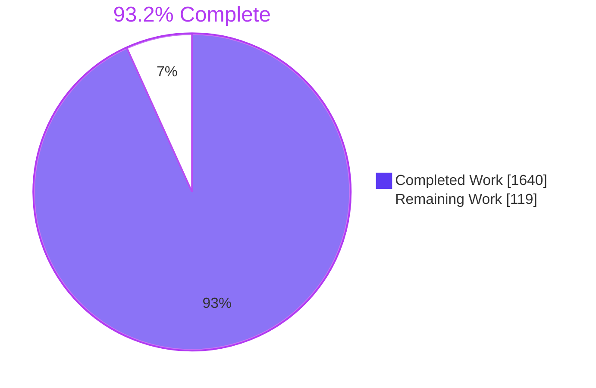
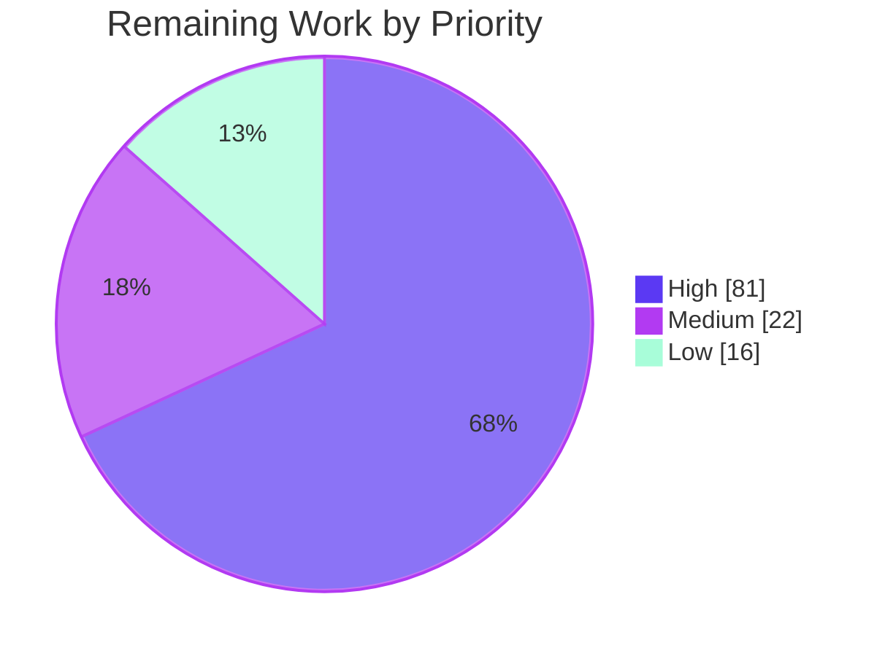
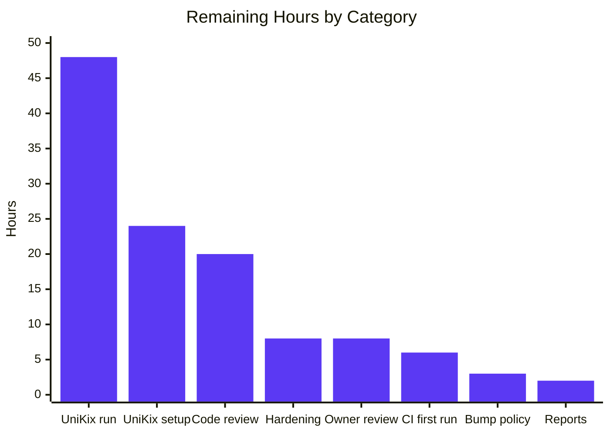

# 1. Executive Summary

## 1.1 Project Overview

This project builds an executable characterization suite for AWS CardDemo. It pins the application's current batch, job and online behaviour as platform-neutral scenarios with versioned baselines, so that a future conversion can be compared against it. The suite delivers:
- a frozen 684-item inventory, 601 scenarios and 601 baselines;
- a 118-entry gap register;
- the `gnucobol-batch` and `unikix` adapters;
- one `pytest tests/` command and one GitHub Actions workflow.

It is meant for modernization engineers and the application owner. Everything lives under `tests/` and `.github/workflows/`, and `app/` is unchanged.

## 1.2 Completion Status



| Metric | Value |
|---|---|
| Total Hours | 1759 |
| Completed Hours (AI + Manual) | 1640 (1640 AI + 0 manual) |
| Remaining Hours | 119 |
| Percent Complete | 93.2% |

1640 ÷ (1640 + 119) = **93.2% complete**. This counts AAP-scoped and path-to-production work only.

## 1.3 Key Accomplishments

- ✅ The inventory is frozen at 684 items, and its counts match the plan exactly.
- ✅ `pytest tests/` passes: 2143 passed, 0 failed, 23 implemented-unexecuted by design.
- ✅ A reverse-order second run produces byte-identical reports.
- ✅ The `dailytran.txt` daily chain is proven on GnuCOBOL (`--check-proof` met).
- ✅ All 123 gnucobol-batch scenarios run, and 100 baselines are observed.
- ✅ The UniKix adapter is ready for operator use: loopback only, with an evidence import.
- ✅ Coverage is reported honestly: 125 of 684 items verified (18.3%) and 0 failing, as projected.
- ✅ `app/`, `samples/` and `diagrams/` are untouched (`--check-protected` ok).

## 1.4 Critical Unresolved Issues

There are **7 open items**, touching **3 of the 6 request items** (items 2, 5 and 6). None of them stops the gnucobol-batch suite. Divergences are detailed in Section 5.2.

| Issue | Impact | Owner | ETA |
|---|---|---|---|
| The baseline bump check fails on push events when a baseline changes on a branch, because the two AAP 0.4.5 version rules contradict each other | A CI run on a push can fail even though the pull-request check passes | Repository maintainer | 3 h |
| `carddemo-tests.yml` has never run on a GitHub-hosted runner | The action tags, the apt pins, the GnuCOBOL build and the 15-minute budget are all unconfirmed on CI | DevOps | 6 h |
| The UniKix adapter has never run against a live TPE/BPE region. The 478 UniKix-only scenarios (467 e2e and 11 JCL/region) have never executed, and all 48 `commands.yaml` entries are unconfirmed | 506 items stay `blocked`, and the online behaviour remains derived, not observed | UniKix operator | 72 h |
| The committed `tests/reports/` were produced on an Ubuntu 26.04 development host, not by the planned final run on Ubuntu 24.04 | Their Environment section and execution ids differ from what CI produces | Maintainer | 2 h |
| The 23 post-open fault unit scenarios are implemented-unexecuted (GAP-MIS-013) | 9 I/O-failure-after-open items are unverified until a fault-injection mechanism exists | Test owner | No ETA; outside AAP scope |
| A scenario's 300 s deadline can be overrun by a few seconds of report writing (306 s in a 1M-record stress case) | The verdict is still `timeout`; only the wall-clock time runs over | Test owner | Included in 8 h hardening |
| LOW hardening residuals: protected-tree bypass through git configuration, bytecode written without `-B`, leftover build workspaces after a killed session, and YAML edge cases | Edge-case robustness only | Test owner | 8 h |

## 1.5 Access Issues

| System/Resource | Type of Access | Issue Description | Resolution Status | Owner |
|---|---|---|---|---|
| UniKix TPE/BPE installation and licence | Runtime and licence | No UniKix installation, licence or 3270 listener is available, so every UniKix scenario is `blocked` under GAP-MIS-009/GAP-MIS-005 | Open: needs an operator host | UniKix operator |
| GitHub Actions (ubuntu-24.04 runner) | CI execution | The workflow has been validated with actionlint only and has not yet run on GitHub | Open: push or open a PR | DevOps |
| Ubuntu 24.04 host | Build host | No Ubuntu 24.04 host or container was available to produce the committed reports with the CI pins | Open: use the CI artifact | Maintainer |

## 1.6 Recommended Next Steps

1. **[High]** Run `carddemo-tests.yml` on GitHub, and confirm every step is green within 15 minutes.
2. **[High]** Choose the push-event bump-check base (for example, the merge-base), and update the workflow.
3. **[High]** Provision UniKix and follow the operator procedure in `tests/README.md`.
4. **[High]** Run `CARDDEMO_ADAPTER=unikix pytest tests/ -m unikix`, then import, triage and commit the evidence.
5. **[Medium]** Commit the Ubuntu 24.04 reports from the `carddemo-reports` artifact, and review the harness code.

# 2. Project Hours Breakdown

## 2.1 Completed Work Detail

| Component | Hours | Description |
|---|---|---|
| Inventory and inventory tooling (AAP 0.3.1) | 120 | `inventory_tools.py` provides `--freeze` and `--check` with drift detection, over 684 items carrying ids, activation, locations and gap ids |
| Record layouts and codec (AAP 0.4.4) | 56 | `layouts.py` generates `layouts.yaml` (28 copybooks). `codec.py` decodes overpunch zoned, COMP-3, binary, implied decimal and cp037 |
| Fixtures and ASCII/EBCDIC cross-check (AAP 0.4.4) | 30 | `fixtures.py` and `fixtures/datasets.yaml` materialize the datasets, and the cross-check registers exactly the two known mismatches |
| Adapter contract, runner, results and scenario schema (AAP 0.4.1, 0.4.3, 0.4.6) | 96 | `adapters/base.py`, `harness/runner.py`, `results.py`, `scenarios.py` and `harness/__init__.py`: per-scenario work directories, the 300 s deadline, the status rules and the manifest check |
| gnucobol-batch adapter (AAP 0.4.2) | 180 | `build.py`, with a keyed build cache and the cobc flags, plus the `datasets.py` catalog (GDG and AIX), the `jobs.py` JCL driver with 27 jobs in `jobs.yaml`, `utilities.py` (IDCAMS, SORT, IEBGENER, IEFBR14 and SDSF) and `programs.yaml` |
| Test stubs and page-zero shim (AAP 0.3.3) | 30 | `CEE3ABD.cbl`, `ceedays.c` (`cobc -m`), `psa_tiot_shim.c` with the page0 probe, and the `PARMDRV` and `DTCDRV` drivers |
| UniKix adapter (AAP 0.4.2) | 190 | `env.py`, `deploy.py` (read-only zip extraction and a test-owned root), `bpe.py`, `tpe.py` (s3270, loopback only), `evidence.py`, `commands.yaml` (48 entries) and `resources.yaml` |
| Baselines, capture and bump check (AAP 0.4.5) | 64 | `baselines.py` (comparison, matchers, semver, `--check-bumps`) and `capture.py` (`--all`, `--bump`, `--work-root`) |
| Reporting and acceptance checks (AAP 0.7.1–0.7.3) | 140 | `report.py`: the matrix, the register and the coverage report, plus `--check`, `--check-proof`, `--check-protected`, `--import-unikix`, `--revalidate` and `--compare-executions` |
| Gap register research (AAP 0.7.2) | 36 | `inventory/gaps.yaml` holds 118 open entries in 6 categories: the 98 seeded entries plus 20 registered during characterization |
| Unit and integration scenarios with observed baselines (AAP 0.4.3, 0.4.5) | 190 | 94 unit and 40 integration scenarios, with 100 baselines observed on GnuCOBOL (128 `.bin` datasets), including the two job-chain proofs |
| End-to-end scenarios and derived baselines (AAP 0.4.3, 0.4.5) | 280 | 467 online e2e scenarios, with 501 baselines derived from the COBOL, BMS and CSD sources |
| Harness self-tests (AAP 0.5.1) | 150 | `test_unit_harness.py`: 2043 tests over layouts, codec, fixtures, both adapters, the reports, the checks and tamper detection |
| pytest configuration, conftest and test modules (AAP 0.5.1, 0.5.4) | 18 | `pytest.ini` (strict markers), `conftest.py` options and deselection, 20 `test_<level>_<area>.py` modules, and the 6 pinned requirements |
| CI workflow (AAP 0.9.2) | 16 | `.github/workflows/carddemo-tests.yml`: two runs, a comparison, the always-run checks and the artifact upload |
| Documentation (AAP 0.9.3) | 14 | `tests/README.md` (setup, adapters, environment variables, the UniKix operator procedure) and `tests/reports/unikix/README.md` |
| Full-suite validation, determinism proof and committed reports (AAP 0.7.3) | 30 | Forward and reverse runs byte-identical, the chain proof met, and the committed reports and 123 result records |
| **Total** | **1640** | |

## 2.2 Remaining Work Detail

| Category | Hours | Priority |
|---|---|---|
| First GitHub Actions run of `carddemo-tests.yml`: confirm the action tags, the apt pins, the GnuCOBOL build and cache, the page-zero step, `NODE_OPTIONS=--tls-min-v1.3` and the 15-minute budget | 6 | High |
| Bump-check policy for push events: choose a base that does not contradict the 1.0.0 rule, and implement it in the workflow | 3 | High |
| UniKix host and operator setup: installation and licence, `CARDDEMO_UNIKIX_ENV`, confirmation of all 48 `commands.yaml` entries, and a loopback 3270 listener | 24 | High |
| UniKix execution of the 478 scenarios: triage, `--import-unikix`, `--revalidate`, and committing the evidence | 48 | High |
| Commit the reports regenerated on Ubuntu 24.04, from the `carddemo-reports` artifact | 2 | Medium |
| Human code review of the harness and adapters (about 70k Python lines) and of sampled baselines | 20 | Medium |
| LOW hardening: the deadline overrun, protected-tree bypass vectors, bytecode writes, leftover build workspaces and YAML edge cases | 8 | Low |
| Owner statements for the 19 uncertain-purpose and 24 suspected-defect register entries | 8 | Low |
| **Total** | **119** | |

## 2.3 Hours Calculation

- **Completed:** 1640 h. This is the sum of Section 2.1, and every row maps to an AAP sub-section.
- **Remaining:** 119 h. This is the sum of Section 2.2: 81 h High, 22 h Medium and 16 h Low.
- **Total:** 1640 + 119 = 1759 h.
- **Completion:** 1640 ÷ 1759 = **93.2%**.
- **Confidence:**
  - **Completed hours: medium.** They are sized from 70,332 Python lines, 546,987 YAML lines and the scenario count.
  - **UniKix remaining hours: low to medium.** The installed release may need command corrections that cannot be sized without a region.

# 3. Test Results

All figures below come from a full run of `pytest tests/` at commit `43c361f9`, followed by the reverse-order run and the repository checks. The run used Python 3.11.18, GnuCOBOL 3.2.0 with BDB, pytest 8.4.2 and the default `gnucobol-batch` adapter. It collected 2644 items, of which 2166 were selected and 478 deselected.

| Area / Category | Framework | Tests | Passed | Failed | Coverage | What This Proves |
|---|---|---|---|---|---|---|
| Harness self-tests (`test_unit_harness.py`) | pytest | 2043 | 2043 | 0 | Functional | Layouts, codec, fixtures, both adapters (UniKix against stand-ins), the baseline rules, the reports and every check behave as specified, and tampering with a baseline is detected |
| Unit scenarios: batch programs standalone (`test_unit_{dat,fin,rpt,trn,utl}.py`) | pytest + GnuCOBOL | 94 | 71 | 0 | 92 of 105 unit items verified | The batch programs' records, reject codes, balances and report lines match their observed baselines. The other 23 are skipped as implemented-unexecuted |
| Integration scenarios: jobs, procs and control cards (`test_integration_{dat,fin,rpt,trn}.py`) | pytest + GnuCOBOL JCL driver | 27 | 27 | 0 | 29 of 42 integration items verified | JCL step sequencing, the catalog, GDG generations and the utility steps reproduce the jobs' end state |
| Job-chain proof (`test_integration_bat.py`) | pytest + GnuCOBOL | 2 | 2 | 0 | 4 of 4 chain items verified | POSTTRAN posts 262 and rejects 38 with code 0102 (RC 4); INTCALC writes 50 interest records; TRANBKP, COMBTRAN (312 records), CREASTMT and TRANREPT finish as baselined |
| Run-order determinism (`--carddemo-order=reverse`) | pytest + `diff -r` | 2143 | 2143 | 0 | 4 of 4 report paths identical | The scenarios do not depend on order, and the reports are reproducible byte for byte |
| Repository gate checks | harness CLIs + actionlint | 7 | 7 | 0 | 684 of 684 items checked | `--check` (register and matrix rules), `--check-proof` (met), `--check-protected`, `--check-bumps --base 93ebec71`, the inventory and layout drift checks, and the workflow lint all pass |

The coverage report's headline figure is functional coverage, not a test pass rate:
- **125 of 684 items verified (18.3%).**
- **The rest:** 0 failing, 506 blocked, 9 implemented-unexecuted and 44 not covered.
- **Gap register:** 118 entries, all open, so the report states that 100% may not be claimed.

No code-coverage tool is part of this suite, by design.

**Not Covered**

These areas have no executed test result:
- **Online e2e scenarios.** The 467 scenarios behind 533 e2e items, covering sign-on, menus, users, accounts, cards, transactions, bill payment, reports and configuration, are deselected on `gnucobol-batch` and need a UniKix TPE region. Run them before relying on any online baseline.
- **UniKix-only job and region scenarios.** 11 scenarios, among them `DAT-TRANBKP-recovery-01`, `RPT-CREASTMT-recovery-01` and `BAT-RUNORDER-normal-01`, need a UniKix BPE node.
- **The UniKix adapter against a real installation.** `env.py`, `deploy.py`, `bpe.py`, `tpe.py` and `evidence.py`, and `--import-unikix`, `--revalidate` and `--compare-executions` on real evidence, have been tested only against stand-ins and a fake `s3270`.
- **The 23 post-open fault unit scenarios.** They are skipped, and their 9 I/O-failure-after-open items stay implemented-unexecuted until a fault mechanism exists (GAP-MIS-013).
- **The GitHub Actions workflow itself.** It has been linted, but not executed on a hosted runner.
- **Rare error branches.** These include build-lock errors, file systems without `flock`, the shallow-clone branch of the protected-tree check, and `_libcob_error` on real CBSTM03A failure output. No suite test drives them.

# 4. Runtime Validation & UI Verification

The suite has no web UI, so no browser flow applies. Its online surface is the CICS 3270 screens, which only a UniKix region can serve.

- ✅ **Operational: toolchain and build.** The 11 COBOL units compile with `cobc -std=ibm -fsign=EBCDIC -ftab-width=4 -fbinary-truncate`, and the 5 stubs and drivers build alongside them. All of them go into a build cache under `<work root>/_build/<build key>/`, which the rest of the session reuses.
- ✅ **Operational: batch programs on fixtures.** 71 unit scenarios run CBTRN02C, CBACT04C, CBTRN03C, CBSTM03A/B, CSUTLDTC and the data utilities, and match their observed records and return codes.
- ✅ **Operational: JCL jobs through the gnucobol-batch driver.** 27 job scenarios exercise the IDCAMS DEFINE/REPRO/DELETE, SORT, IEBGENER and GDG `(+1)`/`(0)` steps.
- ✅ **Operational: daily batch chain.** POSTTRAN → INTCALC → TRANBKP → COMBTRAN → CREASTMT → TRANREPT runs against one catalog, and `report.py --check-proof` reports the proof as met.
- ✅ **Operational: page-zero shim.** The probe maps page zero on the host, so CBSTM03A's control-block walk runs through `psa_tiot_shim.c`.
- ✅ **Operational: report regeneration and checks.** Session end rewrites the matrix, the register and the report, all four checks pass, and nothing writes outside the work root and `tests/reports/`. No core files are produced.
- ⚠ **Partial: UniKix adapter.** When no installation is configured, every UniKix scenario ends cleanly as `blocked` under GAP-MIS-009, with no errors. Deployment, BPE job submission and TPE driving have run only against stand-ins.
- ❌ **Not exercised: online journeys.** Sign-on as `ADMIN001`/`USER0001`, the menu routing, and the account, card, transaction, user, bill-payment and report screens have never been driven against a live TPE listener.
- ⚠ **Partial: CI workflow.** actionlint passes, and the job's test, comparison and check commands pass on the development host. The job itself, including the GnuCOBOL source build, the apt pins and the hosted-runner page-zero step, has never executed on GitHub's `ubuntu-24.04` runner.

# 5. Compliance & Quality Review

## 5.1 Compliance Matrix

| AAP Deliverable | Benchmark | Status | Evidence |
|---|---|---|---|
| Frozen inventory, 684 items (0.3.1) | Counts per kind as planned, and the drift check is clean | ✅ Pass | `inventory_tools.py --check`: 684 items match |
| Layouts, codec and fixtures (0.4.4) | Record lengths, sign and packed decoding, cross-check | ✅ Pass | `layouts.py --check` is current, and the self-tests pass |
| Adapter contract and gnucobol-batch adapter (0.4.1, 0.4.2) | The contract's methods and `Result` fields; all 123 runnable scenarios attempted | ✅ Pass | `tests/adapters/base.py` L610-730; 98 passed and 23 implemented-unexecuted |
| UniKix adapter (0.4.2) | Every command unconfirmed with its gap; loopback only; read-only zip | ⚠ Built, not run live | `commands.yaml` 48 entries; `tpe.py` `_is_loopback` L230 |
| Test seams and stubs (0.3.3, 0.11) | Seams only in the test tree, each limitation registered | ✅ Pass | `tests/stubs/*`; 11 GAP-STB entries; the seam-rule self-test |
| 601 scenarios and 601 baselines (0.4.3, 0.4.5) | Id manifest, naming, outcome assertions, 1.0.0 for new baselines | ✅ Pass | 94/40/467 scenarios; 100 observed and 501 derived; the bump check against `93ebec71` passes |
| Reports and gap register (0.7.1, 0.7.2) | Every non-verified item has an open gap; 98 seeds registered | ✅ Pass | `report.py --check` ok; 118 entries open |
| Acceptance checks (0.7.3) | Exit 0, no failing scenario, two runs identical, chain proof, protected tree | ✅ Pass (local) | Section 3; still to be confirmed on CI |
| CI workflow (0.9.2) | The planned steps, pins, order, ids, timeouts and conditions | ⚠ Pass with divergences | actionlint clean; Section 5.2 rows 3-7 |
| Committed reports provenance (0.9.2) | From a final full run on Ubuntu 24.04 | ❌ Diverges | Section 5.2 row 1 |
| Isolation, determinism and credentials (0.4.6, 0.9.4) | Per-scenario work directories, fixed clock, 300 s deadline, demo users only, no network | ✅ Pass with caveat | `runner.py` L33; `scenarios.py` L293-295; deadline caveat in row 8 |
| Protected tree (0.8.2, 0.11) | No change under `app/`, `samples/` or `diagrams/` | ✅ Pass | `--check-protected`: ok; the branch diff touches only `tests/` and `.github/` |

## 5.2 AAP & Rule Divergences and Gaps

No user rules were specified for this project. Every row below is measured against the AAP.

| # | What the AAP/Rule Required | What Was Delivered Instead | Why It Diverged | Impact | Remediation |
|---|---|---|---|---|---|
| 1 | AAP 0.9.2: the committed `tests/reports/` come from a final full run on Ubuntu 24.04 with the CI pins | The reports were regenerated on an Ubuntu 26.04 development host with GnuCOBOL 3.2 built `--with-db`. They come from 123 result records that name 12 commits. `tests/README.md` L252 states this provenance | No Ubuntu 24.04 host or container was available to the build environment | The Environment section lists the host's packages (`libdb-dev 1:5.3.21ubuntu4`, `s3270 4.3ga10`), and the execution ids differ from CI's. A fresh run at HEAD reproduces every verdict and figure | Commit the reports from the first green CI run's `carddemo-reports` artifact (2 h) |
| 2 | AAP 0.4.5: a baseline absent at the base must be `1.0.0`, and a change against the push's previous commit needs a MAJOR, MINOR or PATCH bump | All 601 baselines stay `1.0.0`. The check against the PR base `93ebec71` passes. On a push whose `before` predates a baseline change, the push-event bump step reports violations (39 for the push of `904b6423`) | The two rules cannot both hold for a baseline that is created and then edited on the same branch | A push-event CI run can fail on the bump step, and any future baseline edit before merge meets the same conflict | Decide the push-event base, for example the merge-base with the target branch, and update the bump step in `.github/workflows/carddemo-tests.yml` L213-227 (3 h) |
| 3 | AAP 0.9.2: a job-level `env: CARDDEMO_TEST_WORKDIR: ${{ runner.temp }}/carddemo-work` | The first step, "Work root" (L54-64), exports it through `GITHUB_ENV`, enforces mode 0700, and sets `PYTEST_DEBUG_TEMPROOT` to a private `_pytest` folder. The upload also leaves out `_session.lock` and `_pytest` | GitHub does not expose the `runner` context in job-level `env`, and actionlint rejects it. The pinned pytest 8.4.2 keeps temporary directories at a predictable shared path (CVE-2025-71176) | Same work root as planned, with stricter permissions | None |
| 4 | AAP 0.9.2 lists no job environment besides the work root | The job sets `NODE_OPTIONS: --tls-min-v1.3` (L37-38) | The workflow comment cites an undici advisory affecting the pinned actions under TLS 1.2 renegotiation | A service the actions reach that lacks TLS 1.3 would fail the step | Confirm on the first GitHub run; remove it if any action step fails its TLS handshake (part of the 6 h CI task) |
| 5 | AAP 0.9.2 step list: Finalize regenerates from the last attempted run | An extra step, "Drop result records of earlier commits" (L178-190), runs before Finalize and removes committed records not written at HEAD | A committed record can never name its own commit, so without this step Finalize would count old records after a run is cut short | Scenarios a cut-short run never reached show as `blocked` under GAP-MIS-018, never as stale passes | None |
| 6 | AAP 0.9.2 step list | An extra log-only step, "Toolchain versions" (L121-124), prints `cobc --version` and the apt package versions | The design decision is not recorded beyond the step's comment, which says it writes logs only so the report projection stays deterministic | No effect on verdicts | None |
| 7 | AAP 0.9.2: the bump-check `BASE` is the PR base, else `before`, else `93ebec71` when empty or all zeros | It also falls back to `93ebec71` when `before` is not a commit in the checkout (L222-225) | After a force-push, the previous tip is absent and the check could not run | A force-push is checked against the starting commit, the same as a PR | None |
| 8 | AAP 0.4.6: a scenario over 300 s is `failing` with reason `timeout` | The verdict is `timeout`, but wall time can exceed 300 s by one report-writing pass (306 s in a 1M-record stress case) | PyYAML writes a scalar in a single loop that cannot be interrupted, so the clock is read right after it | Seconds of overrun; the 15-minute CI budget is unaffected | Optional, within the 8 h hardening task |
| 9 | AAP 0.7.3: `--check-protected` is `git diff --exit-code` plus `git status --porcelain` on `app`, `samples` and `diagrams` | It also refuses skip-worktree/assume-unchanged index flags and ignored untracked files under those paths (`tests/harness/report.py` L4652-4724) | Those flags and ignore rules would hide a working-tree change from `diff` and `status` | The check is stricter; a local ignore rule under `app/` fails it | None |
| 10 | AAP 0.4.5: the `validation.yaml` fields | `validation.yaml` adds `result_sha256`, binding the verdict to the exact `result.yaml` bytes (`tests/reports/unikix/README.md` L41-47) | Without that binding, a verdict could be kept beside raw evidence that had been changed | Imported evidence changed after judgement no longer counts | None |
| 11 | AAP 0.4.5: import and promotion | Each promotion is journalled in a transient `promotion.yaml`, written before the first change and removed after the last (`tests/reports/unikix/README.md` L48, L99) | An import that stops part-way leaves the journal, and the next `--import-unikix` of the same execution completes the promotion from it | An interrupted import is recoverable. A scenario directory still holding `promotion.yaml` must not be committed (README L157) | None |
| 12 | AAP 0.7.2 seed text for GAP-DOC-018 ("`DALYTRAN.PS.INIT` is one 350-byte record of `x'00'`") and GAP-DEF-011 ("the lookup failure") | `gaps.yaml` L514-518 records that the record's last 8 bytes read `00000100`, and GAP-DEF-011 names the DELETE-failure path of COUSR03C L307-333 | The repository bytes and source differ from the AAP wording, and the suite pins what the repository holds | The register is accurate to the repository | None |
| 13 | AAP 0.4.6: the work root is `CARDDEMO_TEST_WORKDIR`, else `mkdtemp` | Admission is stricter. The root must be owned by the user and not group- or world-writable. One session holds `_session.lock`, and a second session stops. With `unikix`, whitespace, quotes and `:` in the path are refused (`tests/README.md` L175) | A writable shared root lets another user swap a working directory for a link. `:` splits `COBCPY`, `PATH` and `LD_LIBRARY_PATH` | An unusable root falls back to a temporary root with a warning, and concurrent sessions need separate roots | None |

**Row 1 — report provenance.** The plan expected the committed reports to come from an Ubuntu 24.04 run with the CI pins. They were regenerated on a development host running Ubuntu 26.04. A fresh run at HEAD reproduces every verdict and figure in them, changing only commit-dependent fields. The Environment block of `tests/reports/coverage-report.md` and the `execution_id` values still differ from CI's, because the build key hashes `cobc --version` and the host. `tests/README.md` L252 states this. After the first green workflow run, download `carddemo-reports`, copy its `tests/reports/` over the committed copy, run `python tests/harness/report.py --check`, and commit. Alternatively, accept the documented provenance.

**Row 2 — bump-check contradiction.** AAP 0.4.5 requires a baseline that is new against the base to be `1.0.0`, and a baseline edited since the previous commit to be bumped. A branch that creates a baseline and later edits it cannot satisfy both. The PR-base check (`baselines.py --check-bumps --base 93ebec71`) passes, but push-event runs whose `before` falls between creation and edit report violations. A maintainer must choose a policy. One option is to compute `BASE` as `git merge-base origin/<default> HEAD` for push events in the step at L213-227. The other is to accept that push runs fail on such pushes, and gate merges on the PR run only.

**Row 4 — TLS 1.3 minimum.** `NODE_OPTIONS: --tls-min-v1.3` forces every Node-based action (checkout, setup-python, cache, upload-artifact) to refuse TLS 1.2. GitHub's endpoints support TLS 1.3, but this has not been confirmed on a hosted runner. If the first run fails in an action step with a TLS handshake error, remove the setting, or pin action versions whose bundled undici is unaffected.

# 6. Risk Assessment

| Risk | Category | Severity | Probability | Mitigation | Status |
|---|---|---|---|---|---|
| The UniKix commands in `tests/adapters/unikix/commands.yaml` (48 entries, all unconfirmed) and the region set-up in `deploy.py`, `bpe.py` and `tpe.py` may not match the installed TPE/BPE release | Integration | High | High | Follow the operator procedure in `tests/README.md` L272: correct each command, and mark it `confirmed` only after it works | Open |
| The 501 derived baselines may differ from what a real region shows, which would force MAJOR bumps and new doc-conflict or uncertain-purpose entries on import | Technical | Medium | High | Import through `report.py --import-unikix`, which promotes equal outcomes (MINOR) and registers differences, and review each MAJOR bump | Open |
| The exact apt pins (`libdb-dev=1:5.3.21ubuntu2`, `s3270=4.1ga10-1.1build2`) or the action tags may not resolve on the hosted runner the first time | Operational | Medium | Medium | Run the workflow before merge, and adjust any pin that no longer resolves | Open |
| The push-event bump check fails whenever a baseline is edited on a branch after it was created | Operational | Medium | High | Adopt a merge-base policy for push events (Section 5.2, row 2) | Open |
| If the hosted runner refuses `sysctl vm.mmap_min_addr=0`, CBSTM03A, CREASTMT and BAT-CHAIN become `blocked`, `--check-proof` is unmet, and the job fails | Technical | High | Low | The Page zero step is `continue-on-error`, and the probe decides. Check the first run's proof step | Open |
| The workflow pins actions by version tag rather than by commit SHA (checkout v7.0.1, setup-python v7.1.0, cache v6.1.0, upload-artifact v7.0.2) | Security | Medium | Low | Pin to full commit SHAs, and keep `permissions: contents: read` and `persist-credentials: false` | Open |
| `--check-protected` can be blinded by local git configuration (`core.fsmonitor`, `refs/replace`, grafts) or by a forged object under the base tree id | Security | Low | Low | CI uses a fresh checkout. For local runs, review the git config before trusting the check | Accepted |
| Very large datasets stress the runner: a 1M-record stress case peaked at 11.8 GB of memory, and its deadline overran by about 6 s | Technical | Low | Low | The suite's own scenarios run in about 4 minutes on one core. Keep large cases out of the CI suite | Accepted |

# 7. Visual Project Status


**Remaining hours by priority (119 h)**



**Remaining hours by category (Section 2.2)**



| Status | Hours | Share |
|---|---|---|
| Completed | 1640 | 93.2% |
| Remaining | 119 | 6.8% |
| **Total** | **1759** | 100% |

# 8. Summary & Recommendations

**Achievements.** The project is **93.2% complete**: 1640 of 1759 hours. It delivers a complete characterization suite for AWS CardDemo, and every part of it lives under `tests/` and one workflow file. The pieces are:
- a frozen 684-item inventory;
- 601 scenarios and 601 versioned baselines;
- a 118-entry gap register;
- two execution adapters behind a common contract;
- a reporting layer that measures functional coverage honestly.

On the default `gnucobol-batch` adapter the suite passes in full: 2143 passed, 0 failed, and 23 implemented-unexecuted by design. A reverse-order second run is byte-identical. The `dailytran.txt` daily chain is proven end to end, and the protected application tree is untouched.

**Remaining gaps.** What remains is almost entirely work that needs an environment the build host did not have:
- a live UniKix TPE/BPE region for the 478 UniKix-only scenarios (72 h);
- a first run of the workflow on GitHub (6 h);
- a policy decision on the contradictory push-event bump rule (3 h);
- committing the Ubuntu 24.04 reports from CI (2 h).

A human code review (20 h) and minor hardening and owner statements (16 h) complete the 119 remaining hours.

**Critical path to production:**
1. Run the workflow on GitHub and settle the bump-check base.
2. Commit the CI-generated reports.
3. Provision UniKix and confirm `commands.yaml`.
4. Run, triage and import the UniKix evidence.

Steps 1 and 2 make the repository's CI trustworthy. Steps 3 and 4 turn the 506 blocked items into verified or registered ones.

**Success metrics.**

| Metric | Now | Target |
|---|---|---|
| Items verified ÷ total | 125 / 684 (18.3%) | Rises as eligible UniKix evidence is imported. The 44 not-covered and 9 implemented-unexecuted items stay open, as do the items whose UniKix copy differs from `app/` (GAP-DOC-020…032) |
| Failing scenarios | 0 | 0, apart from registered cross-adapter divergences |
| UniKix commands confirmed | 0 of 48 | 48 of 48 |
| CI runs green on GitHub | Not yet run | Push and PR runs green |

**Production readiness.**
- **Ready now:** the suite is ready to serve as the batch-side conversion baseline.
- **Not yet ready:** the online-side baseline, which rests on derived expectations until UniKix evidence is imported.
- **Recommendation:** merge after a green PR run and a bump-policy decision, then schedule the UniKix operator run as the next milestone.

# 9. Development Guide

## 9.1 System Prerequisites

- **Operating system:** Linux x86-64. CI uses Ubuntu 24.04, and the suite has also been verified on Ubuntu 26.04 with GCC 15.
- **Python:** 3.11.18 (exact), in a virtual environment outside the checkout.
- **GnuCOBOL:** 3.2, built from source with Berkeley DB. `cobc --info` must report `indexed file handler : BDB`. The Ubuntu `gnucobol3` package (3.1.2) is not supported.
- **C compiler:** `gcc`/`cc`. On GCC 15 or later, which default to C23, configure GnuCOBOL with `CC="gcc -std=gnu17"`.
- **apt packages:** `build-essential`, `libgmp-dev`, `libncurses-dev` and `libdb-dev`. Add `s3270` 4.x for the UniKix adapter only.
- **Optional:** `actionlint` for the workflow, and a UniKix TPE/BPE installation for online and JCL-level scenarios.
- **Resources:** one CPU core is enough. A full run takes about 4 minutes and needs about 300 MB of memory, plus about 2 MB of build cache.
- **Not needed:** ports, databases, Docker or network services.

## 9.2 Environment Setup

Build GnuCOBOL 3.2 once, as `tests/README.md` L95-117 describes:

```bash
(
  set -euo pipefail
  sudo DEBIAN_FRONTEND=noninteractive apt-get install -y build-essential libgmp-dev libncurses-dev libdb-dev
  build_dir="$(mktemp -d)"; cd "$build_dir"
  curl -fsSL -o gnucobol-3.2.tar.xz https://ftp.gnu.org/gnu/gnucobol/gnucobol-3.2.tar.xz
  echo "3bb48af46ced4779facf41fdc2ee60e4ccb86eaa99d010b36685315df39c2ee2  gnucobol-3.2.tar.xz" | sha256sum -c -
  tar -xJf gnucobol-3.2.tar.xz && cd gnucobol-3.2
  ./configure --prefix="$HOME/gnucobol-3.2" --with-db   # add CC="gcc -std=gnu17" on GCC 15+
  make -j"$(nproc)" && make install
)
```

Create the virtual environment and install the six exact pins: pytest 8.4.2, pluggy 1.7.0, iniconfig 2.3.1, packaging 26.3, Pygments 2.21.0 and PyYAML 6.0.3.

```bash
python3.11 -m venv ~/venvs/carddemo
~/venvs/carddemo/bin/pip install -r tests/requirements.txt
```

Every new shell needs this environment line, run from the repository root:

```bash
ulimit -c 0
. ~/venvs/carddemo/bin/activate
export PATH=$HOME/gnucobol-3.2/bin:$PATH LD_LIBRARY_PATH=$HOME/gnucobol-3.2/lib
export CARDDEMO_TEST_WORKDIR="$(mktemp -d)"
mkdir -m 0700 "$CARDDEMO_TEST_WORKDIR/_pytest"
export PYTEST_DEBUG_TEMPROOT="$CARDDEMO_TEST_WORKDIR/_pytest"
```

- Leave `CARDDEMO_ADAPTER` unset; the default is `gnucobol-batch`.
- Set `CARDDEMO_UNIKIX_ENV` and `CARDDEMO_TN3270_ADDR` only on a UniKix operator host.
- `ulimit -c 0` stops an abending COBOL program from writing core files.

## 9.3 Verification of the Toolchain

```bash
python --version                             # Python 3.11.18
cobc --version | head -1                     # cobc (GnuCOBOL) 3.2.0
cobc --info | grep 'indexed file handler'    # BDB
pytest --version                             # pytest 8.4.2
```

## 9.4 Running the Suite

```bash
pytest tests/                                          # full suite, regenerates tests/reports/*
pytest tests/ --carddemo-order=reverse                 # second run, which must be byte-identical
pytest tests/test_unit_utl.py --carddemo-no-report -q  # one module: 18 passed
pytest tests/ -k TRN-CBTRN02C-negative-03 --carddemo-no-report -q
pytest tests/ -m chain --carddemo-no-report -q         # job-chain proofs: 2 passed
```

On a full run, expect `2143 passed, 23 skipped, 478 deselected` in about 230 s. The coverage report should then read `verified 125 / 684 = 18.3%; failing 0, blocked 506, implemented-unexecuted 9, not-covered 44`.

## 9.5 Repository Checks (the CI gate)

```bash
python tests/harness/report.py --check            # report check: ok
python tests/harness/report.py --check-proof      # job-chain proof: met ...
python tests/harness/report.py --check-protected  # protected tree: ok
python tests/harness/baselines.py --check-bumps --base 93ebec71ff7b59a68cedd7c501afe496a8eaa68d
python tests/harness/inventory_tools.py --check   # inventory check passed: 684 items match the repository
python tests/harness/layouts.py --check           # tests/inventory/layouts.yaml is current
actionlint .github/workflows/carddemo-tests.yml   # no output
```

To check determinism the way CI does:
1. Copy `tests/reports/{coverage-matrix.csv,gap-register.csv,coverage-report.md,results}` aside after run 1.
2. Run the reverse-order run.
3. `diff -r` each path; every diff must be empty.

The report commands exit with 0 when everything is fine, 1 when a check finds a problem, and 2 when the action cannot run.

## 9.6 Example Usage

- **Capture or refresh an observed baseline.** Run `python tests/harness/capture.py TRN-CBTRN02C-negative-03 --bump patch`. Then rerun `pytest tests/ -k TRN-CBTRN02C-negative-03` without `--carddemo-no-report`, and run `baselines.py --check-bumps --base HEAD`.
- **UniKix operator run** (`tests/README.md` L272):
  1. Copy the zip's `bin/carddemo.env` and adjust it to the installation.
  2. `export CARDDEMO_UNIKIX_ENV=<path>` and `export CARDDEMO_TN3270_ADDR=127.0.0.1:<port>`.
  3. Run `CARDDEMO_ADAPTER=unikix pytest tests/ -m unikix`.
  4. Run `python tests/harness/report.py --import-unikix <execution_id>`.
  5. Commit `tests/reports/unikix/<execution_id>/`, together with the updated `commands.yaml`, baselines, `gaps.yaml` and reports.
- **Compare two UniKix executions** with `python tests/harness/report.py --compare-executions <id1> <id2>`.

## 9.7 Troubleshooting

| Symptom | Cause | Resolution |
|---|---|---|
| Every gnucobol-batch scenario is `blocked` under GAP-MIS-019 | `cobc` is not on `PATH`, or libcob is not on `LD_LIBRARY_PATH` | Re-run the environment line |
| `pytest tests/ -m e2e` exits 5 | Every e2e scenario is UniKix-only, so the default adapter selects nothing | Use `CARDDEMO_ADAPTER=unikix pytest tests/ -m e2e`. Without an installation, every scenario is `blocked` under GAP-MIS-009 |
| A usage error names `_session.lock` | Another session holds the work root | Give each concurrent session its own `CARDDEMO_TEST_WORKDIR` |
| A warning that the work root was refused | The root is group- or world-writable, inside the repository, or holds `` ` ``, `$`, `"` or `\` (and, with unikix, whitespace, a quote or `:`) | `chmod go-w`, or choose a private path outside the checkout |
| `git status` shows modified `tests/reports/**` after a run | Each run rewrites `execution_id` and `source_identity.commit` | `git checkout -- tests/reports` unless you mean to commit regenerated reports |
| `report.py --check` reports stale records after a capture | The result records predate the new baseline version | Rerun the captured scenarios without `--carddemo-no-report` |
| `__pycache__` appears under `tests/` | A harness script was run without `-B` | Harmless and git-ignored, or run the script with `python -B` |
| CBSTM03A, CREASTMT or BAT-CHAIN are `blocked` under GAP-MIS-002 | Page zero cannot be mapped | Run with `vm.mmap_min_addr=0`, or as a user with CAP_SYS_RAWIO (`tests/README.md` L230) |

# 10. Appendices

## A. Command Reference

| Purpose | Command |
|---|---|
| Full suite (regenerates the reports) | `pytest tests/` |
| One level or marker | `pytest tests/ -m unit` (or `integration`, `chain`, `gnucobol_batch`, `unikix`) |
| One module or one scenario | `pytest tests/test_unit_trn.py`; `pytest tests/ -k <SCENARIO-ID>` |
| Reverse-order run | `pytest tests/ --carddemo-order=reverse` |
| Skip report regeneration (local partial runs) | `--carddemo-no-report` |
| In-suite bump-check base | `--carddemo-baseline-base=<revision>` (default `HEAD`) |
| Regenerate the reports | `python tests/harness/report.py` |
| Register and matrix rules, chain proof, protected tree | `python tests/harness/report.py --check`, `--check-proof`, `--check-protected` |
| UniKix evidence | `python tests/harness/report.py --import-unikix <id>`, `--revalidate`, `--compare-executions <id1> <id2>` |
| Baseline bump check | `python tests/harness/baselines.py --check-bumps --base <revision>` |
| Capture observed baselines | `python tests/harness/capture.py <id>... \| --all [--bump major\|minor\|patch] [--work-root PATH]` |
| Inventory and layouts | `python tests/harness/inventory_tools.py --freeze\|--check`; `python tests/harness/layouts.py --write\|--check` |
| Workflow lint | `actionlint .github/workflows/carddemo-tests.yml` |

## B. Port Reference

| Port | Use |
|---|---|
| None on `gnucobol-batch` | The default adapter opens no port and contacts no service |
| `127.0.0.1:<port>` (operator-chosen) | The UniKix test-owned region's TN3270 listener, given in `CARDDEMO_TN3270_ADDR`. Only loopback addresses are accepted |

## C. Key File Locations

| Path | Contents |
|---|---|
| `tests/inventory/inventory.yaml`, `layouts.yaml`, `gaps.yaml` | The frozen inventory (684 items), the generated record layouts, and the gap register source (118 entries) |
| `tests/scenarios/{unit,integration,e2e}/` | 94, 40 and 467 scenario files |
| `tests/baselines/<SCENARIO-ID>/` | `manifest.yaml`, `expected.yaml` and, for observed baselines, `datasets/*.bin` |
| `tests/harness/` | `runner.py`, `scenarios.py`, `baselines.py`, `report.py`, `capture.py`, `codec.py`, `layouts.py`, `fixtures.py`, `inventory_tools.py`, `results.py` |
| `tests/adapters/base.py` | The adapter contract (`Adapter`, `Result`, `AdapterUnavailable`, `MissingPrerequisite`) |
| `tests/adapters/gnucobol_batch/` | `build.py`, `datasets.py`, `jobs.py` with `jobs.yaml`, `utilities.py`, `programs.yaml` |
| `tests/adapters/unikix/` | `env.py`, `deploy.py`, `bpe.py`, `tpe.py`, `evidence.py`, `commands.yaml`, `resources.yaml` |
| `tests/stubs/` | `CEE3ABD.cbl`, `ceedays.c`, `psa_tiot_shim.c`, `PARMDRV.cbl`, `DTCDRV.cbl` |
| `tests/fixtures/datasets.yaml` | The fixture dataset definitions |
| `tests/reports/` | `coverage-matrix.csv`, `gap-register.csv`, `coverage-report.md`, `results/*.yaml` (123 records), `unikix/README.md` |
| `tests/conftest.py`, `tests/pytest.ini`, `tests/requirements.txt` | Options and deselection, markers, and the six pins |
| `.github/workflows/carddemo-tests.yml` | The CI job `characterization` |

## D. Technology Versions

| Component | Version |
|---|---|
| Python | 3.11.18 |
| pytest / pluggy / iniconfig / packaging / Pygments / PyYAML | 8.4.2 / 1.7.0 / 2.3.1 / 26.3 / 2.21.0 / 6.0.3 |
| GnuCOBOL | 3.2 (cobc 3.2.0), built `--with-db` (Berkeley DB 5.3) |
| CI runner | `ubuntu-24.04`, with `libdb-dev=1:5.3.21ubuntu2` and `s3270=4.1ga10-1.1build2` |
| GitHub Actions | checkout v7.0.1, setup-python v7.1.0, cache v6.1.0, upload-artifact v7.0.2 |
| s3270 | 4.x (UniKix adapter only) |

## E. Environment Variable Reference

| Variable | Purpose | Default / when unset |
|---|---|---|
| `CARDDEMO_ADAPTER` | `gnucobol-batch` or `unikix` | Unset means `gnucobol-batch`. Any other value is a usage error |
| `CARDDEMO_TEST_WORKDIR` | Work root for scenario directories, `_build/`, `_unikix_zip/` and the UniKix deployment root. It must be owner-only, outside the repository, and free of shell-special characters | A fresh `tempfile.mkdtemp(prefix="carddemo-")` |
| `PYTEST_DEBUG_TEMPROOT` | A private folder for pytest's temporary directories | pytest's shared default (avoid it) |
| `CARDDEMO_UNIKIX_ENV` | Path to a `carddemo.env`-format installation file | UniKix scenarios are `blocked` under GAP-MIS-009 |
| `CARDDEMO_TN3270_ADDR` | Loopback `host:port` of the TN3270 listener | Online UniKix scenarios are `blocked` under GAP-MIS-005 |
| `COB_CURRENT_DATE`, `COB_LIBRARY_PATH`, `DD_<ddname>`, `CARDDEMO_CEEDAYS_FEEDBACK`, `LD_PRELOAD`, `CARDDEMO_JOB`/`STEP`/`DDS` | Set by the adapters for each subprocess (clock `2022/07/06 10:00:00.00`); not user settings | — |

## F. Developer Tools Guide

- **Adding or changing a scenario.**
  - Edit `tests/scenarios/<level>/<ID>.yaml`, following `<AREA>-<PROG>-<type>-<nn>`. The schema is checked by `scenarios.py` at collection.
  - Run it with `-k <ID>`, then capture with `capture.py <ID> --bump <level>` for gnucobol-batch scenarios.
  - Run `baselines.py --check-bumps --base HEAD` before committing.
- **Registering a gap.**
  - Add the entry to `tests/inventory/gaps.yaml`, with its category, `unknown`, `needed` and `affected_inventory_ids`.
  - Run `pytest tests/` to regenerate `gap-register.csv`, then run `report.py --check`.
- **Plugging in a converted system.** This means a third adapter: a subclass of `adapters.base.Adapter` plus its own mapping files.
  - **What registration covers:** `harness.ADAPTER_NAMES`, `MARKER_FOR_ADAPTER`, `ADAPTER_CLASSES` in `conftest.py`, a `pytest.ini` marker and `scenarios.capable_adapters`. That selects and runs its scenarios.
  - **What it does not cover:** result persistence, source identity, status aggregation and baseline capture know only `gnucobol-batch` and `unikix`. That wiring is outside this suite (`tests/README.md` L217-228).
- **Never edit `app/`, `samples/` or `diagrams/`.** `--check-protected` fails on any change there.

## G. Glossary

| Term | Meaning |
|---|---|
| Characterization suite | Tests that pin current behaviour as observed or derived, without judging it correct |
| Inventory item | One source artefact or derived behaviour (`INV-<AREA>-<nnn>`); 684 in total |
| Observed / derived baseline | An expectation captured from a real run (100 baselines) or derived from source (501 baselines) |
| `verified` / `blocked` / `implemented-unexecuted` / `not-covered` / `failing` | The item statuses in `coverage-report.md` |
| Gap register | `gap-register.csv`, built from `gaps.yaml`, holding the open questions in six categories (DOC, MIS, STB, DEF, UNC, INF) |
| Deterministic projection | The four report paths that must be byte-identical across a forward and a reverse run |
| Job-chain proof | `BAT-POSTINT-normal-01` and `BAT-CHAIN-normal-01` passing with business outcomes asserted (`--check-proof`) |
| Page-zero shim | `psa_tiot_shim.c`, which maps z/OS PSA/TCB/TIOT control blocks at address 0 for CBSTM03A |
| TPE / BPE | The UniKix online (CICS-compatible) and batch environments |
