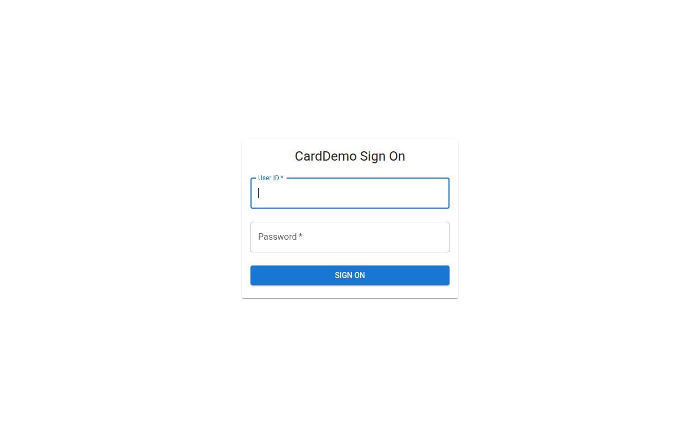
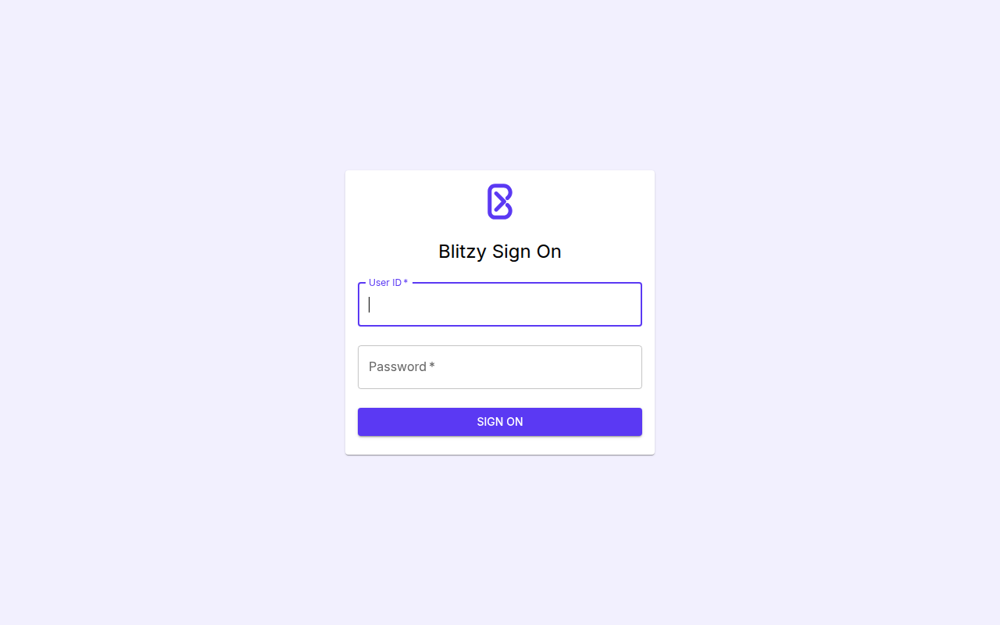
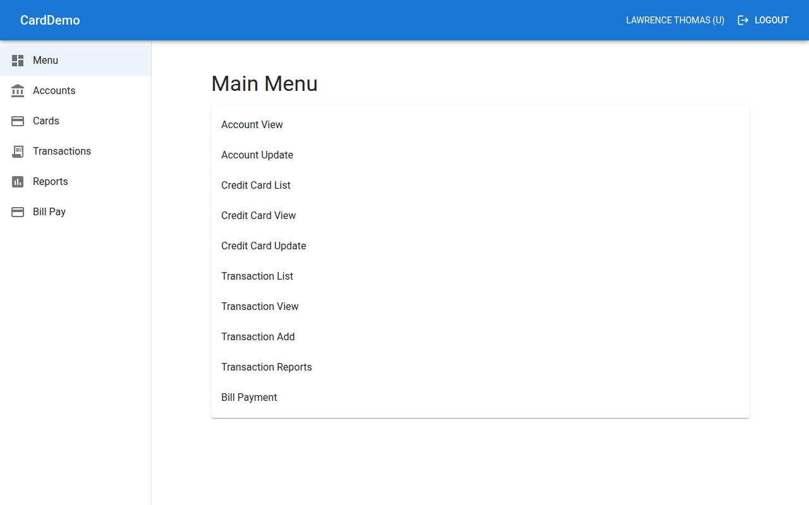
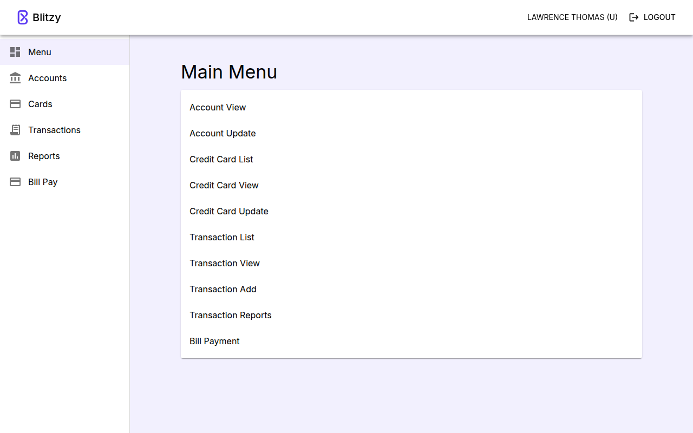
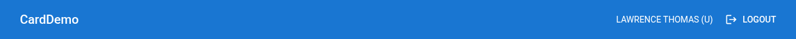
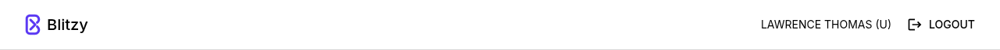
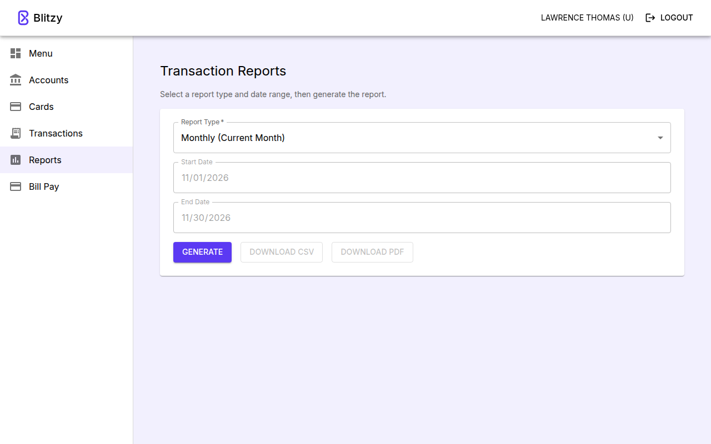

# Apply Blitzy branding to frontend UI

## Summary

This change applies Blitzy branding to the Next.js frontend in `frontend/`. It
changes presentation only: the MUI theme, typography, colors, logo, favicon,
header, and sign-on branding. Business logic, routing, API calls, role checks,
data handling, the backend, the batch package, and the legacy `app/` tree are
unchanged.

- The MUI theme in `frontend/src/app/theme.ts` maps the Brand Inputs palette and
  remains the single source of every brand color. No page or component file
  contains a brand hex value.
- Inter replaces Roboto. `next/font/google` downloads it at build time and the
  app serves it from its own origin.
- The header is a white surface with black text, a 1px `#D9D9D9` bottom border,
  the Blitzy logo, and the title `Blitzy`.
- The sign-on page shows the Blitzy logo above the heading `Blitzy Sign On`.
- The browser tab shows the Blitzy icon (`icon.svg`) and the title `Blitzy`.
- Accessibility adjustments, still presentation only: a 2px `#5B39F3` keyboard
  focus ring and darker error text (`error.dark`). A themed 404 page replaces
  Next's unstyled built-in one, with the same text.

Base commit for every comparison in this document:
`cb634428783e7b08a83594f8c39a9ba8f74740a6`.

## Changed files

Status is relative to the base commit: `A` added, `M` modified, `D` deleted.

| Status | File | Purpose |
| --- | --- | --- |
| A | `blitzy/documentation/branding-pr-description.md` | This pull request description. |
| A | `blitzy/screenshots/branding/after_header.png` | Header after branding (1280 × 65). |
| A | `blitzy/screenshots/branding/after_home_menu.png` | Home page `/menu` after branding (1280 × 800). |
| A | `blitzy/screenshots/branding/after_reports.png` | Reports page `/reports` after branding (1280 × 800). |
| A | `blitzy/screenshots/branding/after_signon.png` | Sign-on page after branding (1280 × 800). |
| A | `blitzy/screenshots/branding/before_header.png` | Header before branding (1280 × 64). |
| A | `blitzy/screenshots/branding/before_home_menu.png` | Home page `/menu` before branding (1280 × 800). |
| A | `blitzy/screenshots/branding/before_signon.png` | Sign-on page before branding (1280 × 800). |
| M | `docs/architecture.md` | Lists `BrandLogo` among the shared frontend components. |
| M | `frontend/Dockerfile` | Comment only: `public/` now holds the brand logo. |
| M | `frontend/__tests__/components/AppShell.test.tsx` | Brand-name assertions expect `Blitzy`. |
| M | `frontend/__tests__/pages/signon.test.tsx` | Heading assertion matches `Blitzy Sign On`. |
| A | `frontend/public/blitzy-logo.svg` | Blitzy logo, the exact Brand Inputs SVG. |
| D | `frontend/src/app/favicon.ico` | Removed; `icon.svg` replaces it. |
| A | `frontend/src/app/icon.svg` | Browser tab icon (the same SVG), App Router icon convention. |
| M | `frontend/src/app/layout.tsx` | Loads Inter as `--font-inter`; sets the page title and description. |
| A | `frontend/src/app/not-found.tsx` | Themed 404 page in place of Next's built-in one; same text and title. |
| M | `frontend/src/app/signon/page.tsx` | Adds the 48px logo above the heading; heading text `Blitzy Sign On`. |
| M | `frontend/src/app/theme.ts` | Brand palette, Inter; AppBar, focus, error-text, table, Typography overrides. |
| M | `frontend/src/components/AppShell.tsx` | `APP_TITLE` is `Blitzy`; adds the 28px logo to the left of the title. |
| A | `frontend/src/components/BrandLogo.tsx` | Shared logo component used by the header and the sign-on page. |
| M | `frontend/src/components/ErrorAlert.tsx` | Comment only: corrects the info Alert contrast figure to ≈6.88:1. |

The two test files change only the asserted strings. No test logic changed, and
no test was skipped or deleted. `frontend/next.config.js` is unchanged.

`not-found.tsx` renders the same `404` heading, `This page could not be found.`
message and `404: This page could not be found.` tab title as Next's built-in
404 page. The built-in page's inline styles forced a white body (black under an
OS dark mode) and the system font; the themed page uses the theme's canvas and
Inter like every other route.

## Brand values applied

Every value below is read from the merged source. Brand Inputs is the only
source for brand values.

### Theme palette (`frontend/src/app/theme.ts`)

| Token | Before | After |
| --- | --- | --- |
| `palette.primary.main` | `#1976d2` | `#5B39F3` |
| `palette.primary.contrastText` | `#ffffff` | `#FFFFFF` |
| `palette.primary.light` | `#42a5f5` | Derived by MUI from `#5B39F3`: `#7B60F5` |
| `palette.primary.dark` | `#1565c0` | Derived by MUI from `#5B39F3`: `#3F27AA` |
| `palette.secondary.main` | `#9c27b0` | `#333333` |
| `palette.secondary.contrastText` | `#ffffff` | `#FFFFFF` |
| `palette.secondary.light` | `#ba68c8` | Derived by MUI from `#333333`: `#5B5B5B` |
| `palette.secondary.dark` | `#7b1fa2` | Derived by MUI from `#333333`: `#232323` |
| `palette.background.default` | `#ffffff` | `#F2F0FE` |
| `palette.background.paper` | `#ffffff` | `#FFFFFF` |
| `palette.text.primary` | `rgba(0, 0, 0, 0.87)` | `#000000` |
| `palette.text.secondary` | `rgba(0, 0, 0, 0.6)` | `#666666` |
| `palette.divider` | MUI default `rgba(0, 0, 0, 0.12)` | `#D9D9D9` |

The theme sets only `main` and `contrastText` for primary and secondary.
`createTheme` derives `light` (main lightened 20%) and `dark` (main darkened
30%), so hover and emphasis shades stay on-brand.

These values are unchanged: `error` `#d32f2f`, `warning` `#ed6c02`, `info`
`#0288d1`, `success` `#2e7d32`, the `grey` scale, `text.disabled`
`rgba(0, 0, 0, 0.38)`, the 8px spacing unit, `shape.borderRadius` 4,
`layout.drawerWidth` 240, breakpoints, shadows, and the typography variant scale.

### Typography

| Item | Value |
| --- | --- |
| Loader (`layout.tsx`) | `Inter` from `next/font/google` |
| Loader options | `subsets: ['latin']`, `display: 'swap'`, `variable: '--font-inter'` |
| Loader fallback | `system-ui`, `-apple-system`, `'Segoe UI'`, `Helvetica`, `Arial`, `sans-serif` |
| CSS variable | `--font-inter`, defined on `<html>` through `inter.variable` |
| Font file at runtime | A `.woff2` file under `/_next/static/media/`, served from the app's own origin |

`typography.fontFamily` in `theme.ts` lists Inter first, then the system
sans-serif fallback stack:

```text
var(--font-inter), system-ui, -apple-system, "Segoe UI", Helvetica, Arial, sans-serif
```

The Roboto import, the `--font-roboto` variable, and the `Roboto` family name are
gone from `frontend/src`.

### Component overrides (`theme.ts` `components`)

| Override | Property | Value |
| --- | --- | --- |
| `MuiAppBar` root | `backgroundColor` | `background.paper` (`#FFFFFF`) |
| `MuiAppBar` root | `color` | `text.primary` (`#000000`) |
| `MuiAppBar` root | `borderBottom` | `1px solid` `divider` (`#D9D9D9`) |
| `MuiButtonBase` root `.Mui-focusVisible` | `outline` | `2px solid` `primary.main` (`#5B39F3`) |
| `MuiButtonBase` root `.Mui-focusVisible` | `outlineOffset` | `2px` |
| `MuiButton`, `MuiIconButton` | `defaultProps.disableFocusRipple` | `true` |
| `MuiListItemButton`, `MuiMenuItem` root `.Mui-focusVisible` | `outlineOffset` | `-2px` (ring drawn inside the row) |
| `MuiListItemButton` selected, forced colors | `borderInlineStart` | `theme.spacing(0.5)` (4px) solid `currentColor` |
| `MuiListItemButton` selected, forced colors | `paddingInlineStart` | `theme.spacing(1.5)` (12px) |
| `MuiTableCell` root | `borderBottomColor` | `divider` (`#D9D9D9`) |
| `MuiTypography` variant | `color="text.secondary"` | `text.secondary` (`#666666`) |
| `MuiFormLabel` root and asterisk `.Mui-error` | `color` | `error.dark` (`#932020`) |
| `MuiFormHelperText` root `.Mui-error` | `color` | `error.dark` (`#932020`) |

The two "selected, forced colors" rows style `.Mui-selected` inside
`@media (forced-colors: active)`.

`AppShell.tsx` passes no `color` prop to the AppBar, so the theme override
applies without any change to the AppBar element. The focus and error-text
overrides are explained under [Contrast adjustments](#contrast-adjustments).

### Product name, metadata, logo, and favicon

| Surface | Value | File under `frontend/` |
| --- | --- | --- |
| Header title (`APP_TITLE`) | `Blitzy` | `src/components/AppShell.tsx` |
| Sign-on heading (`h1`) | `Blitzy Sign On` | `src/app/signon/page.tsx` |
| Page title (`metadata.title`) | `Blitzy` | `src/app/layout.tsx` |
| Page description | The Brand Inputs string shown after this table | `src/app/layout.tsx` |
| Logo asset | `/blitzy-logo.svg`, alt text `Blitzy logo`, width `auto` | `public/blitzy-logo.svg` |
| Logo in the header | 28px tall (`theme.spacing(3.5)`), left of the title | `src/components/BrandLogo.tsx` |
| Logo on the sign-on page | 48px tall (`theme.spacing(6)`), above the heading | `src/components/BrandLogo.tsx` |
| Favicon | `<link rel="icon" href="/icon.svg?…" type="image/svg+xml">` | `src/app/icon.svg` |

The page description, exactly as served in `<meta name="description">`. The
code span's source lines are wrapped for line length; Markdown joins them with a
single space, so the rendered text is the exact string.

`Blitzy: Build enterprise software in days with our autonomous AI platform.
Automate up to 80% of development. Infinite code context. Accelerate your roadmap by 5x.`

`blitzy-logo.svg` and `icon.svg` are byte-identical to the Brand Inputs SVG,
which uses the single fill `#5B39F3`.

## Hard-coded colors replaced

A scan of every `.ts` and `.tsx` file under `frontend/src/` at the base commit
found the six MUI default primary and secondary values only in
`frontend/src/app/theme.ts`, the theme-definition file. **No page or component
file contained one**, so no page or component file needed a replacement.

For the four `light` and `dark` tokens, the literal is removed and MUI derives
the new value from the brand `main`.

| File | Old value | Theme token | New value |
| --- | --- | --- | --- |
| `frontend/src/app/theme.ts` | `#1976d2` | `primary.main` | `#5B39F3` |
| `frontend/src/app/theme.ts` | `#42a5f5` | `primary.light` | `#7B60F5` (derived) |
| `frontend/src/app/theme.ts` | `#1565c0` | `primary.dark` | `#3F27AA` (derived) |
| `frontend/src/app/theme.ts` | `#9c27b0` | `secondary.main` | `#333333` |
| `frontend/src/app/theme.ts` | `#ba68c8` | `secondary.light` | `#5B5B5B` (derived) |
| `frontend/src/app/theme.ts` | `#7b1fa2` | `secondary.dark` | `#232323` (derived) |

None of the six values remains anywhere in `frontend/src`. Error, warning, info,
success, and grey values are unchanged. Test files are outside the scan; two
comments in `frontend/__tests__/testUtils.tsx` still mention `#1976d2` as
historical context and affect nothing at runtime.

In the running app, a scan of the computed colors of every element and
pseudo-element, and of every loaded CSS rule, found none of the six colors on
`/signon`, `/menu`, `/reports`, `/admin`, or `/cards`.

## Contrast adjustments

Every brand value is unchanged, and so is `error.main`. Two adjustments were
made; the logo SVG is unaltered.

1. **Error text.** `error.main` `#d32f2f` measures 4.43:1 on the `#F2F0FE`
   canvas, below the 4.5:1 text minimum (4.98:1 on white). Error labels,
   required asterisks, and helper text now use `palette.error.dark` `#932020`,
   which MUI derives from `#d32f2f`; no palette value was added or changed. It
   measures 7.56:1 on the canvas and 8.51:1 on white. `error.main` stays on
   non-text surfaces: error input outlines (`rgb(211, 47, 47)`), error buttons,
   and alerts and snackbars (white on `#d32f2f`, 4.98:1).
2. **Keyboard focus.** MUI's `ButtonBase` removes the native outline, so focus
   showed only as low-contrast tints and ripples: 1.32:1 for a drawer link,
   1.37:1 for the selected one, about 2.1:1 for the header buttons, and 1.8:1 for
   the contained `SIGN ON` ripple, which also dropped its white label to 3.53:1.
   Every `ButtonBase` control (buttons, icon buttons, nav and menu items,
   pagination) now draws a 2px `#5B39F3` outline on keyboard focus, inset on
   full-width nav and menu rows. Buttons and icon buttons no longer play the
   focus ripple, so a focused `SIGN ON` keeps its resting fill and its label
   stays 6.32:1. In forced-colors mode the outline stays (Chrome's emulation
   forces its color to `rgba(5, 0, 73, 0.8)`, 11.30:1 on the white Canvas), and
   the selected nav item, which loses its tint there, gets a 4px start-edge bar.

Ratios measured in the running app with the WCAG 2.x relative-luminance formula:

| Foreground | Background | Where measured | Ratio | AA threshold |
| --- | --- | --- | --- | --- |
| Text primary `#000000` | Paper `#FFFFFF` | Header, drawer, cards | 21.00:1 | 4.5:1 |
| Text primary `#000000` | Canvas `#F2F0FE` | Page headings on `/menu` and `/reports` | 18.67:1 | 4.5:1 |
| Text primary `#000000` | Selected drawer item `rgba(91, 57, 243, 0.08)` on paper | Drawer | 18.57:1 | 4.5:1 |
| Text secondary `#666666` | Paper `#FFFFFF` | Field labels | 5.74:1 | 4.5:1 |
| Text secondary `#666666` | Canvas `#F2F0FE` | Helper text on `/reports` | 5.10:1 | 4.5:1 |
| Primary `#5B39F3` text | Paper `#FFFFFF` | Focused field label on `/signon` | 6.32:1 | 4.5:1 |
| contrastText `#FFFFFF` | Primary `#5B39F3` | `SIGN ON`, `GENERATE`, and `SEARCH` buttons | 6.32:1 | 4.5:1 |
| Focused outline `#5B39F3` | Paper `#FFFFFF` | Focused text field | 6.32:1 | 3:1 |
| Focus ring `#5B39F3` | Paper `#FFFFFF` | Focused `SIGN ON`, header brand, and `LOGOUT` | 6.32:1 | 3:1 |
| contrastText `#FFFFFF` | Primary `#5B39F3` | Focused `SIGN ON` label (no focus ripple) | 6.32:1 | 4.5:1 |
| Focus ring `#5B39F3` | Focused row `rgba(0, 0, 0, 0.12)` on paper | Drawer | 4.80:1 | 3:1 |
| Focus ring `#5B39F3` | Focused selected row `rgba(91, 57, 243, 0.2)` on paper | Drawer | 4.60:1 | 3:1 |
| Forced-colors ring `rgba(5, 0, 73, 0.8)` | Canvas `#FFFFFF` | Drawer, Chrome forced colors | 11.30:1 | 3:1 |
| Error text `#932020` | Paper `#FFFFFF` | Error label, asterisk, and helper text on `/signon` | 8.51:1 | 4.5:1 |
| Error outline `#d32f2f` | Paper `#FFFFFF` | User ID field in error on `/signon` | 4.98:1 | 3:1 |

Computed for states and pairings that the captured pages do not render:

| Foreground | Background | Ratio |
| --- | --- | --- |
| contrastText `#FFFFFF` | `primary.dark` `#3F27AA` (contained-button hover) | 10.09:1 |
| Primary `#5B39F3` | Canvas `#F2F0FE` | 5.62:1 |
| `#333333` | Paper `#FFFFFF` | 12.63:1 |
| Focus ring `#5B39F3` | Canvas `#F2F0FE` (focused `SEARCH`, `CLEAR`, pagination) | 5.62:1 |
| Error text `#932020` | Canvas `#F2F0FE` | 7.56:1 |
| `error.main` `#d32f2f`, the former error text | Canvas `#F2F0FE` | 4.43:1 |
| contrastText `#FFFFFF` | `error.main` `#d32f2f` (error buttons, alerts, snackbars) | 4.98:1 |

The divider `#D9D9D9` measures 1.41:1 on paper and 1.25:1 on the canvas. It is
used only for decorative separators (dividers, the drawer edge, table rows, and
the header bottom border), not for text or for boundaries needed to identify a
control. Outlined text fields keep the MUI default border `rgba(0, 0, 0, 0.23)`
(rendered `rgb(196, 196, 196)`, 1.74:1 on paper); this change leaves that border
as it was. Each focus indicator listed above is 4.60:1 or more against the
color next to it, above the 3:1 minimum, with and without forced colors.

## Verification

- `npm run type-check`, `npm run lint:ci`, and the Jest suite pass: 27 of 27
  suites and 401 of 401 tests.
- `npm run build` succeeds, and the route list includes `/icon.svg`.
- The tab title is `Blitzy` on every page except the 404 page, whose title is
  `404: This page could not be found.`, as with Next's built-in 404 page. The
  only icon link points to `/icon.svg` with type `image/svg+xml` and returns 200.
  `/favicon.ico` returns 404.
- The console shows no messages on `/signon` or `/menu`, either on first load or
  after a hard reload.
- Every font and image request goes to the app's own origin. The only
  cross-origin requests go to the backend API origin. The date-picker icon on
  `/reports` is Chrome's built-in inline `data:` image, not a network request.
- On `/signon`, `/menu`, and `/reports`:
  - the body background is `rgb(242, 240, 254)`;
  - visible text renders in Inter;
  - primary contained buttons are `rgb(91, 57, 243)` with white text.
- On `/menu`, `/reports`, `/admin`, and `/cards`, the AppBar is
  `rgb(255, 255, 255)` with `rgb(0, 0, 0)` text and a
  `1px solid rgb(217, 217, 217)` bottom border.
- The logo renders 48px tall on `/signon` and 28px tall in the header on `/menu`
  and `/reports`.
- Keyboard focus on `SIGN ON`, the header brand, `LOGOUT`, and the drawer items
  computes a `2px solid rgb(91, 57, 243)` outline, offset `2px` on buttons and
  `-2px` on drawer rows, and a focused button has no ripple element.
- With `forced-colors: active` emulated, focused drawer items keep a 2px solid
  outline, and the selected item has a `4px solid` start border with `12px`
  start padding (`16px` on the other items).
- After an empty sign-on submit, the User ID label, asterisk, and helper text
  compute `rgb(147, 32, 32)`; the field outline stays `rgb(211, 47, 47)`.
- Signed in, an unknown route renders the themed 404 page inside the header and
  drawer, on the `rgb(242, 240, 254)` canvas, with the heading in Inter and no
  inline font or background style.

## Screenshots

All screenshots use a 1280 × 800 viewport. The home page is `/menu`, the page a
regular user reaches after sign-on, captured signed in as a seed regular user.
The header shots capture the AppBar element alone. The after header is 1px
taller because of the new bottom border.

### Sign-on page

Before:



After:



### Home page (`/menu`)

Before:



After:



### Header

Before:



After:



### Reports page (`/reports`, after)


