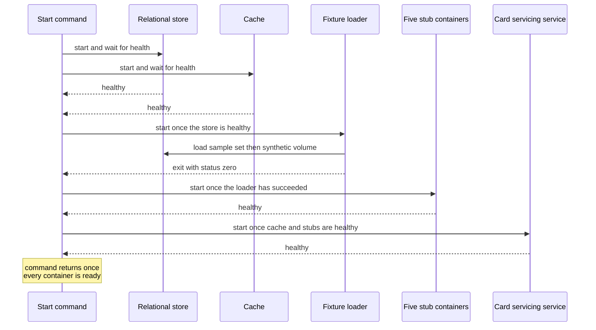

# CS-01-001: Compose test stack with stub services

Parent epic: [CS-01 Account Balance Summary View](../README.md)

## Source Story (verbatim)

> ### 1. Details/Requirements
>
> As a test engineer, I want one Compose stack running the service, five stubs, PostgreSQL, Redis and the fixture loader, so that end-to-end and performance suites run against the same real request path.
>
> Trace: CARD_REQ_TBD · Use Cases · COACTVWC
>
> Directive: testing requirements (Compose test stack)
>
> Account-data access path: No
>
> External integration or SLA-bound: Yes
>
> Capability: one Compose file starts PostgreSQL, Redis, a one-shot fixture loader, the five stub services and the Card Servicing service, all application containers from one image, in a fixed start order with a health check on every long-running container. `docker compose -f tests/docker-compose.yml up -d --wait` therefore returns only when the whole request path is ready, and both the end-to-end and the performance suites start the stack with that one command and stop it with `docker compose -f tests/docker-compose.yml down`. Target paths:
>
> - `tests/docker-compose.yml` (create):
>   - Containers, by Compose service name:
>     - `postgres`: image `postgres:16.6`, database `cardservicing`, user `cardservicing`, password `local-throwaway`, the values CS-11-001 packages as defaults. Health check `pg_isready` for that database and user.
>     - `redis`: image `redis:7.4.2` with no password. Health check `redis-cli ping`.
>     - `fixture-loader`: the service image with profiles `fixture-load` (CS-09-001) and `stack-loader`. It loads the CardDemo sample set, then the synthetic volume (CS-09-007, CS-10-008), runs the start-time query-plan check of CS-10-008 and exits. Its health check is disabled and `restart` is `"no"`. It runs the image's start command under the base image's `timeout` with a 600 s limit, so a load that hangs exits non-zero: Compose 2.29.7 applies no `--wait-timeout` to the wait on a `service_completed_successfully` dependency, so this limit is what bounds the volume load.
>     - `card-data-stub`, `transaction-activity-stub`, `config-stub`, `reference-data-stub` and `auth-stub`: the service image in stub-container mode, each hosting one stub, with profiles `stack-stub-card-data`, `stack-stub-transaction-activity`, `stack-stub-config`, `stack-stub-reference-data` and `stack-stub-auth`.
>     - `card-servicing-service`: the service image with profile `stack-service`.
>   - Image: every application container declares the same build, `card-servicing-service/Dockerfile` with the repository root as context, and the same tag `card-servicing-service:stack`, so all seven run one image.
>   - Start order, through `depends_on`:
>     - `fixture-loader` waits for `postgres` with `service_healthy`.
>     - Each stub waits for `fixture-loader` with `service_completed_successfully`.
>     - `card-servicing-service` waits for `redis` and the five stubs with `service_healthy`, and for `fixture-loader` with `service_completed_successfully`.
>   - Health checks: `postgres` and `redis` as above. The five stubs and the service inherit the image's probe and set an interval of 2 s, a probe timeout of 1 s, 30 retries and a 60 s start period, so a container that never listens turns unhealthy and fails `--wait`.
>   - Ports: inside the stack every stub and the service listen on gRPC port 9090 and web port 8080. The file publishes them on fixed host ports, web then gRPC: service 8080 and 9090, Card Data stub 8081 and 9091, Transaction Activity stub 8082 and 9092, Config stub 8083 and 9093, Reference Data stub 8084 and 9094, Auth stub 8085 and 9095. A stub's web port serves its request log at `GET /internal/stub/request-log` (CS-11-002). `postgres` and `redis` publish no host port.
>   - Environment, every value a literal in the file with no `${…}` interpolation:
>     - `card-servicing-service`: `AUTH_SERVICE_API_KEY` empty, `REDIS_HOST=redis`, `REDIS_PORT=6379`, `REDIS_PASSWORD` empty, `REDIS_SSL_ENABLED=false`, `AZURE_KEYVAULT_URI` empty, `UPSTREAM_TIMEOUT_MS=300`, `UPSTREAM_MAX_RETRIES=2`, `REQUEST_DEADLINE_MS=900` and `SPRING_PROFILES_ACTIVE=stack-service`.
>     - `fixture-loader`, `card-data-stub`, `transaction-activity-stub` and `reference-data-stub`: `DB_URL=jdbc:postgresql://postgres:5432/cardservicing`, `DB_USERNAME=cardservicing`, `DB_PASSWORD=local-throwaway` and `AZURE_KEYVAULT_URI` empty.
>     - Each of the five stubs: `STUB_LATENCY_MS=0` and `STUB_FAILURE_RATE=0`, its per-stub failure-injection values (CS-11-002).
>     - Each stub and the loader: `SPRING_PROFILES_ACTIVE` set to its profiles above.
>     - Each of the 14 variables of the TRD environment-variable table is thus set on exactly the containers its "Read by" column names. An empty `AZURE_KEYVAULT_URI` keeps the Key Vault property source off exactly as an unset one does (CS-12-004).
>       > SCOPE-QUESTION (Resolved): The `postgres` container is given no variable above, yet the `postgres:16.6` image creates its database, user and password only from its own initialisation variables and refuses to initialise an empty store without `POSTGRES_PASSWORD`. `postgres` therefore carries three image bootstrap settings, literals like every other value: `POSTGRES_DB=cardservicing`, `POSTGRES_USER=cardservicing` and `POSTGRES_PASSWORD=local-throwaway`, the database, user and password the `postgres` bullet names and CS-11-001 packages as defaults. Only the image's first-start initialisation reads them and no application container does, so they are not among the 14 variables of the TRD environment-variable table; the TRD lists them, beside the framework profile selector `SPRING_PROFILES_ACTIVE` that the containers above set, under [stack container settings](../../../../technical-requirements.md#stack-container-settings). `redis` carries no variable. Because no named volume survives `down`, each `up` initialises the empty store from these values.
>   - No named volume, so each `up` after `down` starts with an empty store and an empty cache.
> - `card-servicing-service/src/main/resources/application.yml` (edit; created by CS-11-001): one profile-specific document per stack profile, each read only while its profile is active, so every packaged default holds outside the stack:
>   - `stack-service`: `card-servicing.grpc.port` 9090 and the five client targets at the stub containers: `card-servicing.clients.card-data.target` `card-data-stub:9090`, `card-servicing.clients.transaction-activity.target` `transaction-activity-stub:9090`, `card-servicing.clients.config.target` `config-stub:9090`, `card-servicing.clients.reference-data.target` `reference-data-stub:9090` and `card-servicing.auth.target` `auth-stub:9090`.
>   - `stack-stub-card-data`, `stack-stub-transaction-activity`, `stack-stub-config`, `stack-stub-reference-data` and `stack-stub-auth`: `card-servicing.grpc.port` 9090 and `card-servicing.stub.serve` set to `card-data`, `transaction-activity`, `config`, `reference-data` or `auth` respectively, so each container hosts that single stub server and no Card Servicing API service (CS-11-002).
>   - `stack-loader`: `spring.main.web-application-type` `none`, so the loader container runs the `fixture-load` job without an embedded web server.
> - `card-servicing-service/Dockerfile` (edit; created by CS-05-001 on `eclipse-temurin:25-jre`):
>   - An exec-form entry point that starts the packaged application jar from one fixed path in the image, so the profiles a container sets alone select service mode, one stub or the loader, and the container's stop signal reaches the JVM. The loader's time-limited start in the stack file repeats this command after `timeout 600`.
>   - A `HEALTHCHECK` whose probe opens a TCP connection to port 9090 through the base image's bash (`/dev/tcp`), because the base image carries neither curl nor wget, and the gRPC server of each container listens only once its application context is ready (CS-11-002).
>   - No package and no dependency outside `gradle/libs.versions.toml` is added.
> - Together these are the 3 files touched.
>
> In scope:
>
> - The Compose file.
> - Stub-container and loader profiles.
> - Health checks.
> - Startup ordering.
> - Environment values.
>
> Not in this story:
>
> - Stub implementations (CS-09-004, CS-10-004, CS-10-005, CS-11-005, CS-12-001, CS-13-002).
> - Loader logic and volume generation (CS-09-001, CS-09-003, CS-10-002, CS-09-007, CS-10-008).
> - Test code and the CI stages that start this stack (CS-01-002, CS-01-003).
> - AKS deployment manifests.
>
> ### 2. Acceptance Criteria
>
> - AC1: `docker compose -f tests/docker-compose.yml up -d --wait` exits 0 only after `postgres`, `redis`, the five stubs and `card-servicing-service` report healthy and `fixture-loader` has exited 0. `docker compose -f tests/docker-compose.yml ps -a` then shows those eight containers healthy and `fixture-loader` exited with code 0.
> - AC2: The `fixture-loader` container log holds the load report with zero skipped rows for all six entities. Sample rows: 50 accounts, 50 cross-references, 50 category balances, 300 transactions, 7 transaction types and 18 transaction categories. Synthetic rows: 10,000 accounts `10000000001`–`10000010000`, 10,000 cross-references, 100,000 category balances and 1,000,000 transactions.
> - AC3: When the loader exits non-zero, `up -d --wait` exits non-zero and `card-servicing-service` and the five stubs are created but never started. The case is forced by a temporary override file outside the repository that gives `fixture-loader` a store password the store rejects. `docker compose -f tests/docker-compose.yml config` shows the loader's start command under a 600 s `timeout`.
> - AC4: From the host, each stub answers one contract operation with `OK` on its published gRPC port, and the call appears in that stub's request log read from its published web port: Card Data `GetAccount` for `00000000001` on 9091, Transaction Activity `ListTransactions` for `00000000001` on 9092, Config `GetConfig` for `default_page_size` on 9093 returning `"20"`, Reference Data `ListTransactionTypes` on 9094 returning 7 rows, and Auth `ValidateToken` for `fixture-token-user0001` on 9095 returning subject `USER0001`.
> - AC5: `docker compose -f tests/docker-compose.yml config` shows the environment of every container, the service container included, exactly as section 1 lists it, and no container carries a variable that section 1 does not list for it.
>   > SCOPE-QUESTION (Resolved): Section 1's list includes the note beneath the Environment list, so `docker compose -f tests/docker-compose.yml config` shows `postgres` with exactly `POSTGRES_DB=cardservicing`, `POSTGRES_USER=cardservicing` and `POSTGRES_PASSWORD=local-throwaway`, `redis` with no variable, and every other container exactly as the Environment list gives it, its `SPRING_PROFILES_ACTIVE` value included. Any other variable on any container fails AC5. AC10 still holds: the only credential added is the throwaway local-container value `local-throwaway`, which the committed-secret scan of CS-11-001 allows.
> - AC6: The service runs the upstream call policy with these values: each attempt times out at the lesser of 300 ms and the remaining request budget, and at most two retries follow, after 50 ms then 100 ms backoff, on `UNAVAILABLE` or `DEADLINE_EXCEEDED` only, each starting only when its backoff plus a full 300 ms attempt fits before the 900 ms cut-off. In this stack, with `card-data-stub` paused (`docker compose -f tests/docker-compose.yml pause card-data-stub`) and the cache emptied, `GET /v1/accounts/00000000001/balance-summary` with `fixture-token-user0001` returns 504, the logged `cutoffMs` is ≤ 900 and the client-measured response arrives below 1,000 ms. The per-attempt proof under injected latency and failure rates sits in CS-11-003 and the integration suites CS-09-006, CS-10-007, CS-11-007, CS-12-005 and CS-13-004.
> - AC7: Card Data degradation: with `card-data-stub` stopped and the cache emptied, `GET /v1/accounts/00000000001/balance-summary` with `fixture-token-user0001` returns 503 or 504 with an `ErrorObject` carrying a `traceId`. After a `FRESH` request has cached the account's entries, with `card-data-stub` stopped once their 60 s fresh TTL has passed and before their 300 s max stale age, the same request returns 200 with `X-Data-Status: STALE`. In both cases the logged `cutoffMs` is ≤ 900 and the client-measured response arrives below 1,000 ms.
> - AC8: Auth and Transaction Activity fail hard: with `auth-stub` stopped, each of the four UI-facing endpoints for `00000000001` returns 503 or 504, and the Card Data, Transaction Activity and Reference Data request logs record no call for those requests, so access fails closed. With `transaction-activity-stub` stopped and the cache emptied, `GET /v1/accounts/00000000001/transactions` returns 503 or 504. In each case the logged `cutoffMs` is ≤ 900 and the client-measured response arrives below 1,000 ms.
>   > SCOPE-QUESTION (Resolved): The AC8 label "Auth and Transaction Activity fail hard" covers Auth and the transaction list only, the two cases AC8 checks on the stack. When Transaction Activity's transaction read `GetTransaction` fails after retries or at the cut-off, the transaction detail returns a usable cached transaction, one within its 300 s max stale age (CS-10-006), as 200 with `X-Data-Status: STALE`, and returns 503 or 504 only when no such entry is held. When Card Data's cross-reference read `GetCardCrossReference` fails, the transaction detail returns 503 or 504 even when the transaction came from cache. These outcomes follow the `GetTransaction` and `GetCardCrossReference` rows of the degradation table in [TRD — Resilience](../../../../technical-requirements.md#resilience). AC8's checks are unchanged, and the transaction detail outcomes are proven under injection by CS-08-002 and CS-10-007.
> - AC9: Reference Data and Config degradation: with `reference-data-stub` stopped and the cache emptied, so no usable cached reference data exists, the balance summary for `00000000001` returns 200 with `dataStatus` `PARTIAL` and every `typeDescription` JSON `null`. With `config-stub` stopped, the balance summary body, `asOf` aside, and its `dataStatus` equal those returned with every stub running. In each case the logged `cutoffMs` is ≤ 900 and the client-measured response arrives below 1,000 ms.
> - AC10: The stack file holds no `${` interpolation, so no fixture data-set variable or other shell value changes what it starts or loads, and it holds no real secret: every credential value is empty or the throwaway local-container value `local-throwaway`. The committed-secret scan of CS-11-001 passes with the file committed.
> - AC11: After `docker compose -f tests/docker-compose.yml down`, `docker compose -f tests/docker-compose.yml ps -a` lists no container, and the next `up -d --wait` starts with an empty store and an empty cache: its load report repeats AC2, and the first balance summary request for `00000000001` produces exactly one `GetAccount` entry in the Card Data request log.
>
> ### 3. Dependencies
>
> - CS-05-006 — balance summary REST and gRPC endpoints the stack serves.
> - CS-06-003 — category balance REST and gRPC endpoints the stack serves.
> - CS-07-003 — transaction list REST and gRPC endpoints the stack serves.
> - CS-08-003 — transaction detail REST and gRPC endpoints the stack serves.
> - CS-09-007 — synthetic category-balance volume the loader generates at stack start.
> - CS-10-008 — synthetic transaction volume the loader generates at stack start.
>
> Risk: the volume load at stack start lengthens `--wait`, and its load time, recorded by CS-10-008, must stay inside the loader's 600 s limit, which bounds the start because Compose 2.29.7 applies no `--wait-timeout` to the wait on a completed loader.

## 4. Design

- [Physical deployment](../../../../architecture/physical-deployment.mmd)
- [Logical architecture](../../../../architecture/logical-architecture.mmd)
- [Data model — synthetic volume](../../../../data-model.md#synthetic-volume)
- [TRD — D5 One Compose stack for both suites](../../../../technical-requirements.md#d5-one-compose-stack-for-both-suites)
- [TRD — Test and performance harness](../../../../technical-requirements.md#test-and-performance-harness)
- [TRD — Environment variables](../../../../technical-requirements.md#environment-variables)
- Contracts: N/A

## 5. Documentation Changes

Completed during implementation.

## 6. Test Plan

- Unit — Not applicable — the story adds configuration only, with no runtime branch, so it adds no unit case; the committed-secret scan of CS-11-001 still covers the new stack file under this command (AC10). Command `./gradlew :card-servicing-service:test jacocoTestCoverageVerification`; all tests pass, with ≥80% line coverage per module.
- Integration — Not applicable — integration suites host stubs inside the test JVM on loopback ports. Command `./gradlew :card-servicing-service:integrationTest`; one suite per external epic covering a stub exception, latency above `UPSTREAM_TIMEOUT_MS` and the `UPSTREAM_MAX_RETRIES` cap.
- Performance — Applies — this stack hosts the run. Commands `docker compose -f tests/docker-compose.yml up -d --wait`, then `./gradlew :card-servicing-service:performanceTest`, then `docker compose -f tests/docker-compose.yml down`; p50/p95/p99 below 1,000 ms over successful requests with failure injection off, at 10 users × 100 sequential calls, 100,000 category balances and 1,000,000 transactions; injected failures proven by a logged `cutoffMs` ≤ 900 and a client-measured response below 1,000 ms.
- End-to-end — Applies — this stack hosts the run. Commands `docker compose -f tests/docker-compose.yml up -d --wait`, then `./gradlew :card-servicing-service:e2eTest`, then `docker compose -f tests/docker-compose.yml down`; the four-step flow for account `00000000001` returns the expected fixture values and each stub's request log shows at least one call. AC1–AC11 are checked on this stack from the host with `docker compose` commands and HTTP and gRPC requests, and recorded in section 7.

## 7. Validation Results

Completed during implementation.

## Implementation Design

Recommended: Design Option A — one stack file whose one-shot fixture loader gates every other application container.

Rationale: one stack file, started by the one command both suites share, loads the sample set and the synthetic volume into one store in disjoint identifier ranges, so every run of that command yields the same data on every machine.

- Rejected: Design Option B, one profile per suite — each suite names its profile in the start command, so the command both suites share no longer starts the same stack.
- Rejected: a data-set switch read from the caller's shell — the same command loads different data on different machines.
- Rejected: one stack file per suite — two start commands where the request gives one.

### Shared by both options

- Topology: one container each for the relational store, the cache, the fixture loader, each of the five stubs and the card servicing service, all on one private stack network.
- Naming: each container carries a fixed stack name, and the service reaches each stub by that name.
- Addressing: each stub and the service listen on the same two ports inside the stack, and the stack file maps each container to its own fixed pair of host ports.
- Isolation: sample and synthetic rows sit in disjoint identifier ranges, and the end-to-end suite reads only sample accounts.
- Fallback: a stopped or paused stub follows the degradation table, with stale or partial answers where the table allows them and a hard failure elsewhere.
- Provisioning: every application container runs one image built from the service build, and its profile alone decides which mode it runs in.
- Cut-over: the real services replace the stubs by a change of target address and credential source only, and the stack file stays a test asset.
- Failures: a loader that fails or reaches its time limit stops the start, and a container that never turns healthy fails the start command.

### Design Option A — one stack file with a one-shot loader gating service start

The stack file declares one fixture loader container that always loads the legacy sample set and then the synthetic volume, and every stub and the service wait for it to finish with status zero. Health checks on every long-running container make the start command return only when the full request path is ready. The same command and the same file serve the end-to-end and the performance suites.

How it behaves:

- The store and the cache start first and report healthy.
- The fixture loader starts once the store is healthy, loads the sample set, then the synthetic volume, checks the query plan of the first transaction page and exits.
- A loader that fails, or that is still running at its ten-minute limit, exits with a non-zero status, so the stubs and the service are created but never started.
- The five stubs start after the loader succeeds, each serving one stub from the shared image.
- The service starts after the cache and the five stubs report healthy.
- Every value lives in the stack file itself, so no shell setting changes what the command starts or loads.
- A stop removes every container, and the next start begins with an empty store and an empty cache.

| No. | Decision (vs rejected) | Pro | Con |
|---|---|---|---|
| 1 | One stack file for both suites (vs one stack file per suite) | both suites share one start command | every start pays the volume load |
| 2 | Loader as a one-shot container (vs loading inside the service at start) | a failed load stops the start before any request | the stack holds one more container |
| 3 | Stubs from the service image (vs separate stub images) | one build feeds every application container | each stub container carries the whole service |
| 4 | No data-set switch (vs a switch read from the shell) | the same command loads the same data everywhere | no run can skip the volume load |

Effort and risk: small effort across three files, with the load time added to every start as the main risk.

### Design Option B — profiles per suite

The stack file keeps a sample-only loader for the end-to-end suite and adds a volume loader under a performance profile. The end-to-end suite starts the stack with no profile and loads only the sample set, while the performance suite names its profile to add the synthetic volume. Containers, health checks, ports and environment values are the same as in Option A.

How it differs:

- The performance start command names its profile, so the two suites no longer share one command.
- An end-to-end start skips the volume load and returns sooner.
- A performance start runs a second loader after the sample loader.
- A stop that names no profile can leave the volume loader container behind.
- A run that names the wrong profile loads the wrong data set with no error.

| No. | Decision (vs rejected) | Pro | Con |
|---|---|---|---|
| 1 | One profile per suite (vs one stack for both suites) | an end-to-end start skips the volume load | the shared start command splits in two |
| 2 | Volume loader as a second container (vs one loader for both data sets) | each data set has its own loader | a performance start waits on two loaders |
| 3 | Stubs from the service image (vs separate stub images) | one build feeds every application container | each stub container carries the whole service |

Effort and risk: small effort across three files, at risk on the start command the request fixes for both suites.

### Recommendation

- Option: Design Option A.
- Why: one command loads identical data on every machine, and the end-to-end suite reads only sample accounts, so it still observes the small set.
- Strongest argument against: every start, end-to-end runs included, pays the synthetic volume load.
- Shared items that do not decide the choice: the containers, the health checks, the host ports, the environment values, the shared image and the degradation behaviour.
- Flip conditions: a volume load that outgrows the loader's time limit, or a request that allows a separate start command per suite.

## Design Validation

### Option A

Settled assumptions:

- The pinned stack tool reports success once a one-shot dependency has exited with status zero, and leaves its dependents unstarted when it fails.
- The pinned stack tool applies no wait limit to a one-shot dependency, so the loader's own time limit bounds the load.
- The base image carries a shell that can open a network connection, and no web download tool.
- The remote procedure server of each container listens only once its application is ready.
- Each stub story serves its stub alone in a container when that container's profile names it.

Open assumptions:

- Load time on the continuous integration runner Open → the load time the transaction volume story records, set against the ten-minute loader limit.
- Request-log reads from outside a stub container Open → the web route of the stub hosting story on each stub's published port.

| AC | Verdict | Why |
|---|---|---|
| AC1 | Holds | the wait succeeds once the loader completes and every long-running container reports healthy |
| AC2 | Conditional | the full load must finish inside the loader's ten-minute limit |
| AC3 | Holds | dependents of a failed one-shot loader stay created but unstarted |
| AC4 | Holds | each stub listens on its own published port pair |
| AC5 | Holds | every value is a literal in the stack file |
| AC6 | Holds | the stack sets the values that the call policy story proves |
| AC7 | Holds | the card data client serves a stale entry only inside its stale window |
| AC8 | Holds | authentication and the transaction list have no degraded answer |
| AC9 | Holds | configuration outcomes never change the data status |
| AC10 | Holds | the stack file carries only empty or throwaway credentials |
| AC11 | Holds | no named volume survives a stop |

### Option B

Settled assumptions:

- The pinned stack tool reports success once a one-shot dependency has exited with status zero, and leaves its dependents unstarted when it fails.
- The performance start command names its profile.
- A start that names no profile loads only the sample set.

Open assumptions:

- Whether a stop that names no profile removes the volume loader container Open → a trial stop on the pinned stack tool.
- Load time of a performance start Open → the load time the transaction volume story records.

| AC | Verdict | Why |
|---|---|---|
| AC1 | Conditional | the plain start command brings up only the end-to-end data set |
| AC2 | Breaks | the plain start command loads no synthetic rows |
| AC3 | Holds | dependents of a failed one-shot loader stay created but unstarted |
| AC4 | Holds | each stub listens on its own published port pair |
| AC5 | Holds | every value is a literal in the stack file |
| AC6 | Holds | the stack sets the values that the call policy story proves |
| AC7 | Holds | the card data client serves a stale entry only inside its stale window |
| AC8 | Holds | authentication and the transaction list have no degraded answer |
| AC9 | Holds | configuration outcomes never change the data status |
| AC10 | Holds | profiles need no interpolation |
| AC11 | At risk | a stop that names no profile can leave the volume loader container behind |

## Metadata

| Field | Value |
|---|---|
| Build wave | W3 |
| Depends on | CS-05-006, CS-06-003, CS-07-003, CS-08-003, CS-09-007, CS-10-008 |
| Status | TBD |
| Estimated Files Touched | 3 |
| Issue Type | Story |
| Epic Name | Account Balance Summary View |
| Epic Link | CS-01 |
| Story Points | 3 |
| Priority | High |
| Components | TBD |
| Fix Version/s | TBD |
| Team | TBD |
| Assignee | TBD |
| Reporter | TBD |
| Labels | TBD |
| Sprint | TBD |
| Due Date | TBD |
| Environment | TBD |
| Persona | TBD |
| Estimated Effort | TBD |
