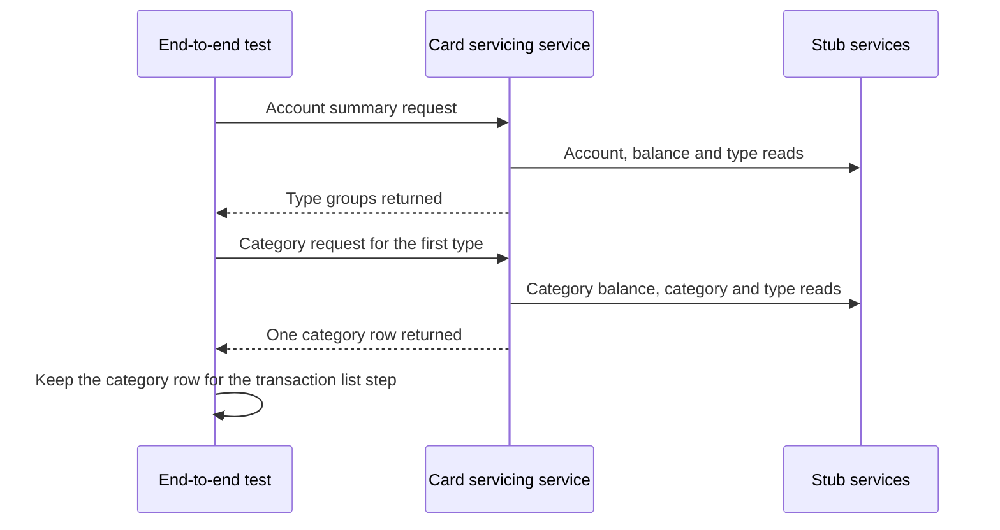

# CS-02-001: Category balance end-to-end step

Parent epic: [CS-02 Category Balance View](../README.md)

## Source Story (verbatim)

> ### 1. Details/Requirements
>
> As a card servicing user, I want to open the categories behind a balance-summary type row, so that I see which categories make up that balance.
>
> Trace: CARD_REQ_TBD · Data Layouts · CVTRA01Y · TRAN-CAT-BAL
>
> Account-data access path: Yes
>
> External integration or SLA-bound: Yes
>
> Capability: step 2 of the one ordered end-to-end flow that stands in for the deferred Card Servicing UI. Through the end-to-end client of CS-01-002 it opens the category balance view of the Compose stack (CS-01-001) for the type row that step 1 (CS-01-004) received from the balance summary, as the UI will, checks every category-balance field against its contract field (the TRD field map: TRANCAT-TYPE-CD → `typeCode`, TRANCAT-CD → `categoryCode`, TRAN-CAT-BAL → `balance` of Data Layouts · CVTRA01Y, with the labels TRAN-TYPE-DESC → `typeDescription` of Data Layouts · CVTRA03Y and TRAN-CAT-TYPE-DESC → `categoryDescription` of Data Layouts · CVTRA04Y), reads the upstream calls behind each answer from the stub request logs, and hands the category row it yields to the next step. Expected values come from the CardDemo sample records: Data Layouts · CVTRA01Y for the one category balance of account `00000000001` (type `01`, category `0001`, balance `0.00`), Reference Tables · TRANTYPE file for the type description `Purchase`, and Reference Tables · TRANCATG file for the category description `Regular Sales Draft`. Target path:
>
> - `card-servicing-service/src/test/java/com/example/cardservicing/e2e/CardServicingFlowE2eTest.java` (edit; created by CS-01-004):
>   - Step 2: the test method at order 2 of the `e2e`-tagged flow class, running after step 1 and before the transaction list step (CS-03-001) in the same class instance, with the client that the CS-01-002 suite base injects. It never re-implements step 1, the client or the cache emptying before step 1.
>   - Type code: the step reads `typeCode` through step 1's hand-off accessor, which holds the `typeCode` of the first `balancesByTypeGroup` element of step 1's `GET /v1/accounts/00000000001/balance-summary` answer and fails the calling step with a message naming step 1 when step 1 did not pass.
>   - Call order in step 2, one call at a time through the client: `GET /v1/accounts/00000000001/category-balances?typeCode=1`, then `GET /v1/accounts/00000000001/category-balances` with `fixture-token-expired`, then `GET /v1/accounts/00000000011/category-balances`, then `GET /v1/accounts/00000000001/category-balances?typeCode=99`, then `GET /v1/accounts/00000000001/category-balances?typeCode=<step 1 type code>`, then `GET /v1/accounts/00000000001/category-balances`. Every call except the second carries the client's default token `fixture-token-user0001` of `USER0001`. The three rejected calls come first because none of them reads the cache or launches the background Config refresh, so no refresh started by an allowed call of this step can land in a rejected call's request-log window.
>   - Hand-off: the step stores the `typeCode` and `categoryCode` of the first `categoryBalances` element of the filtered 200 answer in the flow instance for the transaction list step (CS-03-001). Its accessor fails the calling step with a message naming step 2 when step 2 did not pass.
> - Together this is the 1 file touched.
>
> In scope:
>
> - Step 2 of the flow: the filtered and unfiltered category-balance calls and their field checks.
> - The stub request-log, `cutoffMs` and client-measured latency checks for each call of the step.
> - The malformed type code, unknown type code, expired-token and access-denial checks for this endpoint.
> - The category-row hand-off to the transaction list step.
>
> Not in this story:
>
> - Step 1 and the later flow steps (CS-01-004, CS-03-001, CS-03-002, CS-04-001).
> - The endpoint itself and its gRPC form (CS-06-001, CS-06-002, CS-06-003).
> - The end-to-end client and the Compose stack (CS-01-002, CS-01-001).
> - Injected-failure cases (CS-06-002 and the integration suites).
> - The category balance SLA scenario (CS-02-002).
> - UI code.
>
> ### 2. Acceptance Criteria
>
> - AC1: `GET /v1/accounts/00000000001/category-balances?typeCode=01` with `fixture-token-user0001` returns 200 with `accountId` `"00000000001"` and exactly one `categoryBalances` element: `typeCode` `"01"`, `typeDescription` `"Purchase"`, `categoryCode` `"0001"`, `categoryDescription` `"Regular Sales Draft"` and `balance` `"0.00"`. The `X-Data-Status` header and the body's `dataStatus` are both `FRESH`, `asOf` matches `^[0-9]{4}-[0-9]{2}-[0-9]{2}T[0-9]{2}:[0-9]{2}:[0-9]{2}\.[0-9]{6}Z$`, and every value checked, `asOf` aside, equals the `fresh` 200 example of `ListCategoryBalances` in `card-servicing-api.yaml`.
> - AC2: The `typeCode` sent in AC1 is the value step 1 stored from the first `balancesByTypeGroup` element of its balance-summary answer in the same flow run, and when step 1 did not pass, an empty `balancesByTypeGroup` included, step 2 fails with a message naming step 1 before sending any call. After AC1 the flow instance holds `typeCode` `"01"` and `categoryCode` `"0001"` from the first `categoryBalances` element for the transaction list step.
> - AC3: `GET /v1/accounts/00000000001/category-balances` with no `typeCode` and `fixture-token-user0001` returns 200 with the AC1 `accountId`, the same single `categoryBalances` element as AC1, and `FRESH` in both the header and the body, because the sample account holds one category balance.
> - AC4: `GET /v1/accounts/00000000001/category-balances?typeCode=99`, a well-formed code absent from the transaction category list, returns 400 with `code` `INVALID_ARGUMENT`, `message` `Transaction type code is unknown`, exactly one `details` entry, whose `field` is `typeCode`, and a non-empty `traceId`. The call's entries show `cardservicing.referencedata.v1.ReferenceDataService/ListTransactionCategories` exactly once on the Reference Data stub, with outcome `OK`, which is the first read of the transaction categories since the cache emptying before step 1.
> - AC5: `GET /v1/accounts/00000000001/category-balances?typeCode=1`, which fails the two-character pattern, returns 400 with `code` `INVALID_ARGUMENT`, `message` `Transaction type code must be exactly 2 characters`, exactly one `details` entry, whose `field` is `typeCode`, and a non-empty `traceId`, and the call's entries are empty on all five stubs.
> - AC6: `GET /v1/accounts/00000000011/category-balances` with `fixture-token-user0001` returns 403 with `code` `PERMISSION_DENIED` and a non-empty `traceId`, because `USER0001` is entitled to `00000000001`–`00000000010` among the sample accounts and `00000000011` is a sample account outside that range. The call's entries show only `ValidateToken` and `AuthorizeAccountAccess` on the Auth stub and no entry on the Card Data, Transaction Activity, Reference Data or Config stub, so no account data is read from upstream before access is allowed; that no cache read precedes the access decision either is proven by the guard ordering of CS-12-003.
> - AC7: `GET /v1/accounts/00000000001/category-balances` with `fixture-token-expired` returns 401 with `code` `UNAUTHENTICATED` and a non-empty `traceId`. The call's entries show only `ValidateToken` on the Auth stub, with outcome `UNAUTHENTICATED`, and no entry on the Card Data, Transaction Activity, Reference Data or Config stub.
> - AC8: Each of the six calls of this step receives its full answer below 1,000 ms of client-measured latency, and the completion log line the client matches to it shows `cutoffMs` ≤ 900 (`REQUEST_DEADLINE_MS`). Under the stack defaults of the upstream call policy each attempt times out at the lesser of 300 ms (`UPSTREAM_TIMEOUT_MS`) and the remaining budget, and every stub request-log entry of the step records a `durationMs` of at most 300.
> - AC9: With failure injection off (`STUB_LATENCY_MS` `0` and `STUB_FAILURE_RATE` `0`, the Compose defaults), the client reports no retried call for any of the six calls, so each upstream operation behind a call appears at most once among that call's entries. The retry rule, at most two retries (`UPSTREAM_MAX_RETRIES`) after 50 ms then 100 ms backoff, on `UNAVAILABLE` or `DEADLINE_EXCEEDED` only, each starting only when its backoff plus a full 300 ms attempt fits before the 900 ms cut-off, is proven under injection by CS-06-002.
> - AC10: The step fails when the AC1 or AC3 answer carries `STALE` or `PARTIAL` in the header or the body, or when any call of the step returns 503 or 504. The degraded and failed outcomes of each upstream call this endpoint makes are proven under injection by CS-06-002 and the integration suites CS-09-006, CS-12-005, CS-13-004 and CS-11-007, not by this step: Auth failing closed with 401, 503 or 504; Card Data `ListCategoryBalances` served `STALE` from a cache entry within its 300 s max stale age, otherwise 503 or 504; Reference Data unusable giving 200 `PARTIAL` with `typeDescription` and `categoryDescription` JSON `null`; Config leaving the request and its `dataStatus` unaffected.
>
> ### 3. Dependencies
>
> - CS-01-004 — step 2 runs after step 1 in the same flow class and takes its type code from step 1's balance-summary answer; that step brings the end-to-end client and the Compose stack through its own prerequisites.
>
> Risk: a change to the sample category balances or the reference-data seed changes the AC1 values and fails the step, and a read of the transaction categories before the AC4 call, by an earlier step or a reordered call, moves the Reference Data entry that AC4 checks.

## 4. Design

- [Sequence — category balances](../../../../architecture/sequence-category-balances.mmd)
- [Data model — category_balance](../../../../data-model.md#category_balance)
- [Data model — screen-field coverage matrix](../../../../data-model.md#screen-field-coverage-matrix)
- [TRD — Request path](../../../../technical-requirements.md#request-path)
- [TRD — Deadline boundary](../../../../technical-requirements.md#deadline-boundary)
- [TRD — Resilience](../../../../technical-requirements.md#resilience)
- [TRD — Card Servicing UI field map](../../../../technical-requirements.md#card-servicing-ui)
- [TRD — D5 One Compose stack for both suites](../../../../technical-requirements.md#d5-one-compose-stack-for-both-suites)
- Contracts:
  - [card-servicing-api.yaml](../../../../../card-servicing-service/src/main/resources/openapi/card-servicing-api.yaml)
  - [card_servicing_service.proto](../../../../../card-servicing-service/src/main/proto/cardservicing/api/v1/card_servicing_service.proto)
  - [auth-service.yaml](../../../../../card-servicing-service/src/main/resources/openapi/auth-service.yaml) (fixture tokens)

## 5. Documentation Changes

Completed during implementation.

## 6. Test Plan

- Unit — Not applicable — the story adds an end-to-end step only, with no production code and no untagged case. Command `./gradlew :card-servicing-service:test jacocoTestCoverageVerification`; all tests pass, with ≥80% line coverage per module.
- Integration — Not applicable — the story changes no client or stub, and the injected upstream outcomes are proven by the integration suites named in AC10. Command `./gradlew :card-servicing-service:integrationTest`; one suite per external epic covering a stub exception, latency above `UPSTREAM_TIMEOUT_MS` and the `UPSTREAM_MAX_RETRIES` cap.
- Performance — Not applicable — CS-02-002 measures this endpoint. Commands `docker compose -f tests/docker-compose.yml up -d --wait`, then `./gradlew :card-servicing-service:performanceTest`, then `docker compose -f tests/docker-compose.yml down`; p50, p95 and p99 below 1,000 ms over successful requests with failure injection off, at 10 users × 100 sequential calls, 100,000 category balances and 1,000,000 transactions; injected failures proven by a logged `cutoffMs` ≤ 900 and a client-measured response below 1,000 ms.
- End-to-end — Applies — this story is step 2 of the flow, covering AC1–AC10 on the stack. Commands `docker compose -f tests/docker-compose.yml up -d --wait`, then `./gradlew :card-servicing-service:e2eTest`, then `docker compose -f tests/docker-compose.yml down`; the four-step flow for account `00000000001` returns the expected fixture values and each stub's request log shows at least one call, with every call's `cutoffMs` ≤ 900 and client-measured latency below 1,000 ms.

## 7. Validation Results

Completed during implementation.

## Implementation Design

Recommended: Design Option A — step two chains on the type code that step one returns and hands its own first category row to step three.

Rationale: a flow step that opens the category rows behind the type row step one received, as the deferred user interface will, proves the summary-to-category link along the real request path and gives the next step the category it drills into.

- Rejected: Design Option B, a fixed purchase type code written into the step — the step then passes even when the balance summary no longer leads to the category view, so the drill-down link stays unproven.

### Shared by both options

- Topology: the step runs on the build host and reaches the service and the five stubs through the end-to-end client over the stack's published host ports.
- Naming: the step is the second of one ordered flow shared by the four interactions, and it is named for the category balance view.
- Addressing: the service and stub log addresses come from the end-to-end harness, the allowed calls read the first sample account as the first regular fixture user, and the denial call uses the eleventh sample account.
- Isolation: the step reads only sample accounts, so the synthetic volume in its own number range never changes an expected value, and the rejected calls run first, so no background configuration refresh falls inside their log windows.
- Fallback: the step has no fallback path, so an unexpected status, a missing field or a missing log entry fails the step and, through the category-row hand-off, every later step.
- Provisioning: the continuous integration gate starts the stack before the suite and stops it afterwards, and the shared loader seeds the sample set the step reads.
- Cut-over: the deferred user interface later sends the same requests in place of the end-to-end client, and the real services replace the stubs by address and credential alone, with the step rerun unchanged.
- Failures: failure injection stays off on the stack, and degraded or failed upstream outcomes are proven under injection by the category balance retrieval story and the integration suites.

### Design Option A — type code chained from step one

The step reads the type code that step one stored from the first type row of the balance summary and sends it as the category filter. It sends the three rejected calls first, then the unknown-code call, then the filtered and unfiltered allowed calls, one at a time. It checks each answer by field, status, code and field detail, reads the new stub log entries of each call, and stores the first category row for the transaction list step.

How it behaves:

- A failed step one stops the step before its first call, with a message naming step one.
- The filtered answer must hold one row with the purchase type code, the regular sales draft category code, both descriptions and a zero balance.
- The unfiltered answer must hold the same single row, because the sample account holds one category balance.
- The data-status header and the data status in the body must both read fresh, and the read time is checked by its form.
- The malformed type code must show no upstream call, the expired token must show token validation alone, and the denial call must show the two authentication operations and no data read.
- The unknown type code must show the one transaction-category read that decides the code is unknown together with the type list from step one.
- Every call passes the client's deadline check on cut-off time and client latency, and no call reports a retried operation.

| No. | Decision (vs rejected) | Pro | Con |
|---|---|---|---|
| 1 | Type code taken from step one (vs a fixed value) | the step proves the drill-down link | step two cannot run alone |
| 2 | Single sample row checked field by field (vs a row count only) | a changed value fails the step | the step is tied to the sample data |
| 3 | Rejected calls sent before the allowed calls (vs the order of the criteria) | no background refresh falls into a rejection's log window | the call order must stay fixed |
| 4 | Client timing beside the logged cut-off time (vs the server log alone) | network time is covered | the harness must expose the completion log line |
| 5 | First category row kept for the next step (vs the next step choosing its own filter) | the transaction list step drills from a returned row | a failed step two stops the later steps |

Effort and risk: small effort in one existing file, with step-order coupling inside the flow as the main risk.

### Design Option B — fixed purchase type code

The step writes the purchase type code into its filtered call instead of reading it from step one. Call order, field checks, stub log checks and the category-row hand-off match Option A. The step can run without step one, but it no longer proves that the balance summary leads to the category view.

How it differs:

- The filtered call always sends the purchase type code, whatever step one returned.
- A broken type-code hand-off from step one goes unnoticed, so the summary-to-category link stays unproven.
- The step runs alone, so a failed step one no longer stops it.
- A change to the sample type code needs a matching edit in two steps.

| No. | Decision (vs rejected) | Pro | Con |
|---|---|---|---|
| 1 | Fixed purchase type code (vs the code from step one) | the step runs without step one | the drill-down link goes unchecked |
| 2 | Single sample row checked field by field (vs a row count only) | a changed value fails the step | the step is tied to the sample data |
| 3 | Client timing beside the logged cut-off time (vs the server log alone) | network time is covered | the harness must expose the completion log line |

Effort and risk: small effort in one existing file, at risk on the hand-off criterion, which a fixed code cannot meet.

### Recommendation

- Option: Design Option A.
- Why: it drills from the row the balance summary returned, as the deferred user interface will, and meets the hand-off criterion that Option B cannot.
- Strongest argument against: step two depends on step one, so a failure in the balance summary hides every category-balance check behind it.
- Shared items that do not decide the choice: the end-to-end client, the default fixture identity, the denial account, the call order, the stub log checks, the deadline check and the category-row hand-off.
- Flip conditions: the harness being unable to carry step one's answer to later steps, or the flow steps having to run in isolation.

## Design Validation

### Option A

Settled assumptions:

- The category-balance sample record gives the first sample account one balance, with the purchase type code, the regular sales draft category code and a zero balance.
- The transaction-type and transaction-category seed data fix the two descriptions.
- The first regular fixture user is entitled to the first ten sample accounts, and the eleventh sample account exists outside that range.
- The reference data on the stack reads fresh, because every stub answers with failure injection off.
- The flow empties the cache before step one, and step one reads no transaction categories.
- A rejected call reads no cache entry and launches no configuration refresh.

Open assumptions:

- Step one's type code kept for later steps Open → the hand-off of the balance summary step, confirmed when the first stack run reaches step two.
- Completion log line with the cut-off time Open → the completion log reader of the end-to-end harness story, confirmed on the first stack run.
- Configuration refresh from step one finished before step two's first call Open → the configuration stub log entries of step one's last call on the first stack run.

| AC | Verdict | Why |
|---|---|---|
| AC1 | Holds | each category-balance field is checked by name against the sample record |
| AC2 | Conditional | the balance summary step must keep its type code for later steps |
| AC3 | Holds | the sample account holds one category balance |
| AC4 | Holds | the first transaction-category read decides the code is unknown together with the type list from step one |
| AC5 | Conditional | no configuration refresh from step one may land in the call's log window |
| AC6 | Holds | the access guard denies the call before any data read |
| AC7 | Holds | token validation fails ahead of the authorization and data stages |
| AC8 | Conditional | the harness must expose the completion log line with the cut-off time |
| AC9 | Holds | with failure injection off each upstream operation runs once |
| AC10 | Holds | with failure injection off every read answers fresh |

### Option B

Settled assumptions:

- The category-balance sample record gives the first sample account one balance, with the purchase type code, the regular sales draft category code and a zero balance.
- The transaction-type and transaction-category seed data fix the two descriptions.
- The first regular fixture user is entitled to the first ten sample accounts, and the eleventh sample account exists outside that range.
- The purchase type code written in the step equals the type of the sample account's one balance.

Open assumptions:

- Sample type row unchanged Open → the category-balance fixture load report on each stack start.
- Completion log line with the cut-off time Open → the completion log reader of the end-to-end harness story, confirmed on the first stack run.
- Configuration refresh from step one finished before step two's first call Open → the configuration stub log entries of step one's last call on the first stack run.

| AC | Verdict | Why |
|---|---|---|
| AC1 | Holds | the fixed code matches the sample row |
| AC2 | Breaks | the fixed code is never read from step one |
| AC3 | Holds | the sample account holds one category balance |
| AC4 | Holds | the first transaction-category read decides the code is unknown together with the type list from step one |
| AC5 | Conditional | no configuration refresh from step one may land in the call's log window |
| AC6 | Holds | the access guard denies the call before any data read |
| AC7 | Holds | token validation fails ahead of the authorization and data stages |
| AC8 | Conditional | the harness must expose the completion log line with the cut-off time |
| AC9 | Holds | with failure injection off each upstream operation runs once |
| AC10 | Holds | with failure injection off every read answers fresh |

## Metadata

| Field | Value |
|---|---|
| Build wave | W3 |
| Depends on | CS-01-004 |
| Status | TBD |
| Estimated Files Touched | 1 |
| Issue Type | Story |
| Epic Name | Category Balance View |
| Epic Link | CS-02 |
| Story Points | 2 |
| Priority | High |
| Components | TBD |
| Fix Version/s | TBD |
| Team | TBD |
| Assignee | TBD |
| Reporter | TBD |
| Labels | TBD |
| Sprint | TBD |
| Due Date | TBD |
| Environment | TBD |
| Persona | TBD |
| Estimated Effort | TBD |
