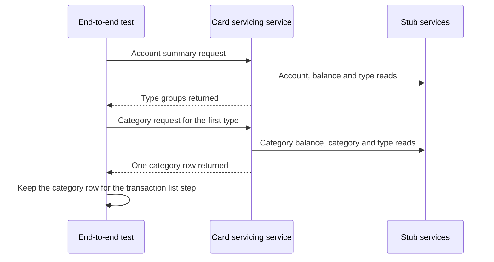

# CS-02-001: Category balance end-to-end step

Parent epic: [CS-02 Category Balance View](../README.md)

## Source Story (verbatim)

> ### 1. Details/Requirements
>
> As a card servicing user, I want to open the categories behind a balance-summary type row, so that I see which categories make up that balance.
>
> Trace: CARD_REQ_TBD · Data Layouts · CVTRA01Y · TRAN-CAT-BAL
>
> Account-data access path: Yes
>
> External integration or SLA-bound: Yes
>
> Capability: step 2 of the one ordered end-to-end flow that stands in for the deferred Card Servicing UI. Through the end-to-end client of CS-01-002 it opens the category balance view of the Compose stack (CS-01-001) for the type row that step 1 (CS-01-004) received from the balance summary, as the UI will, checks every category-balance field against its contract field (the TRD field map: TRANCAT-TYPE-CD → `typeCode`, TRANCAT-CD → `categoryCode`, TRAN-CAT-BAL → `balance` of Data Layouts · CVTRA01Y, with the labels TRAN-TYPE-DESC → `typeDescription` of Data Layouts · CVTRA03Y and TRAN-CAT-TYPE-DESC → `categoryDescription` of Data Layouts · CVTRA04Y), reads the upstream calls behind each answer from the stub request logs, and hands the category row it yields to the next step. Expected values come from the CardDemo sample records: Data Layouts · CVTRA01Y for the one category balance of account `00000000001` (type `01`, category `0001`, balance `0.00`), Reference Tables · TRANTYPE file for the type description `Purchase`, and Reference Tables · TRANCATG file for the category description `Regular Sales Draft`. Target path:
>
> - `card-servicing-service/src/test/java/com/example/cardservicing/e2e/CardServicingFlowE2eTest.java` (edit; created by CS-01-004):
>   - Step 2: the test method at order 2 of the `e2e`-tagged flow class, running after step 1 and before the transaction list step (CS-03-001) in the same class instance, with the client that the CS-01-002 suite base injects. It never re-implements step 1, the client or the cache emptying before step 1.
>   - Type code: the step reads `typeCode` through step 1's hand-off accessor, which holds the `typeCode` of the first `balancesByTypeGroup` element of step 1's `GET /v1/accounts/00000000001/balance-summary` answer and fails the calling step with a message naming step 1 when step 1 did not pass.
>   - Call order in step 2, one call at a time through the client: `GET /v1/accounts/00000000001/category-balances?typeCode=1`, then `GET /v1/accounts/00000000001/category-balances` with `fixture-token-expired`, then `GET /v1/accounts/00000000011/category-balances`, then `GET /v1/accounts/00000000001/category-balances?typeCode=99`, then `GET /v1/accounts/00000000001/category-balances?typeCode=<step 1 type code>`, then `GET /v1/accounts/00000000001/category-balances`. Every call except the second carries the client's default token `fixture-token-user0001` of `USER0001`. The three rejected calls come first because none of them reads the cache or launches the background Config refresh, so no refresh started by an allowed call of this step can land in a rejected call's request-log window.
>     > SCOPE-QUESTION (Resolved): Step one's last allowed call may launch the refresh, which this step's call order cannot hold back, and the client closes that call's window only once the stub logs have settled (CS-01-002), so the refresh is listed with step one and never in step two's rejected windows. This holds also for a final Config entry the stub lists after the 1,000 ms floor, because the window stays open until every call the Config stub reports having received is listed (CS-01-002, CS-11-002). The empty Config logs of AC5, AC6 and AC7 are asserted unchanged, and no application request waits for Config.
>   - Hand-off: the step stores the `typeCode` and `categoryCode` of the first `categoryBalances` element of the filtered 200 answer in the flow instance for the transaction list step (CS-03-001). Its accessor fails the calling step with a message naming step 2 when step 2 did not pass.
> - Together this is the 1 file touched.
>
> In scope:
>
> - Step 2 of the flow: the filtered and unfiltered category-balance calls and their field checks.
> - The stub request-log, `cutoffMs` and client-measured latency checks for each call of the step.
> - The malformed type code, unknown type code, expired-token and access-denial checks for this endpoint.
> - The category-row hand-off to the transaction list step.
>
> Not in this story:
>
> - Step 1 and the later flow steps (CS-01-004, CS-03-001, CS-03-002, CS-04-001).
> - The endpoint itself and its gRPC form (CS-06-001, CS-06-002, CS-06-003).
> - The end-to-end client and the Compose stack (CS-01-002, CS-01-001).
> - Injected-failure cases (CS-06-002 and the integration suites).
> - The category balance SLA scenario (CS-02-002).
> - UI code.
>
> ### 2. Acceptance Criteria
>
> - AC1: `GET /v1/accounts/00000000001/category-balances?typeCode=01` with `fixture-token-user0001` returns 200 with `accountId` `"00000000001"` and exactly one `categoryBalances` element: `typeCode` `"01"`, `typeDescription` `"Purchase"`, `categoryCode` `"0001"`, `categoryDescription` `"Regular Sales Draft"` and `balance` `"0.00"`. The `X-Data-Status` header and the body's `dataStatus` are both `FRESH`, `asOf` matches `^[0-9]{4}-[0-9]{2}-[0-9]{2}T[0-9]{2}:[0-9]{2}:[0-9]{2}\.[0-9]{6}Z$`, and every value checked, `asOf` aside, equals the `fresh` 200 example of `ListCategoryBalances` in `card-servicing-api.yaml`.
> - AC2: The `typeCode` sent in AC1 is the value step 1 stored from the first `balancesByTypeGroup` element of its balance-summary answer in the same flow run, and when step 1 did not pass, an empty `balancesByTypeGroup` included, step 2 fails with a message naming step 1 before sending any call. After AC1 the flow instance holds `typeCode` `"01"` and `categoryCode` `"0001"` from the first `categoryBalances` element for the transaction list step.
> - AC3: `GET /v1/accounts/00000000001/category-balances` with no `typeCode` and `fixture-token-user0001` returns 200 with the AC1 `accountId`, the same single `categoryBalances` element as AC1, and `FRESH` in both the header and the body, because the sample account holds one category balance.
> - AC4: `GET /v1/accounts/00000000001/category-balances?typeCode=99`, a well-formed code absent from the transaction category list, returns 400 with `code` `INVALID_ARGUMENT`, `message` `Transaction type code is unknown`, exactly one `details` entry, whose `field` is `typeCode`, and a non-empty `traceId`. The call's entries show `cardservicing.referencedata.v1.ReferenceDataService/ListTransactionCategories` exactly once on the Reference Data stub, with outcome `OK`, which is the first read of the transaction categories since the cache emptying before step 1.
> - AC5: `GET /v1/accounts/00000000001/category-balances?typeCode=1`, which fails the two-character pattern, returns 400 with `code` `INVALID_ARGUMENT`, `message` `Transaction type code must be exactly 2 characters`, exactly one `details` entry, whose `field` is `typeCode`, and a non-empty `traceId`, and the call's entries are empty on all five stubs.
> - AC6: `GET /v1/accounts/00000000011/category-balances` with `fixture-token-user0001` returns 403 with `code` `PERMISSION_DENIED` and a non-empty `traceId`, because `USER0001` is entitled to `00000000001`–`00000000010` among the sample accounts and `00000000011` is a sample account outside that range. The call's entries show only `ValidateToken` and `AuthorizeAccountAccess` on the Auth stub and no entry on the Card Data, Transaction Activity, Reference Data or Config stub, so no account data is read from upstream before access is allowed; that no cache read precedes the access decision either is proven by the guard ordering of CS-12-003.
> - AC7: `GET /v1/accounts/00000000001/category-balances` with `fixture-token-expired` returns 401 with `code` `UNAUTHENTICATED` and a non-empty `traceId`. The call's entries show only `ValidateToken` on the Auth stub, with outcome `UNAUTHENTICATED`, and no entry on the Card Data, Transaction Activity, Reference Data or Config stub.
> - AC8: Each of the six calls of this step receives its full answer below 1,000 ms of client-measured latency, and the completion log line the client matches to it shows `cutoffMs` ≤ 900 (`REQUEST_DEADLINE_MS`). Under the stack defaults of the upstream call policy each attempt times out at the lesser of 300 ms (`UPSTREAM_TIMEOUT_MS`) and the remaining budget, and every stub request-log entry of the step records a `durationMs` of at most 300.
> - AC9: With failure injection off (`STUB_LATENCY_MS` `0` and `STUB_FAILURE_RATE` `0`, the Compose defaults), the client reports no retried call for any of the six calls, so each upstream operation behind a call appears at most once among that call's entries. The retry rule, at most two retries (`UPSTREAM_MAX_RETRIES`) after 50 ms then 100 ms backoff, on `UNAVAILABLE` or `DEADLINE_EXCEEDED` only, each starting only when its backoff plus a full 300 ms attempt fits before the 900 ms cut-off, is proven under injection by CS-06-002.
> - AC10: The step fails when the AC1 or AC3 answer carries `STALE` or `PARTIAL` in the header or the body, or when any call of the step returns 503 or 504. The degraded and failed outcomes of each upstream call this endpoint makes are proven under injection by CS-06-002 and the integration suites CS-09-006, CS-12-005, CS-13-004 and CS-11-007, not by this step: Auth failing closed with 401, 503 or 504; Card Data `ListCategoryBalances` served `STALE` from a cache entry within its 300 s max stale age, otherwise 503 or 504; Reference Data unusable giving 200 `PARTIAL` with `typeDescription` and `categoryDescription` JSON `null`; Config leaving the request and its `dataStatus` unaffected.
>
> ### 3. Dependencies
>
> - CS-01-004 — step 2 runs after step 1 in the same flow class and takes its type code from step 1's balance-summary answer; that step brings the end-to-end client and the Compose stack through its own prerequisites.
>
> Risk: a change to the sample category balances or the reference-data seed changes the AC1 values and fails the step, and a read of the transaction categories before the AC4 call, by an earlier step or a reordered call, moves the Reference Data entry that AC4 checks.

## 4. Design

- [Sequence — category balances](../../../../architecture/sequence-category-balances.mmd)
- [Data model — category_balance](../../../../data-model.md#category_balance)
- [Data model — screen-field coverage matrix](../../../../data-model.md#screen-field-coverage-matrix)
- [TRD — Request path](../../../../technical-requirements.md#request-path)
- [TRD — Deadline boundary](../../../../technical-requirements.md#deadline-boundary)
- [TRD — Resilience](../../../../technical-requirements.md#resilience)
- [TRD — Card Servicing UI field map](../../../../technical-requirements.md#card-servicing-ui)
- [TRD — D5 One Compose stack for both suites](../../../../technical-requirements.md#d5-one-compose-stack-for-both-suites)
- Contracts:
  - [card-servicing-api.yaml](../../../../../card-servicing-service/src/main/resources/openapi/card-servicing-api.yaml)
  - [card_servicing_service.proto](../../../../../card-servicing-service/src/main/proto/cardservicing/api/v1/card_servicing_service.proto)
  - [auth-service.yaml](../../../../../card-servicing-service/src/main/resources/openapi/auth-service.yaml) (fixture tokens)
  - [auth_service.proto](../../../../../card-servicing-service/src/main/proto/cardservicing/auth/v1/auth_service.proto) (fixture tokens)

## 5. Documentation Changes

Completed during implementation.

## 6. Test Plan

- Unit — Not applicable — the story adds an end-to-end step only, with no production code and no untagged case. Command `./gradlew :card-servicing-service:test jacocoTestCoverageVerification`; all tests pass, with ≥80% line coverage per module.
- Integration — Not applicable — the story changes no client or stub, and the injected upstream outcomes are proven by the integration suites named in AC10. Command `./gradlew :card-servicing-service:integrationTest`; one suite per external epic covering a stub exception, latency above `UPSTREAM_TIMEOUT_MS` and the `UPSTREAM_MAX_RETRIES` cap.
- Performance — Not applicable — CS-02-002 measures this endpoint. Commands `docker compose -f tests/docker-compose.yml up -d --wait`, then `./gradlew :card-servicing-service:performanceTest`, then `docker compose -f tests/docker-compose.yml down`; p50, p95 and p99 below 1,000 ms over successful requests with failure injection off, at 10 users × 100 sequential calls, 100,000 category balances and 1,000,000 transactions; injected failures proven by a logged `cutoffMs` ≤ 900 and a client-measured response below 1,000 ms.
- End-to-end — Applies — this story is step 2 of the flow, covering AC1–AC10 on the stack. Commands `docker compose -f tests/docker-compose.yml up -d --wait`, then `./gradlew :card-servicing-service:e2eTest`, then `docker compose -f tests/docker-compose.yml down`; the four-step flow for account `00000000001` returns the expected fixture values and each stub's request log shows at least one call, with every call's `cutoffMs` ≤ 900 and client-measured latency below 1,000 ms.

## 7. Validation Results

Completed during implementation.

## Implementation Design

Recommended: Design Option A — step two filters by the type code that step one returned.

Rationale: drilling from step one's type row, as the user interface will, proves the summary-to-category link on the real request path.

- Rejected: Design Option B, a fixed purchase type code, which leaves that link unproven.

### Shared by both options

- Topology: the end-to-end client on the build host reaches the service and five stubs over published ports.
- Naming: step two of the one ordered flow, named for the category balance view.
- Addressing: the end-to-end harness supplies service and stub log addresses; allowed calls use the first sample account as the first regular fixture user, the denial call the eleventh.
- Isolation: only sample accounts are read, never the synthetic volume; calls run one at a time, rejected ones first and the unknown code next, and log windows close only once stub logs settle.
- Fallback: none; any unexpected status, field or log entry fails this and every later step.
- Provisioning: the continuous integration gate starts and stops the stack; the shared loader seeds the sample set.
- Cut-over: the user interface later sends these requests, and real services replace stubs by address and credential alone, with the step unchanged.
- Failures: failure injection stays off; the category balance retrieval story and integration suites prove degraded and failed upstream outcomes under injection.

### Design Option A — type code chained from step one

The step filters by the type code that step one stored. It checks each answer and its stub log entries, then hands its first category row to step three, the transaction list.

How it behaves:

- A failed step one stops the step before any call, naming step one.
- Both allowed answers must hold only the sample row, field by field, fresh, with a well-formed read time.
- The malformed code must show no upstream call, the expired token only token validation, the denial only the two authentication operations.
- The unknown code must show one category read.
- No call may exceed the cut-off or latency limit, or retry.

| No. | Decision (vs rejected) | Pro | Con |
|---|---|---|---|
| 1 | Type code from step one (vs a fixed code) | proves the drill-down link | step two cannot run alone |
| 2 | Field-by-field row check (vs a row count) | catches a changed value | ties the step to sample data |
| 3 | Rejected calls first (vs criteria order) | keeps refreshes out of rejected calls' windows | the call order must stay fixed |
| 4 | Client timing plus logged cut-off (vs the server log alone) | covers network time | needs the completion log line |
| 5 | First category row handed on (vs step three's own filter) | step three drills from a returned row | a failed step two stops later steps |

Effort and risk: small, in one file; step-order coupling is the main risk.

### Design Option B — fixed purchase type code

The step writes the purchase type code into its filtered call. All else matches Option A.

How it differs:

- The step runs without step one.
- A broken hand-off from step one goes unnoticed.
- A sample type change needs edits in two steps.

| No. | Decision (vs rejected) | Pro | Con |
|---|---|---|---|
| 1 | Fixed purchase code (vs step one's code) | the step runs alone | the drill-down link goes unchecked |

Effort and risk: small, in one file; the hand-off criterion breaks.

### Recommendation

- Option: Design Option A.
- Why: it alone proves the drill-down link and meets the hand-off criterion.
- Strongest argument against: step two depends on step one, so a summary failure hides every category check.
- Shared items that do not decide the choice: the eight shared topics, the stub log and deadline checks and the category-row hand-off.
- Flip conditions: the harness cannot carry step one's answer forward, or flow steps must run alone.

## Design Validation

### Option A

Settled assumptions:

- The first account's one sample balance is zero, of purchase type, in the regular sales draft category.
- The type and category seed data fix both descriptions.
- The first regular fixture user is entitled to the first ten sample accounts, not the eleventh.
- With failure injection off, every stub answers fresh.
- The cache is emptied before step one, which reads no transaction categories.
- Rejected calls read no cache and start no configuration refresh, and step one's refresh stays in its own settled log window.

Open assumptions:

- Step one's type code kept for later steps Open → step one's hand-off on the first stack run.
- Completion log line with the cut-off time Open → the end-to-end harness's completion log reader.

| AC | Verdict | Why |
|---|---|---|
| AC1 | Holds | every field matches the sample row |
| AC2 | Conditional | step one must keep its type code |
| AC3 | Holds | the sample account holds one balance |
| AC4 | Holds | the first category read finds no such code |
| AC5 | Holds | settled log windows exclude step one's refresh |
| AC6 | Holds | the guard denies before any data read |
| AC7 | Holds | token validation fails before authorization |
| AC8 | Conditional | the harness must expose the completion log line |
| AC9 | Holds | with injection off each operation runs once |
| AC10 | Holds | with injection off every read is fresh |

### Option B

Settled assumptions:

- Option A's settled assumptions hold.
- The written purchase code equals the sample balance's type.

Open assumptions:

- Sample type row unchanged Open → the category-balance load report on each stack start.
- Completion log line with the cut-off time Open → the end-to-end harness's completion log reader.

| AC | Verdict | Why |
|---|---|---|
| AC1 | Holds | the fixed code matches the sample row |
| AC2 | Breaks | the fixed code is never read from step one |
| AC3 | Holds | as for Option A |
| AC4 | Holds | as for Option A |
| AC5 | Holds | as for Option A |
| AC6 | Holds | as for Option A |
| AC7 | Holds | as for Option A |
| AC8 | Conditional | the harness must expose the completion log line |
| AC9 | Holds | as for Option A |
| AC10 | Holds | as for Option A |

## Metadata

| Field | Value |
|---|---|
| Build wave | W3 |
| Depends on | CS-01-004 |
| Status | TBD |
| Estimated Files Touched | 1 |
| Issue Type | Story |
| Epic Name | Category Balance View |
| Epic Link | CS-02 |
| Story Points | 2 |
| Priority | High |
| Components | TBD |
| Fix Version/s | TBD |
| Team | TBD |
| Assignee | TBD |
| Reporter | TBD |
| Labels | TBD |
| Sprint | TBD |
| Due Date | TBD |
| Environment | TBD |
| Persona | TBD |
| Estimated Effort | TBD |
