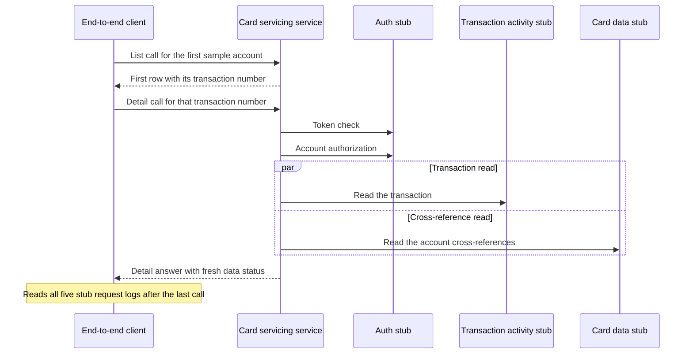

# CS-04-001: Transaction detail end-to-end step

Parent epic: [CS-04 Transaction Detail Drill-Down](../README.md)

## Source Story (verbatim)

> ### 1. Details/Requirements
>
> As a card servicing user, I want to open one transaction from my list, so that I see its full detail.
>
> Trace: CARD_REQ_TBD · Use Cases · COTRN01C
>
> Account-data access path: Yes
>
> External integration or SLA-bound: Yes
>
> Capability: step 4, the last step of the one ordered end-to-end flow (balance summary → category balance → transaction list → transaction detail) that stands in for the deferred Card Servicing UI. Through the end-to-end client `E2eClient` at `card-servicing-service/src/test/java/com/example/cardservicing/e2e/E2eClient.java` (CS-01-002) it opens the transaction detail of the Compose stack `tests/docker-compose.yml` (CS-01-001) with `GET /v1/accounts/{accountId}/transactions/{transactionId}`, as the UI's drill-down from a transaction row will. It takes the first `transactionId` that step 3 (CS-03-001) returned for account `00000000001` and calls with `USER0001`'s fixture token `fixture-token-user0001`. It asserts the fixture values and runs the not-found, invalid-input, permission-denied and unauthenticated cases. It then reads every stub's request log through the client's request-log reader and asserts at least one call per stub. Fields follow Use Cases · COTRN01C, which displays all thirteen Data Layouts · CVTRA05Y fields, merchant fields included, each carried in the response's `transaction` object (the TRD field map: Transaction ID → `transactionId`, Card Number → `cardNumber`, Type CD → `typeCode`, Category CD → `categoryCode`, Source → `source`, Description → `description`, Amount → `amount`, Orig Date → `originalTimestamp`, Proc Date → `processedTimestamp`, Merchant ID → `merchantId`, Merchant Name → `merchantName`, Merchant City → `merchantCity`, Merchant Zip → `merchantZip`). Expected values come from the CardDemo sample records: the Data Layouts · CVTRA06Y daily transaction `0000000776200014`, whose zoned amount `0000009852B` decodes to `985.22` and whose blank processed timestamp the fixture load sets to the original timestamp `2022-06-10 19:27:53.000000`, and the Data Layouts · CVACT03Y cross-reference, which links card `9680294154603697` to account `00000000001` and card `0923877193247330` to account `00000000002`. `./gradlew :card-servicing-service:e2eTest` runs the flow against the running stack. Target path:
>
> - `card-servicing-service/src/test/java/com/example/cardservicing/e2e/CardServicingFlowE2eTest.java` (edit; created by CS-01-004):
>   - Step 4: the test method at the highest order of the `e2e`-tagged flow class, running after step 3 in the same class instance, with the client that the CS-01-002 suite base injects. It never re-implements steps 1 to 3, the client or the cache emptying before step 1.
>   - Transaction identifier: at its start the step reads `transactionId` through step 3's hand-off accessor, which holds it from the first `transactions` element of step 3's filtered answer and fails the calling step with a message naming step 3 when step 3 did not pass, before this step sends any call.
>   - Call order in step 4, one call at a time through the client: `GET /v1/accounts/00000000001/transactions/12345`, then `GET /v1/accounts/00000000001/transactions/<step 3 transaction identifier>` with `fixture-token-expired`, then `GET /v1/accounts/00000000011/transactions/<step 3 transaction identifier>`, then `GET /v1/accounts/00000000001/transactions/<step 3 transaction identifier>`, then `GET /v1/accounts/00000000002/transactions/<step 3 transaction identifier>`, then `GET /v1/accounts/00000000001/transactions/9999999999999999`. Every call except the second carries the client's default token `fixture-token-user0001`. The three rejected calls come first because none of them reads the cache or launches the background Config refresh, so no refresh started by an allowed call can land in a rejected call's request-log window. The allowed call precedes the two not-found calls, so its transaction read reaches the Transaction Activity stub instead of a cache entry a not-found call wrote.
>   - Stub request logs: after the last call the step reads each of the five stubs' request logs in full through the client's request-log reader, under the stub names `auth`, `config`, `card-data`, `reference-data` and `transaction-activity`.
> - Together this is the 1 file touched.
>
> In scope:
>
> - Step 4 of the flow: the allowed transaction-detail call and its checks of all thirteen fields.
> - The transaction identifier chained from step 3.
> - The cases AC1–AC10, with the not-found, invalid-input, permission-denied and unauthenticated error objects.
> - The five-stub request-log assertion after the last step of the flow.
> - The client-measured latency and `cutoffMs` assertions for each call of the step.
>
> Not in this story:
>
> - Endpoint validation, ownership check and exposure (CS-08-001, CS-08-002, CS-08-003).
> - Injected-failure timeouts, retries and degradation (CS-08-002 and the integration suites).
> - The Compose stack (CS-01-001) and `E2eClient` (CS-01-002).
> - Steps 1 to 3 and the paging walk (CS-01-004, CS-02-001, CS-03-001, CS-03-002).
> - Performance measurement of the transaction detail (CS-04-002).
> - UI screens (deferred).
>
> ### 2. Acceptance Criteria
>
> - AC1: Taking the first item's `transactionId` from step 3's response (`0000000776200014`), `GET /v1/accounts/00000000001/transactions/0000000776200014` with `USER0001`'s fixture token returns 200. The response carries `accountId` `"00000000001"` and, in its `transaction` object, `transactionId` `"0000000776200014"`, `typeCode` `"01"`, `categoryCode` `"0001"`, `source` `"POS TERM"`, `description` `"Purchase at Lebsack and Sons"`, `amount` `"985.22"`, `merchantId` `"800000000"` (a string, as the contract types it), `merchantName` `"Lebsack and Sons"`, `merchantCity` `"Otisbury"`, `merchantZip` `"32545"`, `cardNumber` `"9680294154603697"`, `originalTimestamp` `"2022-06-10T19:27:53.000000Z"` and `processedTimestamp` `"2022-06-10T19:27:53.000000Z"`, and the response header `X-Data-Status: FRESH`, equal to the body's `dataStatus`. `asOf` matches `^[0-9]{4}-[0-9]{2}-[0-9]{2}T[0-9]{2}:[0-9]{2}:[0-9]{2}\.[0-9]{6}Z$`, and every other value checked equals the `fresh` 200 example of `GetTransaction` in `card-servicing-api.yaml`. When step 3 recorded no first item, the step fails with a message naming step 3.
> - AC2: `GET /v1/accounts/00000000002/transactions/0000000776200014` with `USER0001`'s token returns 404 with `code` `NOT_FOUND` and a non-empty `traceId`, because card `9680294154603697` is not among account `00000000002`'s cross-reference records.
> - AC3: `GET /v1/accounts/00000000001/transactions/9999999999999999` with `USER0001`'s token returns 404 with `code` `NOT_FOUND` and a non-empty `traceId`.
> - AC4: `GET /v1/accounts/00000000001/transactions/12345` with `USER0001`'s token returns 400 with `code` `INVALID_ARGUMENT`, a `details` entry naming `transactionId` and a non-empty `traceId`. No stub request log, Auth included, gains an entry for that request.
> - AC5: `GET /v1/accounts/00000000011/transactions/0000000776200014` with `USER0001`'s token returns 403 with `code` `PERMISSION_DENIED`. The Transaction Activity and Card Data stub request logs gain no entry for that request, so no account data is read from upstream before access is allowed. The cache side of that rule is proven by CS-12-003.
> - AC6: The AC1 request sent with the expired fixture token returns 401 with `code` `UNAUTHENTICATED`, and the Transaction Activity and Card Data stub request logs gain no entry for it.
> - AC7: After this step, the last of the four, the Auth, Config, Card Data, Reference Data and Transaction Activity stub request logs, each read in full through the end-to-end client, each show at least one call. The Config entry may come from the first allowed call of any end-to-end test on the stack, because the service refreshes its configuration snapshot once per 300 s fresh period.
> - AC8: For the AC1 request, each stub request log shows at most one entry per operation, so no retry occurred with failure injection off. Behaviour under injected failures is proven by CS-08-002 and the integration suites CS-10-007, CS-09-006 and CS-12-005. That covers the per-attempt timeout, the lesser of 300 ms (`UPSTREAM_TIMEOUT_MS`) and the remaining budget, and the retry cap: two retries (`UPSTREAM_MAX_RETRIES`), with 50 ms then 100 ms backoff, on `UNAVAILABLE` or `DEADLINE_EXCEEDED` only, a retry starting only when backoff plus a full 300 ms attempt fits the budget.
> - AC9: For each request in AC1–AC6, the client-measured response arrives below 1,000 ms. The service's completion log line for the AC1 request records `cutoffMs` of at most 900 (`REQUEST_DEADLINE_MS`, measured from receipt to the cut-off).
> - AC10: Each upstream call degrades or fails hard per the TRD degradation table. Auth fails closed with 401, 503 or 504. A `GetTransaction` failure serves the cached transaction as `STALE` within its max stale age, otherwise 503 or 504. A `GetCardCrossReference` failure returns 503 or 504, even when the transaction came from cache. A Config outcome leaves the response and `X-Data-Status` unchanged. With failure injection off on the Compose stack, none of AC1–AC6 returns 503 or 504. Injected cases are proven by CS-08-002 and the integration suites CS-09-006, CS-10-007, CS-11-007 and CS-12-005.
>
> ### 3. Dependencies
>
> - CS-03-001 — step 3 returns account 00000000001's transaction list whose first item supplies this step's transaction identifier, and it completes steps 1 to 3 of the flow this step closes.
>
> Risk: A change to the list order or to the sample fixture set changes step 3's first item, so this step's expected values change with it.

## 4. Design

- [Sequence — transaction detail](../../../../architecture/sequence-transaction-detail.mmd)
- [Data model — transaction_record](../../../../data-model.md#transaction_record)
- [Data model — card_cross_reference](../../../../data-model.md#card_cross_reference)
- [Data model — screen-field coverage matrix](../../../../data-model.md#screen-field-coverage-matrix)
- [Data model — fixture rules](../../../../data-model.md#fixture-rules)
- [TRD — Request path](../../../../technical-requirements.md#request-path)
- [TRD — Deadline boundary](../../../../technical-requirements.md#deadline-boundary)
- [TRD — Edge cases](../../../../technical-requirements.md#edge-cases)
- [TRD — Resilience](../../../../technical-requirements.md#resilience)
- [TRD — Card Servicing UI field map](../../../../technical-requirements.md#card-servicing-ui)
- [TRD — Test and performance harness](../../../../technical-requirements.md#test-and-performance-harness)
- Contracts:
  - [card-servicing-api.yaml](../../../../../card-servicing-service/src/main/resources/openapi/card-servicing-api.yaml)
  - [card_servicing_service.proto](../../../../../card-servicing-service/src/main/proto/cardservicing/api/v1/card_servicing_service.proto)
  - [common.proto](../../../../../card-servicing-contracts/src/main/proto/cardservicing/common/v1/common.proto)
  - [auth-service.yaml](../../../../../card-servicing-service/src/main/resources/openapi/auth-service.yaml) (fixture tokens)

## 5. Documentation Changes

Completed during implementation.

## 6. Test Plan

- Unit — Not applicable — the story adds an end-to-end step only, with no production code and no untagged case. Command `./gradlew :card-servicing-service:test jacocoTestCoverageVerification`; all tests pass, with ≥80% line coverage per module.
- Integration — Not applicable — the story changes no client or stub, and stub exception, latency above `UPSTREAM_TIMEOUT_MS` and the `UPSTREAM_MAX_RETRIES` cap for these calls are covered by the suites CS-10-007, CS-09-006, CS-12-005 and CS-11-007. Command `./gradlew :card-servicing-service:integrationTest`; one suite per external epic covering those three cases.
- Performance — Not applicable — CS-04-002 measures this endpoint. Commands `docker compose -f tests/docker-compose.yml up -d --wait`, then `./gradlew :card-servicing-service:performanceTest`, then `docker compose -f tests/docker-compose.yml down`; p50, p95 and p99 below 1,000 ms over successful requests with failure injection off, at 10 users × 100 sequential calls, 100,000 category balances and 1,000,000 transactions; injected failures proven by a logged `cutoffMs` ≤ 900 and a client-measured response below 1,000 ms.
- End-to-end — Applies — this story is step 4 of the four-step flow for account `00000000001`, covering AC1–AC10 on the stack. Commands `docker compose -f tests/docker-compose.yml up -d --wait`, then `./gradlew :card-servicing-service:e2eTest`, then `docker compose -f tests/docker-compose.yml down`; the flow returns the expected fixture values and each stub's request log shows at least one call, with every client response below 1,000 ms and every matched `cutoffMs` ≤ 900.

## 7. Validation Results

Completed during implementation.

## Implementation Design

Recommended: Design Option A, which chains the detail step on step three's first row and checks every stub log once after the last step.

Rationale: a detail step that opens the transaction the list step returned, as the deferred screen will, proves the list-to-detail hop along the real request path, and one log check after the last step proves that every upstream service took part in the run.

- Rejected: Design Option B, a fixed transaction identifier with a log check after every step — it skips the drill-down hop and changes the three earlier steps, which other stories own.

### Shared by both options

- Topology: one Compose stack holds the service and five stub containers, with the end-to-end client outside it on the build host.
- Naming: the step is step four, the last of the four-step flow, named for the transaction detail screen.
- Addressing: the client calls the service's published port with the account and the transaction number in the request path, and reads the stub request logs through the end-to-end client.
- Isolation: the step reads sample accounts only, as the first regular fixture user, leaving the synthetic range untouched, and its rejected calls run first so no background configuration refresh falls inside their log windows.
- Fallback: none, because an unexpected status fails the step.
- Provisioning: the stack starts before the suite and stops after it, and the shared loader seeds the sample set the step reads.
- Cut-over: the deferred UI replaces the end-to-end client on the same path, and real services replace stubs by address and credential only.
- Failures: injection stays off, any unexpected status fails the step and names it, and degraded or failed upstream outcomes are proven under injection by the detail retrieval story and the integration suites.

### Design Option A — identifier chained from the list step

The step reads the transaction number from the first row the list step returned and opens that transaction for the first sample account. It sends the short-number, expired-token and denied-account calls first, then the allowed call, then the two not-found calls, one at a time. It checks each answer by status, fields, data status and error object, and after its last call it reads all five stub request logs once and requires at least one call on each.

How it behaves:

- A failed list step stops this step before its first call, with a message naming that step.
- The allowed answer must carry all thirteen screen fields with the sample values, compared with the interface example.
- The second sample account must answer not found, because the transaction's card belongs to the first sample account.
- An unknown sixteen-character number must answer not found, and a five-character number must answer bad request with no stub call.
- The denied and expired-token calls must leave the transaction and card stub logs untouched.
- The allowed call must show each upstream operation at most once, so no retry happened.
- Every call must pass the client's deadline check on the logged cut-off time and the client latency.
- The final log read covers every stub, so a stub the run never reached fails the step.

| No. | Decision (vs rejected) | Pro | Con |
|---|---|---|---|
| 1 | Identifier from step three's first row (vs a fixed literal) | it proves the list-to-detail hop | step four cannot run alone |
| 2 | One stub-log check after the last step (vs a check after every step) | it proves every upstream once per run | a missing call is not tied to one step |
| 3 | Negative cases reuse the chained identifier (vs separate fixtures) | the ownership check uses a real transaction | negative cases also wait on step three |
| 4 | Rejected calls ahead of the allowed call (vs the order of the criteria) | no configuration refresh can land in a rejected call's log window | the call order differs from the criteria order |

Effort and risk: small effort in one existing file, low risk.

### Design Option B — fixed identifier and per-step log checks

The step opens a fixed transaction number written into the step instead of the one the list step returned, so it can run without the earlier steps. Each of the four steps checks its own stub log entries for at least one call on every stub it reaches, instead of one check after the last step. The field, status and deadline checks match Option A, but the drill-down hop goes unproven, and the per-step checks edit the three earlier steps, which other stories own.

How it differs:

- The detail call always opens the same transaction, whatever the list step returned.
- A broken hand-off from the list step goes unnoticed.
- The step runs alone, so a failed list step no longer stops it.
- Each step checks the stubs it reaches, so a missing call points at one step.
- A configuration refresh that an earlier test on the stack already made falls outside every step's window.

| No. | Decision (vs rejected) | Pro | Con |
|---|---|---|---|
| 1 | Fixed transaction number (vs the row from step three) | the step runs without the earlier steps | the drill-down hop goes unchecked |
| 2 | Log check after every step (vs one check after the last step) | a missing call points at one step | it edits three steps that other stories own |
| 3 | Negative cases on the fixed number (vs the chained number) | negative cases run without step three | a fixture change needs edits in two steps |

Effort and risk: medium effort across all four steps, medium risk.

### Recommendation

- Option: Design Option A.
- Why: it proves the drill-down hop and every upstream in one file.
- Strongest argument against: a step-three failure masks step four.
- Shared items that do not decide the choice: the stack, the end-to-end client, the first regular fixture user, injection off and the expected statuses.
- Flip conditions: the steps must run in isolation or in parallel, or the list order stops being deterministic.

## Design Validation

### Design Option A

Settled assumptions:

- Identical sample timestamps make step three's first row the highest identifier.
- Compose defaults keep injection off.
- The first regular fixture user's entitlement covers the first ten sample accounts and excludes the eleventh.
- The flow finishes inside the configuration snapshot's fresh window, so no background refresh lands during a negative case.
- The sample cross-reference links the transaction's card to the first sample account alone.
- Card cross-references are never cached, so every allowed detail call reads them from the card stub.

Open assumptions:

- Open → whether the end-to-end client exposes the service completion log with its cut-off time → settled by the end-to-end harness story.
- Open → whether the end-to-end client reads a stub's whole request log beside its per-call and per-step entries → settled by the end-to-end harness story.

| AC | Verdict | Why |
|---|---|---|
| AC1 | Holds | the chained identifier names a sample transaction with fixed values |
| AC2 | Holds | the transaction's card is absent from the second sample account |
| AC3 | Holds | the unknown number has no sample row |
| AC4 | Holds | the length rule rejects the number before any upstream call |
| AC5 | Holds | the access guard denies the eleventh sample account before any data read |
| AC6 | Holds | token validation fails ahead of the authorization and data stages |
| AC7 | Conditional | the harness must read each stub's whole request log |
| AC8 | Holds | with injection off each upstream operation runs once |
| AC9 | Conditional | it rests on the harness exposing the cut-off time |
| AC10 | Holds | with injection off no call returns an unavailable or timed-out status |

### Design Option B

Settled assumptions:

- Compose defaults keep injection off.
- The first regular fixture user's entitlement covers the first ten sample accounts and excludes the eleventh.
- The fixed number names the first sample account's purchase with the highest identifier.
- Each step reads only the log entries recorded since it began.

Open assumptions:

- Open → whether the end-to-end client exposes the service completion log with its cut-off time → settled by the end-to-end harness story.
- Open → whether the fixed transaction stays in the sample set → settled by the transaction fixture load report on each stack start.

| AC | Verdict | Why |
|---|---|---|
| AC1 | Breaks | the step takes no chained first item from step three |
| AC2 | Holds | the transaction's card is absent from the second sample account |
| AC3 | Holds | the unknown number has no sample row |
| AC4 | Holds | the length rule rejects the number before any upstream call |
| AC5 | Holds | the access guard denies the eleventh sample account before any data read |
| AC6 | Holds | token validation fails ahead of the authorization and data stages |
| AC7 | At risk | a configuration refresh made before the flow falls outside every step's window |
| AC8 | Holds | with injection off each upstream operation runs once |
| AC9 | Conditional | it rests on the harness exposing the cut-off time |
| AC10 | Holds | with injection off no call returns an unavailable or timed-out status |

## Metadata

| Field | Value |
|---|---|
| Build wave | W3 |
| Depends on | CS-03-001 |
| Status | TBD |
| Estimated Files Touched | 1 |
| Issue Type | Story |
| Epic Name | Transaction Detail Drill-Down |
| Epic Link | CS-04 |
| Story Points | 2 |
| Priority | High |
| Components | TBD |
| Fix Version/s | TBD |
| Team | TBD |
| Assignee | TBD |
| Reporter | TBD |
| Labels | TBD |
| Sprint | TBD |
| Due Date | TBD |
| Environment | TBD |
| Persona | TBD |
| Estimated Effort | TBD |
