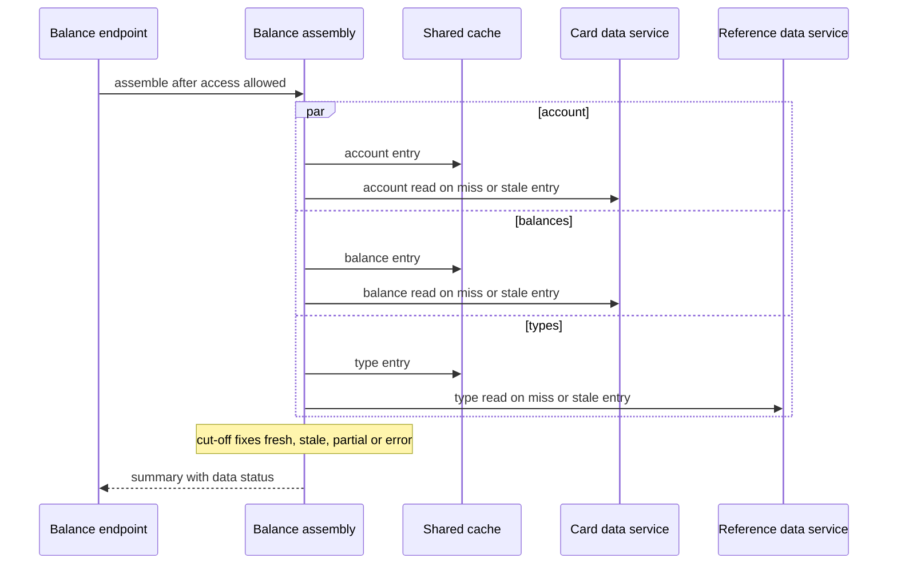

# CS-05-005: Balance summary assembly with stale and partial degradation

Parent epic: [CS-05 Balance Summary Endpoint](../README.md)

## Source Story (verbatim)

> ### 1. Details/Requirements
>
> As a card servicing user, I want my balance summary even when one source is slow or down, so that I see the freshest data available with its status.
>
> Trace: CARD_REQ_TBD · Data Layouts · CVACT01Y · ACCT-CURR-BAL
>
> Account-data access path: Yes
>
> External integration or SLA-bound: Yes
>
> Capability: Stage 3 and the cut-off of the balance summary request path. Once access is allowed, the account record (`Data Layouts · CVACT01Y`), the category balances (`Data Layouts · CVTRA01Y`) and the transaction types (`Data Layouts · CVTRA03Y`) are read concurrently, the balances are summed by type and labelled, and one outcome is fixed at the cut-off: a `FRESH`, `STALE` or `PARTIAL` summary, or an error. Target paths:
>
> - `card-servicing-service/src/main/java/com/example/cardservicing/balance/BalanceSummaryAssembler.java` runs only after the account access guard (CS-12-003) allows access, so no account-data read, cache read included, happens before the allow.
>   - It takes the caller's bearer token, the validated `accountId` and the request's `RequestDeadline` (CS-11-003), the one the guard ran its Auth calls under.
>   - It launches `GetAccount`, `ListCategoryBalances` and `ListTransactionTypes` concurrently through the Card Data client (CS-09-005) and the Reference Data client (CS-13-003), under that deadline. Each client forwards the token, adds `x-api-key` from `AUTH_SERVICE_API_KEY`, and applies its own cache and degrade rule; cache keys carry no caller identity.
>   - It waits for the three reads, each of which the call policy ends within the deadline's remaining budget, and marks the cut-off when the last one completes. If the budget runs out first, the deadline records the cut-off itself, so `cutoffMs` never exceeds 900. A read still unanswered at the cut-off ends in `DEADLINE_EXCEEDED` and degrades by the degradation table inside its client: an account or category-balance read to its stale entry when one is within max stale age, otherwise to 504 `DEADLINE_EXCEEDED`, and the type read to no descriptions.
>   - It aggregates the balances with the type-group aggregator (CS-05-004) and attaches `typeDescription` by `typeCode`. With a partial type result, every description is absent.
>   - It resolves `dataStatus` and `asOf` through `DataStatusResolver`.
>   - It maps `NOT_FOUND` on `GetAccount`, or on `ListCategoryBalances` for the same unknown account, to 404 `NOT_FOUND`, ahead of every other outcome. Otherwise, when an account or category-balance read fails with no usable stale entry, the request ends with that read's final status, the account read's status when both fail: `UNAVAILABLE` (503) or `DEADLINE_EXCEEDED` (504), through the standard error mapping (CS-05-002), with the receipt `traceId`.
>   - It completes the deadline exactly once, with outcome `full` for `FRESH`, `degraded` for `STALE` or `PARTIAL`, and `error` with the response status for 404, 503 or 504, so the completion line carries `cutoffMs`, the outcome and the `traceId`.
> - `card-servicing-service/src/main/java/com/example/cardservicing/balance/BalanceSummary.java` is the assembled result.
>   - It holds every `GetBalanceSummaryResponse` field, with `groupId` omitted when the source value is empty or only spaces. `balancesByTypeGroup` is always present, empty when the account has no category balance, and amounts stay the scale-2 decimal strings the contracts carry.
>   - Each description is either present or absent.
>   - It provides both protocol renderings: the REST body with `typeDescription` as JSON `null` when absent, and the gRPC message with `type_description` unset when absent. An empty string never stands for an absent description, and `asOf` renders as RFC 3339 with microseconds and `Z`.
> - `card-servicing-service/src/main/java/com/example/cardservicing/integration/support/DataStatusResolver.java` sets precedence `PARTIAL` > `STALE` > `FRESH` and sets `asOf` to the oldest read time among the sources used: an upstream result contributes its read time, a cache entry its `cachedAt`, and a partial reference result nothing. Config outcomes never reach it. The category-balance, transaction-list and transaction-detail retrieval stories (CS-06-002, CS-07-002, CS-08-002) reuse it.
> - Tests: `card-servicing-service/src/test/java/com/example/cardservicing/balance/BalanceSummaryAssemblerTest.java` and `card-servicing-service/src/test/java/com/example/cardservicing/integration/support/DataStatusResolverTest.java`. They run against in-JVM loopback stubs, with failure injection per test.
>   - `BalanceSummaryAssemblerTest` sends each test request through the account access guard and then the assembler, as the endpoints will (CS-05-006). It uses the Auth, Config, Card Data and Reference Data stubs registered on `StubHarness` (CS-11-002), per-test `STUB_LATENCY_MS` and `STUB_FAILURE_RATE` overrides on each stub, and the in-memory recording `EntryStore` with the controllable test clock of the CS-11-004 tests for entry ages and cache-read counts. Each test request starts its `RequestDeadline` at receipt, and the test client measures the response time.
>   - `DataStatusResolverTest` covers the precedence and `asOf` rules as table-driven cases.
> - That makes 5 files.
>
> In scope:
>
> - Concurrent Stage 3 reads.
> - Aggregation and description attachment.
> - `STALE`, `PARTIAL` and fail-hard outcomes at the cut-off.
> - `dataStatus` and `asOf`.
> - The null-description mapping.
> - 404 on an unknown account.
>
> Not in this story:
>
> - The REST controller and gRPC method (CS-05-006).
> - Parameter validation (CS-05-003).
> - Token validation and the access decision (CS-12-003).
> - Retry, timeout and deadline mechanics (CS-11-003).
>
> > SCOPE-QUESTION (Resolved): The call policy story (CS-11-003) and the access guard story (CS-12-003) leave starting the request deadline at receipt, and its cut-off after an allow, to this story. This story marks the cut-off and completes the deadline, but its five files hold no receipt stage on either protocol, so it takes the deadline the guard ran under. Until a receipt stage starts the deadline ahead of Stage 0 validation, the guard's own start at its entry applies, and `cutoffMs` leaves out the Stage 0 time, which makes no network call. Settled by the balance summary REST and gRPC endpoints story (CS-05-006), which places the balance summary route on both protocols: it extends the Stage 0 hook to start the request deadline at receipt, ahead of validation, and to attach it to the request, so the guard and this story run under that one deadline and `cutoffMs` counts from receipt.
>
> - Cache mechanics (CS-11-004).
> - The customer-details field gaps (CS-01 epic README).
>
> ### 2. Acceptance Criteria
>
> - AC1: For token `fixture-token-user0001` and account `00000000001`, with all stubs healthy and an empty cache, the result carries `accountId` "00000000001", `activeStatus` "Y", `currentBalance` "194.00", `creditLimit` "2020.00", `cashCreditLimit` "1020.00", `currentCycleCredit` "0.00", `currentCycleDebit` "0.00", `openDate` "2014-11-20", `expirationDate` "2025-05-20", `reissueDate` "2025-05-20" and no `groupId`; `balancesByTypeGroup` [{`typeCode` "01", `typeDescription` "Purchase", `balance` "0.00"}]; `dataStatus` "FRESH"; and `asOf` equal to the earliest of the three upstream read times, in RFC 3339 microsecond `Z` form.
> - AC2: For token `fixture-token-user0001` and account `00000000011`, which is outside the caller's entitlements, the request returns 403 `PERMISSION_DENIED`. For that request the Card Data and Reference Data stub request logs hold zero entries and the cache records zero reads. No account data is read from upstream or cache before access is allowed.
> - AC3: With 200 ms injected latency on the Card Data and Reference Data stubs, an empty cache and healthy Auth, the request returns `FRESH` and the logged `cutoffMs` is below 400, while any two of the reads run in sequence would take at least 400 ms. This proves the three Stage 3 reads run concurrently.
> - AC4: With fresh cache entries on the test clock for the account (aged 10 s), its category balances (aged 20 s) and the transaction types (aged 600 s), the Card Data and Reference Data stub logs hold zero calls. `dataStatus` is `FRESH`, and `asOf` equals the oldest `cachedAt` of the three entries, the transaction types' entry.
> - AC5: With the Card Data stub failing every call (`STUB_FAILURE_RATE` 1.0), the Reference Data stub healthy, and account and category-balance entries aged 120 s and 240 s, past their 60 s fresh TTL but within the 300 s max stale age, the result is 200. `dataStatus` is `STALE`, and `asOf` equals the `cachedAt` of the 240 s entry, the oldest used.
> - AC6: With the Card Data stub failing every call and no entry within max stale age, both with no entry and with entries aged 300 s, the request returns 503 `UNAVAILABLE`. With a Card Data stub latency of 1,000 ms and no usable entry, it returns 504 `DEADLINE_EXCEEDED`. Both responses carry the receipt `traceId`.
> - AC7: With the Reference Data stub failing every call and no type entry within its 86,400 s max stale age, the result is 200 with `dataStatus` `PARTIAL`. The account fields and type-group balances are returned, and `asOf` is the earliest Card Data read time. Every element's description is absent: JSON `null` in the REST rendering, unset in the gRPC rendering, and never an empty string.
> - AC8: A `PARTIAL` type read combined with a `STALE` account read resolves to `PARTIAL`. A `STALE` type entry with fresh account and balance reads resolves to `STALE`. Three fresh reads resolve to `FRESH`. In each case `asOf` is the oldest read time among the sources used.
> - AC9: When `GetAccount` returns `NOT_FOUND` for an account the caller is entitled to, the request returns 404 `NOT_FOUND`, whatever the other two reads return. The Card Data stub log shows exactly one `GetAccount` call, with no retry.
> - AC10: With a Card Data stub latency of 350 ms, an empty cache and healthy Auth, the Card Data stub request log records every `GetAccount` attempt as ending within 30 ms after the lesser of 300 ms (`UPSTREAM_TIMEOUT_MS`) and the budget left when the attempt started. The log shows exactly 2 attempts, and the request returns 504 `DEADLINE_EXCEEDED`.
> - AC11: On `UNAVAILABLE` or `DEADLINE_EXCEEDED`, a read is retried at most two times (`UPSTREAM_MAX_RETRIES`), with 50 ms then 100 ms backoff. A retry starts only if its backoff plus a full 300 ms attempt fits the remaining budget. `NOT_FOUND` and `INVALID_ARGUMENT` are never retried. With the Card Data stub failing every call, its request log shows exactly 3 `GetAccount` attempts, at least 50 ms and then at least 100 ms apart; with a latency of 400 ms it shows exactly 2.
>
> SCOPE-QUESTION (Resolved): AC11 names the statuses that are retried but not that they are the only ones. The call policy retries a read only after `UNAVAILABLE` or `DEADLINE_EXCEEDED`; every other status, `NOT_FOUND` and `INVALID_ARGUMENT` included, ends the read after its first attempt and is returned with no retry, as the single `GetAccount` call of AC9 shows.
>
> SCOPE-QUESTION (Resolved): AC11 takes the spacing of the `GetAccount` attempts from the Card Data stub request log, but a log entry of the stub hosting story (CS-11-002) holds a sequence number, the operation, the outcome and the duration from receipt to close, and no arrival time. The request log proves the count and the outcomes: exactly 3 `GetAccount` entries with outcome `UNAVAILABLE` under the injected `STUB_FAILURE_RATE` 1.0, and exactly 2 at a latency of 400 ms. Because `StubFailureInjector` answers an injected failure before the stub's service definition sees the call, the spacing is measured in `BalanceSummaryAssemblerTest` by a test-local Card Data `StubRegistration` under stub name `card-data`, which `StubHarness.allRegistered()` never discovers. Its handler answers every `GetAccount` at once with `UNAVAILABLE`, serves the other Card Data reads from the stub's fixture set, and records each `GetAccount` arrival time on the monotonic `System.nanoTime()` clock, not the controllable test clock, as it receives the call. AC11's spacing holds when there are exactly 3 arrivals, the second at least 50 ms after the first and the third at least 100 ms after the second. The request log of CS-11-002 stays unchanged, and the 5 files stand.
>
> - AC12: For every degraded 200, 503 and 504 in AC5–AC11, the completion log line's `cutoffMs` is at most 900 (`REQUEST_DEADLINE_MS`), the line carries the outcome and the receipt `traceId`, and the client-measured response arrives below 1,000 ms. The same holds on a cold path with an Auth stub latency of 250 ms beside the AC10 Card Data latency, where the Card Data stub log shows exactly one `GetAccount` attempt and the request returns 504.
>
> SCOPE-QUESTION (Resolved): AC12 states its cut-off bound as `cutoffMs` at most 900 without a unit. The bound is the 900 ms request deadline (`REQUEST_DEADLINE_MS`), measured from receipt to the cut-off, so AC12 requires the cut-off of every request it names to fall at or before 900 ms after receipt.
>
> - AC13: With the Auth stub failing every call, the request returns 503 `UNAVAILABLE`; with an Auth stub latency of 2,000 ms, it returns 504 `DEADLINE_EXCEEDED`; with `fixture-token-expired`, it returns 401 `UNAUTHENTICATED`. In each case the Card Data and Reference Data stub logs hold zero entries.
> - AC14: With the Config stub failing every call, or with a 2,000 ms Config latency and a stale snapshot, `dataStatus` equals the AC1 value `FRESH`, `cutoffMs` is at most 900, and the client-measured response arrives below 1,000 ms.
> - AC15: An entitled account whose category-balance read returns an empty list gives an empty `balancesByTypeGroup` array with `dataStatus` `FRESH`.
>
> ### 3. Dependencies
>
> - CS-05-004 — supplies the type-group aggregation the summary embeds.
> - CS-09-005 — supplies the Card Data client with account and category balance caching and its stale fallback.
> - CS-13-003 — supplies the Reference Data client with cached types and the description fallback.
> - CS-12-003 — supplies the account access guard that must allow access before any read.
> - CS-11-006 — supplies the configuration snapshot behind the per-attempt timeout and retry values.
>
> Risk: On a cold path two sequential Auth calls can leave about 300 ms for Stage 3, so a slow first data attempt leaves no retry and the summary falls to STALE or 504.

## 4. Design

- [Balance summary sequence](../../../../architecture/sequence-balance-summary.mmd)
- [Logical architecture](../../../../architecture/logical-architecture.mmd)
- [Data model — account](../../../../data-model.md#account)
- [Data model — category balance](../../../../data-model.md#category_balance)
- [Data model — transaction type](../../../../data-model.md#transaction_type)
- [TRD — resilience, degradation table and cache rules](../../../../technical-requirements.md#resilience)
- [TRD — request path](../../../../technical-requirements.md#request-path)
- [TRD — deadline boundary](../../../../technical-requirements.md#deadline-boundary)
- [Card Servicing gRPC contract](../../../../../card-servicing-service/src/main/proto/cardservicing/api/v1/card_servicing_service.proto)
- [Card Servicing OpenAPI contract](../../../../../card-servicing-service/src/main/resources/openapi/card-servicing-api.yaml)
- [Card Data gRPC contract](../../../../../card-servicing-service/src/main/proto/cardservicing/carddata/v1/card_data_service.proto)
- [Card Data OpenAPI contract](../../../../../card-servicing-service/src/main/resources/openapi/card-data-service.yaml)
- [Reference Data gRPC contract](../../../../../card-servicing-service/src/main/proto/cardservicing/referencedata/v1/reference_data_service.proto)
- [Reference Data OpenAPI contract](../../../../../card-servicing-service/src/main/resources/openapi/reference-data-service.yaml)

## 5. Documentation Changes

Completed during implementation.

## 6. Test Plan

- Unit: Applies. Command `./gradlew :card-servicing-service:test jacocoTestCoverageVerification`; all tests pass, with ≥80% line coverage per module. Cases: AC1–AC15 against in-JVM loopback stubs with per-test `STUB_LATENCY_MS` and `STUB_FAILURE_RATE`. The AC11 spacing case takes the `GetAccount` arrival times recorded by a test-local Card Data registration that answers `UNAVAILABLE` at once, and the attempt count and outcomes from the stub request log. Deadline cases assert a logged `cutoffMs` ≤ 900 and a client response below 1,000 ms.
- Integration: Not applicable — the integration suites belong to the external epics, the Card Data and Reference Data integration suites (CS-09-006, CS-13-004). Threshold when it applies: `./gradlew :card-servicing-service:integrationTest` passes, with one suite per external epic covering a stub exception, latency above `UPSTREAM_TIMEOUT_MS`, and the `UPSTREAM_MAX_RETRIES` cap.
- Performance: Applies, through the account balance summary SLA scenario (CS-01-005).
  - Commands: `docker compose -f tests/docker-compose.yml up -d --wait`, then `./gradlew :card-servicing-service:performanceTest`, then `docker compose -f tests/docker-compose.yml down`.
  - Pass: p50/p95/p99 below 1,000 ms over successful requests, with failure injection off, at 10 users × 100 sequential calls, 100,000 category balances and 1,000,000 transactions.
  - Injected failures are proven by a logged `cutoffMs` ≤ 900 and a client-measured response below 1,000 ms.
- End-to-end: Applies, through the account balance summary end-to-end step (CS-01-004).
  - Commands: `docker compose -f tests/docker-compose.yml up -d --wait`, then `./gradlew :card-servicing-service:e2eTest`, then `docker compose -f tests/docker-compose.yml down`.
  - Pass: the four-step flow for account `00000000001` returns the AC1 values, and each stub's request log shows at least one call.

## 7. Validation Results

Completed during implementation.

## Implementation Design

Recommended: Option A — a concurrent fan-out of the three reads under one request deadline.

Rationale: only reads launched together leave each read one full attempt inside the budget that remains after the two authentication calls.

- Rejected: Option B, sequential reads, because three attempts in a row exceed the residual budget on a cold path.
- Rejected: a single combined upstream operation, because the contract baseline lists none.

### Shared by both options

- Topology: the assembly runs in the service after the access guard allows, and reads through the card data and reference data clients.
- Naming: the data status values are fresh, stale and partial.
- Addressing: the account number comes from the validated request.
- Isolation: nothing is read before access is allowed, and cache keys carry no caller identity.
- Fallback: account and balance reads fall back to a stale cache entry, and the type read falls back to no descriptions.
- Provisioning: in-process loopback stubs serve the unit tests, and containers serve the test stack.
- Cut-over: real services replace the stubs through the client address and credential source only.
- Failures: unavailable gives 503, an expired deadline gives 504, and an unknown account gives 404.

### Design Option A — concurrent fan-out under one deadline

The assembly launches the account read, the balance read and the type read together as soon as access is allowed, and waits for all three until the last one ends or the request budget runs out. Each client serves a fresh cache entry, calls its upstream on a miss or a stale entry, and falls back to a stale entry or to no descriptions when that upstream fails. At the cut-off the assembly fixes one outcome, and one shared resolver sets the data status and the as-of time.

How it behaves:

- Each read keeps the whole residual budget for one full attempt.
- An unknown account ends the request with the not-found status, whatever the other reads return.
- A failed account or balance read with no usable stale entry ends the request with the unavailable or deadline status.
- A failed or unfinished type read leaves every description absent and marks the summary partial.
- The balances are summed per type and labelled with the type description by type code.
- The resolver ranks partial over stale over fresh and takes the oldest read time among the sources used.
- The assembly marks the cut-off once and writes one completion line with the outcome.

| No. | Decision (vs rejected) | Pro | Con |
|---|---|---|---|
| 1 | Three reads launched together (vs one after another) | each read keeps one full attempt on a cold path | three calls in flight per request |
| 2 | One request deadline for all reads (vs a budget per read) | one cut-off decides every outcome | one slow read can use the whole residual budget |
| 3 | One shared status resolver with partial over stale over fresh (vs logic per endpoint) | one precedence rule for four endpoints | a shared change point |
| 4 | Absent description rather than empty text (vs empty text) | partial results stay distinguishable | each protocol renders absence differently |
| 5 | Unknown account ends the request (vs a summary without account fields) | no summary for an unknown account | the other two reads are discarded |

Effort and risk: one assembly component, one result shape, one shared resolver and two test suites, with the risk in a slow read that uses the whole residual budget.

### Design Option B — sequential reads

The assembly reads the account first, then the balances, then the types, and each read starts only after the previous one ends. Each read holds a fixed share of the request budget, and a hard failure stops the sequence. The same result shape and the same resolver build the summary.

How it differs:

- Each read waits for the previous read to end.
- A fixed share of the budget bounds each read, so time one read leaves unused is lost to the next.
- A hard failure on the account read stops the sequence before the balance and type reads start.
- On a cold path the second and third reads find less than one full attempt of budget left.

| No. | Decision (vs rejected) | Pro | Con |
|---|---|---|---|
| 1 | Account read, then balances, then types (vs together) | simpler control flow | three attempts exceed the cold-path budget |
| 2 | Stop after the first hard failure (vs reading all three) | fewer calls on failure | later stale fallbacks never run |
| 3 | A fixed budget per read (vs one deadline) | each read has a known share | unused budget is lost |

Effort and risk: the same components with simpler control flow, with high risk because three reads in a row do not fit the residual budget on a cold path.

### Recommendation

- Option: Option A.
- Why: only concurrent reads fit the residual budget after two sequential authentication calls.
- Strongest argument against: three calls in flight per request raise upstream load.
- Shared items that do not decide the choice: the degradation table, the status precedence, the access-first rule and the cache rules.
- Flip conditions: the real services cap concurrent calls per caller, or a Requirements Analysis rule makes the account read gate the other two.

## Design Validation

### Validation of Option A

Settled assumptions:

- The cold-path stage budget leaves one data attempt after two authentication attempts.
- The clients apply each read's degrade rule.
- Cache entries carry their write time.
- Foreign keys keep every balance type present in reference data.
- Each source degrades on its own, so a stale account entry may stand beside fresh balances and the summary is then marked stale.

Open assumptions:

- Open → the load of two concurrent calls on the real card data service and one on the real reference data service, settled when the real services replace the stubs.

| AC | Verdict | Why |
|---|---|---|
| AC1 | Holds | three healthy reads give the full summary with the earliest read time |
| AC2 | Holds | the assembly runs only after the guard allows |
| AC3 | Holds | the three reads overlap in time |
| AC4 | Holds | fresh entries answer every read without an upstream call |
| AC5 | Holds | the card data client serves stale entries after its upstream fails |
| AC6 | Holds | no usable entry leaves the final upstream status |
| AC7 | Holds | the reference data client returns no descriptions after its upstream fails |
| AC8 | Holds | the shared resolver applies one precedence rule |
| AC9 | Holds | the not-found status outranks every other outcome |
| AC10 | Holds | the call policy cuts each attempt to the residual budget |
| AC11 | Holds | the call policy applies the retry cap and the fit rule |
| AC12 | Conditional | it rests on the call policy cutting each attempt to the residual budget |
| AC13 | Holds | the guard fails closed before any data read |
| AC14 | Holds | the configuration refresh never joins the data reads |
| AC15 | Holds | an empty balance list gives an empty group list |

### Validation of Option B

Settled assumptions:

- The cold-path stage budget leaves one data attempt after two authentication attempts.
- The clients apply each read's degrade rule.
- Cache entries carry their write time.
- Foreign keys keep every balance type present in reference data.
- Each source degrades on its own, so a stale account entry may stand beside fresh balances and the summary is then marked stale.

Open assumptions:

- Open → the share of the budget each read receives, settled by measuring the three reads on the test stack.

| AC | Verdict | Why |
|---|---|---|
| AC1 | Holds | three healthy reads in a row give the full summary |
| AC2 | Holds | the assembly runs only after the guard allows |
| AC3 | Breaks | sequential calls take at least 600 milliseconds |
| AC4 | Holds | fresh entries answer every read without an upstream call |
| AC5 | At risk | later fallbacks may miss the cut-off |
| AC6 | Holds | no usable entry leaves the final upstream status |
| AC7 | At risk | the type read runs last and may miss the cut-off |
| AC8 | Holds | the shared resolver applies one precedence rule |
| AC9 | Holds | the account read runs first and ends the sequence |
| AC10 | At risk | a fixed share cuts attempts below the full attempt time |
| AC11 | At risk | retries do not fit inside a fixed share |
| AC12 | At risk | three reads in a row strain the deadline |
| AC13 | Holds | the guard fails closed before any data read |
| AC14 | Holds | the configuration refresh never joins the data reads |
| AC15 | Holds | an empty balance list gives an empty group list |

## Metadata

| Field | Value |
|---|---|
| Build wave | W2 |
| Depends on | CS-05-004, CS-09-005, CS-13-003, CS-12-003, CS-11-006 |
| Status | TBD |
| Estimated Files Touched | 5 |
| Issue Type | Story |
| Epic Name | Balance Summary Endpoint |
| Epic Link | CS-05 |
| Story Points | 5 |
| Priority | High |
| Components | TBD |
| Fix Version/s | TBD |
| Team | TBD |
| Assignee | TBD |
| Reporter | TBD |
| Labels | TBD |
| Sprint | TBD |
| Due Date | TBD |
| Environment | TBD |
| Persona | TBD |
| Estimated Effort | TBD |

