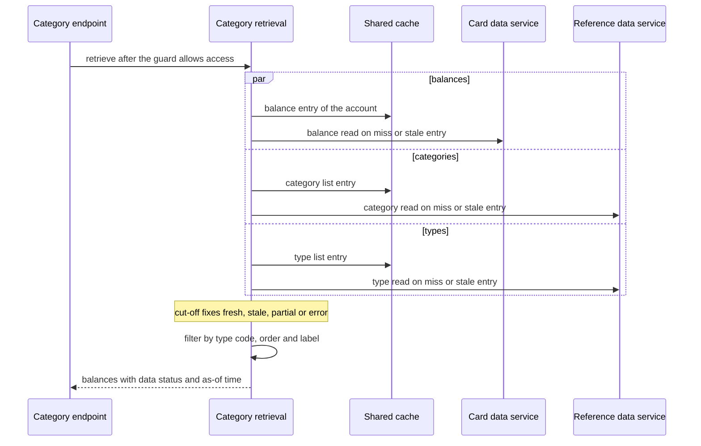

# CS-06-002: Category balance retrieval, filter and degradation

Parent epic: [CS-06 Category Balances Endpoint](../README.md)

## Source Story (verbatim)

> ### 1. Details/Requirements
>
> As a card servicing user, I want my category balances for one type even when descriptions or the source are unavailable, so that I still see balances with their freshness status.
>
> Trace: CARD_REQ_TBD · Data Layouts · CVTRA01Y · TRAN-CAT-BAL
>
> Account-data access path: Yes
>
> External integration or SLA-bound: Yes
>
> Capability: Stage 3 and the cut-off of the category balances request path. Once access is allowed, the account's category balances (`Data Layouts · CVTRA01Y`), the transaction categories (`Data Layouts · CVTRA04Y`) and the transaction types (`Data Layouts · CVTRA03Y`) are read concurrently. The optional `typeCode` filter and the (`typeCode`, `categoryCode`) order are applied, each balance is labelled, and one outcome is fixed at the cut-off: a `FRESH`, `STALE` or `PARTIAL` list, or an error. Target paths:
>
> - `card-servicing-service/src/main/java/com/example/cardservicing/category/CategoryBalanceRetrievalService.java` runs only after the account access guard (CS-12-003, `AccountAccessGuard`) allows access, so no account-data read, cache read included, happens before the allow.
>   - It takes the caller's bearer token, the validated `accountId`, the optional `typeCode` and the request's `RequestDeadline` (CS-11-003), the one the guard ran its Auth calls under.
>     > SCOPE-QUESTION (Resolved): The call policy story (CS-11-003) assigns starting the request deadline at receipt to this story, but the retrieval runs after the access guard and none of its three files holds a receipt stage on either protocol, so it takes the deadline the guard ran under. Until a receipt stage starts the deadline ahead of Stage 0 validation, the guard's own start at its entry applies (CS-12-003), and `cutoffMs` leaves out the Stage 0 time, which makes no network call. Settled by the balance summary REST and gRPC endpoints story (CS-05-006): it extends the Stage 0 hook to start the request deadline at receipt, ahead of validation, on every route the validator declares, the category-balance route of the category balance input validation story (CS-06-001) included, and to attach it to the request, so the guard and this story run under that one deadline and `cutoffMs` counts from receipt.
>   - It launches `CardDataService.ListCategoryBalances` through `CardDataClient.categoryBalances(token, deadline, accountId)` (CS-09-005), and `ReferenceDataService.ListTransactionCategories` and `ReferenceDataService.ListTransactionTypes` through `ReferenceDataClient.transactionCategories(token, deadline)` and `ReferenceDataClient.transactionTypes(token, deadline)` (CS-13-003), concurrently under that deadline. The two Reference Data reads each run on their own virtual thread from `Executors.newVirtualThreadPerTaskExecutor()`, closed with the application context, so no pool size or queue is configured and the request thread only waits.
>   - Each client forwards the token, adds `x-api-key` from `AUTH_SERVICE_API_KEY`, and applies its own cache and degrade rule through `ReadThroughCache` (CS-11-004) and `UpstreamCallPolicy` (CS-11-003). Cache keys carry no caller identity.
>   - It waits for the three reads, each of which the call policy ends within the deadline's remaining budget, and marks the cut-off when the last one completes. If the budget runs out first, the deadline records the cut-off itself, so `cutoffMs` never exceeds 900. A category-balance read still unanswered at the cut-off ends in `DEADLINE_EXCEEDED` and degrades inside the Card Data client to its stale entry when one is within max stale age, otherwise to 504 `DEADLINE_EXCEEDED`. A reference read still unanswered at the cut-off ends in a partial result inside the Reference Data client.
>   - Filter: with `typeCode` present, it keeps only the balances whose type code equals it character for character; with `typeCode` absent, it keeps every balance. The filter applies to the whole account list the Card Data client returns, fresh or stale, and applies whether reference data is usable or not.
>   - Order: it sorts the kept balances by `typeCode` and then `categoryCode` ascending, by ordinal string comparison, as `card-servicing-service/src/main/resources/openapi/card-servicing-api.yaml` documents, whatever order the source returned.
>   - Labels: `categoryDescription` comes from the category list by type code and category code (`ReferenceDataResult.categoryDescription(typeCode, categoryCode)`), and `typeDescription` from the type list by type code (`ReferenceDataResult.typeDescription(typeCode)`), because a transaction category carries no type description. This settles the TRD open item on the category-balance type label: the type-list read runs beside the other two reads, so it adds no serialized call.
>   - Missing labels: with the category list unusable (`usable()` false), both descriptions are absent on every balance, following the TRD degradation table row for `ListTransactionCategories`. With only the type list unusable, every `typeDescription` is absent and each `categoryDescription` is kept. A code that a usable list does not hold leaves that one description absent.
>   - Status: it resolves `dataStatus` and `asOf` through `card-servicing-service/src/main/java/com/example/cardservicing/integration/support/DataStatusResolver.java` (CS-05-005) from the three sources used. `dataStatus` is `PARTIAL` when either list is unusable or any description is absent, otherwise `STALE` when any source was served stale, otherwise `FRESH`; an unusable category list gives `PARTIAL` even when the filter leaves no balance. `asOf` is the oldest read time among the sources used: an upstream read contributes its read time, a cache entry its `cachedAt`, and a partial list nothing.
>   - Hand-on: its result, the nested record `CategoryBalanceRetrievalService.Result`, carries `accountId`, the ordered balances with each description present or absent, `dataStatus`, `asOf`, and the category-list `ReferenceDataResult` unchanged, so the Stage 3 unknown-`typeCode` check of CS-06-001 decides from that list's `usable()` and `isKnownTypeCode(typeCode)`.
>
> > SCOPE-QUESTION (Resolved): The category list alone cannot show that a type is unknown, because a stored transaction type may have no category. The `Result` therefore also carries the type-list `ReferenceDataResult` unchanged, beside the category-list one, and the Stage 3 check of CS-06-001 decides from both: it rejects a `typeCode` only when both results are usable and neither result's `isKnownTypeCode(typeCode)` answers true, and with either result unusable it rejects nothing while the `typeCode` filter still applies and the result is `PARTIAL`. The three reads and the 3 files touched are unchanged.
>   - Errors: `NOT_FOUND` from `ListCategoryBalances` for an unknown account maps to 404 `NOT_FOUND`, ahead of every other outcome and whatever the reference reads return. Otherwise a category-balance read that fails with no usable stale entry ends the request with its final status, `UNAVAILABLE` (503) or `DEADLINE_EXCEEDED` (504). Each is raised as a typed failure through the standard error mapping (CS-05-002) with the receipt `traceId`, and the service completes the deadline with outcome `error` and that status. A Reference Data failure never ends the request.
>   - Data reach: Redis is reached only through `ReadThroughCache` inside the two clients, and account and reference data only through their gRPC clients. The service holds no Redis client and never opens a database connection.
> - `card-servicing-service/src/main/java/com/example/cardservicing/category/CategoryBalanceResponseMapper.java` renders a `Result` on both protocols.
>   - REST: the `ListCategoryBalancesResponse` body of `card-servicing-api.yaml`, with `typeDescription` and `categoryDescription` present on every element, as the string or as JSON `null` when absent, which happens only when `dataStatus` is `PARTIAL`. An empty string never stands for an absent description. The REST rendering also exposes the `X-Data-Status` value, equal to `dataStatus`, which CS-06-003 sets as the response header.
>   - gRPC: the generated `ListCategoryBalancesResponse` of `card-servicing-service/src/main/proto/cardservicing/api/v1/card_servicing_service.proto` (Java package `com.example.cardservicing.contract.api.v1`), with the proto3 `optional` fields `type_description` and `category_description` left unset when absent and set otherwise.
>   - Both: `balance` stays the scale-2 decimal string the Card Data contract carries, for example `"0.00"`; `asOf` renders as RFC 3339 with microseconds and `Z` in UTC, for example `"2024-03-05T14:07:09.123456Z"`; `categoryBalances` is always present, empty when nothing matches.
>   - On rendering it completes the request deadline exactly once, with outcome `full` for `FRESH` and `degraded` for `STALE` or `PARTIAL`, so the completion line carries `cutoffMs`, the outcome and the `traceId`.
> - Test: `card-servicing-service/src/test/java/com/example/cardservicing/category/CategoryBalanceRetrievalServiceTest.java` covers the service and the mapper.
>   - It sends each test request through the account access guard, then the retrieval, then the mapper, as the endpoints will (CS-06-003). Each test request starts its `RequestDeadline` at receipt, and the test client measures the response time.
>   - It uses the Auth, Config, Card Data and Reference Data stubs registered on `card-servicing-service/src/test/java/com/example/cardservicing/support/StubHarness.java` (CS-11-002) under the stub names `auth`, `config`, `card-data` and `reference-data`, with per-test `STUB_LATENCY_MS` and `STUB_FAILURE_RATE` overrides through `StubHarness.inject`, and reads each stub's `StubRequestLog`.
>   - Scripted answers the stubs never give come from test-local `StubRegistration` instances under the same stub names, which `StubHarness.allRegistered()` never discovers: balances out of order, `UNAVAILABLE` on the first two attempts, `NOT_FOUND` or `INVALID_ARGUMENT` for an entitled account, and one Reference Data operation failing while the other answers.
>   - The cache runs on the in-memory recording `EntryStore` with the controllable test clock of the CS-11-004 tests, for entry ages and cache-read counts.
> - That makes 3 files: two created main classes and one test class.
>
> Degradation, per the TRD degradation table:
>
> - A category-balance read that fails after retries or is unfinished at the cut-off gives `STALE` from a cache entry within the 300 s max stale age (60 s fresh TTL, CS-09-005), otherwise 503 `UNAVAILABLE` or 504 `DEADLINE_EXCEEDED`.
> - An unusable category list, with no entry within the 86,400 s max stale age (CS-13-003), gives null descriptions, skips the unknown-`typeCode` check, keeps the `typeCode` filter and gives `PARTIAL`.
> - A Config failure leaves the request unaffected and `dataStatus` unchanged.
>
> Context: `Data Layouts · CVTRA01Y` keys each category balance by TRANCAT-ACCT-ID 9(11), TRANCAT-TYPE-CD X(02) and TRANCAT-CD 9(04), with TRAN-CAT-BAL S9(09)V99. In the sample data account `00000000001` holds one balance, type `01` category `0001` with `0.00`. `Reference Tables · TRANCATG file` names that category "Regular Sales Draft", and `Reference Tables · TRANTYPE file` names type `01` "Purchase" and type `02` "Payment", whose categories `0001` to `0003` hold no balance on that account.
>
> In scope:
>
> - Concurrent Stage 3 reads of the category balances, the transaction categories and the transaction types.
> - The `typeCode` filter and the (`typeCode`, `categoryCode`) order.
> - Description attachment and the category-balance type-label source.
> - `STALE`, `PARTIAL` and fail-hard outcomes at the cut-off, and 404 on an unknown account.
> - `dataStatus` and `asOf` through the shared resolver.
> - The REST `null` and gRPC unset description mapping.
> - Unit tests with per-test failure injection.
>
> Not in this story:
>
> - Stage 0 validation and the unknown-`typeCode` 400 (CS-06-001).
> - The REST controller, the gRPC method, the `X-Data-Status` header and the call order of the Stage 3 check between retrieval and rendering (CS-06-003).
> - Token validation and the access decision (CS-12-003).
> - Cache, call-policy and deadline mechanics, reused unchanged (CS-11-004, CS-11-003).
> - The client cache keys, TTLs and per-call degrade rules (CS-09-005, CS-13-003).
> - The precedence and `asOf` rules of the shared resolver (CS-05-005).
>
> ### 2. Acceptance Criteria
>
> - AC1: For token `fixture-token-user0001`, account `00000000001` and `typeCode` `01`, with all stubs healthy and an empty cache, the result holds one category balance: `typeCode` "01", `typeDescription` "Purchase", `categoryCode` "0001", `categoryDescription` "Regular Sales Draft" and `balance` "0.00". `dataStatus` is "FRESH", and `asOf` equals the earliest of the three upstream read times in `YYYY-MM-DDTHH:MM:SS.ffffffZ` form. The REST rendering equals the `fresh` example of `card-servicing-api.yaml` apart from `asOf`, and the gRPC rendering carries the same values with both descriptions set.
> - AC2: With `typeCode` absent and a test-local Card Data server answering the balances `02`/`0002` "15.00", `01`/`0005` "-7.25" and `01`/`0001` "0.00" in that order for `00000000001`, the result holds all three in the order `01`/`0001`, `01`/`0005`, `02`/`0002`, with `categoryDescription` "Regular Sales Draft", "Interest Amount" and "Electronic payment" and `typeDescription` "Purchase", "Purchase" and "Payment". With `typeCode` `01` the same answer gives `01`/`0001` and then `01`/`0005` only.
> - AC3: `typeCode` `02`, which the category list carries, on account `00000000001`, which holds no type `02` balance, returns a present, empty category balance array with `dataStatus` `FRESH`: REST `"categoryBalances": []` and a gRPC message with no `category_balances` element.
> - AC4: For token `fixture-token-user0001` and account `00000000011`, which is outside the caller's entitlements (`USER0001` is entitled to the sample accounts `00000000001` to `00000000010` only), the request returns 403 `PERMISSION_DENIED`. No account data is read from upstream or cache before access is allowed: for that request the Card Data and Reference Data stub request logs hold zero entries and the recording entry store records zero cache reads.
> - AC5: With a test-local Card Data server answering `NOT_FOUND` for the entitled account `00000000002` and healthy Reference Data, the request returns 404 `NOT_FOUND`, whatever the two reference reads return. The Card Data request log shows exactly one `ListCategoryBalances` call, with no retry, and no category-balance cache entry is written.
> - AC6: Timeout: each Card Data and Reference Data attempt times out at the lesser of 300 ms (`UPSTREAM_TIMEOUT_MS`) and the budget left when the attempt starts. With 400 ms latency injected on stub `card-data`, an empty cache and healthy Auth, the Card Data request log records every `ListCategoryBalances` attempt as ending within 30 ms after that limit and shows exactly 2 attempts, and the request returns 504 `DEADLINE_EXCEEDED`. With the same latency on stub `reference-data` instead, each `ListTransactionCategories` and `ListTransactionTypes` attempt ends within 30 ms after that limit, and the request returns 200 `PARTIAL`.
> - AC7: Retries: on `UNAVAILABLE` or `DEADLINE_EXCEEDED` only, a read is retried at most two times (`UPSTREAM_MAX_RETRIES`), after 50 ms then 100 ms backoff, and a retry starts only when its backoff plus a full 300 ms attempt fits the remaining budget. With a test-local Card Data server answering `UNAVAILABLE` at once on the first two attempts and the balances on the third, the request returns 200 `FRESH`, and the request log shows exactly 3 `ListCategoryBalances` calls, at least 50 ms and then at least 100 ms apart. A `NOT_FOUND` answer (AC5) and an `INVALID_ARGUMENT` answer from a test-local Card Data server each receive exactly 1 call.
> - AC8: Degrades to stale: with the Card Data stub failing every call (`STUB_FAILURE_RATE` 1.0), healthy Reference Data and a `cs:v1:category-balances:00000000001` entry aged 120 s on the test clock, past its 60 s fresh TTL and within its 300 s max stale age, the request returns 200 with the entry's balance, `dataStatus` `STALE` and `asOf` equal to that entry's `cachedAt`. The Card Data request log shows exactly 3 attempts, and the entry is not rewritten. With the Reference Data stub failing every call, fresh Card Data reads and `cs:v1:refcats` and `cs:v1:reftypes` entries aged 3,600 s, past their 3,600 s fresh TTL and within their 86,400 s max stale age, the result keeps both descriptions with `dataStatus` `STALE` and `asOf` equal to those entries' `cachedAt`.
> - AC9: Fails hard: with the Card Data stub failing every call and no category-balance entry within max stale age, both with no entry and with an entry aged 300 s, the request returns 503 `UNAVAILABLE` after exactly 3 attempts. With a Card Data stub latency of 2,000 ms and no usable entry, the request returns 504 `DEADLINE_EXCEEDED` after exactly 2 attempts. A healthy Reference Data answer never turns either outcome into a 200.
> - AC10: Degrades to partial: with the Reference Data stub failing every call and no `cs:v1:refcats` or `cs:v1:reftypes` entry within the 86,400 s max stale age, the request for `00000000001` with `typeCode` `01` returns 200 with `dataStatus` `PARTIAL`, the one `01`/`0001` balance "0.00", and `asOf` equal to the Card Data read time. Every `typeDescription` and `categoryDescription` is JSON `null` in the REST rendering, as in the `partial` example of `card-servicing-api.yaml`, unset in the gRPC rendering, and never an empty string. The `typeCode` filter still applies: with the AC2 Card Data answer, `typeCode` `01` returns exactly the `01`/`0001` and `01`/`0005` balances and `typeCode` `99` returns an empty array, both `PARTIAL`. Combined with the AC8 stale category-balance entry, the result is still `PARTIAL`, with `asOf` equal to that entry's `cachedAt`.
> - AC11: Deadline: for every degraded 200, 503 and 504 in AC6 to AC10 and AC15, the completion log line's `cutoffMs` is at most 900 (`REQUEST_DEADLINE_MS`), the line carries the outcome and the receipt `traceId`, and the client-measured response arrives below 1,000 ms. The same holds on a cold path with an Auth stub latency of 250 ms beside a Card Data latency of 350 ms and no usable entry, where the Card Data request log shows exactly one `ListCategoryBalances` attempt and the request returns 504 `DEADLINE_EXCEEDED`.
>
> SCOPE-QUESTION (Resolved): AC11 states its cut-off bound as `cutoffMs` at most 900 without a unit. The bound is the 900 ms request deadline (`REQUEST_DEADLINE_MS`), measured from receipt to the cut-off, so AC11 requires the cut-off of every request it names to fall at or before 900 ms after receipt.
>
> - AC12: Config: with the Config stub failing every call, and separately with a 2,000 ms Config stub latency and a stale configuration snapshot, an allowed AC1 request returns the AC1 body with `dataStatus` `FRESH`, its `cutoffMs` is at most 900, and its client-measured response arrives below 1,000 ms.
> - AC13: Every error the request returns, 403, 404, 503 or 504, renders through the standard error mapping (CS-05-002) as the standard error object with `code` `PERMISSION_DENIED`, `NOT_FOUND`, `UNAVAILABLE` or `DEADLINE_EXCEEDED` and the `traceId` generated at receipt, equal to the `traceId` on that request's completion log line. On gRPC exactly one `cardservicing.common.v1.ErrorObject` is packed in the `google.rpc.Status` details.
> - AC14: With 200 ms latency injected on stubs `card-data` and `reference-data`, an empty cache and healthy Auth, the request returns `FRESH` and the logged `cutoffMs` is below 400, while any two of the three reads run in sequence would take at least 400 ms. This proves the three Stage 3 reads run concurrently and the type-list read adds no serialized call.
> - AC15: With a test-local Reference Data server failing only `ListTransactionTypes` and no `cs:v1:reftypes` entry, the AC1 request returns 200 `PARTIAL` with `typeDescription` absent (REST `null`, gRPC unset), `categoryDescription` "Regular Sales Draft", and a handed-on category-list `ReferenceDataResult` whose `usable()` is true. With only `ListTransactionCategories` failing and no `cs:v1:refcats` entry, both descriptions are absent on every balance, the result is `PARTIAL`, and the handed-on category list has `usable()` false. With both lists fresh and a test-local Card Data balance `01`/`0009`, a category the list does not hold, that balance's `categoryDescription` is absent and the result is `PARTIAL`.
> > SCOPE-QUESTION (Resolved): AC15 checks only the handed-on category-list result. Each of its cases also checks the handed-on type-list `ReferenceDataResult`: `usable()` false with only `ListTransactionTypes` failing, `usable()` true with only `ListTransactionCategories` failing, and `usable()` true with both lists fresh.
>
> ### 3. Dependencies
>
> - CS-09-005 — Card Data client with category balance caching and stale fallback
> - CS-13-003 — Reference Data client with cache and description fallback
> - CS-12-003 — account access guard allows access before any read
> - CS-05-005 — data-status resolver for precedence and as-of time
>
> Risk: on a cold path two sequential Auth calls can leave one data attempt and no retry inside the residual budget.

## 4. Design

- [Category balances sequence](../../../../architecture/sequence-category-balances.mmd)
- [Logical architecture](../../../../architecture/logical-architecture.mmd)
- [Data model — category_balance](../../../../data-model.md#category_balance)
- [Data model — transaction_category](../../../../data-model.md#transaction_category)
- [Data model — transaction_type](../../../../data-model.md#transaction_type)
- [Data model — reference data as data](../../../../data-model.md#reference-data-as-data)
- [TRD — resilience, degradation table and cache rules](../../../../technical-requirements.md#resilience)
- [TRD — request path stages](../../../../technical-requirements.md#stages)
- [TRD — deadline boundary](../../../../technical-requirements.md#deadline-boundary)
- [TRD — stage budget on a cold path](../../../../technical-requirements.md#stage-budget-on-a-cold-path)
- [TRD — edge cases and error mapping](../../../../technical-requirements.md#edge-cases)
- [Card Servicing gRPC contract](../../../../../card-servicing-service/src/main/proto/cardservicing/api/v1/card_servicing_service.proto)
- [Card Servicing OpenAPI contract](../../../../../card-servicing-service/src/main/resources/openapi/card-servicing-api.yaml)
- [Card Data gRPC contract](../../../../../card-servicing-service/src/main/proto/cardservicing/carddata/v1/card_data_service.proto)
- [Card Data OpenAPI contract](../../../../../card-servicing-service/src/main/resources/openapi/card-data-service.yaml)
- [Reference Data gRPC contract](../../../../../card-servicing-service/src/main/proto/cardservicing/referencedata/v1/reference_data_service.proto)
- [Reference Data OpenAPI contract](../../../../../card-servicing-service/src/main/resources/openapi/reference-data-service.yaml)
- [Shared error object contract](../../../../../card-servicing-contracts/src/main/proto/cardservicing/common/v1/common.proto)

## 5. Documentation Changes

Completed during implementation.

## 6. Test Plan

- Unit: Applies. Command `./gradlew :card-servicing-service:test jacocoTestCoverageVerification`; all tests pass, with ≥80% line coverage per module. Cases: AC1–AC15 in `CategoryBalanceRetrievalServiceTest` against in-JVM loopback stubs with per-test `STUB_LATENCY_MS` and `STUB_FAILURE_RATE`, test-local scripted stub answers, and the recording entry store on the test clock. Both renderings are asserted: REST `null` and gRPC unset for every absent description. Each degraded 200, 503 and 504 asserts a logged `cutoffMs` ≤ 900 and a client-measured response below 1,000 ms.
- Integration: Not applicable — the integration suites belong to the external epics, here the Card Data and Reference Data integration suites (CS-09-006, CS-13-004). Threshold when it applies: `./gradlew :card-servicing-service:integrationTest` passes, with one suite per external epic covering a stub exception, latency above `UPSTREAM_TIMEOUT_MS`, and the `UPSTREAM_MAX_RETRIES` cap.
- Performance: Applies, through the category balance SLA scenario (CS-02-002).
  - Commands: `docker compose -f tests/docker-compose.yml up -d --wait`, then `./gradlew :card-servicing-service:performanceTest`, then `docker compose -f tests/docker-compose.yml down`.
  - Pass: p50/p95/p99 below 1,000 ms over successful requests, with failure injection off, at 10 users × 100 sequential calls, 100,000 category balances and 1,000,000 transactions.
  - Injected failures are proven by a logged `cutoffMs` ≤ 900 and a client-measured response below 1,000 ms.
- End-to-end: Applies, through the category balance end-to-end step (CS-02-001).
  - Commands: `docker compose -f tests/docker-compose.yml up -d --wait`, then `./gradlew :card-servicing-service:e2eTest`, then `docker compose -f tests/docker-compose.yml down`.
  - Pass: the four-step flow for account `00000000001` returns the AC1 values in its category balance step, and each stub's request log shows at least one call.

## 7. Validation Results

Completed during implementation.

## Implementation Design

Recommended: Option A — concurrent balance, category and type reads, with filtering, ordering and description matching inside the service.

Rationale: the card data list operation returns every balance of an account, so a filter, an order and labels applied in the service need no contract change and keep one cache entry per account.

- Rejected: Option B, pushing the type code filter to the card data source, because the baseline list operation of the card data contract carries no type code field.

### Shared by both options

- Topology: the retrieval runs in the service after the access guard allows, and reads the balances through the card data client and the category and type lists through the reference data client, all three side by side.
- Naming: each balance is keyed by its type code and category code as in the category balance record, and the data status values are fresh, stale and partial.
- Addressing: the account number comes from the request path, and the optional type code narrows the list.
- Isolation: nothing is read before access is allowed, and cache entries carry no caller identity.
- Fallback: balances fall back to a stale entry within the five-minute maximum stale age, and an unusable list leaves its descriptions absent with a partial status.
- Labels: category descriptions come from the category list and type descriptions from the type list, because a category carries no type description.
- Provisioning: no new store, cache region or setting.
- Cut-over: swapping the stubs for real services changes only the target address and the credential source.
- Failures: the unavailable status after retries gives 503, the deadline-exceeded status at the cut-off gives 504, and the not-found status passes through as 404.

### Design Option A — filter, order and labels inside the service

The retrieval launches the balance read, the category list read and the type list read together as soon as access is allowed, and waits until the last one ends or the request budget runs out. The card data client returns every balance of the account from one account-wide cache entry, and the retrieval keeps the balances of the requested type code, orders them by type code and category code, and labels each one from the two lists. One shared resolver then sets the data status and the as-of time.

How it behaves:

- A request without a type code returns every balance of the account, and a request with one keeps only that type.
- The order is type code and then category code, whatever order the source returned.
- An unusable category list leaves both descriptions absent on every balance and marks the result partial.
- An unusable type list leaves only the type descriptions absent and marks the result partial.
- An unknown account ends the request with the not-found status, whatever the list reads return.
- The type list result and the category list result travel with the balances to the unknown type check of the validation story.
- The response mapper renders an absent description as a null value on the HTTP interface and as an unset field on the remote procedure interface.

| No. | Decision (vs rejected) | Pro | Con |
|---|---|---|---|
| 1 | Three reads launched together (vs one after another) | each read keeps one full attempt on a cold path | three calls are in flight per request |
| 2 | Type code filter applied in the service (vs at the card data source) | the card data contract stays unchanged | every filtered request carries the whole account list |
| 3 | One account-wide balance entry serving every filter (vs one entry per type code) | one entry per account is refreshed and expired | a filtered request still loads every balance |
| 4 | Order fixed by the service (vs trusting the source order) | the response order holds for any source | every request pays for a sort |

Effort and risk: one retrieval component, one response mapper and one test class, with the risk in a slow balance read that uses the whole residual budget.

### Design Option B — type code filter at the card data source

The card data list operation gains an optional type code, the card data stub applies it, and the card data client caches one entry per account and type code. The retrieval still reads the two lists beside the balance read and labels each balance, but it no longer filters. Ordering and status resolution stay in the service.

How it differs:

- The card data contract gains a filter field that its baseline list operation lacks.
- The card data epic owner must accept the contract extension before this story can start.
- Each type code of an account gets its own cache entry beside the unfiltered one.
- A filtered request carries only the matching balances.
- A stale fallback for one type code cannot use the unfiltered entry of the same account.

| No. | Decision (vs rejected) | Pro | Con |
|---|---|---|---|
| 1 | Type code filter applied by the card data source (vs in the service) | a filtered request carries only matching balances | the contract extension falls outside this epic |
| 2 | One cache entry per account and type code (vs one per account) | each entry holds only one filter's balances | an account holds up to eight entries |
| 3 | Three reads launched together (vs one after another) | each read keeps one full attempt on a cold path | three calls are in flight per request |

Effort and risk: the same three files plus a contract, stub and client change in the card data epic, with the risk in an extension the card data epic owner has not accepted.

### Recommendation

- Option: Option A.
- Why: the baseline card data contract stays unchanged, and one cache entry per account serves every filter.
- Strongest argument against: every filtered request carries the whole account list from the source or the cache.
- Shared items that do not decide the choice: the guard order, the degradation outcomes, the status precedence, the ordering, the label sources and the three concurrent reads.
- Flip conditions: accounts approaching 1,000 category balances, or a source-side type filter adopted by the requirements author.

## Design Validation

### Option A

Settled assumptions:

- The sample data holds one category balance per account at most, and the synthetic volume holds ten.
- The card data list operation carries no type code filter.
- The reference lists come from a long-lived cache with a one-hour fresh lifetime.
- A transaction category carries no type description, so type labels need the type list.
- The shared resolver ranks partial over stale over fresh and takes the oldest read time.
- The receipt stage starts the request deadline before validation on every validated route, so the guard and the retrieval share it.

Open assumptions:

- Open → a cold path with two slow sign-in checks leaves one data attempt and no retry, settled by this story's deadline tests.

| AC | Verdict | Why |
|---|---|---|
| AC1 | Holds | fresh reads of the fixture account give one labelled balance |
| AC2 | Holds | the service sorts and filters any source order |
| AC3 | Holds | a known type with no balance leaves an empty list |
| AC4 | Holds | the retrieval runs only after the access decision |
| AC5 | Holds | the not-found status ends the request ahead of every other outcome |
| AC6 | Holds | the call policy cuts each attempt to the lesser of the timeout and the budget left |
| AC7 | Holds | the call policy retries only the two retryable statuses within the budget |
| AC8 | Holds | each client serves a stale entry within its maximum age |
| AC9 | Holds | a balance read with no usable entry ends in its final status |
| AC10 | Holds | an unusable list leaves descriptions absent with the filter still applied |
| AC11 | Conditional | the cold-path case depends on the sign-in time leaving one full attempt |
| AC12 | Holds | the configuration refresh never sits on the request path |
| AC13 | Holds | every failure passes through the standard error object with the receipt trace number |
| AC14 | Holds | three reads launched together end within one attempt time |
| AC15 | Holds | each list labels its own description |

### Option B

Settled assumptions:

- The sample data holds one category balance per account at most, and the synthetic volume holds ten.
- The reference lists come from a long-lived cache with a one-hour fresh lifetime.
- A transaction category carries no type description, so type labels need the type list.
- The card data list operation carries no type code filter today.

Open assumptions:

- Open → a contract extension accepted by the card data epic owner, settled by contract review.
- Open → a cold path with two slow sign-in checks leaves one data attempt and no retry, settled by this story's deadline tests.

| AC | Verdict | Why |
|---|---|---|
| AC1 | Holds | the source answers the type filter with the one fixture balance |
| AC2 | Conditional | the filtered half relies on the stub honouring the new filter field |
| AC3 | Holds | the source returns an empty list for a known type with no balance |
| AC4 | Holds | the retrieval still runs only after the access decision |
| AC5 | Holds | the source still answers the not-found status for an unknown account |
| AC6 | Holds | the same call policy cuts each attempt |
| AC7 | Holds | the same retry rule applies |
| AC8 | At risk | filtered requests no longer read the named unfiltered stale entry |
| AC9 | Holds | a balance read with no usable entry still ends in its final status |
| AC10 | Conditional | the partial filter case relies on the extended source contract |
| AC11 | Conditional | the cold-path case depends on the sign-in time leaving one full attempt |
| AC12 | Holds | the configuration refresh never sits on the request path |
| AC13 | Holds | the same error object carries the receipt trace number |
| AC14 | Holds | the three reads still run together |
| AC15 | Holds | labelling does not change |

## Metadata

| Field | Value |
|---|---|
| Build wave | W2 |
| Depends on | CS-09-005, CS-13-003, CS-12-003, CS-05-005 |
| Status | TBD |
| Estimated Files Touched | 3 |
| Issue Type | Story |
| Epic Name | Category Balances Endpoint |
| Epic Link | CS-06 |
| Story Points | 5 |
| Priority | High |
| Components | TBD |
| Fix Version/s | TBD |
| Team | TBD |
| Assignee | TBD |
| Reporter | TBD |
| Labels | TBD |
| Sprint | TBD |
| Due Date | TBD |
| Environment | TBD |
| Persona | TBD |
| Estimated Effort | TBD |
