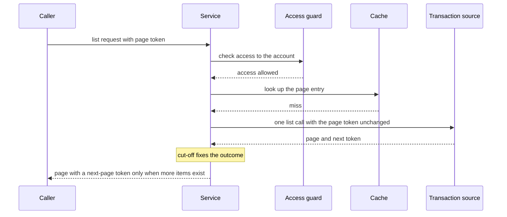

# CS-07-002: Transaction list retrieval with token pass-through

Parent epic: [CS-07 Transaction List Endpoint](../README.md)

## Source Story (verbatim)

> ### 1. Details/Requirements
>
> As a card servicing user, I want my transactions listed newest first a page at a time, so that I can drill from a category into its transactions.
>
> Trace: CARD_REQ_TBD · Use Cases · COTRN00C
>
> Account-data access path: Yes
>
> External integration or SLA-bound: Yes
>
> Capability: Stage 3 and the cut-off of the transaction list request path. Once access is allowed, one page of the account's posted transactions (`Data Layouts · CVTRA05Y`) is read through the Transaction Activity client, newest processed first, as `Use Cases · COTRN00C` pages its list. The caller's page token passes through unchanged, and one outcome is fixed at the cut-off: a `FRESH` page or an error. Target paths:
>
> - `card-servicing-service/src/main/java/com/example/cardservicing/drill/TransactionListService.java` runs only after the account access guard (CS-12-003, `card-servicing-service/src/main/java/com/example/cardservicing/integration/auth/AccountAccessGuard.java`) allows access, so no account-data read, cache read included, happens before the allow.
>   - Inputs: the caller's bearer token; the request's `RequestDeadline` (`card-servicing-service/src/main/java/com/example/cardservicing/integration/support/RequestDeadline.java`, CS-11-003), started at receipt and the one the guard ran its Auth calls under; and the values Stage 0 validated: `accountId`, the optional `typeCode` and `categoryCode`, the effective page size and the `pageToken` exactly as received, the empty string for the first page.
>   - Effective page size: the request's `pageSize` when one is given, otherwise the `default_page_size` of the request's `UpstreamSettings.Capture` (`RequestDeadline.settings()`), which `card-servicing-service/src/main/java/com/example/cardservicing/integration/config/ConfigSnapshot.java` (CS-11-006) publishes, 20 under the built-in defaults. Stage 0 resolves it, so the service never reads the snapshot itself and launches no refresh.
>   - Read: it calls `TransactionActivityClient.transactions(token, deadline, accountId, typeCode, categoryCode, pageSize, pageToken)` (`card-servicing-service/src/main/java/com/example/cardservicing/integration/transactionactivity/TransactionActivityClient.java`, CS-10-006) exactly once per request. The client reads through `card-servicing-service/src/main/java/com/example/cardservicing/integration/support/ReadThroughCache.java` (CS-11-004): a fresh page held for the account, page size, page token and both filters answers with no upstream call, and a miss makes one `TransactionActivityService.ListTransactions` call under `card-servicing-service/src/main/java/com/example/cardservicing/integration/support/UpstreamCallPolicy.java` (CS-11-003) within the deadline. The client forwards the bearer token as `authorization` and adds `x-api-key` from `AUTH_SERVICE_API_KEY`.
>   - Token pass-through: the caller's `pageToken` reaches the client byte for byte unchanged. The service never decodes, re-encodes or wraps it, because Stage 0 already checked its shape, version and fingerprint through `PageTokenCodec` (CS-10-003) and the Transaction Activity service owns the cursor. A non-empty upstream `next_page_token` becomes the page's next-page token unchanged, and an empty one makes the next-page token absent. CS-07-003 renders absence as an omitted REST `nextPageToken` and an empty gRPC `next_page_token`.
>   - Items: each item carries `transactionId`, `typeCode`, `categoryCode`, `description`, `amount`, `originalTimestamp` and `processedTimestamp` exactly as the upstream page carries them. `description` and `originalTimestamp` come from `Data Layouts · CVTRA05Y · TRAN-DESC` and `TRAN-ORIG-TS`, the Description and Date columns of `Use Cases · COTRN00C`. Items keep the upstream order, `processedTimestamp` descending, then `transactionId` descending; the service does not re-sort, filter or drop an item.
>   - Status: it resolves `dataStatus` and `asOf` through `card-servicing-service/src/main/java/com/example/cardservicing/integration/support/DataStatusResolver.java` (CS-05-005, earlier in W2) from the one source used. With no stale fallback and no reference data, every 200 is `FRESH`, and `asOf` is the `cachedAt` the client returns: the upstream read time on a miss, the entry's `cachedAt` on a fresh hit. Config outcomes never affect `dataStatus`.
>   - Cut-off and completion: it marks the cut-off on the deadline when the list read returns or fails. If the budget runs out first, the deadline records the cut-off itself, so `cutoffMs` never exceeds 900. It completes the deadline exactly once, with outcome `full` for a 200 and `error` with the response status for 400, 404, 503 or 504, so the completion line carries `cutoffMs`, the outcome and the receipt `traceId`.
>   - Data reach: Redis is reached only through `ReadThroughCache` inside the client, and transactions only through the gRPC client. The service holds no Redis client, opens no database connection and makes no Card Data or Reference Data call. Cache keys carry no caller identity.
> - `card-servicing-service/src/main/java/com/example/cardservicing/drill/TransactionPage.java`: the result record, holding `accountId`, the ordered `transactions` (always present, empty when nothing matches), the optional next-page token, `dataStatus` and `asOf` in RFC 3339 form with microseconds and `Z`, for example `"2022-06-10T19:27:53.000000Z"`.
> - Test: `card-servicing-service/src/test/java/com/example/cardservicing/drill/TransactionListServiceTest.java`.
>   - It sends each test request through the account access guard and then the service, as the endpoints will (CS-07-003). Each test request starts its `RequestDeadline` at receipt with a test `traceId`, and the test client measures the response time.
>   - It uses the Auth, Config, Transaction Activity and Reference Data stubs registered on `card-servicing-service/src/test/java/com/example/cardservicing/support/StubHarness.java` (CS-11-002) under the stub names `auth`, `config`, `transaction-activity` and `reference-data`, with per-test `STUB_LATENCY_MS` and `STUB_FAILURE_RATE` overrides through `StubHarness.inject`, and reads each stub's `StubRequestLog`.
>   - Scripted answers the stub never gives come from test-local `StubRegistration` instances under stub name `transaction-activity`, which `StubHarness.allRegistered()` never discovers: a fixed non-empty `next_page_token`, and `INVALID_ARGUMENT` with a packed `ErrorObject` holding a `pageToken` detail. A request-capturing server interceptor on such a registration records the `page_size` and `page_token` of each call.
>   - The cache runs on the in-memory recording `EntryStore` with the controllable test clock of the CS-11-004 tests, for entry ages and cache-read counts.
> - That makes 3 files: two created main classes and one test class.
>
> Outcomes, per the TRD degradation table and edge cases:
>
> - `NOT_FOUND` from `ListTransactions`, which the Transaction Activity service answers when the account has no cross-reference record, gives 404 `NOT_FOUND` after one attempt.
> - Upstream `INVALID_ARGUMENT` on paging gives 400 `INVALID_ARGUMENT` with a `details` entry whose `field` is `pageToken`, after one attempt.
> - A well-formed but unknown `typeCode` or `categoryCode` gives 200 with an empty `transactions` array and no next-page token, because this endpoint makes no reference-data call.
> - An existing account with no matching transaction gives 200 with an empty `transactions` array and no next-page token.
> - `UNAVAILABLE` after the last permitted retry gives 503 `UNAVAILABLE`.
> - `DEADLINE_EXCEEDED`, or the budget exhausted before or during the call, gives 504 `DEADLINE_EXCEEDED`.
> - A page is never served stale: a failed read returns no page, even with a page held past its fresh TTL.
> - Each failure is the client's typed failure, rendered through the standard error mapping (CS-05-002, `card-servicing-service/src/main/java/com/example/cardservicing/config/error/`) with the `traceId` generated at receipt. The service builds no error body.
> - A Config failure or a slow background refresh leaves the request, its `dataStatus` and its timing unchanged.
>
> In scope:
>
> - The retrieval service and its result record.
> - Token pass-through in both directions.
> - Outcome mapping for the not-found, invalid-token, empty and fail-hard cases.
> - Deadline outcomes, the cut-off and the completion line.
> - Unit tests with per-test failure injection.
>
> Not in this story:
>
> - Parameter validation and the receipt check of the page token (CS-07-001).
> - The REST controller, the gRPC method and the protocol rendering of the next-page token (CS-07-003).
> - The Transaction Activity client, its cache keys and its periods (CS-10-006).
> - Stub keyset paging and the token format (CS-10-004, CS-10-003).
> - Token validation and the access decision (CS-12-003).
>
> ### 2. Acceptance Criteria
>
> - AC1: For token `fixture-token-user0001` and account `00000000011`, which is outside the entitlements of `USER0001` (`00000000001`–`00000000010` and `10000000001`–`10000002000`), the request returns 403 `PERMISSION_DENIED`. No account data is read from upstream or cache before access is allowed: for that request the Transaction Activity stub request log holds zero entries and the recording entry store records zero cache reads.
> - AC2: For token `fixture-token-user0001`, account `00000000001`, `typeCode` `01`, `categoryCode` `0001` and an effective page size of 20, with all stubs healthy and an empty cache, the page holds five items in the order `0000000776200014`, `0000000755736377`, `0000000624335286`, `0000000555363230`, `0000000503557384`, with `description` "Purchase at Lebsack and Sons", "Purchase at Torp-Stark", "Purchase at Crona, Turner and Hane", "Purchase at Metz, Blanda and Homenick" and "Purchase at Casper Group", `amount` "985.22", "906.44", "598.44", "484.99" and "81.44", `originalTimestamp` and `processedTimestamp` "2022-06-10T19:27:53.000000Z" on each, and no next-page token.
> - AC3: The AC2 request with no filters returns all six items in the order `0000000776200014`, `0000000755736377`, `0000000624335286`, `0000000555363230`, `0000000532120892`, `0000000503557384`, the fifth with `typeCode` "03", `categoryCode` "0001", `description` "Return item at Frami-Hyatt" and `amount` "-70.77", and no next-page token. The items equal, field for field, the six transactions of the `ListTransactions` example response in `card_servicing_service.proto`.
> - AC4: With an empty cache, each request of AC2, AC3 and AC5 adds exactly one `ListTransactions` entry to the Transaction Activity stub request log. A request-capturing test-local registration records its `page_size` equal to the effective page size, 20 in AC2 and AC3 and 2 in AC5, and its `page_token` equal byte for byte to the caller's `pageToken`: the empty string for a first page and the replayed token for a later one.
> - AC5: For account `00000000001` with no filters and an effective page size of 2, the first page holds `0000000776200014` and `0000000755736377` and a next-page token equal byte for byte to the stub's non-empty `next_page_token`. Replaying that token returns `0000000624335286` and `0000000555363230` with the stub's next token, and replaying that one returns `0000000532120892` and `0000000503557384`, where the stub's empty `next_page_token` gives an absent next-page token. A test-local registration answering `next_page_token` "example-opaque-page-token" yields that exact next-page token.
> - AC6: In the unit suite, whose in-memory fixture set holds no cross-reference record for the synthetic accounts, token `fixture-token-user0001` with account `10000000002`, inside the caller's entitlements, makes the stub answer `NOT_FOUND`. The request returns 404 with an `ErrorObject` whose `code` is `NOT_FOUND` and whose `traceId` equals the receipt `traceId` on the completion log line, after exactly one stub call, and no cache entry is written.
> - AC7: For account `00000000001` with `typeCode` `99`, well-formed and absent from the reference data, the request returns 200 with an empty `transactions` array and no next-page token, and the Reference Data stub request log holds zero entries. For token `fixture-token-user0005` and account `10000009002`, which has a cross-reference record and no transactions (the registration's added cross-reference in the unit suite), the request returns 200 with an empty `transactions` array and no next-page token.
> - AC8: With a test-local registration answering `INVALID_ARGUMENT` with one packed `ErrorObject` holding one `details` entry for `pageToken`, to a token that passed Stage 0, the request returns 400 with `code` `INVALID_ARGUMENT`, exactly one `details` entry whose `field` is `pageToken` and the receipt `traceId`, after exactly one stub call, and no cache entry is written.
> - AC9: Timeout: each `ListTransactions` attempt times out at the lesser of 300 ms (`UPSTREAM_TIMEOUT_MS`) and the budget left before the cut-off of the 900 ms deadline (`REQUEST_DEADLINE_MS`). With a per-test latency of 400 ms (`STUB_LATENCY_MS`) on stub `transaction-activity`, healthy Auth stubs and an empty cache, every attempt ends with `DEADLINE_EXCEEDED` no later than 330 ms after it starts.
> - AC10: Retry: on `UNAVAILABLE` or `DEADLINE_EXCEEDED` only, the read is retried at most 2 times (`UPSTREAM_MAX_RETRIES`), after 50 ms and then 100 ms of backoff, and a retry starts only when its backoff plus a full 300 ms attempt fits the remaining budget. With a failure rate of 1.0 (`STUB_FAILURE_RATE`) on stub `transaction-activity`, the stub request log shows exactly 3 `ListTransactions` attempts, at least 50 ms and then at least 100 ms apart. With the AC9 latency it shows exactly 2 (300 + 50 + 300 = 650 ms, then 100 + 300 > 250). The `NOT_FOUND` of AC6 and the `INVALID_ARGUMENT` of AC8 each receive exactly 1 attempt.
> - AC11: Fail hard: with a failure rate of 1.0 the request returns 503 `UNAVAILABLE`, and with the AC9 latency 504 `DEADLINE_EXCEEDED`, each carrying the receipt `traceId`. Both hold with no cache entry and with a page held under the request's key aged 60 s or 120 s on the test clock, past its 60 s fresh TTL: no held page is returned and the held entry is not rewritten. For each, the completion log line carries outcome `error` with the status and a `cutoffMs` of at most 900, and the client-measured response arrives below 1,000 ms.
> - AC12: With both Auth calls at 250 ms latency and an empty cache, the AC3 request returns 200 with the six items after exactly one `ListTransactions` attempt, with `cutoffMs` at most 900 and a client-measured response below 1,000 ms. Auth failures fail closed: with the Auth stub failing every call the request returns 503 `UNAVAILABLE`, with an Auth latency of 2,000 ms 504 `DEADLINE_EXCEEDED`, and with `fixture-token-expired` 401 `UNAUTHENTICATED`. In each case the Transaction Activity stub request log holds zero entries and the cache records zero reads.
> - AC13: With a stale configuration snapshot, its values applied more than 300 s earlier on the test clock, and the Config stub failing every call, or with a Config latency of 2,000 ms, the AC3 request returns the same six items with `dataStatus` `FRESH`, a `cutoffMs` of at most 900 and a client-measured response below 1,000 ms.
> - AC14: Every 200 of AC2, AC3, AC5 and AC7 carries `dataStatus` `FRESH` and an `asOf` in RFC 3339 form with microseconds and `Z`, equal to the upstream read time on a miss. With a page held under the AC3 key aged 30 s on the test clock, within its 60 s fresh TTL, the request returns that page with `asOf` equal to the entry's `cachedAt`, and the Transaction Activity stub request log holds zero entries.
>
> ### 3. Dependencies
>
> - CS-10-006 — the Transaction Activity client with caching under the call policy.
> - CS-12-003 — the account access guard allows access before any read.
> - CS-11-006 — the configuration snapshot supplies the effective page size.
>
> Risk: filtered pages on a long account history may approach the per-attempt timeout, which the transaction list performance scenario measures against its trigger.

## 4. Design

- [Transaction list sequence](../../../../architecture/sequence-transaction-list.mmd)
- [Data model — transaction_record](../../../../data-model.md#transaction_record)
- [Data model — denormalization of transaction account](../../../../data-model.md#denormalization-of-transaction-account)
- [TRD — resilience, degradation table and cache rules](../../../../technical-requirements.md#resilience)
- [TRD — request path](../../../../technical-requirements.md#request-path)
- [TRD — deadline boundary](../../../../technical-requirements.md#deadline-boundary)
- [TRD — edge cases and error mapping](../../../../technical-requirements.md#edge-cases)
- [TRD — D4 transaction-to-account access](../../../../technical-requirements.md#d4-transaction-to-account-access)
- [Card Servicing gRPC contract](../../../../../card-servicing-service/src/main/proto/cardservicing/api/v1/card_servicing_service.proto)
- [Card Servicing OpenAPI contract](../../../../../card-servicing-service/src/main/resources/openapi/card-servicing-api.yaml)
- [Transaction Activity gRPC contract](../../../../../card-servicing-service/src/main/proto/cardservicing/transactionactivity/v1/transaction_activity_service.proto)
- [Transaction Activity OpenAPI contract](../../../../../card-servicing-service/src/main/resources/openapi/transaction-activity-service.yaml)
- [Shared error object contract](../../../../../card-servicing-contracts/src/main/proto/cardservicing/common/v1/common.proto)

## 5. Documentation Changes

Completed during implementation.

## 6. Test Plan

- Unit — Applies: `TransactionListServiceTest` covers AC1–AC14 through the account access guard on the loopback stub harness, with per-test latency and failure-rate overrides, test-local scripted registrations, the recording entry store and the test clock. Command `./gradlew :card-servicing-service:test jacocoTestCoverageVerification`; all tests pass; at least 80% line coverage per module.
- Integration — Not applicable — the Transaction Activity integration suite CS-10-007 covers the client this story calls on a real channel. Threshold when it applies: `./gradlew :card-servicing-service:integrationTest` passes, with one suite per external epic covering a stub exception, latency above `UPSTREAM_TIMEOUT_MS` and the `UPSTREAM_MAX_RETRIES` cap.
- Performance — Applies, through the transaction list SLA scenario CS-03-003, including the four filter shapes on account `10000000001`. Commands `docker compose -f tests/docker-compose.yml up -d --wait`, then `./gradlew :card-servicing-service:performanceTest`, then `docker compose -f tests/docker-compose.yml down`; p50, p95 and p99 below 1,000 ms over successful requests with failure injection off, at 10 users × 100 sequential calls, 100,000 category balances and 1,000,000 transactions; injected failures proven by a logged `cutoffMs` at most 900 and a client-measured response below 1,000 ms.
- End-to-end — Applies, through the transaction list end-to-end step CS-03-001 and the paging navigation step CS-03-002. Commands `docker compose -f tests/docker-compose.yml up -d --wait`, then `./gradlew :card-servicing-service:e2eTest`, then `docker compose -f tests/docker-compose.yml down`; the four-step flow for account `00000000001` returns the expected fixture values, and each stub's request log shows at least one call.

## 7. Validation Results

Completed during implementation.

## Implementation Design

Recommended: Option A — opaque pass-through of the upstream page token, read at receipt by the shared page-token codec.

Rationale: the transaction source owns the cursor, so one token format, checked at receipt and read at the source, keeps the service out of the paging logic and keeps the contract rule that an absent next-page token ends the list.

- Rejected: Option B, the service wraps the upstream token in its own token, leaving two token formats to keep in step.

### Shared by both options

- Topology: one list call per request through the transaction client, after the access guard allows, with no new component.
- Naming: each item keeps the source field meanings, with the description and the origin time standing for the description and date columns of the legacy list screen.
- Addressing: the account path scopes every call, and the filters and the effective page size travel with it.
- Isolation: nothing is read before access is allowed, and cache keys carry no caller identity.
- Fallback: none for the list, so a failure after the retry rules is final and no held page is served.
- Provisioning: no new infrastructure, setting or store connection.
- Cut-over: the real transaction source replaces the stub behind the same client, by target address and credential source only.
- Failures: an unavailable status after the retry rules gives 503, an exhausted deadline gives 504, an unknown account gives the not-found status and a rejected page token gives the bad-request status.

### Design Option A — opaque pass-through of the upstream page token

The service hands the caller's page token to the transaction source exactly as received and hands the source's next-page token back exactly as returned. Receipt validation reads the same token through the shared page-token codec, so a token bound to another account or filter set never reaches an upstream call. An empty token from the source ends the list as an absent next-page token.

How it behaves:

- A first page carries an empty page token, and a later page carries the token the previous page returned.
- The service never decodes, rewrites or wraps a token.
- An empty token from the source becomes an absent next-page token.
- Items arrive newest processed first, ties broken by transaction identifier descending, and the service keeps that order.
- A fresh cached page answers with no remote call, and a miss makes one list call under the retry rules.
- A token the source rejects ends the request with the bad-request status naming the page token.
- Every successful page reports fresh data, with the as-of time of the read or of the fresh cache entry.

| No. | Decision (vs rejected) | Pro | Con |
|---|---|---|---|
| 1 | Token passed through unchanged (vs re-encoded by the service) | one token format end to end | receipt validation depends on the source token format |
| 2 | End of list as an absent next-page token (vs an end marker) | the contract rule holds on both protocols | a client must read absence as the end |
| 3 | One list call per request (vs a prefetch of the next page) | the stage budget keeps one full attempt | each next page costs its own call |
| 4 | Upstream order kept (vs a re-sort in the service) | no second ordering rule | the service relies on the source order |

Effort and risk: one service, one result record and one test class, with the risk in a source token format that the shared codec cannot read.

### Design Option B — the service wraps the upstream token

The service issues its own page token that carries the upstream token inside it, and unwraps it before each list call. Receipt validation checks only the outer token, so the inner token stays opaque to the service. The end of the list stays an absent next-page token.

How it differs:

- The page token the caller sends differs from the token the source receives.
- The next-page token the caller gets differs from the token the source returned.
- Receipt validation reads only the service's own format.
- Each token format needs its own version rule.
- The end of the list and the item order match Option A.

| No. | Decision (vs rejected) | Pro | Con |
|---|---|---|---|
| 1 | Token re-encoded by the service (vs passed through) | receipt validation never depends on the source format | two token formats to keep in step |
| 2 | Inner token checked only at the source (vs at receipt as well) | the service needs no knowledge of the source format | a foreign inner token reaches an upstream call |
| 3 | One list call per request (vs a prefetch of the next page) | the stage budget keeps one full attempt | each next page costs its own call |

Effort and risk: one more token format with its own version rule, at risk where a wrapped token outlives a change to the source format.

### Recommendation

- Option: Option A.
- Why: the transaction source owns the cursor, so passing its token through keeps one token format and the contract end-of-list rule.
- Strongest argument against: receipt validation depends on the upstream token format.
- Shared items that do not decide the choice: one list call after the access check, no stale fallback, the retry rules, cache keys free of caller identity and the outcome mapping.
- Flip condition: the real transaction source issues tokens the shared codec cannot read.

## Design Validation

### Option A

Settled assumptions:

- The transaction source orders each page newest processed first, then by transaction identifier descending.
- List pages carry no stale fallback, so every successful page reports fresh data.
- The transaction source answers the not-found status for an account with no cross-reference record.
- The transaction client reads through the cache and raises each final status through the standard error mapping.
- The access guard allows access before the service runs, under the one request deadline.
- Receipt validation checks the page token shape, version and fingerprint before the access guard runs.

Open assumptions:

- Open → filtered-page latency on the long synthetic history, settled by the transaction list performance scenario.
- Open → whether the real transaction source keeps the stub token format, settled at the real-service cut-over.

| AC | Verdict | Why |
|---|---|---|
| AC1 | Holds | the access guard rejects the account before any read |
| AC2 | Holds | the source applies both filters and the service keeps its order |
| AC3 | Holds | the service returns every source item unchanged |
| AC4 | Holds | the caller's token and the effective page size reach the source unchanged |
| AC5 | Holds | the source token returns to the caller unchanged |
| AC6 | Holds | the not-found status ends the request after one attempt |
| AC7 | Holds | the list makes no reference-data call and an empty page stays empty |
| AC8 | Holds | the bad-request status keeps its page token detail |
| AC9 | Holds | the call policy cuts each attempt to the time left |
| AC10 | Holds | the call policy retries only the two retryable statuses after the fit check |
| AC11 | Holds | the list has no stale path |
| AC12 | Holds | the access guard fails closed before the service runs |
| AC13 | Holds | the background refresh never blocks the request |
| AC14 | Holds | the shared resolver reports fresh data with the read or entry time |

### Option B

Settled assumptions:

- The transaction source orders each page newest processed first, then by transaction identifier descending.
- List pages carry no stale fallback, so every successful page reports fresh data.
- The transaction source answers the not-found status for an account with no cross-reference record.
- The access guard allows access before the service runs, under the one request deadline.

Open assumptions:

- Open → the version rule of the outer token, settled by the page-token codec story.
- Open → filtered-page latency on the long synthetic history, settled by the transaction list performance scenario.

| AC | Verdict | Why |
|---|---|---|
| AC1 | Holds | the access guard rejects the account before any read |
| AC2 | Holds | the source applies both filters and the service keeps its order |
| AC3 | Holds | the service returns every source item unchanged |
| AC4 | Breaks | the source receives the unwrapped inner token rather than the caller's token |
| AC5 | Breaks | the caller receives the wrapped token rather than the source token |
| AC6 | Holds | the not-found status ends the request after one attempt |
| AC7 | Holds | the list makes no reference-data call and an empty page stays empty |
| AC8 | Holds | the bad-request status keeps its page token detail |
| AC9 | Holds | the call policy cuts each attempt to the time left |
| AC10 | Holds | the call policy retries only the two retryable statuses after the fit check |
| AC11 | Holds | the list has no stale path |
| AC12 | Holds | the access guard fails closed before the service runs |
| AC13 | Holds | the background refresh never blocks the request |
| AC14 | Holds | the shared resolver reports fresh data with the read or entry time |

## Metadata

| Field | Value |
|---|---|
| Build wave | W2 |
| Depends on | CS-10-006, CS-12-003, CS-11-006 |
| Status | TBD |
| Estimated Files Touched | 3 |
| Issue Type | Story |
| Epic Name | Transaction List Endpoint |
| Epic Link | CS-07 |
| Story Points | 3 |
| Priority | High |
| Components | TBD |
| Fix Version/s | TBD |
| Team | TBD |
| Assignee | TBD |
| Reporter | TBD |
| Labels | TBD |
| Sprint | TBD |
| Due Date | TBD |
| Environment | TBD |
| Persona | TBD |
| Estimated Effort | TBD |
