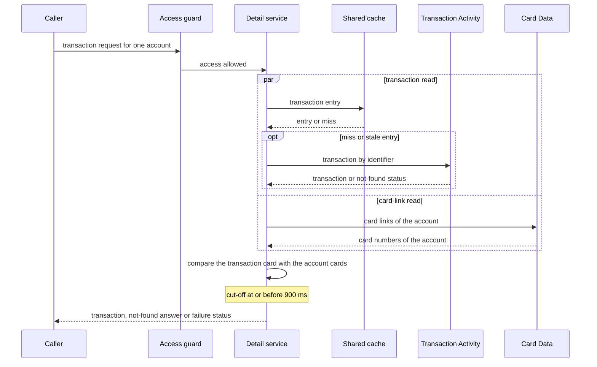

# CS-08-002: Transaction ownership check and detail retrieval

Parent epic: [CS-08 Transaction Detail Endpoint](../README.md)

## Source Story (verbatim)

> ### 1. Details/Requirements
>
> As an account holder, I want a transaction shown only when its card belongs to my account, so that no one reads another account's transaction by guessing its identifier.
>
> Trace: CARD_REQ_TBD · Data Layouts · CVTRA05Y · TRAN-CARD-NUM
>
> Account-data access path: Yes
>
> External integration or SLA-bound: Yes
>
> Capability: Stage 3 and the cut-off of the transaction detail request path. Once access is allowed, the transaction (`Data Layouts · CVTRA05Y`) and the account's card cross-references (`Data Layouts · CVACT03Y`) are read concurrently, the transaction's card number is checked against the account's card numbers, and one outcome is fixed at the cut-off: a `FRESH` or `STALE` transaction, a 404, or an error. Target paths:
>
> - `card-servicing-service/src/main/java/com/example/cardservicing/drill/TransactionDetailService.java` runs only after the account access guard `card-servicing-service/src/main/java/com/example/cardservicing/integration/auth/AccountAccessGuard.java` (CS-12-003) allows access, so no account-data read, cache read included, happens before the allow.
>   - It takes the caller's bearer token, the validated `accountId` and `transactionId`, and the request's `RequestDeadline` (`card-servicing-service/src/main/java/com/example/cardservicing/integration/support/RequestDeadline.java`, CS-11-003), the one the guard ran its Auth calls under.
>   - It starts `CardDataService.GetCardCrossReference` for the account through `CardDataClient.cardCrossReferences(token, deadline, accountId)` (CS-09-005), which returns a future from that client's bounded worker pool, and then runs `TransactionActivityService.GetTransaction` through `TransactionActivityClient.transaction(token, deadline, transactionId)` (CS-10-006) on the request thread, so the two reads overlap. Each client forwards the token, adds `x-api-key` from `AUTH_SERVICE_API_KEY`, and runs every attempt through `card-servicing-service/src/main/java/com/example/cardservicing/integration/support/UpstreamCallPolicy.java` (CS-11-003) within the deadline's remaining budget.
>   - The transaction read goes through `card-servicing-service/src/main/java/com/example/cardservicing/integration/support/ReadThroughCache.java` (CS-11-004) inside its client: a fresh entry answers with no upstream call, and on `UNAVAILABLE` or `DEADLINE_EXCEEDED` an entry within its 300 s max stale age answers `STALE`, as the `GetTransaction` row of the TRD degradation table allows. The cross-reference read is never cached and fails hard, as the `GetCardCrossReference` row requires.
>   - It waits for both reads, never past the deadline's remaining budget, and marks the cut-off when the second one completes. If the budget runs out first, the deadline records the cut-off itself, so `cutoffMs` never exceeds 900, and a read still unanswered at the cut-off ends in `DEADLINE_EXCEEDED`.
>   - Ownership: the transaction belongs to the account only when its `cardNumber` equals, character for character, the `cardNumber` of one of the account's cross-reference records. `NOT_FOUND` from `GetCardCrossReference`, an account with no cross-reference record, counts as an empty card set.
>   - Outcome rules, the first that applies deciding:
>     1. `NOT_FOUND` from `GetTransaction` returns 404 `NOT_FOUND`, whatever the cross-reference read returns.
>     2. A transaction read that fails with no usable cache entry returns its final status, 503 `UNAVAILABLE` or 504 `DEADLINE_EXCEEDED`, so when both reads fail the transaction read's status is returned.
>     3. A cross-reference read that fails returns its final status, 503 `UNAVAILABLE` or 504 `DEADLINE_EXCEEDED`, even when the transaction came from cache.
>     4. A card number absent from the account's card set returns 404 `NOT_FOUND` with the same `code` and `message` as an unknown transaction and no transaction field, so the response does not reveal that the transaction exists under another account.
>     5. Otherwise the transaction is returned.
>   - Any other typed failure either client raises passes through with its own status. Every failure is a typed failure of the CS-05-002 code table, which the standard error handler renders with the `traceId` issued at receipt.
>   - It resolves `dataStatus` and `asOf` through `card-servicing-service/src/main/java/com/example/cardservicing/integration/support/DataStatusResolver.java` (CS-05-005) from the two sources used: an upstream read contributes its read time and a cache entry its `cachedAt`, so a transaction from a fresh or stale cache entry sets `asOf` to that entry's `cachedAt`. Only `FRESH` and `STALE` occur, because this endpoint reads no descriptions, and Config outcomes never reach the resolver.
>   - It completes the deadline exactly once, with outcome `full` for `FRESH`, `degraded` for `STALE`, and `error` with the response status for 404, 503 or 504, so the completion line carries `cutoffMs`, the outcome and the `traceId`.
>   - It opens no store connection and holds no Redis client: Redis is reached only through `ReadThroughCache` inside the Transaction Activity client, and data only through the two gRPC clients.
> - `card-servicing-service/src/main/java/com/example/cardservicing/drill/TransactionDetailResult.java` is the result: `accountId`, the transaction with every field of the `Transaction` message in `card-servicing-service/src/main/proto/cardservicing/api/v1/card_servicing_service.proto`, `dataStatus`, and `asOf` in RFC 3339 with microseconds and `Z`. Amounts stay the scale-2 decimal strings the contracts carry.
> - Test: `card-servicing-service/src/test/java/com/example/cardservicing/drill/TransactionDetailServiceTest.java` sends each test request through the account access guard and then the service, as the endpoints will (CS-08-003).
>   - It uses the Auth, Config, Transaction Activity and Card Data stubs registered on `StubHarness` (`card-servicing-service/src/test/java/com/example/cardservicing/support/StubHarness.java`, CS-11-002), with per-test `STUB_LATENCY_MS` and `STUB_FAILURE_RATE` overrides on each stub and call counts from each stub's `StubRequestLog`.
>   - The cache runs on the in-memory recording `EntryStore` with the controllable test clock of the CS-11-004 tests, for entry ages and cache-read counts.
>   - Each test request starts its `RequestDeadline` at receipt, and the test client measures the response time.
> - That makes 3 files, all created.
> - Context: `Use Cases · COTRN01C` reads a transaction by TRAN-ID alone, with no account check. The baseline adds the account path and the ownership 404, which this story implements.
>
> In scope:
>
> - The ownership check of the transaction's card number against the account's card numbers.
> - The concurrent transaction and cross-reference reads.
> - The 404 rules for an unknown transaction and for a card not on the account.
> - `dataStatus` and `asOf`.
> - The deadline, degradation and fail-hard outcomes at the cut-off.
>
> Not in this story:
>
> - Input validation (CS-08-001).
> - The REST controller, the gRPC method and the wire mapping (CS-08-003).
> - Token validation and the access decision (CS-12-003).
> - The Transaction Activity client and its cache entries (CS-10-006), the Card Data client (CS-09-005), and the cache mechanics (CS-11-004).
> - Retry, timeout and deadline mechanics (CS-11-003).
>
> ### 2. Acceptance Criteria
>
> - AC1: For token `fixture-token-user0001` and transaction `0000000776200014` under account `00000000011`, which is outside the caller's entitlements, the request returns 403 `PERMISSION_DENIED`. For that request the Transaction Activity and Card Data stub request logs hold zero entries and the cache records zero reads, so no account data is read from upstream or cache before access is allowed.
> - AC2: For token `fixture-token-user0001`, transaction `0000000776200014` under account `00000000001`, all stubs healthy and an empty cache, the result carries `accountId` "00000000001" and a transaction with `transactionId` "0000000776200014", `typeCode` "01", `categoryCode` "0001", `source` "POS TERM", `description` "Purchase at Lebsack and Sons", `amount` "985.22", `merchantId` "800000000", `merchantName` "Lebsack and Sons", `merchantCity` "Otisbury", `merchantZip` "32545", `cardNumber` "9680294154603697", and `originalTimestamp` and `processedTimestamp` "2022-06-10T19:27:53.000000Z". `dataStatus` is `FRESH`, `asOf` equals the earlier of the two upstream read times, the Transaction Activity and Card Data stub logs each show exactly one call, and the completion line carries outcome `full`.
> - AC3: The same token and transaction under account `00000000002`, which is within the caller's entitlements and whose only card is `0923877193247330`, returns 404 `NOT_FOUND` with `message` "Transaction not found" and no transaction field, the same `code` and `message` as AC4.
> - AC4: Transaction `9999999999999999` under account `00000000001` returns 404 `NOT_FOUND` with `message` "Transaction not found", and the Transaction Activity stub request log shows exactly one `GetTransaction` call, because `NOT_FOUND` is not retried.
> - AC5: With 200 ms injected latency on both the Transaction Activity and Card Data stubs, the Auth stub at zero latency and an empty cache, the request returns 200 with `dataStatus` `FRESH` and a logged `cutoffMs` below 400, while the two reads run in sequence would take at least 400 ms. This proves the two Stage 3 reads run concurrently.
> - AC6: Each `GetTransaction` and `GetCardCrossReference` attempt times out at the lesser of 300 ms (`UPSTREAM_TIMEOUT_MS`) and the budget left before the cut-off. With 350 ms latency on both the Transaction Activity and Card Data stubs, an empty cache and healthy Auth, each stub request log records every attempt ending within 30 ms after that lesser value and shows exactly 2 attempts, and the request returns 504 `DEADLINE_EXCEEDED`.
> - AC7: On `UNAVAILABLE` or `DEADLINE_EXCEEDED` only, each read is retried at most two times (`UPSTREAM_MAX_RETRIES`), with 50 ms then 100 ms backoff, and a retry starts only if its backoff plus a full 300 ms attempt fits before the 900 ms cut-off. With either stub failing every call, its request log shows exactly 3 attempts of its operation, at least 50 ms and then at least 100 ms apart.
> - AC8: With the Transaction Activity stub failing every call (`STUB_FAILURE_RATE` 1.0) and no cache entry for the transaction, the request returns 503 `UNAVAILABLE` with no transaction body, and the stub log shows exactly 3 `GetTransaction` calls.
> - AC9: With the Transaction Activity stub failing every call and an entry for `0000000776200014` aged 120 s on the test clock, past its 60 s fresh TTL and within its 300 s max stale age, the request under `00000000001` returns 200 with `dataStatus` `STALE`, `asOf` equal to the entry's `cachedAt`, and outcome `degraded` on the completion line. With the entry aged 300 s, the request returns 503 `UNAVAILABLE` as in AC8.
> - AC10: With the Card Data stub failing every call and `0000000776200014` held in a fresh cache entry, the request returns 503 `UNAVAILABLE`, never 200, and the stub log shows exactly 3 `GetCardCrossReference` calls. With a Card Data stub latency of 2,000 ms in place of the failures, it returns 504 `DEADLINE_EXCEEDED` after exactly 2 `GetCardCrossReference` attempts.
> - AC11: With 2,000 ms latency on the Transaction Activity stub, the Auth and Card Data stubs at zero latency and no cache entry, the request returns 504 `DEADLINE_EXCEEDED`, and the stub log shows exactly 2 `GetTransaction` attempts, because a third would not fit the remaining budget.
> - AC12: For every degraded 200, 503 and 504 in AC6–AC11, the completion line's `cutoffMs` is at most 900 (`REQUEST_DEADLINE_MS`), the line carries the outcome and the receipt `traceId`, and the client-measured response arrives below 1,000 ms. The same holds on a cold path with an Auth stub latency of 250 ms and a Transaction Activity stub latency of 350 ms, where the Transaction Activity stub log shows exactly one `GetTransaction` attempt and the request returns 504.
> - AC13: With `0000000776200014` held in a cache entry aged 10 s, younger than its 60 s fresh TTL, the request under `00000000001` returns 200 with `dataStatus` `FRESH` and `asOf` equal to that entry's `cachedAt`. The Transaction Activity stub log holds zero calls, and the Card Data stub log holds exactly one `GetCardCrossReference` call.
> - AC14: With the Config stub failing every call, or with a 2,000 ms Config latency and a stale snapshot, the AC2 request returns the AC2 result with `dataStatus` `FRESH`, a `cutoffMs` of at most 900 and a client-measured response below 1,000 ms.
> - AC15: With `fixture-token-expired`, the request returns 401 `UNAUTHENTICATED`. With the Auth stub failing every call, it returns 503 `UNAVAILABLE`. In both cases the Transaction Activity and Card Data stub logs hold zero entries and the cache records zero reads.
> - AC16: Every error in AC1, AC3, AC4, AC6, AC8, AC10, AC11, AC12 and AC15 carries the `traceId` generated at receipt, equal to the `traceId` on that request's completion line.
>
> ### 3. Dependencies
>
> - CS-10-006 — supplies the Transaction Activity client with the cached transaction read and its stale fallback.
> - CS-09-005 — supplies the Card Data client with the uncached cross-reference read.
> - CS-12-003 — supplies the account access guard that allows access before this service runs.
> - CS-05-005 — supplies the data-status resolver for `dataStatus` and `asOf`.
>
> Risk: The cross-reference read shares the Stage 3 budget with the transaction read, so a slow or failing cross-reference read on a cold path ends the request with 504 or 503 even when the transaction is cached.

## 4. Design

- [Transaction detail sequence](../../../../architecture/sequence-transaction-detail.mmd)
- [Logical architecture](../../../../architecture/logical-architecture.mmd)
- [Data model — transaction_record](../../../../data-model.md#transaction_record)
- [Data model — card_cross_reference](../../../../data-model.md#card_cross_reference)
- [TRD — resilience, degradation table and cache rules](../../../../technical-requirements.md#resilience)
- [TRD — request path stages](../../../../technical-requirements.md#stages)
- [TRD — deadline boundary](../../../../technical-requirements.md#deadline-boundary)
- [TRD — stage budget on a cold path](../../../../technical-requirements.md#stage-budget-on-a-cold-path)
- [TRD — edge cases and error mapping](../../../../technical-requirements.md#edge-cases)
- [Card Servicing gRPC contract](../../../../../card-servicing-service/src/main/proto/cardservicing/api/v1/card_servicing_service.proto)
- [Card Servicing OpenAPI contract](../../../../../card-servicing-service/src/main/resources/openapi/card-servicing-api.yaml)
- [Transaction Activity gRPC contract](../../../../../card-servicing-service/src/main/proto/cardservicing/transactionactivity/v1/transaction_activity_service.proto)
- [Transaction Activity OpenAPI contract](../../../../../card-servicing-service/src/main/resources/openapi/transaction-activity-service.yaml)
- [Card Data gRPC contract](../../../../../card-servicing-service/src/main/proto/cardservicing/carddata/v1/card_data_service.proto)
- [Card Data OpenAPI contract](../../../../../card-servicing-service/src/main/resources/openapi/card-data-service.yaml)
- [Shared error object contract](../../../../../card-servicing-contracts/src/main/proto/cardservicing/common/v1/common.proto)

## 5. Documentation Changes

Completed during implementation.

## 6. Test Plan

- Unit: Applies. Command `./gradlew :card-servicing-service:test jacocoTestCoverageVerification`; all tests pass, with ≥80% line coverage per module. Cases: AC1–AC16 against in-JVM loopback stubs with per-test `STUB_LATENCY_MS` and `STUB_FAILURE_RATE`, the recording entry store and the test clock. Deadline cases assert a logged `cutoffMs` ≤ 900 and a client response below 1,000 ms.
- Integration: Not applicable — the integration suites belong to the external epics, the Card Data and Transaction Activity integration suites (CS-09-006, CS-10-007). Threshold when it applies: `./gradlew :card-servicing-service:integrationTest` passes, with one suite per external epic covering a stub exception, latency above `UPSTREAM_TIMEOUT_MS`, and the `UPSTREAM_MAX_RETRIES` cap.
- Performance: Applies, through the transaction detail SLA scenario (CS-04-002).
  - Commands: `docker compose -f tests/docker-compose.yml up -d --wait`, then `./gradlew :card-servicing-service:performanceTest`, then `docker compose -f tests/docker-compose.yml down`.
  - Pass: p50/p95/p99 below 1,000 ms over successful requests, with failure injection off, at 10 users × 100 sequential calls, 100,000 category balances and 1,000,000 transactions.
  - Injected failures are proven by this story's unit cases: a logged `cutoffMs` ≤ 900 and a client-measured response below 1,000 ms.
- End-to-end: Applies, through the transaction detail step (CS-04-001). Commands: `docker compose -f tests/docker-compose.yml up -d --wait`, then `./gradlew :card-servicing-service:e2eTest`, then `docker compose -f tests/docker-compose.yml down`; the four-step flow for account `00000000001` returns the expected fixture values, and each stub's request log shows at least one call.

## 7. Validation Results

Completed during implementation.

## Implementation Design

Recommended: Option A — the transaction read and the card-link read run side by side once access is allowed, and the card numbers are compared when both answer.

Rationale: the ownership rule needs both answers, so overlapping the two reads costs the stage one read's latency and leaves the remaining budget for retries.

- Rejected: Option B, reading the account's card links first and the transaction second, because two remote calls in a row share one budget and a cold path then leaves the second read no retry.

### Shared by both options

- Topology: the detail service runs inside the service process after the access guard allows, and reaches the transaction service and the card data service through their existing clients.
- Naming: a transaction belongs to the account when its card number equals one card number among the account's card links, as the card cross-reference record defines them.
- Addressing: the account number and the transaction identifier come from the request, and the transaction service is asked by transaction identifier alone.
- Isolation: no read happens before access is allowed, and the transaction cache entry carries no caller and no account, so the card comparison runs on every request, cache hits included.
- Fallback: a transaction may come from a stale cache entry up to five minutes old, while the card links are never cached and never served stale.
- Provisioning: no new store, cache region, setting or deployed component.
- Cut-over: real services replace the stubs by target address and credential source only.
- Failures: an unknown transaction and a transaction on another account give one identical not-found answer, the unavailable status after retries gives 503, and the deadline-exceeded status at the cut-off gives 504.

### Design Option A — side-by-side reads, then compare

The card-link read starts on the card data client's worker pool, and the transaction read runs on the request thread meanwhile, through the shared cache. The service waits for both, never past the remaining budget, marks the cut-off and applies the outcome rules in their fixed order. A matching card number returns the transaction with its data status and as-of time.

How it behaves:

- On a cold path both reads start together, so the stage costs the slower read rather than the sum of both.
- A fresh cached transaction skips the transaction call, while the card-link call still runs.
- An unknown transaction gives the not-found answer even when the card-link read fails.
- A card-link failure gives 503 or 504, even with the transaction already taken from the cache.
- A transaction on another account gives the same not-found answer as an unknown one, with no transaction in it.
- When both reads fail, the transaction read's status is the answer.

| No. | Decision (vs rejected) | Pro | Con |
|---|---|---|---|
| 1 | Both reads side by side (vs card links first) | the stage costs one read's latency | a card-link call is spent on unknown transactions |
| 2 | Card comparison inside the service (vs the transaction service naming the owner) | no change to either upstream interface | every request carries a card-link read |
| 3 | One not-found answer for unknown and foreign transactions (vs a distinct answer) | a caller learns nothing about other accounts | the response alone cannot tell the two cases apart |
| 4 | Transaction status first when both reads fail (vs card-link status first) | one fixed precedence for every test | the card-link failure is absent from the answer |

Effort and risk: one service, one result and one test, with the risk in the card data worker pool queueing the card-link read under load.

### Design Option B — card links first, then the transaction

The service reads the account's card links, waits for them, and only then reads the transaction through the shared cache. The comparison and the outcome rules are the same as in Option A. An account with no card links ends in the not-found answer before any transaction read.

How it differs:

- The stage costs the sum of both reads.
- On a cold path the two authentication calls can leave about 300 ms, which a slow card-link read can spend in full before the transaction read starts.
- A fresh cached transaction still waits behind the card-link read.
- An account with no card links skips the transaction call.
- A card-link failure ends the request before any transaction read.

| No. | Decision (vs rejected) | Pro | Con |
|---|---|---|---|
| 1 | Card links before the transaction (vs side by side) | an account with no card links skips the transaction call | the stage costs both latencies |
| 2 | One read in flight at a time (vs two) | no worker pool use for this endpoint | no overlap absorbs a slow read |
| 3 | Same outcome rules as Option A (vs new rules) | each outcome keeps its answer | the timing alone decides between the options |

Effort and risk: the same three files with no overlap of reads, with the risk in deadline-exceeded answers whenever both reads are slow.

### Recommendation

- Option: Option A.
- Why: only side-by-side reads keep the stage within one read's latency, so the remaining budget still holds a retry on a cold path.
- Strongest argument against: every request spends a card-link read and a worker pool slot, even when the transaction turns out unknown.
- Shared items that do not decide the choice: the ownership rule, the identical not-found answer, the fail-hard card-link read, the stale transaction fallback and the data status rules.
- Flip conditions: the transaction service returns the owning account with each transaction, which removes the card-link read, or the card data client loses its worker pool, so the two reads can no longer overlap.

## Design Validation

### Option A

Settled assumptions:

- The card data client returns its card-link read as a future on its own worker pool, and the transaction client blocks the request thread.
- The card links are never cached, so each request compares against current ownership.
- The transaction cache keeps an entry fresh for one minute and usable when stale for five minutes.
- The access guard has allowed the request before the service runs.
- A card number is a fixed sixteen-character value on both records.

Open assumptions:

- Open → whether the card data worker pool queues the card-link read under ten concurrent users, settled by the transaction detail service-level scenario.
- Open → the share of detail requests answered from the transaction cache, settled by the stub request logs of the same scenario.

| AC | Verdict | Why |
|---|---|---|
| AC1 | Holds | the service runs only after the guard allows access |
| AC2 | Holds | both reads answer and the card numbers match |
| AC3 | Holds | the card number is absent from the second account's card links |
| AC4 | Holds | the not-found status ends the transaction read after one attempt |
| AC5 | Holds | the two reads overlap, so the stage costs one latency |
| AC6 | Holds | the call policy cuts each attempt to the remaining budget |
| AC7 | Holds | the call policy applies the retry cap, the waits and the fit rule |
| AC8 | Holds | with no usable entry the unavailable status stands |
| AC9 | Holds | the transaction client serves the stale entry within five minutes |
| AC10 | Holds | the card-link read fails hard whatever the transaction source |
| AC11 | Holds | the fit rule stops after the second attempt |
| AC12 | Holds | the deadline fixes the cut-off by 900 ms in every failure case |
| AC13 | Holds | a fresh entry skips the transaction call while the card-link read still runs |
| AC14 | Holds | the configuration refresh never reaches the data status or the budget |
| AC15 | Holds | the guard rejects before the service runs |
| AC16 | Holds | every failure passes through the standard error object with the receipt trace identifier |

### Option B

Settled assumptions:

- The clients, cache periods and guard order are the same as in Option A.
- The card-link read finishes before the transaction read starts.
- The card links are never cached, so each request compares against current ownership.

Open assumptions:

- Open → how much of the stage budget the card-link read uses at the planning volume, settled by the stub request logs of the transaction detail service-level scenario.

| AC | Verdict | Why |
|---|---|---|
| AC1 | Holds | the guard still runs first |
| AC2 | Holds | both reads answer in turn and the card numbers match |
| AC3 | Holds | the card comparison is unchanged |
| AC4 | Holds | the not-found status still ends the transaction read after one attempt |
| AC5 | Breaks | two reads of 200 ms in a row put the cut-off past 400 ms |
| AC6 | Breaks | the failed card-link read ends the request before any transaction attempt |
| AC7 | Holds | the call policy still applies the retry cap, the waits and the fit rule |
| AC8 | Holds | with no usable entry the unavailable status still stands |
| AC9 | Holds | the stale entry is served after the card-link read |
| AC10 | Holds | the card-link failure ends the request before the transaction read |
| AC11 | Conditional | the second transaction attempt fits only while the card-link read answers at once |
| AC12 | Conditional | the cold-path case shows one transaction attempt only while the card-link read answers at once |
| AC13 | Holds | the fresh entry is served after the card-link read |
| AC14 | Holds | the configuration refresh never reaches the data status or the budget |
| AC15 | Holds | the guard rejects before the service runs |
| AC16 | Holds | every failure passes through the standard error object with the receipt trace identifier |

## Metadata

| Field | Value |
|---|---|
| Build wave | W2 |
| Depends on | CS-10-006, CS-09-005, CS-12-003, CS-05-005 |
| Status | TBD |
| Estimated Files Touched | 3 |
| Issue Type | Story |
| Epic Name | Transaction Detail Endpoint |
| Epic Link | CS-08 |
| Story Points | 5 |
| Priority | High |
| Components | TBD |
| Fix Version/s | TBD |
| Team | TBD |
| Assignee | TBD |
| Reporter | TBD |
| Labels | TBD |
| Sprint | TBD |
| Due Date | TBD |
| Environment | TBD |
| Persona | TBD |
| Estimated Effort | TBD |
