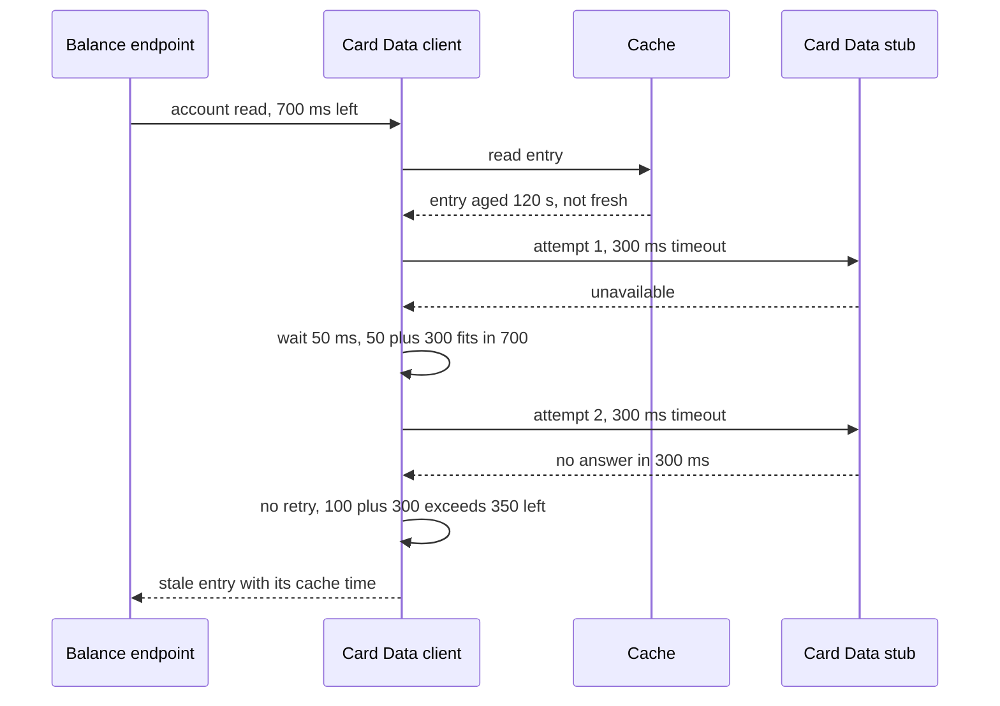

# CS-09-005: Card Data client with account and category balance caching

Parent epic: [CS-09 Card Data Integration](../README.md)

## Source Story (verbatim)

> ### 1. Details/Requirements
>
> As a card servicing user, I want account and category-balance reads cached with a stale fallback, so that a short Card Data outage still shows my balances.
>
> Trace: CARD_REQ_TBD · Data Layouts · CVACT01Y · ACCT-CURR-BAL
>
> Account-data access path: No
>
> > SCOPE-QUESTION (Resolved): Should this client carry the account-data classification? This client is the service's only path to account, cross-reference and category-balance records, so every account-data read of the request path runs through it, and the line resolves to `Account-data access path: Yes`. The client does not duplicate authorization: the account access guard (CS-12-003) allows access before any caller invokes the client, and AC15 states the constraint.
>
> External integration or SLA-bound: Yes
>
> Capability: one Card Data client is the service's only path to account records (`Data Layouts · CVACT01Y`), card cross-references (`Data Layouts · CVACT03Y`) and category balances (`Data Layouts · CVTRA01Y`). It serves the Stage 3 reads of the request path: `GetAccount` and `ListCategoryBalances` run concurrently for the balance summary, `ListCategoryBalances` serves category balances, and `GetCardCrossReference` serves the ownership check of the transaction detail. Account and category-balance reads are cached with a stale fallback, and the cross-reference read is never cached. Target paths:
>
> - `card-servicing-service/src/main/java/com/example/cardservicing/integration/carddata/CardDataClient.java`:
>   - Wraps the blocking stub that grpc-java generates for `cardservicing.carddata.v1.CardDataService` in the Java package `com.example.cardservicing.contract.carddata.v1` from `card-servicing-service/src/main/proto/cardservicing/carddata/v1/card_data_service.proto`, generated under the build directory and never checked in.
>   - `account(token, deadline, accountId)`, `categoryBalances(token, deadline, accountId)` and `cardCrossReferences(token, deadline, accountId)` each submit one read to the client's bounded worker pool and return a `java.util.concurrent.CompletableFuture`, so an endpoint starts its Stage 3 reads concurrently and one instance serves concurrent requests. A failed read completes the future exceptionally with the final `io.grpc.StatusRuntimeException`, its status and packed `ErrorObject` unchanged.
>   - `GetAccount` and `ListCategoryBalances` run through `UpstreamCallPolicy` and `RequestDeadline` (CS-11-003) inside `ReadThroughCache` (CS-11-004): the upstream read the cache receives is one policy-wrapped call within the request's `RequestDeadline`, and the cache's time-left supplier reports that deadline's remaining budget. `account` completes with `ReadThroughCache.CachedValue<Account>` and `categoryBalances` with `ReadThroughCache.CachedValue<List<CategoryBalance>>`, each holding the value, its `cachedAt` and a freshness of `FRESH` or `STALE`.
>   - `GetCardCrossReference` runs through the call policy only: uncached, with no stale fallback. `cardCrossReferences` completes with the `card_cross_references` list in the stub's order and never sends a cache command.
>   - Each call adds the forwarded bearer token as `authorization: Bearer <caller token>` and `x-api-key` with the value of `card-servicing.auth.api-key` from `card-servicing-service/src/main/java/com/example/cardservicing/config/CardServicingProperties.java` (CS-11-001), bound from `AUTH_SERVICE_API_KEY`: an empty placeholder in the stub phase, sent as an empty value, and a Key Vault secret when deployed (CS-12-004). The headers are attached per call, so the client holds no token between calls.
>   - Adds no attempt, timeout, retry, backoff or freshness rule of its own, and holds no store connection and no Redis client: Redis is reached only through `ReadThroughCache`, and account data only through this gRPC client.
>   - Writes one warning line per stale result or failed read naming the operation, the account identifier and the final gRPC status code. No line carries the token, the service credential or any other call metadata.
> - `card-servicing-service/src/main/java/com/example/cardservicing/integration/carddata/CardDataChannelConfiguration.java`:
>   - Builds one plaintext gRPC channel per service instance to the Card Data target address, and the blocking stub over it. The channel connects on first use, so a context starts with no Card Data service reachable, and the channel and the worker pool shut down when the application context closes.
>   - Binds the target address from `card-servicing.clients.card-data.target` through a `@ConfigurationProperties` record nested in this file.
>   - Builds the bounded worker pool the blocking calls run on: 32 daemon threads and a queue of 64 waiting reads, both constants of this class and never configuration entries. A read submitted while 32 reads run and 64 wait completes at once with `UNAVAILABLE` and sends no stub call and no cache command.
>   - Builds the two `ReadThroughCache.KeyFamily` values of the rules below, each with a codec that writes the generated `GetAccountResponse` or `ListCategoryBalancesResponse` as protobuf bytes.
>   - Holds the gRPC Netty transport's client frame logger `io.grpc.netty.shaded.io.grpc.netty.NettyClientHandler` at INFO through Spring Boot's `LoggingSystem` when it starts, and installs, before it builds its channel, a nested `CardDataChannelConfiguration.ClientFrameLogGuard` built the same way as the client frame-log guards of CS-12-002, CS-11-006 and CS-13-003, because at DEBUG that shared logger writes every outbound header value, `authorization` and `x-api-key` included.
>
> > SCOPE-QUESTION (Resolved): Does "built the same way" keep every wrapper in place when another frame-log guard installs at the same time? Not if each guard locks only its own class: every frame-log guard of the process replaces the one default logger factory of the shaded Netty transport, separate class monitors do not exclude each other, and two installers that both read the same factory each publish a wrapper around it, so the later publication drops the earlier wrapper, and that guard's frame logger can write credentials once a later context resets it to DEBUG. Resolution: "built the same way" includes one shared installation lock. `CardDataChannelConfiguration.ClientFrameLogGuard.install()`, like every other frame-log guard of the process, the server guard `GrpcServerConfiguration.ServerFrameLogGuard` (CS-11-002) and the client guards `AuthClient.ClientFrameLogGuard` (CS-12-002), `ConfigClient.ClientFrameLogGuard` (CS-11-006), `ReferenceDataClientConfiguration.ClientFrameLogGuard` (CS-13-003) and `TransactionActivityClient.ClientFrameLogGuard` (CS-10-006), runs its whole body while holding the monitor of the shaded logger-factory class itself, `synchronized (InternalLoggerFactory.class)` on `io.grpc.netty.shaded.io.netty.util.internal.logging.InternalLoggerFactory`: the synchronization of its static `install()` is that shared monitor, and the guard class's own monitor plays no part. That class object exists once per class loader, the same scope as the default-factory field every guard replaces, so every installer able to replace that factory shares it, with no shared class, no new file and no story edge. Inside the lock, `install()` reads the guard's installed flag and returns at once when it is set. Otherwise it reads the current default factory with `InternalLoggerFactory.getDefaultFactory()`, builds its wrapper around exactly that factory, publishes the wrapper with `InternalLoggerFactory.setDefaultFactory` and sets the installed flag only after that call returns. Because the read and the publication happen under the same lock, no installer publishes over a factory it has not read: each wrapper delegates to the factory it found, the wrappers of earlier guards included, so the chain keeps every guard installed before it, whatever the start order and the thread. No code of the service or its tests replaces the default factory except an installer that holds this lock and follows this sequence, such as the test-local client-side installer of CS-11-002. The wrapper's behaviour, the install-before-channel rule, the never-removed rule and the level hold stay as the guards of CS-12-002, CS-11-006 and CS-13-003 set them, and the lock adds no file, no dependency and no environment variable, so the 5 files touched stand.
>
> - `card-servicing-service/src/main/resources/application.yml`: adds the Card Data target-address entry `card-servicing.clients.card-data.target` under the service's `card-servicing` configuration (owned by CS-11-001) with the literal loopback default `localhost:9090`. It is not an environment placeholder and not a variable of the TRD environment-variable table, and the 14 bound properties of CS-11-001 stay unchanged. The unit suite sets it to the `127.0.0.1` port that `StubHarness` reports, the Compose stack (CS-01-001) sets the stub container address, and a deployed environment sets the real service address.
> - `card-servicing-service/src/test/java/com/example/cardservicing/integration/carddata/CardDataClientTest.java`: policy, deadline, credentials, worker-pool, swap-point and status-mapping cases against the registered Card Data stub, `StubHarness.of(new CardDataStubRegistration())` (CS-09-004, `card-servicing-service/src/test/java/com/example/cardservicing/support/StubHarness.java`), with per-test latency and failure-rate overrides through `StubHarness.inject` on stub `card-data` and attempts counted in the stub request log. A test-local `StubRegistration` under stub name `card-data`, which `StubHarness.allRegistered()` never discovers, wraps the stub's service definition with a header-capturing server interceptor that also records each call's arrival time. The cache runs on an empty in-memory `EntryStore` unless a case seeds it. The test builds its token and service-key values at runtime, so the committed-secret scan of CS-11-001 finds no literal credential.
> - `card-servicing-service/src/test/java/com/example/cardservicing/integration/carddata/CardDataClientCacheTest.java`: fresh hit, miss, stale refresh, stale fallback, expiry beyond max stale age and Redis failure, on the in-memory recording `EntryStore` and the failing `EntryStore` that the CS-11-004 tests use, with one controllable test clock for entry ages and the registered Card Data stub as the upstream.
> - Together these are the 5 files touched.
>
> Rules:
>
> - Cache keys use the TRD forms under `cs:v1:`: key family `account` with key `cs:v1:account:<accountId>`, and key family `category-balances` with key `cs:v1:category-balances:<accountId>`. Neither carries a subject, token or role, so one entry serves every caller of that account once the guard (CS-12-003) has allowed access.
> - Both families have a fresh TTL of 60 s and the 300 s max stale age of the TRD cache rules, which the cache also writes as the entry's Redis expiry. The TRD cache rules leave the fresh TTL to this story, and 60 s keeps a 240 s stale window inside the 300 s max stale age.
> - A Redis failure is treated as a miss, and an entry that does not parse counts as a miss.
> - Card cross-references are not cached, so the ownership check of the transaction detail always reads current data and fails hard when it cannot.
> - Neither credential is logged, and no cache key carries either.
> - The swap point is the target address and credential source only: replacing the stub with the real Card Data service changes `card-servicing.clients.card-data.target` and the source of `AUTH_SERVICE_API_KEY`, and no class.
> - Degradation, per the TRD degradation table: `account` and `categoryBalances` complete `STALE` with the entry's `cachedAt` when the last permitted attempt fails with `UNAVAILABLE` or `DEADLINE_EXCEEDED` and an entry within the 300 s max stale age is held, and otherwise complete exceptionally with that status, which the standard error mapping (CS-05-002) turns into 503 or 504. `cardCrossReferences` fails hard with 503 or 504. `NOT_FOUND` surfaces as 404 and is never retried.
>
> In scope:
>
> - The 5 files above.
> - The three calls `GetAccount`, `ListCategoryBalances` and `GetCardCrossReference`.
> - Caching of the account and category-balance reads.
> - The stale outcome with `cachedAt`.
> - The fail-hard cross-reference read.
> - Forwarding of the bearer token and the service credential.
> - The target address and its channel.
> - The bounded worker pool.
>
> Not in this story:
>
> - `dataStatus` and `asOf` resolution (CS-05-005) and the HTTP status mapping (CS-05-002).
> - The account access guard that authorizes before any read (CS-12-003).
> - Config refresh and the configuration snapshot behind `UpstreamSettings` (CS-11-006).
> - The container-backed Card Data integration suite (CS-09-006).
> - The Card Data stub (CS-09-004) and its container address in `tests/docker-compose.yml` (CS-01-001).
> - Call-policy and cache mechanics: attempts, backoff, the request deadline, freshness, stale fallback and Redis failure handling (CS-11-003, CS-11-004).
> - Service-to-service mTLS inside AKS (security control S4).
>
> ### 2. Acceptance Criteria
>
> - AC1: Timeout: each `GetAccount`, `ListCategoryBalances` and `GetCardCrossReference` attempt times out at the lesser of 300 ms (`UPSTREAM_TIMEOUT_MS`) and the time left before the cut-off of the request deadline. With a per-test stub latency of 400 ms (`STUB_LATENCY_MS`) on stub `card-data` and a fresh 900 ms budget, the first attempt of each operation ends with `DEADLINE_EXCEEDED` between 300 and 330 ms after it starts. With the same latency and 200 ms of budget left at call start, the attempt ends with `DEADLINE_EXCEEDED` no later than 230 ms after the call starts.
> - AC2: Retry: on `UNAVAILABLE` or `DEADLINE_EXCEEDED` only, the client retries at most 2 times (`UPSTREAM_MAX_RETRIES`), after 50 ms then 100 ms backoff. With a per-test failure rate of 1.0 (`STUB_FAILURE_RATE`) on stub `card-data`, the stub request log shows exactly 3 attempts for one call of each operation. A `NOT_FOUND` answer for account `00000000099` and an `INVALID_ARGUMENT` answer for account `00000000000` each show exactly 1 attempt in the request log, for each operation.
> - AC3: Retry fit: a retry starts only when its backoff plus a full 300 ms attempt fits before the deadline. With a per-test stub latency of 400 ms and a 900 ms budget, the stub request log shows exactly 2 attempts for one call of each operation (300 + 50 + 300 = 650 ms, then 100 + 300 > 250).
> - AC4: Deadline: the 900 ms deadline (`REQUEST_DEADLINE_MS`) runs from receipt to the cut-off, and every failure case resolves at or before it. With a per-test stub latency of 2,000 ms, a test request starts a 900 ms `RequestDeadline`, calls `account` for `00000000001` and marks the cut-off when the future completes: the stub request log shows exactly 2 attempts, the outcome is `STALE` when an entry aged 120 s is held and `DEADLINE_EXCEEDED` when none is, the completion line logs `cutoffMs` ≤ 900, and the time the caller measures from the deadline's start to the future's completion is below 1,000 ms. The same holds for `categoryBalances`, and for `cardCrossReferences` with `DEADLINE_EXCEEDED` as its only failure outcome.
> - AC5: Fresh hit: an account or category-balance entry younger than the 60 s fresh TTL is returned `FRESH` with its stored `cachedAt`, and the stub request log holds zero calls. On the test clock this holds for entries aged 0 s and 59 s. An entry aged 60 s, with the stub answering, causes exactly one stub call and returns the stub's value `FRESH` with a new `cachedAt`.
> - AC6: Miss: with no entry, one `account` read for `00000000001` makes exactly one stub call, returns `FRESH` with `currentBalance` `194.00` and `creditLimit` `2020.00`, and writes exactly one entry, key `cs:v1:account:00000000001`, with `cachedAt` equal to the read time and a Redis expiry of 300 s. One `categoryBalances` read writes `cs:v1:category-balances:00000000001` holding the one balance `01`/`0001` `0.00` in the same way. Neither key contains the caller's token or subject. A second read of each within the fresh TTL with a different token is a fresh hit, and the request log still holds exactly one call per operation.
> - AC7: Degrade, stale: when the last permitted attempt fails with `UNAVAILABLE` (failure rate 1.0) and an entry within its 300 s max stale age is held, `account` and `categoryBalances` degrade to the cached value marked `STALE`, carrying the entry's original `cachedAt`, and the entry is not rewritten. On the test clock this holds for entries aged 60 s and 299 s, and AC4 covers the same degrade after `DEADLINE_EXCEEDED`.
> - AC8: Degrade expiry: when the last permitted attempt fails and the entry is aged 300 s or more on the test clock, or no entry is held, `account` and `categoryBalances` return no cached value. The future completes exceptionally with `UNAVAILABLE` after the failure-rate case, which the standard error mapping turns into 503, and with `DEADLINE_EXCEEDED` after the 2,000 ms latency case, which it turns into 504.
> - AC9: Fail hard, cross-reference: `cardCrossReferences` for `00000000001` returns the one cross-reference with `cardNumber` `9680294154603697` and `customerId` `000000001` when the stub answers, and fails hard otherwise. With failure rate 1.0 it completes exceptionally with `UNAVAILABLE` (503) after exactly 3 attempts, and with a stub latency of 2,000 ms with `DEADLINE_EXCEEDED` (504) after exactly 2. The recording entry store records zero commands across all three cases, so the cross-reference read never reads or writes the cache.
> - AC10: Not found: `NOT_FOUND` from any of the three operations for account `00000000099` completes the future exceptionally with `NOT_FOUND` and its packed `ErrorObject` unchanged, which the standard error mapping turns into 404. It is not retried: each operation shows exactly 1 attempt in the request log. No entry is written, and an entry for that account aged 120 s is never returned in its place.
> - AC11: Redis failure: with every entry-store command failing, each `account` and `categoryBalances` read is treated as a miss: it reaches the stub exactly once and completes `FRESH` with the stub's values, and no Redis error reaches the caller. With the stub failing as well, the stub's `UNAVAILABLE` status is the one returned.
> - AC12: Credentials: every stub call carries the forwarded `authorization` bearer token and the `x-api-key` value. On all three operations the header-capturing interceptor records `authorization` equal to `Bearer ` followed by the test token, and `x-api-key` equal to the configured value, or an empty value when the key is empty. With the root log level and the client frame logger at DEBUG on a live channel, the log output captured across the AC1, AC2, AC6, AC7 and AC9 paths contains neither value, and no written cache key contains either.
>
> > SCOPE-QUESTION (Resolved): The criterion also covers concurrent guard installation. Does this client's frame-log guard stay in the shaded transport's logger factory when the server guard `GrpcServerConfiguration.ServerFrameLogGuard` (CS-11-002) installs at the same moment, and do new connections then keep both credentials out of the log after a later DEBUG reset? Resolution: `CardDataClientTest` adds two cases, with no new file. (T1) Shared-lock check, in the test JVM: while the test thread holds the monitor of `InternalLoggerFactory`, a second thread calling `CardDataChannelConfiguration.ClientFrameLogGuard.install()` reaches thread state `BLOCKED` within 1 s, and `InternalLoggerFactory.getDefaultFactory()` returns the same object as before. Once the test releases the monitor, the call returns within 1 s. The check holds whether or not the guard is already installed, because the installed flag is read inside the lock. (T2) Concurrent installation with later DEBUG resets, in fresh JVMs: the test starts 5 child JVMs one after another through the JDK process API, `ProcessBuilder` with the running JVM's `java` command and the test class path, each running a `main` nested in `CardDataClientTest`, so no guard is installed when a child starts. In each child, two threads released together by one `CountDownLatch` call `GrpcServerConfiguration.ServerFrameLogGuard.install()` and `CardDataChannelConfiguration.ClientFrameLogGuard.install()`. The child then sets the root level, `io.grpc`, `io.grpc.netty.shaded.io.grpc.netty.NettyServerHandler` and `io.grpc.netty.shaded.io.grpc.netty.NettyClientHandler` to DEBUG through `LoggingSystem.get(classLoader)`, the state a later context's logging reset leaves, starts a new loopback server for the Card Data stub, `CardDataStubRegistration` (CS-09-004), through `StubServerHost`, opens a new plaintext channel to the port it reports, built the way `CardDataChannelConfiguration` builds its channel, and sets the same four loggers to DEBUG again, since `StubServerHost` holds the server frame logger at INFO when it starts a server. It then sends 5 `GetAccount` calls for account `00000000001` through the generated blocking stub on that channel, each carrying `authorization: Bearer <token>` and `x-api-key` with a bearer token and a service key that the parent generated at runtime and wrote to the child's standard input, so no credential literal is committed, `CommittedSecretScanTest` (CS-11-001) stays green and neither value appears on a command line. The child prints that `InternalLoggerFactory.getInstance` reports DEBUG disabled for both frame-logger names while both loggers stand at DEBUG, and exits 0. The parent reads the child's merged standard output and standard error and finds neither value.
>
> - AC13: Swap point: with `card-servicing.clients.card-data.target` set to the port of a second `StubHarness` serving `CardDataStubRegistration`, every call of the three operations lands in that harness's request log and none in the first harness's log, with no change to any class. With the property not overridden, the bound target address is `localhost:9090`.
> - AC14: Bounded worker pool: with a stub latency of 400 ms, 20 concurrent `account` reads for the accounts `00000000001` to `00000000020` each reach the stub within 50 ms of submission, as the interceptor's arrival times show. With a stub latency of 2,000 ms, 96 concurrent `account` reads for `00000000001` fill the 32 worker threads and the 64 queue places, and a 97th read, for `00000000002`, submitted before any of them completes, ends exceptionally with `UNAVAILABLE` while the recording entry store holds no command for `cs:v1:account:00000000002`.
> > SCOPE-QUESTION (Resolved): Which criterion carries the authorization constraint of this account-data access path? None of AC1–AC14 does. Resolution: AC15 below. The client adds no access check of its own, and its unit suite adds no case for AC15: the account access guard (CS-12-003) decides access before any caller invokes the client, so the proof sits with the guard and with the endpoint stories that call this client.
> >
> > - AC15: Authorization: a request for account `00000000011` with `fixture-token-user0001`, outside the entitlements of `USER0001` (CS-12-001), returns 403 with `code` `PERMISSION_DENIED` from the account access guard before any call reaches this client. For that request the Card Data stub request log holds zero entries and the cache records zero reads of `cs:v1:account:00000000011` and `cs:v1:category-balances:00000000011`, so no account data is read from upstream or cache before access is allowed. The proof is delegated to CS-12-003 AC1, CS-12-005 AC3 and the endpoint stories that call this client: CS-05-005 AC2, CS-06-002 AC4 and CS-08-002 AC1.
>
> ### 3. Dependencies
>
> - CS-09-004 — provides the Card Data stub the client calls and whose request log the tests read.
> - CS-11-003 — provides the upstream call policy, request deadline and upstream settings.
> - CS-11-004 — provides the read-through cache with stale fallback.
>
> Risk: A stale entry served past its max stale age would show outdated balances, so expiry is tested at the boundary.

## 4. Design

- Diagrams: [Logical architecture](../../../../architecture/logical-architecture.mmd), [Balance summary sequence](../../../../architecture/sequence-balance-summary.mmd), [Transaction detail sequence](../../../../architecture/sequence-transaction-detail.mmd)
- Data model: [Account](../../../../data-model.md#account), [Category balance](../../../../data-model.md#category_balance), [Card cross reference](../../../../data-model.md#card_cross_reference)
- Technical requirements: [Resilience, degradation table and cache rules](../../../../technical-requirements.md#resilience), [Deadline boundary](../../../../technical-requirements.md#deadline-boundary), [D3 Stub hosting and swap point](../../../../technical-requirements.md#d3-stub-hosting-and-swap-point), [External systems](../../../../technical-requirements.md#external-systems), [Mock-to-real swap and credential management](../../../../technical-requirements.md#mock-to-real-swap-and-credential-management), [Environment variables](../../../../technical-requirements.md#environment-variables)
- Contracts: [Card Data proto](../../../../../card-servicing-service/src/main/proto/cardservicing/carddata/v1/card_data_service.proto), [Card Data OpenAPI](../../../../../card-servicing-service/src/main/resources/openapi/card-data-service.yaml), [Shared error contract](../../../../../card-servicing-contracts/src/main/proto/cardservicing/common/v1/common.proto)

## 5. Documentation Changes

Completed during implementation.

## 6. Test Plan

- Unit: Applies. Command `./gradlew :card-servicing-service:test jacocoTestCoverageVerification`; all tests pass with ≥80% line coverage per module. `CardDataClientTest` and `CardDataClientCacheTest` cover AC1–AC14 on the loopback stub harness with per-test latency and failure overrides: the attempt timeout, the retry counts and the non-retried statuses, the fit rule, the 2,000 ms deadline case, fresh hit, miss and write-back, stale refresh, stale fallback at 60 s and 299 s, expiry at 300 s and with no entry, the fail-hard cross-reference read, not-found, Redis failure, the forwarded credentials and their absence from logs, the shared installation lock of the frame-log guard in the test JVM and its concurrent installation beside the server guard in five fresh JVMs with both frame loggers reset to DEBUG, the swap point and the worker-pool bound. AC15 is proven where the account access guard runs, by CS-12-003, CS-12-005 and the endpoint stories that call this client.
- Integration: Applies through the Card Data integration suite CS-09-006, which runs this client against the Card Data stub on a real gRPC channel with Testcontainers `postgres:16.6` and `redis:7.4.2`; this story adds no integration suite. Command `./gradlew :card-servicing-service:integrationTest`; all pass, with one suite per external epic covering a stub exception, latency above `UPSTREAM_TIMEOUT_MS` and the `UPSTREAM_MAX_RETRIES` cap.
- Performance: Applies through the balance summary SLA scenario (CS-01-005) and the category balance SLA scenario (CS-02-002), whose endpoints call this client:
  - Commands: `docker compose -f tests/docker-compose.yml up -d --wait`, then `./gradlew :card-servicing-service:performanceTest`, then `docker compose -f tests/docker-compose.yml down`.
  - Pass: p50, p95 and p99 below 1,000 ms over successful requests, with failure injection off, at 10 users × 100 sequential calls, 100,000 category balances and 1,000,000 transactions.
  - Injected failures are proven by a logged `cutoffMs` ≤ 900 and a client-measured response below 1,000 ms.
- End-to-end: Not applicable — the end-to-end step CS-01-004 covers the flow that calls this client. Threshold when it applies: `docker compose -f tests/docker-compose.yml up -d --wait`, then `./gradlew :card-servicing-service:e2eTest`, then `docker compose -f tests/docker-compose.yml down`; the four-step flow for account `00000000001` returns the expected fixture values, and each stub's request log shows at least one call.

## 7. Validation Results

Completed during implementation.

## Implementation Design

Recommended: Option A, blocking calls on a bounded worker pool inside the shared policy and cache.

Rationale: blocking calls leave timing, freshness and fallback to the shared policy and cache.

- Rejected: Option B, per-call callback chains, which duplicate the timing rules.

Shared by both options:

- Topology: one client per upstream service.
- Naming: cache keys carry version and account only.
- Addressing: one typed target address per upstream.
- Isolation: cache access only through the shared read-through component.
- Fallback: stale entries for account and category-balance reads only.
- Provisioning: credentials from the environment or deployed key vault.
- Cut-over: only the target address and credential source change.
- Failures: unavailable or deadline status after the retry cap.

### Design Option A

Each read is one blocking call on 32 worker threads with 64 waiting places. The call policy gives each attempt the lesser of 300 ms and the time left. Account and category-balance reads run inside the shared cache.

How it behaves:

- A fresh entry answers without a remote call.
- A miss makes one call and writes back.
- A failed last attempt falls back to a usable stale entry.
- A full pool fails new reads at once.

| No. | Decision (vs rejected) | Pro | Con |
|---|---|---|---|
| 1 | Bounded worker pool (vs unbounded threads) | bursts cannot exhaust threads | a full pool fails reads |
| 2 | Policy wraps each attempt (vs one call timeout) | attempts fit the time left | each attempt computes a timeout |
| 3 | Uncached cross-reference read (vs cached) | ownership checks see current data | every transaction detail costs a call |
| 4 | Stale results carry cache time (vs plain values) | stale balances show their age | results carry a timestamp |

Effort and risk: low effort, with pool sizing as the risk.

### Design Option B

Each read is an asynchronous call with a per-call callback chain. Transport threads run the callbacks, so no worker pool exists.

How it differs:

- Timeout, retry and fit rules are rewritten as callbacks.
- Retry start times depend on the transport thread.
- The stale fallback runs outside the cache wrapper.
- Concurrency is unbounded without a separate limit.

| No. | Decision (vs rejected) | Pro | Con |
|---|---|---|---|
| 1 | Callback chains (vs pooled blocking calls) | no thread waits on a call | timing rules live twice |
| 2 | Transport threads run callbacks (vs a dedicated pool) | no pool to size | reads are unbounded |
| 3 | Client-side fallback (vs the cache wrapper) | each chain sees the final status | stale handling repeats the cache rule |

Effort and risk: more effort, with timing drift as the risk.

### Recommendation

- Option: Option A.
- Why: one place decides all timing and fallback.
- Strongest argument against: the pool caps concurrency and needs sizing.
- Shared items that do not decide the choice: cache rules, retry cap, credentials and swap point.
- Flip conditions: an asynchronous call policy, or pool exhaustion under load.

## Design Validation

### Option A

Settled assumptions:

- The request deadline runs from receipt to a cut-off no later than 900 ms after receipt.
- A guard silences the transport's header logging, and every such guard of the process, server or client, installs under one shared lock and wraps the guards installed before it.

Open assumptions:

- Open → pool size for ten concurrent users → settled by the balance summary performance scenario.
- Open → real-cache stale reads match the in-memory store → settled by the card data integration suite.
- Open → 60-second freshness suits the balance owner with real postings → settled by the data owner at sign-off.

| AC | Verdict | Why |
|---|---|---|
| AC1 | Holds | attempts fit the time left |
| AC2 | Holds | only retryable statuses retry |
| AC3 | Holds | retries check their fit |
| AC4 | Holds | outcomes beat the cut-off |
| AC5 | Holds | fresh entries skip the call |
| AC6 | Holds | a miss writes one entry |
| AC7 | Holds | stale entries return unchanged |
| AC8 | Holds | expired entries pass the status through |
| AC9 | Holds | cross-references bypass the cache |
| AC10 | Holds | not-found is never retried |
| AC11 | Holds | cache failure means a miss |
| AC12 | Holds | credentials ride each call unlogged |
| AC13 | Holds | configuration sets the address |
| AC14 | Holds | the pool rejects overflow |
| AC15 | Holds | the access guard denies first |

### Option B

Settled assumptions:

- Option A's settled assumptions hold.

Open assumptions:

- Open → callback timing matches the policy's fit rule → settled by rerunning the policy's timing tests on callbacks.
- Open → unbounded concurrent reads fit the transport's capacity → settled by the balance summary performance scenario.

| AC | Verdict | Why |
|---|---|---|
| AC1 | Conditional | callbacks must repeat the attempt cut |
| AC2 | Conditional | callbacks repeat the retry rule |
| AC3 | At risk | thread timing shifts fit checks |
| AC4 | At risk | callback timing moves the cut-off |
| AC5 | Holds | fresh entries skip the call |
| AC6 | Holds | a miss writes one entry |
| AC7 | Conditional | the fallback must follow the last callback |
| AC8 | Holds | expired entries pass the status through |
| AC9 | Holds | cross-references bypass the cache |
| AC10 | Holds | not-found is never retried |
| AC11 | Holds | cache failure means a miss |
| AC12 | Holds | credentials ride each call unlogged |
| AC13 | Holds | configuration sets the address |
| AC14 | Breaks | no worker pool exists |
| AC15 | Holds | the access guard denies first |

## Metadata

| Field | Value |
|---|---|
| Build wave | W1 |
| Depends on | CS-09-004, CS-11-003, CS-11-004 |
| Status | TBD |
| Estimated Files Touched | 5 |
| Issue Type | Story |
| Epic Name | Card Data Integration |
| Epic Link | CS-09 |
| Story Points | 3 |
| Priority | High |
| Components | TBD |
| Fix Version/s | TBD |
| Team | TBD |
| Assignee | TBD |
| Reporter | TBD |
| Labels | TBD |
| Sprint | TBD |
| Due Date | TBD |
| Environment | TBD |
| Persona | TBD |
| Estimated Effort | TBD |
