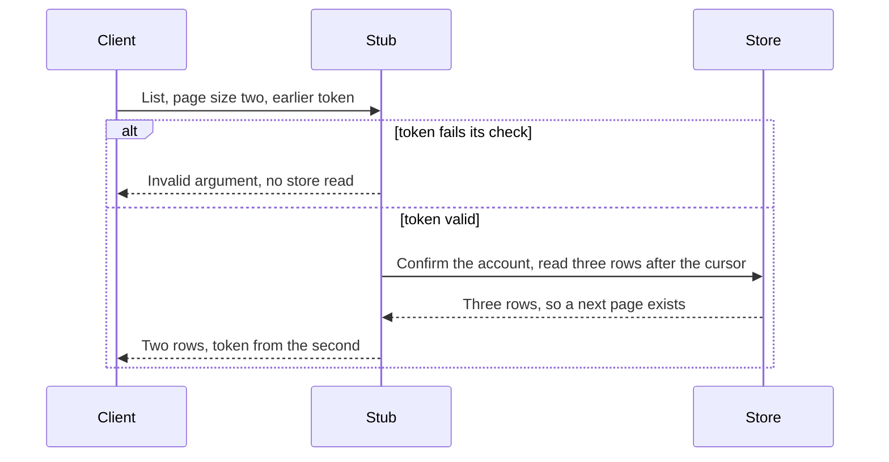

# CS-10-004: Transaction Activity stub transaction listing with keyset paging

Parent epic: [CS-10 Transaction Activity Integration](../README.md)

## Source Story (verbatim)

> ### 1. Details/Requirements
>
> As a test engineer, I want a mocked Transaction Activity service that lists one account's transactions newest first in keyset pages, so that the drill-down is testable at full volume.
>
> Trace: CARD_REQ_TBD · Use Cases · COTRN00C
>
> Account-data access path: No
>
> External integration or SLA-bound: No
>
> Capability: one gRPC stub of `cardservicing.transactionactivity.v1.TransactionActivityService` from `card-servicing-service/src/main/proto/cardservicing/transactionactivity/v1/transaction_activity_service.proto` answers `ListTransactions` from a mock-data provider over the rows that CS-10-002 loads into `transaction_record` and the cross-reference rows that CS-09-003 loads into `card_cross_reference`. The shared stub hosting of CS-11-002 serves it under the stub name `transaction-activity`: on a `127.0.0.1` loopback port inside the test JVM through its `StubRegistration`, or alone in its own container in the Compose stack (CS-01-001). The provider reads one account's rows on the keyset index `(account_id, processed_timestamp desc, transaction_id desc)` of decision D4, ordered `processed_timestamp desc, transaction_id desc`. When a page token is present it applies the row-value keyset predicate `(processed_timestamp, transaction_id) < (cursor timestamp, cursor transaction ID)`, it applies the optional `type_code` and `category_code` filters as exact equality, and it reads `page_size + 1` rows. `Use Cases · COTRN00C` reads one record past its ten-row page to decide whether a next page exists (PROCESS-PAGE-FORWARD), and the surplus row plays that part here. When `page_size + 1` rows return, the stub answers the first `page_size` rows and sets `next_page_token` to the cursor of the last row it answers, its processed timestamp and transaction ID, encoded by `PageTokenCodec` (CS-10-003) against the request's account and filters. Otherwise it answers every row read and `next_page_token` is the empty string, which the REST twin `card-servicing-service/src/main/resources/openapi/transaction-activity-service.yaml` renders by omitting `nextPageToken`. `GetTransaction` is added to the same stub by CS-10-005. Target paths:
>
> - `card-servicing-service/src/main/java/com/example/cardservicing/integration/transactionactivity/TransactionActivityStub.java`:
>   - Extends the generated `TransactionActivityServiceGrpc.TransactionActivityServiceImplBase` in `com.example.cardservicing.contract.transactionactivity.v1`, which is generated under the build directory and never checked in. `GetTransaction` keeps the generated default answer, `UNIMPLEMENTED`, until CS-10-005 implements it.
>   - Checks the request against the contract before any provider read: `account_id` matches `^[0-9]{11}$` and is not all zeros, a set `type_code` matches `^[\s\S]{2}$`, a set `category_code` matches `^[0-9]{4}$`, `page_size` lies in 1–100, and a non-empty `page_token` is at most 166 characters matching `^[A-Za-z0-9_-]*$`. A failed check answers `INVALID_ARGUMENT` with exactly one `details` entry naming the field in its camelCase form: `accountId`, `typeCode`, `categoryCode`, `pageSize` or `pageToken`. An account failure carries the message `Account number must be a non zero 11 digit number` and the entry description `must be 11 digits and not all zeros`, a `page_token` failure carries the page-token message and entry of the next rule, and every other field failure carries the message `Request parameters are invalid`.
>   - Decodes a non-empty `page_token` with `PageTokenCodec` against the request's account and filters before any provider read; an empty token means the first page and is never decoded. A token that does not decode, carries a version other than 1 or fails the fingerprint check answers `INVALID_ARGUMENT` with the message `Page token is invalid or does not match this request` and exactly one `details` entry with field `pageToken` and description `must be a token returned for the same account and filters`.
>   - An account is unknown when the provider holds no `card_cross_reference` row for it, and the call then answers `NOT_FOUND` with the message `Account not found`. The check runs on every call, before the page read. An existing account with no matching row answers `OK` with an empty `transactions` array and an empty `next_page_token`, never an error, so a well-formed filter value absent from the data yields an empty page.
>   - A provider read failure, the store unreachable or a query error, answers `UNAVAILABLE` with the message `Transaction activity store unavailable`. The stub logs the cause with the call's `traceId`, and no exception text reaches the caller.
>     > SCOPE-QUESTION (Resolved): What may the stub log about the cause? One diagnostic record and nothing else: exactly one `WARN` line per failed call, built only from an allowlist, which is the call's `traceId`; its full operation name `cardservicing.transactionactivity.v1.TransactionActivityService/ListTransactions`; the fully qualified class name of the exception the provider caught; the fully qualified class name of the innermost cause in its chain; and the SQLSTATE of the first `java.sql.SQLException` in the chain when it matches `^[0-9A-Z]{5}$`, otherwise `none`. When the read failure carries no caught exception, as the in-memory provider's does, both class names are the read failure's own. Its template is `Provider read failed traceId={} operation={} exception={} rootCause={} sqlState={}`. The line never carries an exception message, a stack trace, a nested cause's text, SQL text, a bound parameter or request value, a connection URL, a user name or a password, and the stub passes no exception object to the logger. The provider writes no log line of its own and copies no text from the caught exception into its read failure, which carries the caught exception only as its cause. The outward answer stays as written, and no file, dependency or story edge is added, so the 4 files touched stand.
>   - Every non-OK answer packs exactly one `cardservicing.common.v1.ErrorObject` from `card-servicing-contracts/src/main/proto/cardservicing/common/v1/common.proto` into the `google.rpc.Status` details through `io.grpc.protobuf.StatusProto`. The object carries the answer's status name as `code`, its message, a `traceId` the stub issues at receipt as a 32-character lower-case hexadecimal value, and the `details` entry above or an empty list. The stub hosting places no error interceptor in front of a stub, so the stub builds this object itself.
>   - Renders each row in the contract's string forms: amounts as scale-2 decimal strings matching `^-?[0-9]{1,9}\.[0-9]{2}$`, for example `-70.77`; both timestamps in RFC 3339 with microseconds and `Z`, for example `2022-06-10T19:27:53.000000Z`; identifiers, codes and the card number with their leading zeros; free text with trailing padding removed. The `transactions` array is always present.
>   - Reads the provider on every call and keeps no copy of the rows between calls.
>   - A nested configuration class, active only when `card-servicing.stub.serve` is `transaction-activity`, builds the relational provider and declares the `StubServerHost.HostedStub` bean named `transaction-activity` for container mode. With `card-servicing.stub.serve` empty, the Card Servicing service process builds no Transaction Activity stub and no provider, so it opens no store connection for them.
> - `card-servicing-service/src/main/java/com/example/cardservicing/integration/transactionactivity/TransactionMockDataProvider.java`: the provider abstraction, with one account-existence check and one page read that takes the account, the optional type and category filters, the optional cursor and the row limit `page_size + 1`, and its relational implementation nested in the same file. The relational implementation runs both reads as native SQL through the JPA `EntityManager` over the store connection declared by CS-09-001, because `TransactionRecordRepository` (CS-10-001) declares no paging query. The existence check counts `card_cross_reference` rows by `account_id` on that table's `(account_id)` index. The page read selects from `transaction_record` with `account_id = ?`, the filter equalities, the row-value keyset predicate when a cursor is present, `order by processed_timestamp desc, transaction_id desc` and `limit ?`, so PostgreSQL 16 serves it from the D4 keyset index with no sort. It reads the store on every call, holds no stub-side cache, and turns any persistence or connection exception into one provider read failure.
>   > SCOPE-QUESTION (Resolved): Which request values may enter the SQL text of the two native queries, when a type code admits any two characters and a cursor transaction ID any 16, quotes included? None. Every value of both native queries travels as a bound JDBC parameter, never as SQL text: the existence check binds the account ID, and the page read binds the account ID, the type code, the category code, the cursor processed timestamp, the cursor transaction ID and the row limit `page_size + 1`. The SQL text is assembled only from fixed fragments written in the provider source: the base select, `and type_code = ?`, `and category_code = ?`, `and (processed_timestamp, transaction_id) < (?, ?)` and the order-and-limit tail. A request value decides only which fixed fragments join, so the existence check has one possible text and the page read eight. No value is escaped, quoted, formatted or concatenated into SQL, and the contract's full character domain stays accepted, quotes included. The rule sits in the provider file, so the 4 files touched stand.
> - `card-servicing-service/src/test/java/com/example/cardservicing/integration/transactionactivity/TransactionActivityStubRegistration.java`: the `StubRegistration` (CS-11-002) for stub name `transaction-activity`, with no per-stub latency or failure rate. It sits under `com.example.cardservicing.integration`, not beside the harness in `com.example.cardservicing.support`, because `StubHarness.allRegistered()` discovers registrations only under `com.example.cardservicing.integration` and every suite sees each stub whose story has landed. Its service definition is a `TransactionActivityStub` built over an in-memory provider, nested in the same file, that applies the same order, filters, keyset predicate and row limit with no store connection. Its small fixture set holds the 300 sample transactions that the CS-10-002 `TransactionFixtureLoader` writes from the class-path copy `card-servicing-service/src/main/resources/fixtures/dailytran.txt`, driven through the recording transaction manager of CS-09-001 over test doubles seeded with the cross-references of `CardDataFixtureSet` (CS-09-003), so the in-memory rows equal the loaded rows with no second parser. It adds one cross-reference with no transactions, card `7000000000009002` for account `10000009002`, the synthetic shape of CS-10-008. The in-memory provider also accepts an explicit row list or fails every read, so a test serves added, reordered, empty or failing data. It sits in the test sources because `StubRegistration` and `CardDataFixtureSet` are test-source types.
> - `card-servicing-service/src/test/java/com/example/cardservicing/integration/transactionactivity/TransactionActivityStubListingTest.java`: the tests of section 2. Loopback cases run with `StubHarness.of(new TransactionActivityStubRegistration())`, or with `StubHarness.of(...)` over a registration whose in-memory provider serves an explicit row list or fails every read, and a client of the generated `TransactionActivityServiceGrpc` stub on the port the harness reports. The discovery case runs with `StubHarness.allRegistered()`. Container-mode cases start a Spring Boot test context with `card-servicing.stub.serve=transaction-activity`, `card-servicing.grpc.port=0` and the JPA `EntityManager` replaced by a test double, or with `card-servicing.stub.serve` empty.
> - Together these are the 4 files touched.
>
> Rules:
>
> - Answers follow `transaction_activity_service.proto` and `transaction-activity-service.yaml` exactly: every field name, every pattern, the newest-first order, the empty `next_page_token` on the last page and the always-present `transactions` array.
> - The stub ignores the `x-api-key` service key and the forwarded `authorization` metadata and never re-authorizes, so it never answers `UNAUTHENTICATED`, although the contract lists that status for the real service. `DEADLINE_EXCEEDED` arises at the client, never from the stub. No token value reaches the request log or any stub log line.
> - The stub reads only `transaction_record` and `card_cross_reference`. It never opens a Redis connection, never calls Auth or any other service, and makes zero live external calls.
> - `STUB_LATENCY_MS` and `STUB_FAILURE_RATE` apply through `StubFailureInjector`, which `StubServerHost` places in front of the stub, and every call lands in `StubRequestLog` with its full operation name, outcome and duration in ms (CS-11-002). The transaction list SLA scenario CS-03-003 reads these durations for the D4 filter shapes and their 150 ms p99 trigger. The stub adds no interceptor of its own.
>
> In scope:
>
> - The `ListTransactions` operation with its order, filters, keyset predicate and next-token rule.
> - The contract request checks, the page-token check, the account-unknown rule and the store-failure answer, each with the packed error object.
> - The provider abstraction with its relational query and its in-memory twin.
> - Registration with the test harness and the container-mode hosted stub.
> - Failure injection and request-log entries inherited from the stub hosting of CS-11-002.
> - The listing tests.
>
> Not in this story:
>
> - `GetTransaction` (CS-10-005).
> - The Transaction Activity client, its call policy and its cache (CS-10-006).
> - The endpoint's page-size validation against the configuration snapshot and its Stage 0 token check (CS-07-001).
> - Page-token encoding, decoding and the fingerprint (CS-10-003).
> - The `transaction_record` table, its keyset index and its repository (CS-10-001), the sample load (CS-10-002) and the transaction volume (CS-10-008).
> - The filter-leading indexes held in the plan's Recommendations behind the D4 trigger.
> - The container-backed Transaction Activity integration suite (CS-10-007) and the stub container in `tests/docker-compose.yml` (CS-01-001).
> - Authorization of the caller (CS-12-003).
> - Stub hosting, failure injection, the request log and the harness mechanics (CS-11-002).
>
> ### 2. Acceptance Criteria
>
> - AC1: Listing account `00000000001` with page size 2 and no filters, each next page requested with the previous page's `next_page_token`, returns `0000000776200014`, `0000000755736377`, then `0000000624335286`, `0000000555363230`, then `0000000532120892`, `0000000503557384`. The first two pages carry a non-empty `next_page_token` and the third an empty one, and no transaction ID appears on two pages.
> - AC2: Listing `00000000001` with page size 6 and no filters returns all six rows in the AC1 order on one page with an empty `next_page_token`, and the rows equal, field for field, the six transactions of the `firstPage` 200 example of `transaction-activity-service.yaml`, which the test reads from the classpath.
> - AC3: Listing `00000000001` with page size 20 and type filter `03` returns exactly one row, `0000000532120892`, with amount `-70.77`, and an empty `next_page_token`.
> - AC4: Listing `00000000001` with page size 20, type filter `01` and category filter `0001` returns the other five rows in newest-first order: `0000000776200014`, `0000000755736377`, `0000000624335286`, `0000000555363230`, `0000000503557384`.
> - AC5: Listing `00000000001` with page size 20 and the well-formed type filter `05`, which category reference data holds and the sample does not, returns `OK` with an empty `transactions` array and an empty `next_page_token`.
>   > SCOPE-QUESTION (Resolved): Does a value that passes the contract checks but carries SQL metacharacters change the page read? No: it matches as plain text under the binding rule beneath the provider bullet. `TransactionActivityStubListingTest` proves it with three cases. (a) Listing `00000000001` with page size 20 and the two-character type filter `';` returns `OK` with an empty `transactions` array and an empty `next_page_token`. (b) A token minted by `PageTokenCodec` for `00000000001` with no filters, whose cursor holds the sample rows' processed timestamp and the 16-character transaction ID `x' OR 'a'='a'--x`, presented with page size 6, returns the six AC2 rows on one page with an empty `next_page_token`, because the cursor compares as plain text. (c) Through the relational provider over the `EntityManager` test double, which records each native query's SQL text and bound parameters, every native query of both requests carries SQL text equal, character for character, to the fixed text for the clauses present and containing none of the request values, and bound parameters equal to the request values, unchanged, in position order. The cases sit in the listing test file, so the 4 files touched stand.
> - AC6: Listing account `00000000099`, which has no cross-reference record, returns `NOT_FOUND` with one packed `ErrorObject`: `code` `NOT_FOUND`, `message` `Account not found`, a 32-character lower-case hexadecimal `traceId` and an empty `details` list.
> - AC7: Listing account `10000009002`, which has a cross-reference record and no transactions (in unit suites the registration's added cross-reference), returns `OK` with an empty `transactions` array and an empty `next_page_token`.
> - AC8: The AC1 first-page token with one character changed, and the unchanged token presented with type filter `01`, each return `INVALID_ARGUMENT` with one packed `ErrorObject` holding exactly one `details` entry whose `field` is `pageToken`, and the provider is read 0 times for these calls.
> - AC9: With a per-test failure-rate override of 1.0 (`STUB_FAILURE_RATE`) on stub `transaction-activity`, 20 of 20 calls return `UNAVAILABLE` and the provider is read 0 times. With a per-test latency override of 400 ms (`STUB_LATENCY_MS`), each answer reaches the client no earlier than 400 ms after sending and still carries the AC2 rows.
> - AC10: Every call adds exactly one request-log entry holding the full operation name `cardservicing.transactionactivity.v1.TransactionActivityService/ListTransactions`, the outcome status name and the duration in ms. The three AC1 calls followed by the AC6 call produce exactly 4 entries with outcomes `OK`, `OK`, `OK` and `NOT_FOUND` in call order, and under the AC9 latency override each entry shows a duration of at least 400 ms.
>
> > SCOPE-QUESTION (Resolved): Each of those 4 entries also carries the listed account, `00000000001` for the three AC1 calls and `00000000099` for the AC6 call, which the request log takes from the request's `account_id` field (CS-11-002), so a reader can take one account's call durations from a window shared with other accounts, as the transaction list SLA scenario CS-03-003 does. `TransactionActivityStubListingTest` is already among the 4 files touched, so this story gains no file and the 4 files touched stand.
>
> - AC11: With no Redis server reachable and no Auth stub registered, an AC2 call with no `x-api-key` and no `authorization` metadata and an AC2 call carrying both, their values generated at runtime, return identical rows, and no call answers `UNAUTHENTICATED`.
> - AC12: Each of these requests returns `INVALID_ARGUMENT` with one packed `ErrorObject` holding exactly one `details` entry for the field named, and the provider is read 0 times: account `0000000001A` or the all-zero `00000000000` (`accountId`, message `Account number must be a non zero 11 digit number`), type filter `1` (`typeCode`), category filter `X001` (`categoryCode`), and page size 0 or 101 (`pageSize`). For account `00000000001`, page size 1 returns only `0000000776200014` with a non-empty `next_page_token`, and page size 100 returns the six AC2 rows.
> - AC13: With the relational provider's store unreachable, a listing for `00000000001` returns `UNAVAILABLE` with one packed `ErrorObject`: `code` `UNAVAILABLE`, `message` `Transaction activity store unavailable`, a 32-character lower-case hexadecimal `traceId` and an empty `details` list. The request log records the call with outcome `UNAVAILABLE`, and no exception text reaches the client.
>   > SCOPE-QUESTION (Resolved): Does the store-failure log line carry what the failure held? No. `TransactionActivityStubListingTest` proves the diagnostic record noted beneath the provider-failure bullet: the relational provider over the `EntityManager` test double throws a persistence exception whose message carries runtime-generated sentinels, which are a 16-digit card number, a bearer token, an `x-api-key` value, a password and a SQL-shaped fragment naming account `00000000001`, with a `java.sql.SQLException` cause of SQLSTATE `08001` carrying them again. With every log event captured on the root logger at DEBUG from the call's start until its answer arrives, the captured text holds none of the sentinels, and exactly one line holds the call's `traceId`, equal to the packed `ErrorObject` `traceId`, the operation name, both class names and `08001`. With the registration's in-memory provider failing every read, that line carries `sqlState=none`. The case sits in the listing test file, so the 4 files touched stand.
> - AC14: `StubHarness.allRegistered()` starts the stub under stub name `transaction-activity` on a `127.0.0.1` port it reports, and a client on that port receives the AC2 answer. A context started with `card-servicing.stub.serve` empty holds no `TransactionActivityStub` bean, no provider bean and no hosted stub named `transaction-activity`. A context started with `card-servicing.stub.serve=transaction-activity` holds that hosted stub, and a listing call through it reads the store through the relational provider.
>
> ### 3. Dependencies
>
> - CS-10-002 — loads the sample rows the provider reads.
> - CS-10-003 — provides the page token codec.
> - CS-11-002 — provides stub hosting, failure injection and the request log.
>
> Risk: a cursor tie-break error duplicates or drops rows sharing one timestamp, which every sample row does.

## 4. Design

- Diagram: [Sequence — transaction list](../../../../architecture/sequence-transaction-list.mmd)
- Data model: [transaction_record](../../../../data-model.md#transaction_record), [card_cross_reference](../../../../data-model.md#card_cross_reference), [Denormalization of transaction account](../../../../data-model.md#denormalization-of-transaction-account), [Synthetic volume](../../../../data-model.md#synthetic-volume)
- TRD: [D4 Transaction-to-account access](../../../../technical-requirements.md#d4-transaction-to-account-access), [D3 Stub hosting and swap point](../../../../technical-requirements.md#d3-stub-hosting-and-swap-point), [External systems](../../../../technical-requirements.md#external-systems), [Resilience: failure injection and request log](../../../../technical-requirements.md#resilience)
- Contracts: [transaction_activity_service.proto](../../../../../card-servicing-service/src/main/proto/cardservicing/transactionactivity/v1/transaction_activity_service.proto), [transaction-activity-service.yaml](../../../../../card-servicing-service/src/main/resources/openapi/transaction-activity-service.yaml), [common.proto](../../../../../card-servicing-contracts/src/main/proto/cardservicing/common/v1/common.proto)

## 5. Documentation Changes

Completed during implementation.

## 6. Test Plan

- Unit — Applies: `TransactionActivityStubListingTest` covers AC1–AC14 on the loopback harness over the in-memory fixture set and in test contexts: page-size-2 paging across rows that share one timestamp, the one-page answer against the contract example, the type and category filters, the unknown filter value, the AC5 injection cases (the quote-bearing type filter `';` and cursor transaction ID `x' OR 'a'='a'--x` matched as plain text, and the recorded native-query text fixed with every value bound in position order), the unknown account, the account with no transactions, the changed and mismatched page tokens, failure rate 1.0 and the 400 ms latency, request-log entries and their order, service-key indifference, the request checks at their boundaries, the unreachable store, the AC13 sentinel capture (root-logger events at DEBUG holding no card, token, key, password or SQL sentinel and exactly one allowlisted diagnostic line with `08001`, or `sqlState=none` from the in-memory provider), discovery and the container-mode relational path. Command `./gradlew :card-servicing-service:test jacocoTestCoverageVerification`; all tests pass; at least 80% line coverage per module.
- Integration — Applies, through the Transaction Activity integration suite CS-10-007, which runs this stub's relational provider and its keyset query over the sample rows in the `postgres:16.6` container database, AC5 injection cases (a) and (b) included, proving literal matching on PostgreSQL. Command `./gradlew :card-servicing-service:integrationTest`; one suite per external epic (CS-10-007 for this epic) covering a stub exception, latency above `UPSTREAM_TIMEOUT_MS` and the `UPSTREAM_MAX_RETRIES` cap.
- Performance — Applies, through the transaction list SLA scenario CS-03-003, whose D4 filter shapes on account `10000000001` read this stub's request-log durations against the 150 ms p99 trigger. `docker compose -f tests/docker-compose.yml up -d --wait`, `./gradlew :card-servicing-service:performanceTest`, `docker compose -f tests/docker-compose.yml down`; p50, p95 and p99 below 1,000 ms over successful requests with failure injection off at 10 users × 100 sequential calls, 100,000 category balances and 1,000,000 transactions; injected failures proven by a logged `cutoffMs` at most 900 and a client-measured response below 1,000 ms; applies to balance-retrieval and drill-down stories.
- End-to-end — Applies, through the transaction list paging navigation step CS-03-002, which pages account `00000000001` through this stub in the Compose stack. `docker compose -f tests/docker-compose.yml up -d --wait`, `./gradlew :card-servicing-service:e2eTest`, `docker compose -f tests/docker-compose.yml down`; the four-step flow for account `00000000001` returns the expected fixture values and each stub's request log shows at least one call.

## 7. Validation Results

Completed during implementation.

## Implementation Design

Recommended: Design Option A — row-value keyset predicate on the composite index.

Rationale: a timestamp-and-identifier cursor resumes each page exactly, even on shared timestamps.

- Rejected: Design Option B, offset paging — page cost grows with depth.
- Rejected: a card-number index sorted per page — cost grows with account history.

### Shared by both options

- Topology: loopback port in the test process, or a lone container in the shared stack.
- Naming: interface field names; the request log names each call by its full operation name.
- Addressing: one account, optional type and category filters, page size and optional token.
- Isolation: transaction and cross-reference tables, bound values, no cache, no re-authorization.
- Fallback: none; a store failure answers unavailable, logging its kind but never its text.
- Provisioning: fixture loader in the shared stack, small fixture set in unit suites.
- Cut-over: the real service swaps in by target address and credential source only.
- Failures: injected delay or outage; bad input gets invalid-argument, unknown accounts not-found.

### Design Option A — row-value keyset predicate on the composite index

Each page reads the account's rows newest first, strictly after the last answered row's timestamp and identifier. One surplus row decides the next token.

How it behaves:

- A short read answers every row with an empty token; no match yields an empty page.
- Filters match exactly in the index walk; the in-memory twin applies the same rules.

| No. | Decision (vs rejected) | Pro | Con |
|---|---|---|---|
| 1 | Row-value pair (vs timestamp alone) | ties never repeat rows | two values per token |
| 2 | One surplus row (vs a separate count) | no extra read | a row more per page |
| 3 | Cross-reference check (vs empty page) | unknown is not empty | one extra lookup |
| 4 | Token check first (vs after account) | refusals skip the store | hides not-found |

Effort and risk: moderate effort, low risk at the planning baseline.

### Design Option B — offset paging

The token counts rows already answered, and each page skips that many. All else matches Option A.

How it differs:

- Deep pages read and discard every earlier row; results hold only while nothing writes.
- The offset token needs its own form and fingerprint.

| No. | Decision (vs rejected) | Pro | Con |
|---|---|---|---|
| 1 | Row offset (vs a keyset cursor) | simplest query | cost grows with depth |
| 2 | Own token form (vs the shared codec) | no cursor values | a second format to check |
| 3 | One surplus row (vs a separate count) | no extra read | a row more per page |

Effort and risk: small effort, at risk on deep-page latency.

### Recommendation

- Option: Design Option A
- Why: only it meets the quote-bearing cursor case; an unfiltered page is one seek at any depth.
- Strongest argument against: a sparse filter still scans the account's history.
- Shared items that do not decide the choice: order, filters, account rule, checks, injection, log.
- Flip conditions: offsets win only without the cursor case and with no paging past page one.

## Design Validation

### Option A

Settled assumptions: repeated sample timestamps leave order to the identifier; both indexes exist; the codec refuses bad, other-version and mismatched tokens; hosting adds injector and log.

Sparse filtered-page cost at 100,000 rows Open → the volume scenario's 150 ms trigger.

| AC | Verdict | Why |
|---|---|---|
| AC1 | Holds | identifier breaks timestamp ties |
| AC2 | Holds | six rows fit one page |
| AC3 | Holds | exact type match |
| AC4 | Holds | exact filter matches |
| AC5 | Holds | bound values match as plain text |
| AC6 | Holds | account check first |
| AC7 | Holds | empty page returned |
| AC8 | Holds | codec refuses first |
| AC9 | Holds | injector answers first |
| AC10 | Holds | log records every call |
| AC11 | Holds | key and token unread |
| AC12 | Holds | checks run first |
| AC13 | Holds | failure maps to unavailable |
| AC14 | Holds | hosted only when named |

### Option B

Settled assumptions: sample timestamps all repeat, so the identifier decides order; with no writes, an offset always finds the same row; the hosting story fronts every stub with injector and log.

- Offset-token fingerprint Open → a token format and checks beside the codec.
- Deep-page latency at 100,000 rows Open → the volume scenario.

| AC | Verdict | Why |
|---|---|---|
| AC1 | Holds | offsets match at sample size |
| AC2 | Holds | six rows fit one page |
| AC3 | Holds | filter precedes offset |
| AC4 | Holds | exact filter matches |
| AC5 | Breaks | the offset token carries no keyset cursor |
| AC6 | Holds | shared account check |
| AC7 | Holds | empty page returned |
| AC8 | Conditional | refused only with a fingerprint |
| AC9 | Holds | injector answers first |
| AC10 | Holds | log records every call |
| AC11 | Holds | key and token unread |
| AC12 | Holds | shared contract checks |
| AC13 | Holds | failure maps to unavailable |
| AC14 | Holds | shared registration and hosting |

## Metadata

| Field | Value |
|---|---|
| Build wave | W1 |
| Depends on | CS-10-002, CS-10-003, CS-11-002 |
| Status | TBD |
| Estimated Files Touched | 4 |
| Issue Type | Story |
| Epic Name | Transaction Activity Integration |
| Epic Link | CS-10 |
| Story Points | 5 |
| Priority | High |
| Components | TBD |
| Fix Version/s | TBD |
| Team | TBD |
| Assignee | TBD |
| Reporter | TBD |
| Labels | TBD |
| Sprint | TBD |
| Due Date | TBD |
| Environment | TBD |
| Persona | TBD |
| Estimated Effort | TBD |
