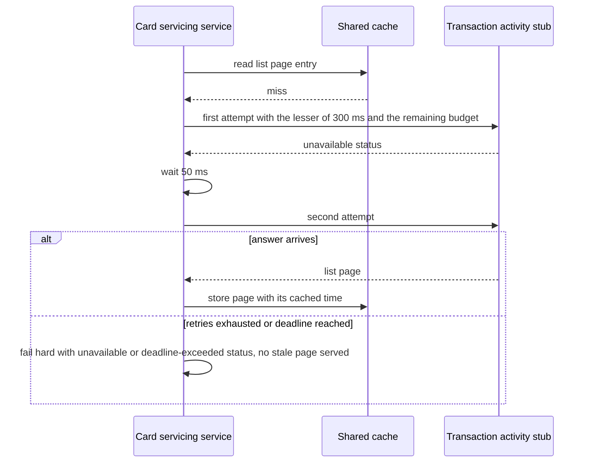

# CS-10-006: Transaction Activity client with transaction caching

Parent epic: [CS-10 Transaction Activity Integration](../README.md)

## Source Story (verbatim)

> ### 1. Details/Requirements
>
> As a card servicing user, I want transaction reads cached and bounded by the call policy, so that drill-downs answer inside the deadline.
>
> Trace: CARD_REQ_TBD · Data Layouts · CVTRA05Y · TRAN-ID
>
> Account-data access path: No
>
> External integration or SLA-bound: Yes
>
> Capability: one Transaction Activity client is the service's only path to posted transactions (`Data Layouts · CVTRA05Y`). It serves the Stage 3 reads of both drill-downs: `ListTransactions` for the transaction list, which pages an account's transactions as `Use Cases · COTRN00C` pages its list, and `GetTransaction` for the transaction detail, which reads one transaction by TRAN-ID as `Use Cases · COTRN01C` does. Every call runs through the upstream call policy inside the request deadline, and both reads go through the read-through cache: a list page is served only while fresh, and a detail entry may answer an outage as stale, as the TRD degradation table sets out for each operation. Target paths:
>
> - `card-servicing-service/src/main/java/com/example/cardservicing/integration/transactionactivity/TransactionActivityClient.java`:
>   - Wraps the blocking stub that grpc-java generates for `cardservicing.transactionactivity.v1.TransactionActivityService` in the Java package `com.example.cardservicing.contract.transactionactivity.v1` from `card-servicing-service/src/main/proto/cardservicing/transactionactivity/v1/transaction_activity_service.proto`, generated under the build directory and never checked in.
>   - `transactions(token, deadline, accountId, typeCode, categoryCode, pageSize, pageToken)` returns `ReadThroughCache.CachedValue<ListTransactionsResponse>`: the page in the stub's order with its `next_page_token` unchanged, its `cachedAt` and a freshness that is always `FRESH`. `typeCode` and `categoryCode` are optional, and an empty `pageToken` asks for the first page. `transaction(token, deadline, transactionId)` returns `ReadThroughCache.CachedValue<Transaction>` with a freshness of `FRESH` or `STALE`.
>   - Both methods are blocking calls on the caller's thread, so the detail endpoint (CS-08-002) runs its transaction read while the cross-reference future of the Card Data client (CS-09-005) runs concurrently, and one instance serves concurrent requests.
>   - Each read is one call of `ReadThroughCache.read` (CS-11-004) with its key family from `TransactionCacheKeys`, its identifiers, an upstream read that is one `UpstreamCallPolicy` call (CS-11-003) within the request's `RequestDeadline`, and a time-left supplier that reports that deadline's remaining budget. The policy takes the per-attempt timeout and the retry cap from the `UpstreamSettings.Capture` that the deadline took at receipt: 300 ms (`UPSTREAM_TIMEOUT_MS`) and 2 (`UPSTREAM_MAX_RETRIES`) until the configuration snapshot of CS-11-006 backs the provider.
>   - Each call adds the forwarded bearer token as `authorization: Bearer <caller token>` and `x-api-key` with the value of `card-servicing.auth.api-key` from `card-servicing-service/src/main/java/com/example/cardservicing/config/CardServicingProperties.java` (CS-11-001), bound from `AUTH_SERVICE_API_KEY`: an empty placeholder in the stub phase, sent as an empty value, and a Key Vault secret when deployed (CS-12-004). The headers are attached per call, so the client holds no token between calls.
>   - Turns each final non-OK status into the typed failure of the code table in `card-servicing-service/src/main/java/com/example/cardservicing/config/error/` (CS-05-002) by the status rules below. The standard error handler renders it with the `traceId` issued at receipt.
>   - Builds one plaintext gRPC channel per service instance to the Transaction Activity target address, and the blocking stub over it. The channel connects on first use, so a context starts with no Transaction Activity service reachable, and it shuts down when the application context closes.
>   - Binds the target address from `card-servicing.clients.transaction-activity.target` through a `@ConfigurationProperties` record nested in this file, with the placeholder default `localhost:9090`. It is not a variable of the TRD environment-variable table, so `card-servicing-service/src/main/resources/application.yml` and `CardServicingProperties` stay unchanged and no environment variable is added. The unit suite sets it to the `127.0.0.1` port that `StubHarness` reports, the Compose stack (CS-01-001) sets the stub container address, and a deployed environment sets the real service address.
>   - Holds the gRPC Netty transport's client frame logger `io.grpc.netty.shaded.io.grpc.netty.NettyClientHandler` at INFO through Spring Boot's `LoggingSystem` when it starts, and installs, before it builds its channel, a nested `TransactionActivityClient.ClientFrameLogGuard` built the same way as the client frame-log guards of CS-12-002, CS-11-006, CS-13-003 and CS-09-005, because at DEBUG that shared logger writes every outbound header value, `authorization` and `x-api-key` included.
>   - Writes one warning line per failed read and per stale result, naming the operation, the account identifier or transaction ID and the final gRPC status code, with the `traceId` of the logging context. No line carries the token, the service credential or any other call metadata.
>   - Adds no attempt, timeout, retry, backoff or freshness rule of its own, and holds no store connection and no Redis client: Redis is reached only through `ReadThroughCache`, and transactions only through this gRPC client.
> - `card-servicing-service/src/main/java/com/example/cardservicing/integration/transactionactivity/TransactionCacheKeys.java`: the two `ReadThroughCache.KeyFamily` values of the rules below, each with a codec that writes the generated `ListTransactionsResponse` or `Transaction` as protobuf bytes, and the identifier builder of each family.
> - `card-servicing-service/src/test/java/com/example/cardservicing/integration/transactionactivity/TransactionActivityClientTest.java`: policy, deadline, status-mapping, credential and swap-point cases against the registered Transaction Activity stub, `StubHarness.of(new TransactionActivityStubRegistration())` (CS-10-004 and CS-10-005; `card-servicing-service/src/test/java/com/example/cardservicing/support/StubHarness.java`, CS-11-002), with per-test latency and failure-rate overrides through `StubHarness.inject` on stub `transaction-activity` and attempts counted in the stub request log. A test-local `StubRegistration` under stub name `transaction-activity`, which `StubHarness.allRegistered()` never discovers, wraps the stub's service definition with a header-capturing server interceptor, because the stub itself ignores call metadata. The cache runs on an empty in-memory `EntryStore` unless a case seeds it. The test builds its token and service-key values at runtime, so the committed-secret scan of CS-11-001 finds no literal credential.
> - `card-servicing-service/src/test/java/com/example/cardservicing/integration/transactionactivity/TransactionActivityClientCacheTest.java`: fresh hit, miss and write-back, key forms and identifier encoding, filter separation, the fresh-only list page, the detail stale fallback and its expiry, and Redis failure, on the in-memory recording `EntryStore` and the failing `EntryStore` that the CS-11-004 tests use, with one controllable test clock for entry ages and the registered Transaction Activity stub as the upstream.
> - Together these are the 4 files touched.
>
> Rules:
>
> - Key families, named under `cs:v1:` as the TRD cache rules leave to this story: family `transaction` holds detail entries under `cs:v1:transaction:<transactionId>`, and family `transaction-page` holds list pages under `cs:v1:transaction-page:<accountId>:<pageSize>:<pageToken>:<typeCode>:<categoryCode>`, bound to the account, the page size, the page token and both filters. No key carries a subject, token or role, so one entry serves every caller once the guard (CS-12-003) has allowed access.
> - Identifier encoding: the contract lets a transaction ID and a type code hold any character, a colon and whitespace included, and the cache rejects both in an identifier. Each identifier is therefore the UTF-8 form encoding of `java.net.URLEncoder`, which leaves digits and page tokens unchanged and turns `0:` into `0%3A` and `0 ` into `0+`. An absent filter or an empty page token is the marker `~`, which that encoding never produces. Example keys: `cs:v1:transaction:0000000776200014` and `cs:v1:transaction-page:00000000001:2:~:~:~`.
> - Periods: the TRD cache rules leave both values to this story. Family `transaction` has a fresh TTL of 60 s and a max stale age of 300 s. Family `transaction-page` has a fresh TTL of 60 s and a max stale age equal to it, so a page has no stale window. The cache writes the max stale age as the entry's Redis expiry. 60 s and 300 s are the account periods of the Card Data client (CS-09-005), so a balance and the transactions behind it age by one rule.
> - Degradation, per the TRD degradation table: `ListTransactions` fails hard, so when the last permitted attempt fails or the call is unfinished at the cut-off, `transactions` raises the failure and never returns a page past its fresh TTL. `GetTransaction` degrades: on `UNAVAILABLE` or `DEADLINE_EXCEEDED` with a detail entry within its 300 s max stale age held, `transaction` returns the held transaction `STALE` with its original `cachedAt`, and with no usable entry it raises the failure.
> - Status rules: `UNAVAILABLE` after the last permitted retry becomes `UNAVAILABLE` (503). `DEADLINE_EXCEEDED`, or a budget exhausted before or during the call, becomes `DEADLINE_EXCEEDED` (504). `NOT_FOUND` becomes `NOT_FOUND` (404). `INVALID_ARGUMENT` becomes `INVALID_ARGUMENT` (400) carrying the `details` of the packed `ErrorObject`, so a rejected page token yields exactly one entry with field `pageToken`. `UNAUTHENTICATED` becomes `UNAUTHENTICATED` (401). Any other non-OK status becomes `UNAVAILABLE` (503), the fail-hard outcome of the degradation table. Only `UNAVAILABLE` and `DEADLINE_EXCEEDED` are retried, by the call policy, and only they can reach a stale detail entry. No failure writes an entry.
> - Neither credential is logged, and no cache key carries either.
> - The swap point is the target address and credential source only: replacing the stub with the real Transaction Activity service changes `card-servicing.clients.transaction-activity.target` and the source of `AUTH_SERVICE_API_KEY`, and no class.
>
> In scope:
>
> - The 4 files above.
> - The two calls `ListTransactions` and `GetTransaction`.
> - The call policy wiring within the request deadline.
> - The two key families with their periods and identifier encoding.
> - The fail-hard list read and the stale-or-fail-hard detail read.
> - Forwarding of the bearer token and the service credential.
> - The target address and its channel.
> - The client tests on the in-JVM stub harness.
>
> Not in this story:
>
> - The transaction list endpoint, its validation and its page-token pass-through (CS-07-001, CS-07-002).
> - The detail ownership check against the account's cross-references (CS-08-002).
> - Account authorization before any read (CS-12-003).
> - `dataStatus` and `asOf` resolution (CS-05-005) and the error rendering (CS-05-002).
> - The Transaction Activity stub (CS-10-004, CS-10-005) and its container address in `tests/docker-compose.yml` (CS-01-001).
> - The container-backed Transaction Activity integration suite (CS-10-007).
> - Call-policy and cache mechanics: attempts, backoff, the request deadline, freshness, stale fallback and Redis failure handling (CS-11-003, CS-11-004).
> - The configuration snapshot behind `UpstreamSettings` (CS-11-006).
>
> ### 2. Acceptance Criteria
>
> - AC1: Timeout: each `ListTransactions` and `GetTransaction` attempt times out at the lesser of 300 ms (`UPSTREAM_TIMEOUT_MS`) and the time left before the cut-off of the 900 ms request deadline (`REQUEST_DEADLINE_MS`). With a per-test stub latency of 400 ms (`STUB_LATENCY_MS`) on stub `transaction-activity` and a fresh 900 ms budget, the first attempt of each operation ends with `DEADLINE_EXCEEDED` between 300 and 330 ms after it starts. With the same latency and 200 ms of budget left at call start, the attempt ends with `DEADLINE_EXCEEDED` no later than 230 ms after the call starts.
> - AC2: Retry: on `UNAVAILABLE` or `DEADLINE_EXCEEDED` only, the client retries at most 2 times (`UPSTREAM_MAX_RETRIES`), waiting 50 ms before the first retry and 100 ms before the second, and starts a retry only when its backoff plus a full 300 ms attempt fits in the remaining budget. With a per-test failure rate of 1.0 (`STUB_FAILURE_RATE`), one call of each operation shows exactly 3 attempts in the stub request log and returns no earlier than 150 ms after it starts, the 50 ms and 100 ms backoff waits between attempts that fail at once.
> - AC3: Fail hard on unavailable: a test request starts a 900 ms `RequestDeadline`, places a test `traceId` in the logging context and marks the cut-off when the call returns. With failure rate 1.0 and no cached entry, one call of each operation shows exactly 3 attempts in the stub request log and ends with the `UNAVAILABLE` failure, which the standard error mapping renders as 503. The client's warning line carries that `traceId`, the completion line logs `cutoffMs` ≤ 900, and the time the test measures from the deadline's start to the outcome is below 1,000 ms.
> - AC4: Fail hard on deadline: with a per-test stub latency of 400 ms and no cached entry, the AC3 test request shows exactly 2 attempts for one call of each operation (300 + 50 + 300 = 650 ms, then 100 + 300 > 250) and ends with the `DEADLINE_EXCEEDED` failure, rendered as 504, with a logged `cutoffMs` ≤ 900 and a test-measured outcome below 1,000 ms.
> - AC5: List page never stale: with failure rate 1.0 and a page held under `cs:v1:transaction-page:00000000001:2:~:~:~` aged 60 s or 120 s on the test clock, `transactions` for account `00000000001` at page size 2 with no filters and no token ends with the `UNAVAILABLE` failure (503) after exactly 3 attempts, returns no page and leaves the held entry unrewritten. With the AC4 latency of 400 ms in place of the failure rate, it ends with the `DEADLINE_EXCEEDED` failure (504) in the same way.
> - AC6: Detail degrade or fail hard, per the `GetTransaction` row of the TRD degradation table: with failure rate 1.0 and a detail entry for `0000000776200014` held aged 60 s or 299 s on the test clock, `transaction` returns the held transaction marked `STALE` with its original `cachedAt` after exactly 3 attempts, and the entry is not rewritten. With the 400 ms latency the same holds after exactly 2 attempts. With the entry aged 300 s or more, or none held, the call ends with the `UNAVAILABLE` failure (503) or the `DEADLINE_EXCEEDED` failure (504) and returns no transaction.
> - AC7: Not found: `NOT_FOUND` from `ListTransactions` for account `00000000099` and from `GetTransaction` for `9999999999999999` ends with the `NOT_FOUND` failure (404) after exactly 1 attempt and writes no entry, and a detail entry for `9999999999999999` aged 120 s is never returned in its place.
> - AC8: Invalid page token: the first-page token that `transactions` returns for account `00000000001` at page size 2, with one character changed, makes the stub answer `INVALID_ARGUMENT`. The call ends with the `INVALID_ARGUMENT` failure (400), whose `details` hold exactly one entry with `field` `pageToken`, after exactly 1 attempt, and writes no entry.
> - AC9: Fresh hit and write-back: with no entry, one `transaction` read for `0000000776200014` makes exactly 1 stub call, returns it `FRESH` with amount `985.22` and card number `9680294154603697`, and writes exactly one entry, key `cs:v1:transaction:0000000776200014`, with `cachedAt` equal to the read time and a Redis expiry of 300 s. One `transactions` read for `00000000001` at page size 2 returns `0000000776200014` and `0000000755736377` with a non-empty `next_page_token` and writes `cs:v1:transaction-page:00000000001:2:~:~:~` with a Redis expiry of 60 s. An entry of either family aged 0 s or 59 s, younger than its 60 s fresh TTL, is returned `FRESH` with its stored `cachedAt` and the stub request log stays empty. An entry aged 60 s, with the stub answering, causes exactly 1 stub call and returns `FRESH` with a new `cachedAt`.
> - AC10: Keys: after a `transactions` read for `00000000001` at page size 20 with type filter `01`, a read with type filter `03` makes exactly 1 stub call and returns only `0000000532120892`, never the cached `01` page. Reads with type filter `0:` or `0 ` return the stub's empty page with no rejection by the cache, and any key they write holds the identifier `0%3A` or `0+`. No written key contains the caller's subject or token, and a second `transaction` read for `0000000776200014` within its fresh TTL with a different token is a fresh hit.
> - AC11: Redis failure: with every entry-store command failing, each `transaction` and `transactions` read is treated as a miss: it reaches the stub exactly once, returns the stub's result `FRESH`, and no Redis error reaches the caller. With the stub failing as well, the stub's `UNAVAILABLE` is the failure returned.
> - AC12: Credentials: every stub call of both operations carries `authorization` equal to `Bearer ` followed by the test token and `x-api-key` equal to the value bound from `AUTH_SERVICE_API_KEY`, or an empty value when the key is empty, as the header-capturing interceptor records. With the root log level and the client frame logger at DEBUG on a live channel, the log output captured across the AC1, AC3, AC6 and AC9 paths contains neither value, and no written cache key contains either.
> - AC13: Swap point: with `card-servicing.clients.transaction-activity.target` set to the port of a second `StubHarness` serving `TransactionActivityStubRegistration`, every call of both operations lands in that harness's request log and none in the first harness's log, with no change to any class. With the property not overridden, the bound target address is `localhost:9090`.
>
> ### 3. Dependencies
>
> - CS-10-005 — completes the stub contract the client calls.
> - CS-11-003 — provides the call policy and the request deadline.
> - CS-11-004 — provides the read-through cache.
>
> Risk: caching list pages keyed without the filter fingerprint would serve one filter's page to another.

## 4. Design

- Diagrams: [Sequence — transaction list](../../../../architecture/sequence-transaction-list.mmd), [Sequence — transaction detail](../../../../architecture/sequence-transaction-detail.mmd)
- Data model: [transaction_record](../../../../data-model.md#transaction_record)
- TRD: [Resilience, degradation table and cache rules](../../../../technical-requirements.md#resilience), [Deadline boundary](../../../../technical-requirements.md#deadline-boundary), [External systems](../../../../technical-requirements.md#external-systems), [Mock-to-real swap and credential management](../../../../technical-requirements.md#mock-to-real-swap-and-credential-management), [Environment variables](../../../../technical-requirements.md#environment-variables)
- Contracts: [transaction_activity_service.proto](../../../../../card-servicing-service/src/main/proto/cardservicing/transactionactivity/v1/transaction_activity_service.proto), [transaction-activity-service.yaml](../../../../../card-servicing-service/src/main/resources/openapi/transaction-activity-service.yaml), [common.proto](../../../../../card-servicing-contracts/src/main/proto/cardservicing/common/v1/common.proto)

## 5. Documentation Changes

Completed during implementation.

## 6. Test Plan

- Unit — Applies: `TransactionActivityClientTest` and `TransactionActivityClientCacheTest` cover AC1–AC13 on the loopback stub harness with per-test latency and failure overrides: the attempt timeout, the retry waits, the fit rule, the fail-hard list read, the detail stale fallback and its expiry, the not-found and invalid-token statuses, fresh hit, miss and write-back, key separation and encoding, Redis failure, the forwarded credentials and their absence from logs, and the swap point. Command `./gradlew :card-servicing-service:test jacocoTestCoverageVerification`; all tests pass; at least 80% line coverage per module.
- Integration — Applies, through the Transaction Activity integration suite CS-10-007, which runs this client against the stub on a real gRPC channel with Testcontainers `postgres:16.6` and `redis:7.4.2`; this story adds no integration suite. Command `./gradlew :card-servicing-service:integrationTest`; one suite per external epic (CS-10-007 for this epic) covering a stub exception, latency above `UPSTREAM_TIMEOUT_MS` and the `UPSTREAM_MAX_RETRIES` cap.
- Performance — Applies, through the transaction list SLA scenario CS-03-003 and the transaction detail SLA scenario CS-04-002, whose endpoints call this client. `docker compose -f tests/docker-compose.yml up -d --wait`, `./gradlew :card-servicing-service:performanceTest`, `docker compose -f tests/docker-compose.yml down`; p50, p95 and p99 below 1,000 ms over successful requests with failure injection off at 10 users × 100 sequential calls, 100,000 category balances and 1,000,000 transactions; injected failures proven by a logged `cutoffMs` at most 900 and a client-measured response below 1,000 ms; applies to balance-retrieval and drill-down stories.
- End-to-end — Not applicable — covered by CS-03-001 and CS-04-001 at the endpoint level. Where it applies: `docker compose -f tests/docker-compose.yml up -d --wait`, `./gradlew :card-servicing-service:e2eTest`, `docker compose -f tests/docker-compose.yml down`; the four-step flow for account `00000000001` returns the expected fixture values and each stub's request log shows at least one call.

## 7. Validation Results

Completed during implementation.

## Implementation Design

Recommended: Design Option A — detail entries and list pages under separate key families.

Rationale: repeat detail reads and repeat list pages skip the remote call, while each family keeps the outage rule of its own degradation row.

- Rejected: Design Option B, caching detail entries only — every list page would reach the stub and spend the stage budget on repeat pages.
- Rejected: one list entry per account without the filters, page size and page token — one filter's page would answer another.

### Shared by both options

- Topology: the client lives inside the card servicing service with one channel to the Transaction Activity stub, on a loopback port in unit suites or at its container in the shared stack.
- Naming: key families sit under the versioned cache prefix, and every identifier is form-encoded so any character of a transaction identifier or type filter yields a valid key.
- Addressing: the target address and the service credential come from configuration.
- Isolation: keys carry no caller identity, and the service reaches the shared cache only through the read-through cache and never reads the store directly.
- Fallback: list reads have no stale path, and a detail entry within its maximum stale age answers an unavailable or deadline-exceeded failure as stale, as the degradation table sets out.
- Provisioning: the channel is built at service start and connects on first use, and the service credential comes from the environment, or from the key vault when deployed.
- Cut-over: the real service replaces the stub by target address and credential source only.
- Failures: only unavailable and deadline-exceeded statuses are retried, and every other status surfaces after one attempt.

### Design Option A — detail entries and list pages under separate key families

The client keeps two key families in the shared cache. A detail entry is keyed by the transaction identifier alone, and a list page by the account, the page size, the page token and both filters. Both families stay fresh for one minute, and only the detail family keeps a five-minute stale window for outages.

How it behaves:

- A repeat detail read or a repeat list page within one minute answers from the shared cache with no remote call.
- A miss or an entry past its freshness window runs one call under the call policy and writes the answer back with a new cache time.
- A list read that fails after the retry cap fails hard with the unavailable or deadline-exceeded status, even with a recent page held.
- A detail read that fails after the retry cap returns a held entry younger than five minutes as stale, and otherwise fails hard.
- A not-found or invalid-argument status surfaces after one attempt and writes no entry.
- A detail read hits whether or not the page that listed the transaction was cached.

| No. | Decision (vs rejected) | Pro | Con |
|---|---|---|---|
| 1 | List key of account, page size, page token and both filters (vs account alone) | one filter's page never answers another | more cache entries |
| 2 | Detail entries in their own family (vs inside list pages) | a detail read hits whether or not its page was cached | one more key family |
| 3 | List pages served only while fresh (vs a stale window) | the list keeps its fail-hard rule | an outage shows as an error even with a recent page |

Effort and risk: moderate effort, low risk.

### Design Option B — detail entries only

Only detail entries are cached, under the same family, freshness window and stale window as Option A. Every list page, repeat pages included, calls the Transaction Activity stub. The cache footprint stays small.

How it differs:

- No list-page family exists.
- Repeat pages spend a full upstream attempt and its share of the stage budget.
- The cache footprint stays small.
- A list outage fails hard exactly as in Option A.

| No. | Decision (vs rejected) | Pro | Con |
|---|---|---|---|
| 1 | No list-page cache (vs a list-page family) | the cache holds no page entries | every repeat page costs a remote call |
| 2 | Detail entries in their own family (vs no cache) | a repeat detail read skips the remote call | one key family to maintain |
| 3 | Detail stale window kept (vs fail hard) | a short outage still shows a transaction | a stale detail can be five minutes old |

Effort and risk: small effort, at risk on the stage budget for repeat paging.

### Recommendation

- Option: Design Option A
- Why: repeat pages and repeat detail reads skip the upstream call while the fail-hard rule for the list still holds.
- Strongest argument against: list-page entries multiply with filter and token combinations.
- Shared items that do not decide the choice: the call policy, the request deadline, the fail-hard and stale outcomes, credential forwarding and a cache failure treated as a miss.
- Flip conditions: a low list-page hit rate, or cache memory beyond the sizing recorded in the plan's recommendations.

## Design Validation

### Option A

Settled assumptions:

- The call policy and the request deadline exist from the call policy story.
- The read-through cache treats a cache failure as a miss and serves no stale entry for a family whose stale window equals its freshness window.
- The degradation table gives the list no stale path and the detail a stale path within its maximum stale age.
- This story fixes a one-minute freshness window for both families and a five-minute maximum stale age for detail entries.
- The transport writes header values only through its frame logger, which a process-wide guard silences below the information level.

Open assumptions:

- The list-page hit rate at the planning baseline Open → the transaction list service-level scenario.
- A one-minute freshness window suits the data owner once real postings replace the stub Open → the data owner at sign-off.

| AC | Verdict | Why |
|---|---|---|
| AC1 | Holds | the call policy cuts each attempt to the time left |
| AC2 | Holds | the call policy retries only the two retryable statuses after the fit check |
| AC3 | Holds | with no usable entry the final unavailable status fails the call |
| AC4 | Holds | the fit check stops the third attempt before the cut-off |
| AC5 | Holds | the list family has no stale window |
| AC6 | Holds | the detail family keeps a five-minute stale window |
| AC7 | Holds | the not-found status ends the call after one attempt |
| AC8 | Holds | the invalid-argument status keeps its page token field |
| AC9 | Holds | both families answer fresh entries with no remote call |
| AC10 | Holds | the list key carries both filters in encoded form |
| AC11 | Holds | the read-through cache treats its own failure as a miss |
| AC12 | Holds | both credentials ride on each call with the frame logger silenced |
| AC13 | Holds | the channel reads its target address from configuration |

### Option B

Settled assumptions:

- The call policy and the request deadline exist from the call policy story.
- The read-through cache treats a cache failure as a miss.
- The degradation table gives the list no stale path and the detail a stale path within its maximum stale age.
- This story fixes a one-minute freshness window and a five-minute maximum stale age for detail entries.

Open assumptions:

- Repeat paging fits the stage budget at the planning baseline Open → the transaction list service-level scenario.

| AC | Verdict | Why |
|---|---|---|
| AC1 | Holds | the call policy cuts each attempt to the time left |
| AC2 | Holds | the call policy retries only the two retryable statuses after the fit check |
| AC3 | Holds | with no usable entry the final unavailable status fails the call |
| AC4 | Holds | the fit check stops the third attempt before the cut-off |
| AC5 | Holds | no list page is ever held |
| AC6 | Holds | the detail family matches Option A |
| AC7 | Holds | the not-found status ends the call after one attempt |
| AC8 | Holds | the invalid-argument status keeps its page token field |
| AC9 | Conditional | it holds for detail entries only |
| AC10 | Holds | no list keys exist |
| AC11 | Holds | the read-through cache treats its own failure as a miss |
| AC12 | Holds | both credentials ride on each call with the frame logger silenced |
| AC13 | Holds | the channel reads its target address from configuration |

## Metadata

| Field | Value |
|---|---|
| Build wave | W1 |
| Depends on | CS-10-005, CS-11-003, CS-11-004 |
| Status | TBD |
| Estimated Files Touched | 4 |
| Issue Type | Story |
| Epic Name | Transaction Activity Integration |
| Epic Link | CS-10 |
| Story Points | 3 |
| Priority | High |
| Components | TBD |
| Fix Version/s | TBD |
| Team | TBD |
| Assignee | TBD |
| Reporter | TBD |
| Labels | TBD |
| Sprint | TBD |
| Due Date | TBD |
| Environment | TBD |
| Persona | TBD |
| Estimated Effort | TBD |
