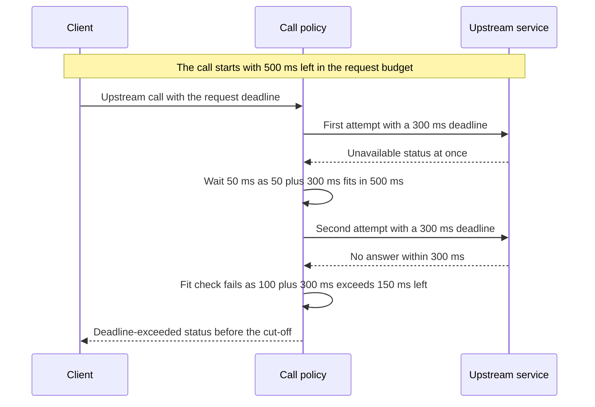

# CS-11-003: Upstream call policy with request deadline

Parent epic: [CS-11 Config Service Integration](../README.md)

## Source Story (verbatim)

> ### 1. Details/Requirements
>
> As a card servicing user, I want every upstream call bounded by one request deadline, so that I get an answer or an error inside one second.
>
> Trace: CARD_REQ_TBD · Use Cases · COTRN00C
>
> Directive: error handling, timeouts and retries
>
> Account-data access path: No
>
> External integration or SLA-bound: Yes
>
> Anchor basis: Use Cases · COTRN00C fills a fixed ten-row page set inside the program (PROCESS-PAGE-FORWARD); that screen behaviour is what this epic turns into configured page size and call settings. This story turns the call settings into one call policy and one per-request deadline that every upstream call obeys.
>
> Capability: one call policy wraps every upstream gRPC call the five clients make, so each attempt is bounded by the per-attempt timeout and by the one request deadline, retries follow one rule, and the final status reaches the caller unchanged. Target paths:
>
> - `card-servicing-service/src/main/java/com/example/cardservicing/integration/support/UpstreamCallPolicy.java`:
>   - Wraps each upstream gRPC call made for a request and takes that request's `RequestDeadline`.
>   - Reads the per-attempt timeout and the retry cap from `UpstreamSettings` at the start of every call.
>
> > SCOPE-QUESTION (Resolved): The values come through `UpstreamSettings`, but from the request rather than from a live read: at the start of every call the policy reads the timeout and the retry cap from the `UpstreamSettings.Capture` that the request's `RequestDeadline` took once at receipt, and it never calls the provider itself. Every call of one request, the guard's Auth calls and the concurrent stage-3 reads included, therefore uses one published set of values, and a provider change during the request reaches only requests started after it. The policy still holds no per-request state, and this story gains no file, dependency edge or environment variable, so the 7 files touched stand.
>
>   - Sets each attempt's gRPC call deadline to the lesser of the timeout and the remaining budget. It also bounds its own wait for the attempt's result to the same value and cancels the attempt when that wait expires, so an attempt whose upstream ignores its deadline still ends on time with `DEADLINE_EXCEEDED`.
>   - Retries only on `UNAVAILABLE` or `DEADLINE_EXCEEDED`, at most the retry cap times, waiting 50 ms before the first retry and 100 ms before each later one. A retry starts only if its backoff plus a full attempt at the timeout fits in the remaining budget (backoff + timeout ≤ remaining).
>   - Makes no attempt when the remaining budget is 0 ms or less, and returns `DEADLINE_EXCEEDED`.
>   - Returns the last attempt's response or status unchanged. It never substitutes a value, a cached entry or a different status.
>   - Holds no per-request state, so one instance serves all five clients and the concurrent stage-3 reads of one request.
>   - Takes its clock and its backoff scheduler as constructor collaborators, so tests control time.
> - `card-servicing-service/src/main/java/com/example/cardservicing/integration/support/RequestDeadline.java`:
>   - Started once per request at receipt with `REQUEST_DEADLINE_MS` (900 ms) from the CS-11-001 properties, never from Config.
>   - Reports the remaining budget to every upstream call of that request, concurrent calls included.
>
> > SCOPE-QUESTION (Resolved): Starting the deadline also fixes the request's settings. The start receives the `UpstreamSettings` provider, calls its `capture()` exactly once at receipt and holds the returned immutable `UpstreamSettings.Capture` for the life of the request. It reports that capture through `settings()` to every upstream call of the request, concurrent calls included, and to the request's Stage 0 page-size validation and transaction-list default, so a refresh published during the request changes only later requests. The 900 ms budget still comes from `REQUEST_DEADLINE_MS` and is never part of the capture, and a background refresh's own deadline takes its own capture at launch.
>
>   - Records the cut-off, the moment the service stops waiting for upstream calls and fixes the outcome, when its caller marks it or when the budget runs out, whichever comes first. A later mark leaves the recorded cut-off unchanged, so `cutoffMs` never exceeds `REQUEST_DEADLINE_MS`.
>   - On completion writes exactly one structured log line carrying `traceId` (from the logging context CS-05-002 fills at receipt), the outcome (`full`, `degraded` or `error`, with the response status) and `cutoffMs`, the time from receipt to the cut-off. It never writes a bearer token, an `x-api-key` value or any other call metadata.
> - `card-servicing-service/src/main/java/com/example/cardservicing/integration/support/UpstreamSettings.java`:
>   - The settings provider for the timeout and the retry cap. It starts on the built-in defaults, the CS-11-001 bound values of `UPSTREAM_TIMEOUT_MS` (300) and `UPSTREAM_MAX_RETRIES` (2).
>   - Carries the `accessAllowed(token)` hook, a no-op in this story. CS-11-006 backs the provider with `ConfigSnapshot` and implements the hook, so the policy and its callers change no dependency.
>
> > SCOPE-QUESTION (Resolved): The provider exposes its values through one `capture()` method and no separate getter, so no reader can combine values of two published records. `capture()` returns the immutable nested record `UpstreamSettings.Capture` of the four values the configuration snapshot later supplies: the default page size, the maximum page size, the per-attempt timeout and the retry cap. The built-in provider's capture holds `default_page_size` 20 and `max_page_size` 100 as constants and the bound `UPSTREAM_TIMEOUT_MS` (300) and `UPSTREAM_MAX_RETRIES` (2). The `accessAllowed(token)` hook stays a no-op, and CS-11-006 returns its held record from `capture()`, so the policy and its callers still change no dependency.
>
> - `card-servicing-service/src/test/java/com/example/cardservicing/integration/support/UpstreamCallPolicyTest.java` covers the attempt timeout, the backoff, the retry cap, the retry-fit rule and the non-retryable statuses.
> - `card-servicing-service/src/test/java/com/example/cardservicing/integration/support/RequestDeadlineTest.java` covers the cut-off, `cutoffMs` and the completion log line.
> - `card-servicing-service/src/test/java/com/example/cardservicing/integration/support/UpstreamSettingsTest.java` covers the defaults, an override and the no-op hook.
> - `card-servicing-service/src/test/java/com/example/cardservicing/integration/support/ColdPathBudgetTest.java` covers the cold-path stage budget and the 2,000 ms latency case.
> - Together these are the 7 files touched.
>
> Timing rules: with every attempt timing out at 300 ms, a 900 ms budget allows 2 attempts (300 + 50 + 300 = 650 ms, then 100 + 300 > 250). Exactly 3 attempts arise only when failures return at once. On a cold path, two sequential Auth first attempts can consume up to 600 ms, leaving about 300 ms for stage 3: one full data attempt and no data retry.
>
> > SCOPE-QUESTION (Resolved): Failures that return at once are one way to reach exactly 3 attempts, not the only one. With the retry cap at 2, a call whose attempts each fail with `UNAVAILABLE` or `DEADLINE_EXCEEDED` receives 3 attempts whenever both retry-fit checks pass: at least 350 ms (50 + 300) is left after the first failure and at least 400 ms (100 + 300) after the second. The second check implies the first, so on a full 900 ms budget the first two attempts together take at most 450 ms, not counting the 50 ms wait between them. For example, with `UNAVAILABLE` answers that each arrive 100 ms after their attempt starts, attempt 1 fails at 100 ms with 800 ms left (50 + 300 ≤ 800), attempt 2 starts at 150 ms and fails at 250 ms with 650 ms left (100 + 300 ≤ 650), and attempt 3 starts at 350 ms and fails at 450 ms. The 2-attempt example for attempts that each time out at 300 ms stands.
>
> Test approach: the unit tests drive the policy with a test-local fake upstream call and a controllable test clock for exact timing, because the stub host (CS-11-002) is not a prerequisite. The 2,000 ms latency case in `ColdPathBudgetTest` runs on the real clock. The real-channel proof runs in each external integration suite (CS-09-006, CS-10-007, CS-11-007, CS-12-005, CS-13-004).
>
> In scope:
>
> - The 7 files above.
> - The per-attempt deadline cut to the remaining budget.
> - Retry and backoff on `UNAVAILABLE` and `DEADLINE_EXCEEDED`, with the retry cap.
> - The retry-fit rule.
> - The request deadline and its cut-off.
> - The completion log line with `traceId`, outcome and `cutoffMs`.
> - The settings provider on the built-in defaults and its no-op hook.
>
> Not in this story:
>
> - The error object, the code table and the status mapping that turn a returned status into 503 or 504 (CS-05-002).
> - Config-backed settings: the configuration snapshot behind the settings provider and the hook's background refresh (CS-11-006).
> - The guard's call of the hook after an allow (CS-12-003).
> - Stub failure injection and the stub request log (CS-11-002).
> - Per-client degrade or fail-hard handling of a returned status (CS-09-005, CS-10-006, CS-11-006, CS-12-002, CS-13-003).
> - Endpoint deadline outcomes, including starting the request deadline at receipt and marking the cut-off (CS-05-005, CS-06-002, CS-07-002, CS-08-002).
>   > SCOPE-QUESTION (Resolved): On the category balances route the cut-off after an allow is marked by the category balance REST and gRPC endpoints story (CS-06-003), whose adapters mark it right after the Stage 3 unknown-`typeCode` check, while the retrieval story (CS-06-002) marks it only for its own 404, 503 and 504 and keeps the endpoint deadline outcomes.
> - The real-channel proof of this policy (CS-09-006, CS-10-007, CS-11-007, CS-12-005, CS-13-004).
>
> ### 2. Acceptance Criteria
>
> - AC1: Per-attempt timeout: each upstream attempt times out at the lesser of 300 ms (`UPSTREAM_TIMEOUT_MS`) and the remaining budget of the 900 ms deadline (`REQUEST_DEADLINE_MS`): with 120 ms remaining the attempt deadline is 120 ms, and with the full budget it is 300 ms.
> - AC2: A first attempt answering `UNAVAILABLE` is retried after a 50 ms backoff and a second after a 100 ms backoff; on the test clock the second attempt starts exactly 50 ms and the third exactly 100 ms after the preceding failure.
> - AC3: At most two retries (`UPSTREAM_MAX_RETRIES` = 2): an upstream answering `UNAVAILABLE` at once on every attempt receives exactly 3 attempts, and the policy returns `UNAVAILABLE`, which the standard error mapping turns into 503 with the receipt `traceId`. With `UPSTREAM_MAX_RETRIES` = 0 the same upstream receives exactly 1 attempt.
> - AC4: Retry only on `UNAVAILABLE` or `DEADLINE_EXCEEDED`: an upstream answering `NOT_FOUND`, `INVALID_ARGUMENT`, `UNAUTHENTICATED` or `PERMISSION_DENIED` receives exactly 1 attempt and its status is returned unchanged.
> - AC5: Retry-fit rule boundary: when a first attempt fails with 340 ms remaining, no retry starts (50 + 300 > 340) and the last status is returned; when it fails with 350 ms remaining, a retry starts.
> - AC6: Deadline exhaustion: an upstream delaying 2,000 ms on every attempt receives exactly 2 attempts, `DEADLINE_EXCEEDED` (504) is returned, the logged `cutoffMs` is at most 900, and the test caller, measuring from receipt, receives the outcome below 1,000 ms.
> - AC7: Cold path: two sequential calls succeeding after 290 ms each leave 320 ms; the next call gets one attempt with a 300 ms deadline, and an immediate `UNAVAILABLE` on it is not retried (50 + 300 > 320).
> - AC8: A call started with no budget left (remaining ≤ 0) makes no attempt and returns `DEADLINE_EXCEEDED`.
> - AC9: Degrade or fail-hard outcome passed through: after the last attempt the policy returns the final status to its caller unchanged and never substitutes a value, so each client applies its row of the TRD degradation table (Auth fails closed, account and category-balance reads may serve `STALE`, Reference Data may serve `PARTIAL`, Config leaves the request unaffected).
> - AC10: Completion log line: each completed request writes exactly one line carrying `traceId`, outcome and `cutoffMs`, and a second completion call writes no line. On the test clock an outcome fixed 650 ms after receipt logs `cutoffMs` 650, and a request still waiting when the 900 ms budget runs out logs `cutoffMs` 900. With a bearer token and an `x-api-key` value in the call metadata, neither value appears in any line the policy or deadline writes.
> - AC11: `UpstreamSettings` starts on 300 and 2, and on 250 when `UPSTREAM_TIMEOUT_MS=250`, with a no-op `accessAllowed(token)` hook: calling the hook records zero upstream calls and starts no thread or scheduled task. A test provider returning 200 and 1 makes the policy use a 200 ms attempt deadline and at most 1 retry, so replacing the provider (CS-11-006) needs no change to the policy.
>
> > SCOPE-QUESTION (Resolved): The criterion also covers the request-local capture. The built-in provider's capture holds 20, 100, 300 and 2, and 20, 100, 250 and 2 with `UPSTREAM_TIMEOUT_MS=250`. Refresh during a request, in `UpstreamCallPolicyTest`: with a counting test provider whose capture changes from 300 and 2 to 200 and 1 between two calls of one request, the second call of that request, to an upstream answering `UNAVAILABLE` at once, still uses a 300 ms attempt deadline and up to 2 retries and receives exactly 3 attempts. The same call in a request whose `RequestDeadline` starts after the change uses a 200 ms attempt deadline and at most 1 retry and receives exactly 2 attempts, and the provider records exactly one `capture()` call per request.
>
> ### 3. Dependencies
>
> - CS-11-001 — timeout, retry and deadline settings.
> - CS-05-002 — error codes and the receipt traceId for mapped outcomes.
>
> Risk: thread scheduling on a loaded runner can push a real-time attempt past its computed deadline, so exact timing runs on the test clock except in the 2,000 ms latency case.

## 4. Design

- [Balance summary sequence](../../../../architecture/sequence-balance-summary.mmd)
- [Logical architecture](../../../../architecture/logical-architecture.mmd)
- [Data model — entity relationship diagram](../../../../data-model.md#entity-relationship-diagram)
- [TRD — resilience](../../../../technical-requirements.md#resilience)
- [TRD — request path](../../../../technical-requirements.md#request-path)
- [TRD — deadline boundary](../../../../technical-requirements.md#deadline-boundary)
- [TRD — stage budget on a cold path](../../../../technical-requirements.md#stage-budget-on-a-cold-path)
- [TRD — configuration snapshot](../../../../technical-requirements.md#configuration-snapshot)
- [TRD — environment variables](../../../../technical-requirements.md#environment-variables)

Contracts: N/A

## 5. Documentation Changes

Completed during implementation.

## 6. Test Plan

- Unit: Applies. Command `./gradlew :card-servicing-service:test jacocoTestCoverageVerification`; all tests pass and line coverage is at least 80% per module. Cases: the attempt deadline at the full budget and at 120 ms remaining, the 50 ms and 100 ms backoff on the test clock, the retry cap at 2 and at 0, each non-retryable status, the 340 ms and 350 ms fit boundary, the 2,000 ms latency case on the real clock, the cold-path 320 ms case, the call with no budget left, status pass-through, the completion log line with its cut-off values and secret absence, the settings provider with its no-op hook and its built-in capture of 20, 100, 300 and 2, and a provider change between two calls of one request, which leaves that request on the settings it captured at receipt while the next request uses the new ones.
- Integration: Applies — through the five external integration suites CS-09-006, CS-10-007, CS-11-007, CS-12-005 and CS-13-004, which exercise this policy on a real gRPC channel; this story adds no integration test of its own. Command `./gradlew :card-servicing-service:integrationTest`; all pass, with one suite per external epic covering a stub exception, latency above `UPSTREAM_TIMEOUT_MS` and the `UPSTREAM_MAX_RETRIES` cap.
- Performance: Not applicable — this story ships no endpoint; it applies to balance-retrieval and drill-down stories. Threshold when it applies:
  - Commands: `docker compose -f tests/docker-compose.yml up -d --wait`, then `./gradlew :card-servicing-service:performanceTest`, then `docker compose -f tests/docker-compose.yml down`.
  - Pass: p50, p95 and p99 below 1,000 ms over successful requests, with failure injection off, at 10 users × 100 sequential calls, 100,000 category balances and 1,000,000 transactions.
  - Injected failures are proven by a logged `cutoffMs` ≤ 900 and a client-measured response below 1,000 ms.
- End-to-end: Not applicable — no UI interaction step. Threshold when it applies: `docker compose -f tests/docker-compose.yml up -d --wait`, then `./gradlew :card-servicing-service:e2eTest`, then `docker compose -f tests/docker-compose.yml down`; the four-step flow for account `00000000001` returns the expected fixture values, and each stub's request log shows at least one call.

## 7. Validation Results

Completed during implementation.

## Implementation Design

Recommended: Design Option A — one policy wrapper that sets each attempt deadline from the request budget.

Rationale: one wrapper owned by the service decides every attempt deadline and every retry from the time left in the request, so each upstream call fits inside the one-second answer.

- Rejected: Option B, the channel's built-in retry configuration, because it cannot apply the rule that a retry starts only when a full attempt fits the remaining budget.

Shared by both options:

- Topology: one call policy shared by all five upstream clients, with one request deadline per request.
- Naming: outcomes are named by their remote procedure status, such as the unavailable status and the deadline-exceeded status.
- Addressing: each client keeps its own remote procedure channel and target address.
- Isolation: one request's budget never extends another's, and the concurrent reads of one request share its budget.
- Fallback: the caller's row of the degradation table decides what a failure becomes.
- Provisioning: the timeout setting, retry cap and deadline setting come from the configuration-properties story.
- Cut-over: the configuration snapshot later supplies the timeout setting and retry cap in place of the built-in values.
- Failures: the last status reaches the caller unchanged, and the request deadline writes one completion line with the cut-off time.

### Design Option A

One call policy wraps every upstream call a client makes. Before each attempt it reads the time left in the request and gives the attempt the lesser of the timeout setting and that time. After an unavailable or deadline-exceeded status it waits 50 ms before the first retry and 100 ms before each later one, and starts the retry only when the wait plus a full attempt fits in the time left.

How it behaves:

- With the full 900 ms budget an attempt gets 300 ms, and with 120 ms left it gets 120 ms.
- A not-found, invalid-argument, unauthenticated or permission-denied status returns after one attempt.
- The retry cap limits a call to three attempts whenever both fit checks pass, as when failures return at once or after 100 ms each, and attempts that each time out at 300 ms limit it to two.
- A call that starts with no time left makes no attempt and returns the deadline-exceeded status.
- The policy stops waiting when an attempt's own deadline passes, so an upstream that ignores the deadline still ends on time.
- The request deadline takes one record of the four settings from the settings provider at receipt, and every call of that request reads the timeout setting and retry cap from that record, so a change published during the request reaches only later requests.
- The request deadline records the cut-off when the caller fixes the outcome or when the budget runs out, and writes one completion line with the trace identifier, the outcome and the cut-off time.

| No. | Decision (vs rejected) | Pro | Con |
|---|---|---|---|
| 1 | Attempt deadline cut to the time left in the request (vs a fixed attempt limit) | no attempt outlives the request budget | every attempt computes its own deadline |
| 2 | Retry decided by the policy with a fit check (vs the channel's built-in rules) | a retry starts only when a full attempt fits | retry logic is written and tested here |
| 3 | Fixed waits of 50 ms and 100 ms (vs a random wait) | tests can assert exact retry start times | retries from many callers start in step |
| 4 | Settings captured once at receipt and carried by the request deadline (vs a read of the settings provider on every call) | one request never mixes two sets of settings | a new value reaches only requests that start after it |

Effort and risk: one policy, one request deadline, one settings provider and four test classes, with the risk in retry timing that drifts on a loaded runner.

### Design Option B

Each client declares the channel's built-in retry rules once, when its channel is built: at most three attempts, a fixed 300 ms limit on each attempt, retry on the unavailable and deadline-exceeded statuses, and a backoff starting at 50 ms. The call policy only sets the whole call's deadline to the time left in the request and leaves the attempts to the channel.

How it differs:

- The channel waits a random time up to each backoff value, so retry start times vary from run to run.
- The channel retries while any time is left, with no check that a full attempt fits.
- A late retry runs with less than a full attempt, cut short by the whole call's deadline.
- The retry rules are fixed when the channel is built, so a new retry cap or timeout setting from the configuration snapshot needs a new channel.

| No. | Decision (vs rejected) | Pro | Con |
|---|---|---|---|
| 1 | Fixed attempt limit in the channel rules (vs an attempt deadline cut to the time left) | one rule per channel | the limit ignores a changed timeout setting |
| 2 | Retry decided by the channel's built-in rules (vs a policy fit check) | no retry logic to write | a retry can start with no room for a full attempt |
| 3 | Random wait up to each backoff value (vs fixed waits of 50 ms and 100 ms) | retries from many callers spread out | retry start times vary from run to run |

Effort and risk: less code in this story but channel rules declared in five clients, with the risk in retries that start without room for a full attempt.

### Recommendation

- Option: Option A.
- Why: only a wrapper that reads the time left before each attempt can cut each attempt to the budget and refuse a retry that would not fit.
- Strongest argument against: hand-written retry logic must be tested for every status and every timing boundary.
- Shared items that do not decide the choice: the request deadline and its completion line, the status mapping from the error-object story, the callers' degradation rows and the settings from the configuration-properties story.
- Flip condition: a channel retry feature that cuts each attempt to the time left, checks that a full attempt fits before each retry and waits fixed times.

## Design Validation

### Option A validation

Settled assumptions:

- The timeout setting is 300 ms, the retry cap is 2 and the deadline setting is 900 ms while no configuration snapshot is held.
- The deadline setting never comes from the configuration service.
- The error-object story maps the unavailable status to 503 and the deadline-exceeded status to 504, each with the receipt trace identifier.
- Each endpoint story starts one request deadline at receipt from the settings provider and passes it to every upstream call of that request.

Open assumptions:

- Open → the first external integration suite settles timing on a real channel.
- Open → the configuration client story settles the timeout setting and retry cap the configuration service supplies.

| AC | Verdict | Why |
|---|---|---|
| AC1 | Holds | the policy cuts each attempt to the lesser of the timeout setting and the time left |
| AC2 | Holds | the fixed waits run on the test clock |
| AC3 | Holds | the policy counts attempts against the retry cap |
| AC4 | Holds | only two statuses enter the retry path |
| AC5 | Holds | the fit check compares the wait plus a full attempt with the time left |
| AC6 | Conditional | the real-clock case depends on thread scheduling on the test runner |
| AC7 | Holds | the fit check refuses a retry with 320 ms left |
| AC8 | Holds | the policy makes no attempt with no time left |
| AC9 | Holds | the policy returns the last status with no substitute value |
| AC10 | Holds | the request deadline writes one line and never reads call metadata |
| AC11 | Holds | each call reads the settings its request captured once from the settings provider at receipt |

### Option B validation

Settled assumptions:

- The timeout setting is 300 ms, the retry cap is 2 and the deadline setting is 900 ms while no configuration snapshot is held.
- The deadline setting never comes from the configuration service.
- The error-object story maps the unavailable status to 503 and the deadline-exceeded status to 504, each with the receipt trace identifier.
- The channel's built-in retry waits a random time up to each backoff value.

Open assumptions:

- Open → the first external integration suite settles timing on a real channel.
- Open → a channel library release settles whether built-in retry can cut each attempt to the time left.

| AC | Verdict | Why |
|---|---|---|
| AC1 | At risk | the attempt limit is fixed in the channel rules rather than read from the timeout setting |
| AC2 | Breaks | the channel waits a random time up to each backoff value |
| AC3 | At risk | the fixed channel rules keep three attempts under a zero retry cap until the channel is rebuilt |
| AC4 | Holds | the channel retries only the listed statuses |
| AC5 | Breaks | the channel retries with no check that a full attempt fits |
| AC6 | Breaks | a third attempt starts with less than a full attempt left |
| AC7 | Breaks | the channel retries the immediate unavailable status with 320 ms left |
| AC8 | Holds | a whole-call deadline with no time left fails before any attempt |
| AC9 | Holds | the channel returns the last status unchanged |
| AC10 | Holds | the request deadline writes the completion line in both options |
| AC11 | At risk | the channel rules ignore the settings a later request captures until the channel is rebuilt |

## Metadata

| Field | Value |
|---|---|
| Build wave | W0 |
| Depends on | CS-11-001, CS-05-002 |
| Status | TBD |
| Estimated Files Touched | 7 |
| Issue Type | Story |
| Epic Name | Config Service Integration |
| Epic Link | CS-11 |
| Story Points | 5 |
| Priority | High |
| Components | TBD |
| Fix Version/s | TBD |
| Team | TBD |
| Assignee | TBD |
| Reporter | TBD |
| Labels | TBD |
| Sprint | TBD |
| Due Date | TBD |
| Environment | TBD |
| Persona | TBD |
| Estimated Effort | TBD |
