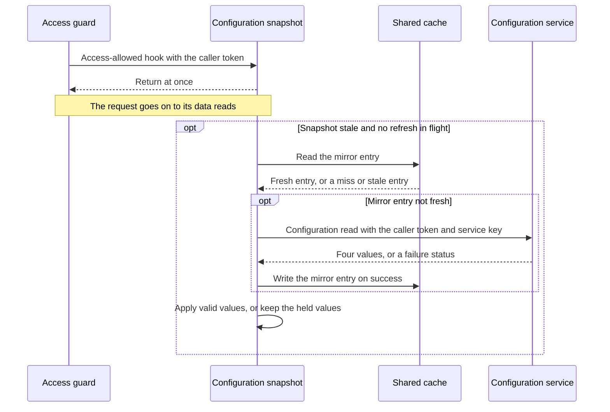

# CS-11-006: Config client with cached values and built-in defaults

Parent epic: [CS-11 Config Service Integration](../README.md)

## Source Story (verbatim)

> ### 1. Details/Requirements
>
> As a card servicing user, I want configuration refreshed in the background, so that no request ever waits on the Config service.
>
> Trace: CARD_REQ_TBD · Use Cases · COTRN00C
>
> Account-data access path: No
>
> External integration or SLA-bound: Yes
>
> Anchor basis: Use Cases · COTRN00C fills a fixed ten-row page set inside the program (PROCESS-PAGE-FORWARD); that screen behaviour is what this epic turns into configured page size and call settings. This story reads those settings from the Config service into an in-memory snapshot that every request reads at receipt and every upstream call reads through the settings provider.
>
> Capability: one Config client reads the four configuration values through the upstream call policy, and one configuration snapshot holds them in memory. Requests read only memory. A single-flight background refresh, launched through the `accessAllowed(token)` hook once a request is allowed, reads the `cs:v1:config` mirror and calls `GetConfig` only when the mirror is not fresh. Target paths:
>
> - `card-servicing-service/src/main/java/com/example/cardservicing/integration/config/ConfigClient.java`:
>   - A client of the generated `ConfigServiceGrpc` blocking stub in `com.example.cardservicing.contract.config.v1`, which is generated under the build directory and never checked in. It holds one channel to the Config service target bound from `card-servicing.clients.config.target` by a `@ConfigurationProperties` record nested in this file, so `card-servicing-service/src/main/java/com/example/cardservicing/config/CardServicingProperties.java` and `card-servicing-service/src/main/resources/application.yml` from CS-11-001 stay unchanged. Tests set it to the `127.0.0.1` port that `StubHarness` reports, and the Compose stack (CS-01-001) sets the container address.
>   - `getConfig(token, deadline)` requests exactly the keys `default_page_size`, `max_page_size`, `upstream_timeout_ms` and `upstream_max_retries`, the contract example request, through `UpstreamCallPolicy` with the given `RequestDeadline`. It sends the bearer token in `authorization` metadata and the service credential bound from `AUTH_SERVICE_API_KEY` (`card-servicing.auth.api-key`) in `x-api-key`.
>   - It checks the answer before returning it. All four keys are present. Each value is a decimal-integer string matching `^[0-9]+$`, the `values` pattern of `card-servicing-service/src/main/resources/openapi/config-service.yaml`, and fits a Java `int`. `max_page_size` lies from 1 to 100, the contract `pageSize` bound. `default_page_size` lies from 1 to the answered `max_page_size`. `upstream_timeout_ms` is at least 1, the CS-11-001 startup rule for `UPSTREAM_TIMEOUT_MS`. Entries beyond the four keys are ignored.
>   - A failed check throws `io.grpc.StatusRuntimeException` with status `INTERNAL` and a description naming the offending key, never its value. The call policy never retries `INTERNAL`, and the read-through cache never falls back on it.
>   - It returns the nested record `ConfigClient.ConfigValues` holding the four checked values as integers. It never logs the token, the service credential or any other call metadata.
> - `card-servicing-service/src/main/java/com/example/cardservicing/integration/config/ConfigSnapshot.java`:
>   - Implements `UpstreamSettings` (CS-11-003) and implements its `accessAllowed(token)` hook. It is declared as the primary `UpstreamSettings` bean, so the call policy, the five clients and the access guard receive it with no change to their dependencies.
>   - Holds the current values in one `java.util.concurrent.atomic.AtomicReference` to an immutable record of the four values, their `cachedAt` and their fresh-until time, `cachedAt` plus 300 s. Reads at receipt (`current()`, `defaultPageSize()`, `maxPageSize()` and the timeout and retry cap of `UpstreamSettings`) touch only that reference: no network call, no Redis command, no lock and no refresh. The record notes whether the values are fresh, stale or built-in, and that note launches nothing.
>   - Built-in defaults until the first successful refresh: `default_page_size` 20 and `max_page_size` 100 as constants, and the timeout and retry cap from the CS-11-001 bound values of `UPSTREAM_TIMEOUT_MS` (300) and `UPSTREAM_MAX_RETRIES` (2). Every upstream call uses them until then, both Auth calls and `GetConfig` itself included. `REQUEST_DEADLINE_MS` is never a Config key and is never read from the snapshot.
>   - Exposes `default_page_size` as `defaultPageSize()` and `max_page_size` as `maxPageSize()` for the transaction-list validation (CS-07-001) and retrieval (CS-07-002) stories.
>   - `accessAllowed(token)`: when the held values are stale or built-in, it claims an in-flight flag by compare-and-set, checks staleness again, submits one refresh to its executor and returns. It never waits for the refresh. A caller that loses the flag, or finds the values fresh, returns at once. The access guard (CS-12-003) calls it only after `AuthorizeAccountAccess` allows access, so a request rejected with a Stage 0 400, a 401 or a 403 starts no Config call.
>   - The refresh starts its own `RequestDeadline` of `REQUEST_DEADLINE_MS` (900 ms) at launch, independent of the triggering request's deadline, and never marks completion on it, so it writes no request completion line. It calls `ReadThroughCache.read` with the key family `config` and an upstream read of `ConfigClient.getConfig(token, deadline)`. The family has the key `cs:v1:config`, a fresh TTL of 300 s, no stale limit, and a codec that writes the four values as a UTF-8 JSON object of decimal strings and rejects on decode an entry that fails the client's checks, which the cache treats as a miss.
>   - A fresh mirror entry, one written by any instance within 300 s, satisfies the refresh with no `GetConfig`. A miss, a stale entry or a Redis failure leads to one `GetConfig`, whose success the cache writes back with `cachedAt` equal to the read time. The mirror is never read on the request path.
>   - A `FRESH` result replaces the held record, with fresh-until at its `cachedAt` plus 300 s. A `STALE` result means the configuration read failed: the snapshot keeps its held values, adopts the stale mirror values only while it holds the built-in defaults, and stays stale. Any exception also keeps the held values, with no stale limit. The in-flight flag clears when the refresh ends, so the next allowed call on a stale snapshot launches the next refresh.
>   - Writes one log line per refresh: applied, with its source (mirror or `GetConfig`); failed, with the final status; or rejected, with the offending key name. No line carries the token or the service credential. The refresh holds the token only while it runs, and the token never reaches the held record or the mirror.
>   - Takes its `java.time.Clock`, its executor and an `org.springframework.beans.factory.ObjectProvider<ConfigClient>` as constructor collaborators, so tests control time and await each refresh. The client is resolved at the first refresh because the call policy the client uses reads its settings from this snapshot, and constructor injection would form a cycle. The executor is one daemon thread, shut down when the application context closes.
> - `card-servicing-service/src/test/java/com/example/cardservicing/integration/config/ConfigClientTest.java` covers the requested keys, the forwarded token and service key, every rejected answer, the attempt timeout, the retry count and the non-retried statuses.
> - `card-servicing-service/src/test/java/com/example/cardservicing/integration/config/ConfigSnapshotTest.java` covers receipt reads with the stub and Redis stopped, the built-in defaults, launch only through the hook, the success rewrite and its mirror write, failure with no stale limit, mirror seeding and the settings provider handing values to the call policy.
> - `card-servicing-service/src/test/java/com/example/cardservicing/integration/config/ConfigSnapshotRefreshConcurrencyTest.java` covers the single-flight refresh under 10 threads, the 300 s fresh-period boundary, the non-blocking hook and a request left unaffected by a slow refresh.
> - Together these are the 5 files touched.
>
> Test approach: each test registers either the Config stub's `ConfigStubRegistration` (CS-11-005) or a test-local Config server through `StubHarness.of(...)`, both under stub name `config`, so per-test injection of `STUB_LATENCY_MS` and `STUB_FAILURE_RATE` and the request log apply to both. The test-local server is an anonymous `StubRegistration`, which `StubHarness.allRegistered()` never discovers. It serves the non-baseline, invalid and `UNAUTHENTICATED` answers and records call metadata, because the Config stub answers only valid baseline values and never reads credentials. The mirror sits on the in-memory recording `EntryStore` and the failing one that CS-11-004 tests use. The snapshot and the cache share one controllable test clock for the 300 s fresh TTL, and latency cases run on the real clock.
>
> In scope:
>
> - The 5 files above.
> - The receipt read of the in-memory snapshot and its built-in defaults.
> - The single-flight background refresh launched through the `accessAllowed(token)` hook, under its own deadline.
> - The `cs:v1:config` mirror through the read-through cache, including mirror seeding.
> - Backing the settings provider, and supplying `default_page_size` and `max_page_size`.
> - The checks on every `GetConfig` answer.
> - Forwarding the triggering bearer token and the service key on the refresh.
>
> Not in this story:
>
> - The access guard's call of `accessAllowed(token)` after an allow (CS-12-003).
> - Page-size validation against `max_page_size` at Stage 0 (CS-07-001).
> - Use of `default_page_size` in the transaction list (CS-07-002).
> - The Config stub (CS-11-005).
> - Proof against a real `redis:7.4.2` mirror and a real channel, and the Integration CI stage (CS-11-007).
> - The call policy, the request deadline and the settings provider with its no-op hook (CS-11-003).
> - The read-through cache, its entry envelope and the Redis connection (CS-11-004).
> - The Config stub container and the client target it sets in `tests/docker-compose.yml` (CS-01-001).
>
> ### 2. Acceptance Criteria
>
> - AC1: Receipt read makes no network call: with the Config stub stopped and an entry store that fails and records every command, 100 receipt reads of a fresh snapshot and 100 of a stale one each return the four held values, the stub records 0 calls and the entry store records 0 commands.
> - AC2: Built-in defaults: a new snapshot with an empty mirror and no successful refresh returns `default_page_size` 20, `max_page_size` 100, a 300 ms timeout (`UPSTREAM_TIMEOUT_MS`) and a retry cap of 2 (`UPSTREAM_MAX_RETRIES`), and as the settings provider it hands the call policy 300 ms and 2 retries for every call, the first `GetConfig` included. With `UPSTREAM_TIMEOUT_MS=250` and `UPSTREAM_MAX_RETRIES=1` bound, it returns 250 and 1 with the page sizes unchanged.
> - AC3: Single-flight: with a stale snapshot, 10 `accessAllowed(token)` calls released together on 10 threads record exactly 1 `GetConfig` in the Config stub's request log. Once that refresh applies its values, calls at 1 s and at 299 s after the applied `cachedAt` on the test clock record none, and the first call at 300 s records exactly 1 more.
> - AC4: Non-blocking: with a per-test latency override of 2,000 ms (`STUB_LATENCY_MS`) on stub `config`, `accessAllowed(token)` on a stale snapshot returns in under 50 ms on the real clock, and receipt reads made while that refresh runs each return the held values in under 50 ms.
> - AC5: Launch only through the hook: with a stale snapshot and the Config stub running, 10 receipt reads standing for requests that end with a Stage 0 400, a 401 or a 403, and therefore never call `accessAllowed(token)`, leave the Config stub's request log empty and submit 0 refreshes. The proof through the access guard is CS-12-005.
> - AC6: Success rewrites: after `GetConfig` answers `default_page_size` "10", `max_page_size` "50", `upstream_timeout_ms` "250" and `upstream_max_retries` "1", receipt reads return 10, 50, 250 and 1, and the `cs:v1:config` mirror holds those four values with `cachedAt` equal to the test-clock time when the read returned. The settings provider then hands the call policy 250 ms and 1 retry, so the next call to an upstream answering `UNAVAILABLE` at once receives exactly 2 attempts.
> - AC7: Failure keeps held values (degrade): with the AC6 values held and a per-test failure-rate override of 1.0 (`STUB_FAILURE_RATE`) on stub `config`, a refresh records only `UNAVAILABLE` outcomes in the request log, and receipt reads still return 10, 50, 250 and 1, also 24 h later on the test clock, with no stale limit. No exception reaches the caller of `accessAllowed(token)` or of a receipt read, the refresh logs its failure with status `UNAVAILABLE`, and the first allowed call after that refresh has ended launches exactly 1 new refresh.
> - AC8: Invalid answer: an answer missing `upstream_max_retries`, holding `max_page_size` "ten", "-1", "0" or "101", holding `default_page_size` "60" with `max_page_size` "50", or holding `upstream_timeout_ms` "0" is not applied and not written to the mirror. In each case the held values stay, the refresh logs the offending key name, and the answer receives exactly 1 attempt.
> - AC9: Timeout and retry on the refresh: the refresh runs under its own 900 ms deadline (`REQUEST_DEADLINE_MS`) started at launch, and each `GetConfig` attempt times out at the lesser of 300 ms (`UPSTREAM_TIMEOUT_MS`) and the remaining budget, with at most two retries (`UPSTREAM_MAX_RETRIES`) after 50 ms then 100 ms backoff, on `UNAVAILABLE` or `DEADLINE_EXCEEDED` only. Immediate `UNAVAILABLE` answers record exactly 3 `GetConfig` entries per refresh. A 400 ms latency override records exactly 2, each attempt ending with `DEADLINE_EXCEEDED` at the client 300 ms after it started (300 + 50 + 300 = 650 ms, then 100 + 300 > 250). An `UNAUTHENTICATED` answer records exactly 1.
> - AC10: Deadline and request unaffected: with a 2,000 ms latency override on stub `config`, a test request that starts a 900 ms `RequestDeadline` (`REQUEST_DEADLINE_MS`) at receipt, calls `accessAllowed(token)` on a stale snapshot and then completes a 100 ms fake data call through `UpstreamCallPolicy` logs `cutoffMs` ≤ 900 and returns to the test caller below 1,000 ms. Its outcome equals that of the same run with the latency override at 0. No snapshot state is an input of `dataStatus` resolution, so a Config outcome leaves `dataStatus` unchanged (degradation table: Config → request unaffected).
> - AC11: Credentials: the test-local Config server records that the refresh sends the triggering request's bearer token in `authorization` metadata and the `AUTH_SERVICE_API_KEY` value in `x-api-key`. With a test token and a test key set, neither value appears in any log line captured during an applied, a failed and a rejected refresh, nor in the mirror entry.
> - AC12: Mirror seeding: with a built-in snapshot and a fresh `cs:v1:config` entry written 100 s earlier on the test clock by a second snapshot sharing the entry store, the first refresh applies the mirror values with 0 `GetConfig` calls, and the snapshot turns stale 200 s later. With every entry-store command failing, the first refresh calls `GetConfig` exactly once, applies its values and logs the failed mirror write without the values. With a built-in snapshot, a stale mirror entry and the Config stub failing, the refresh adopts the mirror values and the snapshot stays stale.
>
> ### 3. Dependencies
>
> - CS-11-005 — the Config stub this client calls.
> - CS-11-003 — the call policy and the settings provider this snapshot backs.
> - CS-11-004 — the read-through cache that holds the cs:v1:config mirror.
>
> Risk: a refresh that never succeeds leaves every call on built-in defaults indefinitely, which hides a broken Config path unless the refresh-failure log line is watched.

## 4. Design

- [Balance summary sequence](../../../../architecture/sequence-balance-summary.mmd)
- [Category balances sequence](../../../../architecture/sequence-category-balances.mmd)
- [Transaction list sequence](../../../../architecture/sequence-transaction-list.mmd)
- [Transaction detail sequence](../../../../architecture/sequence-transaction-detail.mmd)
- [Logical architecture](../../../../architecture/logical-architecture.mmd)
- [Data model — entity relationship diagram](../../../../data-model.md#entity-relationship-diagram)
- [TRD — configuration snapshot](../../../../technical-requirements.md#configuration-snapshot)
- [TRD — request path](../../../../technical-requirements.md#request-path)
- [TRD — deadline boundary](../../../../technical-requirements.md#deadline-boundary)
- [TRD — resilience, degradation table and cache rules](../../../../technical-requirements.md#resilience)
- [TRD — external systems](../../../../technical-requirements.md#external-systems)
- [TRD — mock-to-real swap and credential management](../../../../technical-requirements.md#mock-to-real-swap-and-credential-management)
- [TRD — environment variables](../../../../technical-requirements.md#environment-variables)
- Contracts: [Config service proto](../../../../../card-servicing-service/src/main/proto/cardservicing/config/v1/config_service.proto)
- Contracts: [Config service OpenAPI](../../../../../card-servicing-service/src/main/resources/openapi/config-service.yaml)

## 5. Documentation Changes

Completed during implementation.

## 6. Test Plan

- Unit: Applies. Command `./gradlew :card-servicing-service:test jacocoTestCoverageVerification`; all tests pass and line coverage is at least 80% per module. Cases: receipt reads with the stub and Redis stopped, the built-in defaults and their bound overrides, launch only through the hook, the single-flight refresh under 10 threads, the 299 s and 300 s fresh-period boundary, the non-blocking hook under 2,000 ms latency, the success rewrite and its mirror write, failure with no stale limit, each rejected answer, the attempt timeout and retry counts, the non-retried statuses, the forwarded credentials and their absence from logs, mirror seeding, and a request left unaffected by a slow refresh.
- Integration: Applies. This story adds no integration suite; the Config integration suite (CS-11-007) runs this client and snapshot against the Config stub with a real gRPC channel and the `cs:v1:config` mirror in a Testcontainers `redis:7.4.2` container. Command `./gradlew :card-servicing-service:integrationTest`; all pass, with one suite per external epic covering a stub exception, latency above `UPSTREAM_TIMEOUT_MS` and the `UPSTREAM_MAX_RETRIES` cap.
- Performance: Not applicable — the Config refresh runs off every request path and no request waits for it; it applies to balance-retrieval and drill-down stories. Threshold when it applies:
  - Commands: `docker compose -f tests/docker-compose.yml up -d --wait`, then `./gradlew :card-servicing-service:performanceTest`, then `docker compose -f tests/docker-compose.yml down`.
  - Pass: p50, p95 and p99 below 1,000 ms over successful requests, with failure injection off, at 10 users × 100 sequential calls, 100,000 category balances and 1,000,000 transactions.
  - Injected failures are proven by a logged `cutoffMs` ≤ 900 and a client-measured response below 1,000 ms.
- End-to-end: Not applicable — this story adds no UI interaction step. Threshold when it applies: `docker compose -f tests/docker-compose.yml up -d --wait`, then `./gradlew :card-servicing-service:e2eTest`, then `docker compose -f tests/docker-compose.yml down`; the four-step flow for account `00000000001` returns the expected fixture values, and each stub's request log shows at least one call.

## 7. Validation Results

Completed during implementation.

## Implementation Design

Recommended: Design Option A — an in-memory configuration snapshot with a background single-flight refresh.

Rationale: requests read the four configuration values from memory, and one background refresh per instance keeps them current, so the configuration service never sits on a request path.

- Rejected: Design Option B, a per-request read-through cache of the configuration, because a miss adds a serialized configuration read to the request path.

Shared by both options:

- Topology: one configuration snapshot per service instance, with one mirror entry in the shared cache that every instance reads.
- Naming: the four values are the default page size, the maximum page size, the timeout value and the retry value, requested by the names the contract gives them.
- Addressing: the configuration service address comes from service configuration, set by the test harness or by the shared stack.
- Isolation: the mirror entry and the held values carry no caller identity, and a caller token lives only for one configuration read.
- Fallback: held values first, then the built-in defaults of 20, 100, 300 ms and 2 retries.
- Provisioning: the built-in timeout value and retry value come from the configuration-properties story, and the two page-size defaults are fixed in the service.
- Cut-over: the real configuration service replaces the stub with only an address and credential change.
- Failures: a failed or refused configuration read keeps the held values, writes one log line and never reaches a request.

### Design Option A

Every request reads the configuration snapshot from memory at receipt and never calls the cache or the configuration service for it. When the access guard allows a request and the snapshot is past its 300 s fresh period, the access-allowed hook launches one background refresh and returns at once. The refresh reads the mirror entry first, calls the configuration service only when that entry is not fresh, and then applies valid values or keeps the held ones.

How it behaves:

- Ten callers reaching the hook together launch one refresh, and callers inside the fresh period launch none.
- A request rejected before access is allowed never reaches the hook, so it starts no refresh.
- The refresh runs under its own 900 ms budget, so a slow configuration service consumes no request time.
- A fresh mirror entry written by another instance is applied with no configuration read.
- An answer missing a value or holding a value outside its bounds is refused, and the held values stay.
- A failed refresh keeps the held values with no age limit, and the next allowed request after it launches another.

| No. | Decision (vs rejected) | Pro | Con |
|---|---|---|---|
| 1 | Values read from memory at receipt (vs a cache read on each request) | no request makes a network call for configuration | each instance holds its own copy of the values |
| 2 | Refresh launched by the access-allowed hook (vs a timer on each instance) | only an allowed caller has its token forwarded | an idle instance keeps stale values until its next allowed request |
| 3 | Held values kept with no age limit after a failure (vs a return to the built-in defaults after a limit) | a long configuration outage never changes page sizes or call settings | a broken configuration path shows only in the refresh log |

Effort and risk: one client, one snapshot and three test classes, with the risk in the race between concurrent hook callers and a refresh that is finishing.

### Design Option B

Every request reads the configuration through the read-through cache before its data reads. A fresh mirror entry is served with no configuration read, and a miss or stale entry calls the configuration service inside the request, bounded by the request's own deadline. A failed read serves the stale mirror entry, and the built-in defaults when no entry exists.

How it differs:

- Every request makes one cache call for configuration, and a miss adds a configuration read in series with the request's other work.
- The read must wait until access is allowed, or a rejected request would call the configuration service.
- Concurrent misses on one instance each call the configuration service unless a separate guard joins them.
- No access-allowed hook is used, and no background work runs.

| No. | Decision (vs rejected) | Pro | Con |
|---|---|---|---|
| 1 | Configuration read through the shared cache on each request (vs memory only) | every instance reads the same values | every request pays one cache call |
| 2 | Configuration read on a miss inside the request (vs a background refresh) | values are never older than the fresh period | a slow configuration service consumes the request budget |
| 3 | Stale mirror entry, then built-in defaults, after a failure (vs held values in memory) | no in-memory state to manage | a cache outage during a configuration outage moves every request to the built-in defaults |

Effort and risk: less concurrency code but a configuration read on the request path, with the risk in cache misses that run out of budget while the configuration service is slow.

### Recommendation

- Option: Design Option A.
- Why: only a memory read at receipt keeps configuration off every request path, so no request waits on the configuration service.
- Strongest argument against: new values reach a busy instance only after an allowed request past the fresh period, and an idle instance serves stale values until its next allowed request.
- Shared items that do not decide the choice: the mirror entry and its fresh period, the four value names, the address-only cut-over, the built-in defaults and the call policy that bounds each configuration read.
- Flip condition: a push channel from the configuration service, or a requirement that every instance switch to new values at the same moment.

## Design Validation

### Option A validation

Settled assumptions:

- The configuration service answers the four values as whole-number text, as the contract states.
- The deadline setting is never a configuration value.
- The call policy reads the timeout value and retry value from the settings provider at the start of every call.
- The read-through cache serves a fresh mirror entry with no upstream read and treats a cache failure as a miss.
- Configuration outcomes feed no part of the data status.

Open assumptions:

- Open → the access-guard story settles that the hook receives the caller token after every allow and never before one.
- Open → the Config integration suite settles refresh timing on a real cache and a real remote procedure channel.
- Open → the technical requirements settle the refresh budget and mirror seeding, which this story takes as a 900 ms budget of its own and a mirror read first.

| AC | Verdict | Why |
|---|---|---|
| AC1 | Holds | a receipt read touches only the values held in memory |
| AC2 | Holds | the snapshot starts on the built-in defaults from the configuration-properties story |
| AC3 | Holds | the in-flight flag and the second staleness check admit one refresh per stale period |
| AC4 | Conditional | the under-50 ms return depends on thread scheduling on the test runner |
| AC5 | Holds | only the access-allowed hook launches a refresh |
| AC6 | Holds | a successful read replaces the held values and the mirror entry |
| AC7 | Holds | a failure leaves the held values in place with no age limit |
| AC8 | Holds | the client refuses a bad answer ahead of the snapshot and the cache |
| AC9 | Holds | the shared call policy bounds each attempt within the refresh budget |
| AC10 | Conditional | the cut-off time on the real clock depends on thread scheduling on the test runner |
| AC11 | Holds | the client writes the token and service key only into call metadata |
| AC12 | Holds | the refresh reads the mirror entry before any configuration read |

### Option B validation

Settled assumptions:

- The configuration service answers the four values as whole-number text, as the contract states.
- The read-through cache serves a fresh mirror entry with no upstream read and treats a cache failure as a miss.
- The read-through cache joins no concurrent misses on its own.

Open assumptions:

- Open → the endpoint stories settle where in the request the configuration read sits.
- Open → a load run settles how often a busy instance misses the mirror entry.

| AC | Verdict | Why |
|---|---|---|
| AC1 | Breaks | a receipt read reaches the cache and, on a miss, the configuration service |
| AC2 | Holds | the built-in defaults apply while no mirror entry exists |
| AC3 | Conditional | concurrent misses join only behind a separate guard |
| AC4 | Breaks | the request waits for the configuration read on a miss |
| AC5 | At risk | rejected requests stay silent only with the read placed after authorization |
| AC6 | Holds | a successful read writes the mirror entry with its cache time |
| AC7 | Holds | the cache serves the stale mirror entry with no age limit |
| AC8 | Holds | the same answer checks refuse a bad value |
| AC9 | Conditional | the attempt count follows the request's remaining time |
| AC10 | Breaks | a 2,000 ms configuration read consumes the request budget before its data reads |
| AC11 | Holds | the read forwards the same token and service key |
| AC12 | Holds | the cache serves a fresh mirror entry with no configuration read |

## Metadata

| Field | Value |
|---|---|
| Build wave | W1 |
| Depends on | CS-11-005, CS-11-003, CS-11-004 |
| Status | TBD |
| Estimated Files Touched | 5 |
| Issue Type | Story |
| Epic Name | Config Service Integration |
| Epic Link | CS-11 |
| Story Points | 5 |
| Priority | High |
| Components | TBD |
| Fix Version/s | TBD |
| Team | TBD |
| Assignee | TBD |
| Reporter | TBD |
| Labels | TBD |
| Sprint | TBD |
| Due Date | TBD |
| Environment | TBD |
| Persona | TBD |
| Estimated Effort | TBD |
