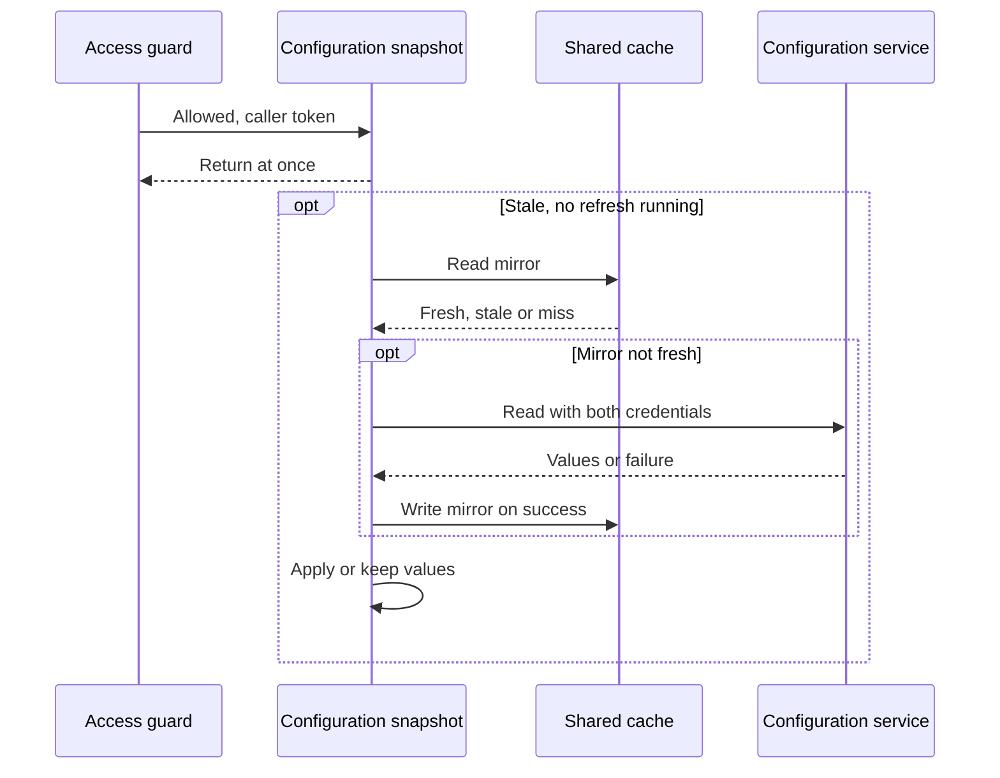

# CS-11-006: Config client with cached values and built-in defaults

Parent epic: [CS-11 Config Service Integration](../README.md)

## Source Story (verbatim)

> ### 1. Details/Requirements
>
> As a card servicing user, I want configuration refreshed in the background, so that no request ever waits on the Config service.
>
> Trace: CARD_REQ_TBD · Use Cases · COTRN00C
>
> Account-data access path: No
>
> External integration or SLA-bound: Yes
>
> Anchor basis: Use Cases · COTRN00C fills a fixed ten-row page set inside the program (PROCESS-PAGE-FORWARD); that screen behaviour is what this epic turns into configured page size and call settings. This story reads those settings from the Config service into an in-memory snapshot that every request reads at receipt and every upstream call reads through the settings provider.
>
> Capability: one Config client reads the four configuration values through the upstream call policy, and one configuration snapshot holds them in memory. Requests read only memory. A single-flight background refresh, launched through the `accessAllowed(token)` hook once a request is allowed, reads the `cs:v1:config` mirror and calls `GetConfig` only when the mirror is not fresh. Target paths:
>
> - `card-servicing-service/src/main/java/com/example/cardservicing/integration/config/ConfigClient.java`:
>   - A client of the generated `ConfigServiceGrpc` blocking stub in `com.example.cardservicing.contract.config.v1`, which is generated under the build directory and never checked in. It holds one channel to the Config service target bound from `card-servicing.clients.config.target` by a `@ConfigurationProperties` record nested in this file, so `card-servicing-service/src/main/java/com/example/cardservicing/config/CardServicingProperties.java` and `card-servicing-service/src/main/resources/application.yml` from CS-11-001 stay unchanged. Tests set it to the `127.0.0.1` port that `StubHarness` reports, and the Compose stack (CS-01-001) sets the container address.
>   - `getConfig(token, deadline)` requests exactly the keys `default_page_size`, `max_page_size`, `upstream_timeout_ms` and `upstream_max_retries`, the contract example request, through `UpstreamCallPolicy` with the given `RequestDeadline`. It sends the bearer token in `authorization` metadata and the service credential bound from `AUTH_SERVICE_API_KEY` (`card-servicing.auth.api-key`) in `x-api-key`.
>   - It checks the answer before returning it. All four keys are present. Each value is a decimal-integer string matching `^[0-9]+$`, the `values` pattern of `card-servicing-service/src/main/resources/openapi/config-service.yaml`, and fits a Java `int`. `max_page_size` lies from 1 to 100, the contract `pageSize` bound. `default_page_size` lies from 1 to the answered `max_page_size`. `upstream_timeout_ms` is at least 1, the CS-11-001 startup rule for `UPSTREAM_TIMEOUT_MS`. Entries beyond the four keys are ignored.
>   - A failed check throws `io.grpc.StatusRuntimeException` with status `INTERNAL` and a description naming the offending key, never its value. The call policy never retries `INTERNAL`, and the read-through cache never falls back on it.
>   - It returns the nested record `ConfigClient.ConfigValues` holding the four checked values as integers. It never logs the token, the service credential or any other call metadata.
>
> > SCOPE-QUESTION (Resolved): The transport must not log them either. `ConfigClient` holds the gRPC Netty transport's client frame logger `io.grpc.netty.shaded.io.grpc.netty.NettyClientHandler` at INFO through Spring Boot's `LoggingSystem` when it starts in each application context, before its first call, whatever the root level, the same hold the Auth client (CS-12-002) and the Reference Data client (CS-13-003) apply to that process-wide logger, because at DEBUG it writes every outbound header value, `authorization` and `x-api-key` included. It obtains the logging system with `LoggingSystem.get(classLoader)`, so the hold applies as well where a test builds the client with no application context. The hold adds no file, no dependency and no environment variable.
>
> > SCOPE-QUESTION (Resolved): The level hold above does not by itself keep the credentials out of the log. A later application context in the same JVM, such as a test context started while the client's channel is live, initialises logging and applies its own `logging.level` settings when its environment is prepared. Until a client of that context re-applies the hold, which a context that starts no client never does, the frame logger of every live client connection reads DEBUG. `ConfigClient` therefore also owns a credential guard that no logger level can lift: its nested class `ConfigClient.ClientFrameLogGuard`, built the same way as the server guard `GrpcServerConfiguration.ServerFrameLogGuard` of CS-11-002, whose idempotent, synchronized static `install()` replaces the default logger factory of the shaded Netty transport, through `io.grpc.netty.shaded.io.netty.util.internal.logging.InternalLoggerFactory.setDefaultFactory`, with a wrapper around the factory it replaces. The wrapper hands every logger name to that factory unchanged except `io.grpc.netty.shaded.io.grpc.netty.NettyClientHandler`, for which it returns a logger that reports TRACE and DEBUG as disabled, discards every TRACE and DEBUG event and passes INFO and above to the delegate. The transport builds the frame logger of each connection the channel opens from that factory and asks the logger whether DEBUG is enabled before it writes a frame, so no frame of a guarded connection reaches a log line, whatever level `LoggingSystem`, a `logging.level` setting, a later context's logging reset or a runtime level change gives the logger. `ConfigClient` calls `install()` before it builds its channel, in an application context and where a test builds the client with no application context alike, so the guard is in place before the channel opens its first connection. The guard records in a static field that it has installed its wrapper, so a second call changes nothing, and nothing removes the wrapper, so it holds for as long as the JVM runs, across every later context start and close. The Auth client (CS-12-002) and the Reference Data client (CS-13-003) each install a guard of their own in the same way, as a nested class of the class that applies their hold and builds their channel, and a guard installed after another wraps it and changes nothing observable, because both drop the same events. The level hold stays, so the effective level AC11 reads is INFO once the client has started, but the guard, not the level, is the never-log protection. The guard adds no file, no dependency, since the factory ships in the pinned `grpc-netty-shaded`, and no environment variable, so the 5 files touched stand.
>
> > SCOPE-QUESTION (Resolved): The synchronization of the idempotent, synchronized static `install()` above, of this guard and of the server guard it is built like, is one lock shared by every frame-log guard of the process, not the monitor of `ConfigClient.ClientFrameLogGuard`. Each guard class has a monitor of its own, and separate monitors do not exclude each other, so two guards that each held only their own could both read the same default factory and publish two wrappers around it, and the later publication would drop the earlier wrapper. Every frame-log guard of the process, the server guard `GrpcServerConfiguration.ServerFrameLogGuard` (CS-11-002) and the client guards `AuthClient.ClientFrameLogGuard` (CS-12-002), `ConfigClient.ClientFrameLogGuard` (this story), `ReferenceDataClientConfiguration.ClientFrameLogGuard` (CS-13-003), `CardDataChannelConfiguration.ClientFrameLogGuard` (CS-09-005) and `TransactionActivityClient.ClientFrameLogGuard` (CS-10-006), therefore runs its whole `install()` while holding the monitor of the shaded logger-factory class itself, `synchronized (InternalLoggerFactory.class)` on `io.grpc.netty.shaded.io.netty.util.internal.logging.InternalLoggerFactory`. The guard class's own monitor plays no part. That class object exists once per class loader, the same scope as the default-factory field every guard replaces, so every installer able to replace that factory shares it, and the lock needs no shared class, no new file and no story edge. Inside the lock, `install()` reads the guard's installed flag and returns at once when it is set. Otherwise it reads the current default factory with `InternalLoggerFactory.getDefaultFactory()`, builds its wrapper around exactly that factory, publishes the wrapper with `InternalLoggerFactory.setDefaultFactory`, and sets the installed flag only after that call returns. Because the read and the publication happen under the same lock, no installer publishes over a factory it has not read: each wrapper delegates to the factory it found, the wrappers of earlier guards included, so the chain keeps every guard installed before it, whatever the start order and the thread. A guard installed after another therefore wraps it and changes nothing observable in any order and on any thread, the server guard of CS-11-002 included. No code of the service or its tests replaces the default factory except an installer that holds this lock and follows this sequence, such as the test-local client-side installer of CS-11-002. The wrapper behaviour, the install before the channel is built, the never-removed wrapper and the level hold stay as stated above, and the lock adds no file, no dependency and no environment variable, so the 5 files touched stand.
>
> - `card-servicing-service/src/main/java/com/example/cardservicing/integration/config/ConfigSnapshot.java`:
>   - Implements `UpstreamSettings` (CS-11-003) and implements its `accessAllowed(token)` hook. It is declared as the primary `UpstreamSettings` bean, so the call policy, the five clients and the access guard receive it with no change to their dependencies.
>
> > SCOPE-QUESTION (Resolved): The bean reaches the call policy and the five clients only through the `UpstreamSettings.Capture` that each request's `RequestDeadline` takes from it once at receipt (CS-11-003). The code that starts the deadline receives the bean, and the access guard calls it only for `accessAllowed(token)`, so none of them changes a dependency.
>
>   - Holds the current values in one `java.util.concurrent.atomic.AtomicReference` to an immutable record of the four values, their `cachedAt` and their fresh-until time, `cachedAt` plus 300 s. Reads at receipt (`current()`, `defaultPageSize()`, `maxPageSize()` and the timeout and retry cap of `UpstreamSettings`) touch only that reference: no network call, no Redis command, no lock and no refresh. The record notes whether the values are fresh, stale or built-in, and that note launches nothing.
>
> > SCOPE-QUESTION (Resolved): The snapshot implements the `capture()` of `UpstreamSettings` (CS-11-003) as a single read of the `AtomicReference` that returns the immutable four-value `UpstreamSettings.Capture` the held record carries, so one capture never mixes two published records. The timeout and retry cap of `UpstreamSettings` are fields of that capture. Request code reads `default_page_size`, `max_page_size`, the timeout and the retry cap only from the capture its `RequestDeadline` took at receipt, never through `current()` or a single-value getter after receipt, and the refresh's own `RequestDeadline` takes its own capture at launch. A refresh that publishes a new record therefore changes only requests started after it.
>
>   - Built-in defaults until the first successful refresh: `default_page_size` 20 and `max_page_size` 100 as constants, and the timeout and retry cap from the CS-11-001 bound values of `UPSTREAM_TIMEOUT_MS` (300) and `UPSTREAM_MAX_RETRIES` (2). Every upstream call uses them until then, both Auth calls and `GetConfig` itself included. `REQUEST_DEADLINE_MS` is never a Config key and is never read from the snapshot.
>   - Exposes `default_page_size` as `defaultPageSize()` and `max_page_size` as `maxPageSize()` for the transaction-list validation (CS-07-001) and retrieval (CS-07-002) stories.
>
> > SCOPE-QUESTION (Resolved): The transaction-list validation (CS-07-001) and retrieval (CS-07-002) stories take `default_page_size` and `max_page_size` from the capture held by the request's `RequestDeadline`, not through repeated `defaultPageSize()` or `maxPageSize()` calls, so the Stage 0 `max_page_size` check and the list's default page size in one request come from one published record. Each getter remains a single read of the reference.
>
>   - `accessAllowed(token)`: when the held values are stale or built-in, it claims an in-flight flag by compare-and-set, checks staleness again, submits one refresh to its executor and returns. It never waits for the refresh. A caller that loses the flag, or finds the values fresh, returns at once. The access guard (CS-12-003) calls it only after `AuthorizeAccountAccess` allows access, so a request rejected with a Stage 0 400, a 401 or a 403 starts no Config call.
>   - The refresh starts its own `RequestDeadline` of `REQUEST_DEADLINE_MS` (900 ms) at launch, independent of the triggering request's deadline, and never marks completion on it, so it writes no request completion line. It calls `ReadThroughCache.read` with the key family `config` and an upstream read of `ConfigClient.getConfig(token, deadline)`. The family has the key `cs:v1:config`, a fresh TTL of 300 s, no stale limit, and a codec that writes the four values as a UTF-8 JSON object of decimal strings and rejects on decode an entry that fails the client's checks, which the cache treats as a miss.
>
> > SCOPE-QUESTION (Resolved): The refresh also passes the remaining budget of its own `RequestDeadline` to that cache read as its `timeLeft` (CS-11-004), so the mirror read and the mirror write-back each wait at most the cache's 50 ms command wait or the refresh's time left, whichever is less. An unresponsive Redis therefore costs the refresh at most 50 ms before `GetConfig`, which leaves `GetConfig` every attempt that AC9 counts within the 900 ms budget, and an abandoned mirror write is logged without the values while the values `GetConfig` returned still apply.
>
>   - A fresh mirror entry, one written by any instance within 300 s, satisfies the refresh with no `GetConfig`. A miss, a stale entry or a Redis failure leads to one `GetConfig`, whose success the cache writes back with `cachedAt` equal to the read time. The mirror is never read on the request path.
>   - A `FRESH` result replaces the held record, with fresh-until at its `cachedAt` plus 300 s. A `STALE` result means the configuration read failed: the snapshot keeps its held values, adopts the stale mirror values only while it holds the built-in defaults, and stays stale. Any exception also keeps the held values, with no stale limit. The in-flight flag clears when the refresh ends, so the next allowed call on a stale snapshot launches the next refresh.
>   - Writes one log line per refresh: applied, with its source (mirror or `GetConfig`); failed, with the final status; or rejected, with the offending key name. No line carries the token or the service credential. The refresh holds the token only while it runs, and the token never reaches the held record or the mirror.
>   - Takes its `java.time.Clock`, its executor and an `org.springframework.beans.factory.ObjectProvider<ConfigClient>` as constructor collaborators, so tests control time and await each refresh. The client is resolved at the first refresh because the call policy the client uses reads its settings from this snapshot, and constructor injection would form a cycle. The executor is one daemon thread, shut down when the application context closes.
>
> > SCOPE-QUESTION (Resolved): The call policy reads its settings only from each request's capture (CS-11-003) and holds no settings provider, so constructor injection of the client would form no cycle. The client is still resolved through the `ObjectProvider` at the first refresh, which leaves the refresh, its tests and the 5 files touched unchanged.
>
> - `card-servicing-service/src/test/java/com/example/cardservicing/integration/config/ConfigClientTest.java` covers the requested keys, the forwarded token and service key, every rejected answer, the attempt timeout, the retry count and the non-retried statuses.
> - `card-servicing-service/src/test/java/com/example/cardservicing/integration/config/ConfigSnapshotTest.java` covers receipt reads with the stub and Redis stopped, the built-in defaults, launch only through the hook, the success rewrite and its mirror write, failure with no stale limit, mirror seeding and the settings provider handing values to the call policy.
> - `card-servicing-service/src/test/java/com/example/cardservicing/integration/config/ConfigSnapshotRefreshConcurrencyTest.java` covers the single-flight refresh under 10 threads, the 300 s fresh-period boundary, the non-blocking hook and a request left unaffected by a slow refresh.
> - Together these are the 5 files touched.
>
> Test approach: each test registers either the Config stub's `ConfigStubRegistration` (CS-11-005) or a test-local Config server through `StubHarness.of(...)`, both under stub name `config`, so per-test injection of `STUB_LATENCY_MS` and `STUB_FAILURE_RATE` and the request log apply to both. The test-local server is an anonymous `StubRegistration`, which `StubHarness.allRegistered()` never discovers. It serves the non-baseline, invalid and `UNAUTHENTICATED` answers and records call metadata, because the Config stub answers only valid baseline values and never reads credentials. The mirror sits on the in-memory recording `EntryStore` and the failing one that CS-11-004 tests use. The snapshot and the cache share one controllable test clock for the 300 s fresh TTL, and latency cases run on the real clock.
>
> In scope:
>
> - The 5 files above.
> - The receipt read of the in-memory snapshot and its built-in defaults.
> - The single-flight background refresh launched through the `accessAllowed(token)` hook, under its own deadline.
> - The `cs:v1:config` mirror through the read-through cache, including mirror seeding.
> - Backing the settings provider, and supplying `default_page_size` and `max_page_size`.
> - The checks on every `GetConfig` answer.
> - Forwarding the triggering bearer token and the service key on the refresh.
>
> Not in this story:
>
> - The access guard's call of `accessAllowed(token)` after an allow (CS-12-003).
> - Page-size validation against `max_page_size` at Stage 0 (CS-07-001).
> - Use of `default_page_size` in the transaction list (CS-07-002).
> - The Config stub (CS-11-005).
> - Proof against a real `redis:7.4.2` mirror and a real channel, and the Integration CI stage (CS-11-007).
> - The call policy, the request deadline and the settings provider with its no-op hook (CS-11-003).
> - The read-through cache, its entry envelope and the Redis connection (CS-11-004).
> - The Config stub container and the client target it sets in `tests/docker-compose.yml` (CS-01-001).
>
> ### 2. Acceptance Criteria
>
> - AC1: Receipt read makes no network call: with the Config stub stopped and an entry store that fails and records every command, 100 receipt reads of a fresh snapshot and 100 of a stale one each return the four held values, the stub records 0 calls and the entry store records 0 commands.
> - AC2: Built-in defaults: a new snapshot with an empty mirror and no successful refresh returns `default_page_size` 20, `max_page_size` 100, a 300 ms timeout (`UPSTREAM_TIMEOUT_MS`) and a retry cap of 2 (`UPSTREAM_MAX_RETRIES`), and as the settings provider it hands the call policy 300 ms and 2 retries for every call, the first `GetConfig` included. With `UPSTREAM_TIMEOUT_MS=250` and `UPSTREAM_MAX_RETRIES=1` bound, it returns 250 and 1 with the page sizes unchanged.
> - AC3: Single-flight: with a stale snapshot, 10 `accessAllowed(token)` calls released together on 10 threads record exactly 1 `GetConfig` in the Config stub's request log. Once that refresh applies its values, calls at 1 s and at 299 s after the applied `cachedAt` on the test clock record none, and the first call at 300 s records exactly 1 more.
> - AC4: Non-blocking: with a per-test latency override of 2,000 ms (`STUB_LATENCY_MS`) on stub `config`, `accessAllowed(token)` on a stale snapshot returns in under 50 ms on the real clock, and receipt reads made while that refresh runs each return the held values in under 50 ms.
> - AC5: Launch only through the hook: with a stale snapshot and the Config stub running, 10 receipt reads standing for requests that end with a Stage 0 400, a 401 or a 403, and therefore never call `accessAllowed(token)`, leave the Config stub's request log empty and submit 0 refreshes. The proof through the access guard is CS-12-005.
> - AC6: Success rewrites: after `GetConfig` answers `default_page_size` "10", `max_page_size` "50", `upstream_timeout_ms` "250" and `upstream_max_retries` "1", receipt reads return 10, 50, 250 and 1, and the `cs:v1:config` mirror holds those four values with `cachedAt` equal to the test-clock time when the read returned. The settings provider then hands the call policy 250 ms and 1 retry, so the next call to an upstream answering `UNAVAILABLE` at once receives exactly 2 attempts.
>
> > SCOPE-QUESTION (Resolved): The next call is a call of a request whose `RequestDeadline` started after the values applied, because each request keeps the capture it took at receipt. Refresh during a request: a request that captured 20, 100, 300 and 2 before the refresh applied 10, 50, 250 and 1 still reports page sizes 20 and 100 and keeps 300 ms and 2 retries for every later call, so its next call to an upstream answering `UNAVAILABLE` at once receives exactly 3 attempts, while the same call in a request started after the refresh receives exactly 2.
>
> - AC7: Failure keeps held values (degrade): with the AC6 values held and a per-test failure-rate override of 1.0 (`STUB_FAILURE_RATE`) on stub `config`, a refresh records only `UNAVAILABLE` outcomes in the request log, and receipt reads still return 10, 50, 250 and 1, also 24 h later on the test clock, with no stale limit. No exception reaches the caller of `accessAllowed(token)` or of a receipt read, the refresh logs its failure with status `UNAVAILABLE`, and the first allowed call after that refresh has ended launches exactly 1 new refresh.
> - AC8: Invalid answer: an answer missing `upstream_max_retries`, holding `max_page_size` "ten", "-1", "0" or "101", holding `default_page_size` "60" with `max_page_size` "50", or holding `upstream_timeout_ms` "0" is not applied and not written to the mirror. In each case the held values stay, the refresh logs the offending key name, and the answer receives exactly 1 attempt.
> - AC9: Timeout and retry on the refresh: the refresh runs under its own 900 ms deadline (`REQUEST_DEADLINE_MS`) started at launch, and each `GetConfig` attempt times out at the lesser of 300 ms (`UPSTREAM_TIMEOUT_MS`) and the remaining budget, with at most two retries (`UPSTREAM_MAX_RETRIES`) after 50 ms then 100 ms backoff, on `UNAVAILABLE` or `DEADLINE_EXCEEDED` only. Immediate `UNAVAILABLE` answers record exactly 3 `GetConfig` entries per refresh. A 400 ms latency override records exactly 2, each attempt ending with `DEADLINE_EXCEEDED` at the client 300 ms after it started (300 + 50 + 300 = 650 ms, then 100 + 300 > 250). An `UNAUTHENTICATED` answer records exactly 1.
>
> > SCOPE-QUESTION (Resolved): AC9's 400 ms case is the retry-fit rule of the call policy (CS-11-003): a retry starts only when its backoff plus a full 300 ms attempt fits the budget left on the refresh's 900 ms deadline. After the second attempt ends at 650 ms, the 100 ms backoff plus a full 300 ms attempt needs 400 ms while 250 ms remain, so the second retry never starts.
>
> - AC10: Deadline and request unaffected: with a 2,000 ms latency override on stub `config`, a test request that starts a 900 ms `RequestDeadline` (`REQUEST_DEADLINE_MS`) at receipt, calls `accessAllowed(token)` on a stale snapshot and then completes a 100 ms fake data call through `UpstreamCallPolicy` logs `cutoffMs` ≤ 900 and returns to the test caller below 1,000 ms. Its outcome equals that of the same run with the latency override at 0. No snapshot state is an input of `dataStatus` resolution, so a Config outcome leaves `dataStatus` unchanged (degradation table: Config → request unaffected).
> - AC11: Credentials: the test-local Config server records that the refresh sends the triggering request's bearer token in `authorization` metadata and the `AUTH_SERVICE_API_KEY` value in `x-api-key`. With a test token and a test key set, neither value appears in any log line captured during an applied, a failed and a rejected refresh, nor in the mirror entry.
>
> > SCOPE-QUESTION (Resolved): The criterion also covers the transport frame loggers. With the root log level and the `io.grpc` log level at DEBUG, and the test token and service key generated at runtime so no credential literal is committed and `CommittedSecretScanTest` (CS-11-001) stays green, neither value appears in any line captured during the applied, the failed and the rejected refresh, the lines of the client frame logger `io.grpc.netty.shaded.io.grpc.netty.NettyClientHandler` and of the server frame logger `io.grpc.netty.shaded.io.grpc.netty.NettyServerHandler` of the test-local Config server hosted through CS-11-002 included, nor in the mirror entry, and once the client has started the effective level of `io.grpc.netty.shaded.io.grpc.netty.NettyClientHandler` is INFO.
>
> > SCOPE-QUESTION (Resolved): The criterion also covers live client channels while logger levels change. Two more cases run in `ConfigClientTest` against the Config stub that `StubHarness` started, on a `ConfigClient` built with a service key generated at runtime, as above, whose channel, the one the background refresh uses, a first `getConfig` call has opened. Each case sends `getConfig` calls, each with a bearer token generated at runtime, with output captured by Spring Boot's `OutputCaptureExtension`, which records standard output and standard error and so keeps recording across a logging reset. First, the test sets the effective level of `io.grpc.netty.shaded.io.grpc.netty.NettyClientHandler` to DEBUG through `LoggingSystem`, the state a logging reset leaves before any re-application, sends 5 `getConfig` calls that each return the four checked values, and then sets the level back to INFO. Second, the test starts a further application through `SpringApplicationBuilder` from a test configuration that declares a second `ConfigClient` and its collaborators, with the client target set to the same stub and `logging.level.root`, `logging.level.io.grpc` and `logging.level.io.grpc.netty.shaded.io.grpc.netty.NettyClientHandler` set to DEBUG, and adds a test listener ordered at `LoggingApplicationListener.DEFAULT_ORDER + 1`, directly after Spring Boot's logging listener. On `ApplicationEnvironmentPreparedEvent`, after that application has initialised logging and applied its DEBUG settings and before any of its beans exists, the listener reads the effective level of `NettyClientHandler` as DEBUG and then sends 5 `getConfig` calls on the already-live client of the first case, each with a newly generated token, all returning the four checked values before the listener returns. The application then reports ready, with the effective level of `NettyClientHandler` back at INFO once its client has started, and is closed. None of the values generated in either case appears in the captured output, the lines of the stub's server frame logger included.
>
> > SCOPE-QUESTION (Resolved): The criterion also covers concurrent guard installation. Two more cases run in `ConfigClientTest`. Shared-lock check, in the test JVM: while the test thread holds the monitor of `InternalLoggerFactory`, a second thread calling `ConfigClient.ClientFrameLogGuard.install()` reaches thread state `BLOCKED` within 1 s, and `InternalLoggerFactory.getDefaultFactory()` returns the same object as before. Once the test releases the monitor, the call returns within 1 s. The check holds whether or not the guard is already installed, because the installed flag is read inside the lock. Concurrent installation with later DEBUG resets, in fresh JVMs: the test starts 5 child JVMs one after another through the JDK process API, `ProcessBuilder` with the running JVM's `java` command and the test class path, each running a `main` nested in `ConfigClientTest`, so no guard is installed when a child starts. In each child, two threads released together by one `CountDownLatch` call `GrpcServerConfiguration.ServerFrameLogGuard.install()` and `ConfigClient.ClientFrameLogGuard.install()`. The child then starts a new loopback server for the Config stub, the service definition of `ConfigStubRegistration` (CS-11-005) hosted as stub `config`, through `StubServerHost`, and builds a `ConfigClient` with no application context, its target set to that server's bound port, which starts the client with a new channel to that server that has opened no connection yet. The `install()` calls that `StubServerHost` and `ConfigClient` make find their guards already installed and change nothing. Because `StubServerHost` and the client each apply their INFO hold when they start, only after those starts does the child set the root level, `io.grpc`, `io.grpc.netty.shaded.io.grpc.netty.NettyServerHandler` and `io.grpc.netty.shaded.io.grpc.netty.NettyClientHandler` to DEBUG through `LoggingSystem.get(classLoader)`, the state a later context's logging reset leaves. A reset made before the starts would be undone by the holds and would hide a lost wrapper. It then sends 5 `getConfig` calls that each return the four checked values, the first one opening the channel's first connection after the reset. The calls' bearer token and the client's service key are values the parent generated at runtime and wrote to the child's standard input, so no credential literal is committed, `CommittedSecretScanTest` (CS-11-001) stays green and neither value appears on a command line. With both frame loggers still at DEBUG, the child prints that `InternalLoggerFactory.getInstance` reports DEBUG disabled for both frame-logger names and exits 0. The parent reads the child's merged standard output and standard error, requires that line and exit status 0, and finds neither value. The cases add no file, so the 5 files touched stand.
>
> - AC12: Mirror seeding: with a built-in snapshot and a fresh `cs:v1:config` entry written 100 s earlier on the test clock by a second snapshot sharing the entry store, the first refresh applies the mirror values with 0 `GetConfig` calls, and the snapshot turns stale 200 s later. With every entry-store command failing, the first refresh calls `GetConfig` exactly once, applies its values and logs the failed mirror write without the values. With a built-in snapshot, a stale mirror entry and the Config stub failing, the refresh adopts the mirror values and the snapshot stays stale.
>
> > SCOPE-QUESTION (Resolved): An entry store that accepts every command and never answers, the one the CS-11-004 tests use, is handled like the failing one: the first refresh records a wait of at most 50 ms on its mirror read and on its mirror write, calls `GetConfig` exactly once within its 900 ms budget, applies its values with `GetConfig` as their source and logs the abandoned mirror write without the values.
>
> ### 3. Dependencies
>
> - CS-11-005 — the Config stub this client calls.
> - CS-11-003 — the call policy and the settings provider this snapshot backs.
> - CS-11-004 — the read-through cache that holds the cs:v1:config mirror.
>
> Risk: a refresh that never succeeds leaves every call on built-in defaults indefinitely, which hides a broken Config path unless the refresh-failure log line is watched.

## 4. Design

- [Balance summary sequence](../../../../architecture/sequence-balance-summary.mmd)
- [Category balances sequence](../../../../architecture/sequence-category-balances.mmd)
- [Transaction list sequence](../../../../architecture/sequence-transaction-list.mmd)
- [Transaction detail sequence](../../../../architecture/sequence-transaction-detail.mmd)
- [Logical architecture](../../../../architecture/logical-architecture.mmd)
- [Data model — entity relationship diagram](../../../../data-model.md#entity-relationship-diagram)
- [TRD — configuration snapshot](../../../../technical-requirements.md#configuration-snapshot)
- [TRD — request path](../../../../technical-requirements.md#request-path)
- [TRD — deadline boundary](../../../../technical-requirements.md#deadline-boundary)
- [TRD — resilience, degradation table and cache rules](../../../../technical-requirements.md#resilience)
- [TRD — external systems](../../../../technical-requirements.md#external-systems)
- [TRD — mock-to-real swap and credential management](../../../../technical-requirements.md#mock-to-real-swap-and-credential-management)
- [TRD — environment variables](../../../../technical-requirements.md#environment-variables)
- Contracts: [Config service proto](../../../../../card-servicing-service/src/main/proto/cardservicing/config/v1/config_service.proto)
- Contracts: [Config service OpenAPI](../../../../../card-servicing-service/src/main/resources/openapi/config-service.yaml)

## 5. Documentation Changes

Completed during implementation.

## 6. Test Plan

- Unit: Applies. Command `./gradlew :card-servicing-service:test jacocoTestCoverageVerification`; all tests pass and line coverage is at least 80% per module. Cases: receipt reads with the stub and Redis stopped, the built-in defaults and their bound overrides, launch only through the hook, the single-flight refresh under 10 threads, the 299 s and 300 s fresh-period boundary, the non-blocking hook under 2,000 ms latency, the success rewrite and its mirror write, failure with no stale limit, each rejected answer, the attempt timeout and retry counts, the non-retried statuses, the forwarded credentials and their absence from every log line, transport frame loggers included, at root and `io.grpc` DEBUG with runtime-generated values, the client frame-logger guard with the client frame logger forced to DEBUG on a live channel and during a later application's logging initialisation against the already-live client, the shared installation lock of that guard and its concurrent installation beside the server guard in five fresh JVMs with both frame loggers reset to DEBUG, mirror seeding, a never-answering entry store that leaves the refresh exactly one `GetConfig` within its budget, and a request left unaffected by a slow refresh. Cases also cover a refresh applied during a request: that request keeps the four values it captured at receipt and gives an upstream answering `UNAVAILABLE` at once 3 attempts, while a request started after the refresh gives it 2.
- Integration: Applies. This story adds no integration suite; the Config integration suite (CS-11-007) runs this client and snapshot against the Config stub with a real gRPC channel and the `cs:v1:config` mirror in a Testcontainers `redis:7.4.2` container. Command `./gradlew :card-servicing-service:integrationTest`; all pass, with one suite per external epic covering a stub exception, latency above `UPSTREAM_TIMEOUT_MS` and the `UPSTREAM_MAX_RETRIES` cap.
- Performance: Not applicable — the Config refresh runs off every request path and no request waits for it; it applies to balance-retrieval and drill-down stories. Threshold when it applies:
  - Commands: `docker compose -f tests/docker-compose.yml up -d --wait`, then `./gradlew :card-servicing-service:performanceTest`, then `docker compose -f tests/docker-compose.yml down`.
  - Pass: p50, p95 and p99 below 1,000 ms over successful requests, with failure injection off, at 10 users × 100 sequential calls, 100,000 category balances and 1,000,000 transactions.
  - Injected failures are proven by a logged `cutoffMs` ≤ 900 and a client-measured response below 1,000 ms.
- End-to-end: Not applicable — this story adds no UI interaction step. Threshold when it applies: `docker compose -f tests/docker-compose.yml up -d --wait`, then `./gradlew :card-servicing-service:e2eTest`, then `docker compose -f tests/docker-compose.yml down`; the four-step flow for account `00000000001` returns the expected fixture values, and each stub's request log shows at least one call.

## 7. Validation Results

Completed during implementation.

## Implementation Design

Recommended: Design Option A — an in-memory configuration snapshot with a background single-flight refresh.

Rationale: no request waits on the configuration service.

- Rejected: Design Option B, a per-request cache read, because misses stall requests.

Shared by both options:

- Topology: one shared-cache mirror entry serves every instance.
- Naming: the four values keep their contract names.
- Addressing: service configuration sets the configuration service address.
- Isolation: configuration values and the mirror carry no caller identity.
- Fallback: built-in defaults of 20, 100, 300 ms and 2 retries apply without a usable value.
- Provisioning: the configuration-properties story supplies the timeout and retry defaults.
- Cut-over: the real service needs only an address and credential change.
- Failures: a failed read logs one line and passes no error to requests or data status.

### Design Option A

Requests read the snapshot from memory. An allowed request on a stale snapshot launches one background refresh, which reads the mirror first.

How it behaves:

- Ten simultaneous hook callers launch one refresh, and rejected requests launch none.
- The refresh has its own 900 ms budget and a 50 ms cache wait cap.
- Requests keep their receipt values, and failures keep held values with no age limit.
- A stale mirror entry replaces only built-in defaults.
- The client's lifelong header-logging guard shares one install lock with every such guard and keeps earlier guards.

| No. | Decision (vs rejected) | Pro | Con |
|---|---|---|---|
| 1 | Memory read at receipt (vs per-request cache read) | no request-path network call | one copy per instance |
| 2 | Refresh from the access-allowed hook (vs a timer) | only allowed callers' tokens travel | idle instances stay stale |
| 3 | No age limit on held values (vs defaults after a limit) | long outages leave settings unchanged | broken configuration shows only in logs |

Effort and risk: five files, with the risk in a hook-refresh race.

### Design Option B

Every request reads configuration through the cache. A miss calls the configuration service within the request deadline, and failures fall back to the stale entry, then built-in defaults.

How it differs:

- A miss adds a serial configuration read to the request.
- The read must follow authorization.
- Concurrent misses each call the service without a joining guard.
- No hook or background work runs.

| No. | Decision (vs rejected) | Pro | Con |
|---|---|---|---|
| 1 | Cache read per request (vs memory only) | every instance reads the same values | a cache call per request |
| 2 | In-request read on a miss (vs a background refresh) | stale entries prompt new reads | a slow service consumes request budget |
| 3 | Stale entry, then defaults, after failure (vs held values) | no in-memory state | a joint outage forces built-in defaults |

Effort and risk: less concurrency code, with misses risking the request budget.

### Recommendation

- Option: Design Option A.
- Why: memory reads keep configuration off every request path.
- Strongest argument against: an idle instance serves stale values until its next allowed request.
- Shared items that do not decide the choice: the mirror entry, value names, cut-over, built-in defaults and call policy.
- Flip condition: a configuration push channel, or every instance switching values at once.

## Design Validation

### Option A validation

Settled assumptions:

- The cache serves fresh entries without upstream reads and treats failures as misses.
- The stub hosting story guards the server end, and only frame loggers log headers.

Open assumptions:

- Open → the access-guard story settles that the hook gets the caller token after every allow, never before.
- Open → the Config integration suite settles refresh timing on a real cache and channel.
- Open → the technical requirements settle the 900 ms refresh budget and mirror-first read.

| AC | Verdict | Why |
|---|---|---|
| AC1 | Holds | receipt reads touch only memory |
| AC2 | Holds | the snapshot starts on built-in defaults |
| AC3 | Holds | an in-flight flag admits one refresh |
| AC4 | Conditional | test-runner scheduling decides the 50 ms margin |
| AC5 | Holds | only the hook launches refreshes |
| AC6 | Holds | successful reads replace held values and the mirror for later requests |
| AC7 | Holds | failures keep held values indefinitely |
| AC8 | Holds | the client refuses bad answers ahead of the snapshot |
| AC9 | Holds | the call policy bounds each attempt |
| AC10 | Conditional | test-runner scheduling decides the cut-off |
| AC11 | Holds | only guarded call metadata carries credentials |
| AC12 | Holds | a capped mirror read comes first |

### Option B validation

Settled assumptions:

- Option A's cache and transport assumptions hold.
- The cache joins no concurrent misses on its own.

Open assumptions:

- Open → the endpoint stories settle where the configuration read sits.
- Open → a load run settles how often a busy instance misses the mirror.

| AC | Verdict | Why |
|---|---|---|
| AC1 | Breaks | receipt reads reach the cache |
| AC2 | Holds | a missing mirror entry selects built-in defaults |
| AC3 | Conditional | joining misses needs a separate guard |
| AC4 | Breaks | a miss makes the request wait |
| AC5 | At risk | rejected requests stay silent only with the read after authorization |
| AC6 | Holds | successful reads populate the mirror for later requests |
| AC7 | Breaks | nothing launches the next refresh |
| AC8 | Holds | the same answer checks apply |
| AC9 | Conditional | attempts follow the request's remaining time |
| AC10 | Breaks | a slow read consumes the request budget |
| AC11 | Holds | the same client and guards apply |
| AC12 | Breaks | no held snapshot adopts stale values |

## Metadata

| Field | Value |
|---|---|
| Build wave | W1 |
| Depends on | CS-11-005, CS-11-003, CS-11-004 |
| Status | TBD |
| Estimated Files Touched | 5 |
| Issue Type | Story |
| Epic Name | Config Service Integration |
| Epic Link | CS-11 |
| Story Points | 5 |
| Priority | High |
| Components | TBD |
| Fix Version/s | TBD |
| Team | TBD |
| Assignee | TBD |
| Reporter | TBD |
| Labels | TBD |
| Sprint | TBD |
| Due Date | TBD |
| Environment | TBD |
| Persona | TBD |
| Estimated Effort | TBD |
