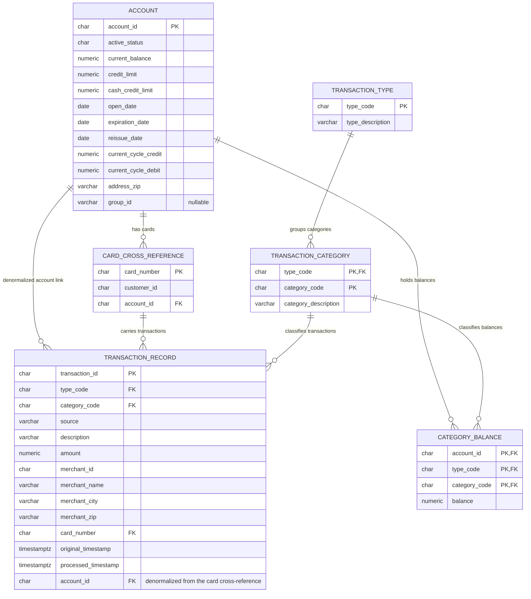

# Card Servicing Data Model

This is the Data Model / Schema Design for the first, read-only Card Servicing iteration: six PostgreSQL tables, their relationships, the screen fields they serve, the fixture load that fills them and the synthetic volume used for performance testing.

## Scope and sources

The six baseline logical entities are the fixed schema target and are carried unchanged: Account, CardCrossReference, TransactionType, TransactionCategory, CategoryBalance and Transaction. The target store is Azure Database for PostgreSQL Flexible Server running PostgreSQL 16, as set by [decision D1](technical-requirements.md#d1-data-store).

Sources, cited by anchor:

- Data Layouts: `Data Layouts · CVACT01Y` (account), `Data Layouts · CVACT03Y` (card cross-reference), `Data Layouts · CVTRA01Y` (category balance), `Data Layouts · CVTRA05Y` (transaction) and `Data Layouts · CVTRA06Y` (daily transaction feed, the same layout as CVTRA05Y under `DALYTRAN-*` names).
- Reference Tables: the record structures `Data Layouts · CVTRA03Y` (transaction type) and `Data Layouts · CVTRA04Y` (transaction category), with their rows taken from `Reference Tables · TRANTYPE file` and `Reference Tables · TRANCATG file`.
- Use Cases, for field visibility only: `Use Cases · COACTVWC` (account view), `Use Cases · COTRN00C` (transaction list) and `Use Cases · COTRN01C` (transaction detail).

Every baseline field matches its copybook in name, PICTURE and length, so there is no mismatch to resolve. Two source nuances are carried as annotations only:

- The account expiry field is misspelled in the source as `ACCT-EXPIRAION-DATE`. It maps to the contract field `expirationDate` and the column `expiration_date`.
- The type record's code field is named `TRAN-TYPE` (`Data Layouts · CVTRA03Y · TRAN-TYPE`), not `TRAN-TYPE-CD` as in the category, balance and transaction records.

Type rule, applied to every column:

- A baseline `char(n)` stays `char(n)`, a baseline `decimal` becomes `numeric`, and a baseline `timestamp(6) UTC` becomes `timestamptz(6)`.
- Numeric identifiers and codes keep their leading zeros, so a `9(n)` identifier or code is `char(n)`, never an integer.
- Signed amounts keep the copybook precision: `S9(10)V99` is `numeric(12,2)` and `S9(09)V99` is `numeric(11,2)`.
- Descriptions are `varchar(50)`, because both type and category descriptions are X(50) (`Data Layouts · CVTRA03Y · TRAN-TYPE-DESC`, `Data Layouts · CVTRA04Y · TRAN-CAT-TYPE-DESC`); the longest sample values are 13 and 29 characters. Other free text is `varchar(n)` at its X(n) length, loaded with trailing padding removed.
- Dates are `date`, because each copybook X(10) date holds ISO `YYYY-MM-DD` text.

Data reach. The Card Servicing service never opens a database connection; each table is read only by the stub that owns it and written only by the fixture loader.

| Table | Logical entity | Read by | Written by |
|---|---|---|---|
| `account` | Account | Card Data stub | Fixture loader |
| `card_cross_reference` | CardCrossReference | Card Data stub; Transaction Activity stub (decides "account unknown") | Fixture loader |
| `transaction_type` | TransactionType | Reference Data stub | Fixture loader |
| `transaction_category` | TransactionCategory | Reference Data stub | Fixture loader |
| `category_balance` | CategoryBalance | Card Data stub | Fixture loader |
| `transaction_record` | Transaction | Transaction Activity stub | Fixture loader |

The contracts that expose these entities:

- Card Data: [card_data_service.proto](../card-servicing-service/src/main/proto/cardservicing/carddata/v1/card_data_service.proto) and [card-data-service.yaml](../card-servicing-service/src/main/resources/openapi/card-data-service.yaml).
- Transaction Activity: [transaction_activity_service.proto](../card-servicing-service/src/main/proto/cardservicing/transactionactivity/v1/transaction_activity_service.proto) and [transaction-activity-service.yaml](../card-servicing-service/src/main/resources/openapi/transaction-activity-service.yaml).
- Reference Data: [reference_data_service.proto](../card-servicing-service/src/main/proto/cardservicing/referencedata/v1/reference_data_service.proto) and [reference-data-service.yaml](../card-servicing-service/src/main/resources/openapi/reference-data-service.yaml).

## Entity-to-table mapping

Each table lists its columns with type, nullability, key role, the contract field that carries the value (camelCase JSON; the proto field is its snake_case form) and the source field with its PICTURE.

### account

Logical entity Account; source `Data Layouts · CVACT01Y` (record length 300).

| Column | Type | Null | Key | Contract field | Source field and PICTURE |
|---|---|---|---|---|---|
| `account_id` | `char(11)` | NOT NULL | PK | `accountId` | ACCT-ID 9(11) |
| `active_status` | `char(1)` | NOT NULL | — | `activeStatus` | ACCT-ACTIVE-STATUS X(01) |
| `current_balance` | `numeric(12,2)` | NOT NULL | — | `currentBalance` | ACCT-CURR-BAL S9(10)V99 |
| `credit_limit` | `numeric(12,2)` | NOT NULL | — | `creditLimit` | ACCT-CREDIT-LIMIT S9(10)V99 |
| `cash_credit_limit` | `numeric(12,2)` | NOT NULL | — | `cashCreditLimit` | ACCT-CASH-CREDIT-LIMIT S9(10)V99 |
| `open_date` | `date` | NOT NULL | — | `openDate` | ACCT-OPEN-DATE X(10) |
| `expiration_date` | `date` | NOT NULL | — | `expirationDate` | ACCT-EXPIRAION-DATE X(10) (misspelled in the source) |
| `reissue_date` | `date` | NOT NULL | — | `reissueDate` | ACCT-REISSUE-DATE X(10) |
| `current_cycle_credit` | `numeric(12,2)` | NOT NULL | — | `currentCycleCredit` | ACCT-CURR-CYC-CREDIT S9(10)V99 |
| `current_cycle_debit` | `numeric(12,2)` | NOT NULL | — | `currentCycleDebit` | ACCT-CURR-CYC-DEBIT S9(10)V99 |
| `address_zip` | `varchar(10)` | NOT NULL | — | `addressZip` | ACCT-ADDR-ZIP X(10) |
| `group_id` | `varchar(10)` | NULL | — | `groupId` (omitted when NULL) | ACCT-GROUP-ID X(10); blank in every sample row |

Indexes: primary key `(account_id)`. The trailing FILLER X(178) is not stored.

### card_cross_reference

Logical entity CardCrossReference; source `Data Layouts · CVACT03Y` (record length 50).

| Column | Type | Null | Key | Contract field | Source field and PICTURE |
|---|---|---|---|---|---|
| `card_number` | `char(16)` | NOT NULL | PK | `cardNumber` | XREF-CARD-NUM X(16) |
| `customer_id` | `char(9)` | NOT NULL | — | `customerId` | XREF-CUST-ID 9(09) |
| `account_id` | `char(11)` | NOT NULL | FK → `account.account_id` | `accountId` | XREF-ACCT-ID 9(11) |

Indexes: primary key `(card_number)`; `(account_id)` for the account-to-card lookup, which also decides "account unknown" for the Transaction Activity stub (an account with no cross-reference row returns `NOT_FOUND` from `ListTransactions`). The trailing FILLER X(14) is not stored.

### transaction_type

Logical entity TransactionType; source `Data Layouts · CVTRA03Y` (record length 60), rows from `Reference Tables · TRANTYPE file`.

| Column | Type | Null | Key | Contract field | Source field and PICTURE |
|---|---|---|---|---|---|
| `type_code` | `char(2)` | NOT NULL | PK | `typeCode` | TRAN-TYPE X(02) |
| `type_description` | `varchar(50)` | NOT NULL | — | `typeDescription` | TRAN-TYPE-DESC X(50) |

Indexes: primary key `(type_code)`. The trailing FILLER X(08) is not stored.

### transaction_category

Logical entity TransactionCategory; source `Data Layouts · CVTRA04Y` (record length 60), rows from `Reference Tables · TRANCATG file`.

| Column | Type | Null | Key | Contract field | Source field and PICTURE |
|---|---|---|---|---|---|
| `type_code` | `char(2)` | NOT NULL | PK; FK → `transaction_type.type_code` | `typeCode` | TRAN-TYPE-CD X(02) |
| `category_code` | `char(4)` | NOT NULL | PK | `categoryCode` | TRAN-CAT-CD 9(04) |
| `category_description` | `varchar(50)` | NOT NULL | — | `categoryDescription` | TRAN-CAT-TYPE-DESC X(50) |

Indexes: primary key `(type_code, category_code)`, which also serves the foreign key to `transaction_type`. The trailing FILLER X(04) is not stored.

### category_balance

Logical entity CategoryBalance; source `Data Layouts · CVTRA01Y` (record length 50).

| Column | Type | Null | Key | Contract field | Source field and PICTURE |
|---|---|---|---|---|---|
| `account_id` | `char(11)` | NOT NULL | PK; FK → `account.account_id` | `accountId` | TRANCAT-ACCT-ID 9(11) |
| `type_code` | `char(2)` | NOT NULL | PK; FK → `transaction_category` | `typeCode` | TRANCAT-TYPE-CD X(02) |
| `category_code` | `char(4)` | NOT NULL | PK; FK → `transaction_category` | `categoryCode` | TRANCAT-CD 9(04) |
| `balance` | `numeric(11,2)` | NOT NULL | — | `balance` | TRAN-CAT-BAL S9(09)V99 |

Keys: primary key `(account_id, type_code, category_code)`, whose leading `account_id` serves the per-account read in `(type_code, category_code)` order; foreign key `(type_code, category_code)` → `transaction_category (type_code, category_code)`. The trailing FILLER X(22) is not stored.

### transaction_record

Logical entity Transaction; source `Data Layouts · CVTRA05Y` (record length 350). The table is named `transaction_record` to avoid the SQL keyword `TRANSACTION`.

| Column | Type | Null | Key | Contract field | Source field and PICTURE |
|---|---|---|---|---|---|
| `transaction_id` | `char(16)` | NOT NULL | PK | `transactionId` | TRAN-ID X(16) |
| `type_code` | `char(2)` | NOT NULL | FK → `transaction_category` | `typeCode` | TRAN-TYPE-CD X(02) |
| `category_code` | `char(4)` | NOT NULL | FK → `transaction_category` | `categoryCode` | TRAN-CAT-CD 9(04) |
| `source` | `varchar(10)` | NOT NULL | — | `source` | TRAN-SOURCE X(10) |
| `description` | `varchar(100)` | NOT NULL | — | `description` | TRAN-DESC X(100) |
| `amount` | `numeric(11,2)` | NOT NULL | — | `amount` | TRAN-AMT S9(09)V99 |
| `merchant_id` | `char(9)` | NOT NULL | — | `merchantId` | TRAN-MERCHANT-ID 9(09) |
| `merchant_name` | `varchar(50)` | NOT NULL | — | `merchantName` | TRAN-MERCHANT-NAME X(50) |
| `merchant_city` | `varchar(50)` | NOT NULL | — | `merchantCity` | TRAN-MERCHANT-CITY X(50) |
| `merchant_zip` | `varchar(10)` | NOT NULL | — | `merchantZip` | TRAN-MERCHANT-ZIP X(10) |
| `card_number` | `char(16)` | NOT NULL | FK → `card_cross_reference.card_number` | `cardNumber` | TRAN-CARD-NUM X(16) |
| `original_timestamp` | `timestamptz(6)` | NOT NULL | — | `originalTimestamp` | TRAN-ORIG-TS X(26) |
| `processed_timestamp` | `timestamptz(6)` | NOT NULL | — | `processedTimestamp` | TRAN-PROC-TS X(26) |
| `account_id` | `char(11)` | NOT NULL | FK → `account.account_id` | — (selected by the request's `accountId`) | Derived from XREF-ACCT-ID 9(11) through the card's cross-reference row; see [Denormalization of transaction account](#denormalization-of-transaction-account) |

Keys and indexes:

- Primary key `(transaction_id)`, which serves the single-transaction lookup.
- Foreign key `(type_code, category_code)` → `transaction_category (type_code, category_code)`.
- Baseline card index `(card_number)`, kept; it also serves the foreign key to `card_cross_reference`.
- Keyset index `(account_id, processed_timestamp desc, transaction_id desc)` for the per-account newest-first page ([decision D4](technical-requirements.md#d4-transaction-to-account-access)).

`account_id` is the only denormalized column in the schema. The trailing FILLER X(20) is not stored.

Wire formats, shared by REST and gRPC:

- Amounts serialize from the scale-2 `numeric` value as strings with exactly two decimals, for example `"194.00"`, `"-70.77"` or `"1234.56"`.
- Timestamps serialize in RFC 3339 with microseconds and `Z`, for example `"2022-06-10T19:27:53.000000Z"`.
- Dates serialize as `YYYY-MM-DD` strings, for example `"2014-11-20"`.
- Identifiers and codes serialize as strings with their leading zeros, for example `"00000000001"` and `"0001"`.

## Entity relationship diagram

Entities are named by their tables in upper case. Attribute types omit lengths and precision, which the mapping tables above carry.

Cardinalities: an account has zero or more cards and zero or more category balances; a card carries zero or more transactions; a transaction type groups zero or more categories; a category classifies zero or more category balances and transactions. The account-to-transaction link duplicates the path account → card → transaction and is the one denormalization.

## Denormalization of transaction account

`transaction_record.account_id` is populated at load from the cross-reference row of the transaction's card (`card_number` → `card_cross_reference.account_id`). It carries a foreign key to `account` and must always equal the account of the transaction's card.

Why it exists. The transaction list reads one account's transactions newest-processed first, one page at a time. With the column, the keyset index `(account_id, processed_timestamp desc, transaction_id desc)` serves each page as one index seek: an equality on `account_id`, then the row-value predicate `(processed_timestamp, transaction_id) < ($1, $2)`, where `$1` and `$2` are the last position returned on the previous page, reading `pageSize + 1` entries in index order (the extra entry tells whether a next page exists). Without the column, the stub would filter `card_number = ANY(...)` over the account's cards through the card index. That index is ordered by card first, so the per-account result loses the global `(processed_timestamp, transaction_id)` order and every page forces a sort whose cost grows with the account's history. A join through `card_cross_reference` on each page has the same ordering problem.

Cost and drift. The column adds about 12 bytes per row (a `char(11)` value and its header), which is about 12 MB at the 1,000,000-row planning baseline. It cannot drift, because this iteration has no write operations: the only writer is the fixture loader, which derives it. The decision, its ranked alternatives and its pressure-test are in [decision D4](technical-requirements.md#d4-transaction-to-account-access).

Filters. `type_code` and `category_code` are not in the index key. A filtered page scans the account's entries in index order and rejects rows until `pageSize + 1` match, so its cost grows with the account's history divided by the filter's selectivity, not with total volume. The answer to the D4 trigger is three filter-leading indexes, each fixing every filtered column by equality ahead of the cursor order. They are recorded in [Recommendations](implementation-plan.md#recommendations) and are not created in this iteration:

- `(account_id, type_code, processed_timestamp desc, transaction_id desc)` for a `typeCode` filter alone.
- `(account_id, type_code, category_code, processed_timestamp desc, transaction_id desc)` for both filters.
- `(account_id, category_code, processed_timestamp desc, transaction_id desc)` for a `categoryCode` filter alone.

## Reference data as data

The type-to-category mapping is rows, not code. `transaction_type` and `transaction_category` are seeded from `card-servicing-service/src/main/resources/reference-data/transaction-types.yaml` (7 rows) and `card-servicing-service/src/main/resources/reference-data/transaction-categories.yaml` (18 rows). Story CS-13-001 creates both files from `Reference Tables · TRANTYPE file` and `Reference Tables · TRANCATG file`. No code path enumerates a type or category; every reader takes them from these rows.

Transaction types (`Reference Tables · TRANTYPE file`):

| `type_code` | `type_description` |
|---|---|
| 01 | Purchase |
| 02 | Payment |
| 03 | Credit |
| 04 | Authorization |
| 05 | Refund |
| 06 | Reversal |
| 07 | Adjustment |

Transaction categories (`Reference Tables · TRANCATG file`); every `type_code` names a row above:

| `type_code` | `category_code` | `category_description` |
|---|---|---|
| 01 | 0001 | Regular Sales Draft |
| 01 | 0002 | Regular Cash Advance |
| 01 | 0003 | Convenience Check Debit |
| 01 | 0004 | ATM Cash Advance |
| 01 | 0005 | Interest Amount |
| 02 | 0001 | Cash payment |
| 02 | 0002 | Electronic payment |
| 02 | 0003 | Check payment |
| 03 | 0001 | Credit to Account |
| 03 | 0002 | Credit to Purchase balance |
| 03 | 0003 | Credit to Cash balance |
| 04 | 0001 | Zero dollar authorization |
| 04 | 0002 | Online purchase authorization |
| 04 | 0003 | Travel booking authorization |
| 05 | 0001 | Refund credit |
| 06 | 0001 | Fraud reversal |
| 06 | 0002 | Non-fraud reversal |
| 07 | 0001 | Sales draft credit adjustment |

Change path. A type or category change is a data load by the data owner into these two tables. The Reference Data stub reads the change on its next request, and the Card Servicing service sees it within the 3,600 s fresh TTL of its cache keys `cs:v1:reftypes` and `cs:v1:refcats`. No deploy is needed. The same rows decide the category-balance endpoint's unknown-`typeCode` check and label type-group and category balances with their descriptions.

## Screen-field coverage matrix

Every field the four in-scope interactions display, with the contract field that carries it and the column that stores it. The Anchor cell names the screen (Use Cases) and the record field with its PICTURE (Data Layouts). The category balance view has no CardDemo screen, so its anchor is `Data Layouts · CVTRA01Y · TRAN-CAT-BAL` and its rows are record fields.

| Interaction | Screen label or record field | Anchor | Contract field | Column | Status |
|---|---|---|---|---|---|
| Account balance summary | Account Number | Use Cases · COACTVWC; Data Layouts · CVACT01Y · ACCT-ID 9(11) | `accountId` | `account.account_id` | Covered |
| Account balance summary | Active Y/N | Use Cases · COACTVWC; Data Layouts · CVACT01Y · ACCT-ACTIVE-STATUS X(01) | `activeStatus` | `account.active_status` | Covered |
| Account balance summary | Opened | Use Cases · COACTVWC; Data Layouts · CVACT01Y · ACCT-OPEN-DATE X(10) | `openDate` | `account.open_date` | Covered |
| Account balance summary | Credit Limit | Use Cases · COACTVWC; Data Layouts · CVACT01Y · ACCT-CREDIT-LIMIT S9(10)V99 | `creditLimit` | `account.credit_limit` | Covered |
| Account balance summary | Expiry | Use Cases · COACTVWC; Data Layouts · CVACT01Y · ACCT-EXPIRAION-DATE X(10) | `expirationDate` | `account.expiration_date` | Covered |
| Account balance summary | Cash credit Limit | Use Cases · COACTVWC; Data Layouts · CVACT01Y · ACCT-CASH-CREDIT-LIMIT S9(10)V99 | `cashCreditLimit` | `account.cash_credit_limit` | Covered |
| Account balance summary | Reissue | Use Cases · COACTVWC; Data Layouts · CVACT01Y · ACCT-REISSUE-DATE X(10) | `reissueDate` | `account.reissue_date` | Covered |
| Account balance summary | Current Balance | Use Cases · COACTVWC; Data Layouts · CVACT01Y · ACCT-CURR-BAL S9(10)V99 | `currentBalance` | `account.current_balance` | Covered |
| Account balance summary | Current Cycle Credit | Use Cases · COACTVWC; Data Layouts · CVACT01Y · ACCT-CURR-CYC-CREDIT S9(10)V99 | `currentCycleCredit` | `account.current_cycle_credit` | Covered |
| Account balance summary | Account Group | Use Cases · COACTVWC; Data Layouts · CVACT01Y · ACCT-GROUP-ID X(10) | `groupId` | `account.group_id` | Covered |
| Account balance summary | Current Cycle Debit | Use Cases · COACTVWC; Data Layouts · CVACT01Y · ACCT-CURR-CYC-DEBIT S9(10)V99 | `currentCycleDebit` | `account.current_cycle_debit` | Covered |
| Account balance summary | Type-group balances (no screen label) | Data Layouts · CVTRA01Y · TRAN-CAT-BAL S9(09)V99; Data Layouts · CVTRA03Y · TRAN-TYPE-DESC X(50) | `balancesByTypeGroup` (`typeCode`, `typeDescription`, `balance`) | Sum of `category_balance.balance` per `category_balance.type_code`, with `transaction_type.type_description` | Covered |
| Category balance view | TRANCAT-TYPE-CD | Data Layouts · CVTRA01Y · TRANCAT-TYPE-CD X(02) | `typeCode` | `category_balance.type_code` | Covered |
| Category balance view | TRANCAT-CD | Data Layouts · CVTRA01Y · TRANCAT-CD 9(04) | `categoryCode` | `category_balance.category_code` | Covered |
| Category balance view | TRAN-CAT-BAL | Data Layouts · CVTRA01Y · TRAN-CAT-BAL S9(09)V99 | `balance` | `category_balance.balance` | Covered |
| Category balance view | TRAN-TYPE-DESC | Data Layouts · CVTRA03Y · TRAN-TYPE-DESC X(50) | `typeDescription` | `transaction_type.type_description` | Covered |
| Category balance view | TRAN-CAT-TYPE-DESC | Data Layouts · CVTRA04Y · TRAN-CAT-TYPE-DESC X(50) | `categoryDescription` | `transaction_category.category_description` | Covered |
| Transaction list | Transaction ID | Use Cases · COTRN00C; Data Layouts · CVTRA05Y · TRAN-ID X(16) | `transactionId` | `transaction_record.transaction_id` | Covered |
| Transaction list | Date | Use Cases · COTRN00C; Data Layouts · CVTRA05Y · TRAN-ORIG-TS X(26) (the screen's Date is taken from TRAN-ORIG-TS) | `originalTimestamp` | `transaction_record.original_timestamp` | Covered |
| Transaction list | Description | Use Cases · COTRN00C; Data Layouts · CVTRA05Y · TRAN-DESC X(100) | `description` | `transaction_record.description` | Covered |
| Transaction list | Amount | Use Cases · COTRN00C; Data Layouts · CVTRA05Y · TRAN-AMT S9(09)V99 | `amount` | `transaction_record.amount` | Covered |
| Transaction detail | Transaction ID | Use Cases · COTRN01C; Data Layouts · CVTRA05Y · TRAN-ID X(16) | `transactionId` | `transaction_record.transaction_id` | Covered |
| Transaction detail | Card Number | Use Cases · COTRN01C; Data Layouts · CVTRA05Y · TRAN-CARD-NUM X(16) | `cardNumber` | `transaction_record.card_number` | Covered |
| Transaction detail | Type CD | Use Cases · COTRN01C; Data Layouts · CVTRA05Y · TRAN-TYPE-CD X(02) | `typeCode` | `transaction_record.type_code` | Covered |
| Transaction detail | Category CD | Use Cases · COTRN01C; Data Layouts · CVTRA05Y · TRAN-CAT-CD 9(04) | `categoryCode` | `transaction_record.category_code` | Covered |
| Transaction detail | Source | Use Cases · COTRN01C; Data Layouts · CVTRA05Y · TRAN-SOURCE X(10) | `source` | `transaction_record.source` | Covered |
| Transaction detail | Description | Use Cases · COTRN01C; Data Layouts · CVTRA05Y · TRAN-DESC X(100) | `description` | `transaction_record.description` | Covered |
| Transaction detail | Amount | Use Cases · COTRN01C; Data Layouts · CVTRA05Y · TRAN-AMT S9(09)V99 | `amount` | `transaction_record.amount` | Covered |
| Transaction detail | Orig Date | Use Cases · COTRN01C; Data Layouts · CVTRA05Y · TRAN-ORIG-TS X(26) | `originalTimestamp` | `transaction_record.original_timestamp` | Covered |
| Transaction detail | Proc Date | Use Cases · COTRN01C; Data Layouts · CVTRA05Y · TRAN-PROC-TS X(26) | `processedTimestamp` | `transaction_record.processed_timestamp` | Covered |
| Transaction detail | Merchant ID | Use Cases · COTRN01C; Data Layouts · CVTRA05Y · TRAN-MERCHANT-ID 9(09) | `merchantId` | `transaction_record.merchant_id` | Covered |
| Transaction detail | Merchant Name | Use Cases · COTRN01C; Data Layouts · CVTRA05Y · TRAN-MERCHANT-NAME X(50) | `merchantName` | `transaction_record.merchant_name` | Covered |
| Transaction detail | Merchant City | Use Cases · COTRN01C; Data Layouts · CVTRA05Y · TRAN-MERCHANT-CITY X(50) | `merchantCity` | `transaction_record.merchant_city` | Covered |
| Transaction detail | Merchant Zip | Use Cases · COTRN01C; Data Layouts · CVTRA05Y · TRAN-MERCHANT-ZIP X(10) | `merchantZip` | `transaction_record.merchant_zip` | Covered |
| Account balance summary (Customer Details) | Customer id | Use Cases · COACTVWC; Data Layouts · CVCUS01Y · CUST-ID 9(09) | `customerId` on the Card Data cross-reference read only, not on the balance summary | `card_cross_reference.customer_id` | Field gap — baseline field not exposed on balance summary; delivery awaits a Requirements Analysis ID |
| Account balance summary (Customer Details) | SSN | Use Cases · COACTVWC; Data Layouts · CVCUS01Y · CUST-SSN 9(09), shown as NNN-NN-NNNN | — | — | Field gap — no baseline entity or operation; delivery awaits a Requirements Analysis ID |
| Account balance summary (Customer Details) | Date of birth | Use Cases · COACTVWC; Data Layouts · CVCUS01Y · CUST-DOB-YYYY-MM-DD X(10) | — | — | Field gap — no baseline entity or operation; delivery awaits a Requirements Analysis ID |
| Account balance summary (Customer Details) | FICO Score | Use Cases · COACTVWC; Data Layouts · CVCUS01Y · CUST-FICO-CREDIT-SCORE 9(03) | — | — | Field gap — no baseline entity or operation; delivery awaits a Requirements Analysis ID |
| Account balance summary (Customer Details) | First Name | Use Cases · COACTVWC; Data Layouts · CVCUS01Y · CUST-FIRST-NAME X(25) | — | — | Field gap — no baseline entity or operation; delivery awaits a Requirements Analysis ID |
| Account balance summary (Customer Details) | Middle Name | Use Cases · COACTVWC; Data Layouts · CVCUS01Y · CUST-MIDDLE-NAME X(25) | — | — | Field gap — no baseline entity or operation; delivery awaits a Requirements Analysis ID |
| Account balance summary (Customer Details) | Last Name | Use Cases · COACTVWC; Data Layouts · CVCUS01Y · CUST-LAST-NAME X(25) | — | — | Field gap — no baseline entity or operation; delivery awaits a Requirements Analysis ID |
| Account balance summary (Customer Details) | Address | Use Cases · COACTVWC; Data Layouts · CVCUS01Y · CUST-ADDR-LINE-1 and CUST-ADDR-LINE-2 X(50) | — | — | Field gap — no baseline entity or operation; delivery awaits a Requirements Analysis ID |
| Account balance summary (Customer Details) | State | Use Cases · COACTVWC; Data Layouts · CVCUS01Y · CUST-ADDR-STATE-CD X(02) | — | — | Field gap — no baseline entity or operation; delivery awaits a Requirements Analysis ID |
| Account balance summary (Customer Details) | Zip | Use Cases · COACTVWC; Data Layouts · CVCUS01Y · CUST-ADDR-ZIP X(10) | — | — | Field gap — no baseline entity or operation; delivery awaits a Requirements Analysis ID |
| Account balance summary (Customer Details) | City | Use Cases · COACTVWC; Data Layouts · CVCUS01Y · CUST-ADDR-LINE-3 X(50) | — | — | Field gap — no baseline entity or operation; delivery awaits a Requirements Analysis ID |
| Account balance summary (Customer Details) | Country | Use Cases · COACTVWC; Data Layouts · CVCUS01Y · CUST-ADDR-COUNTRY-CD X(03) | — | — | Field gap — no baseline entity or operation; delivery awaits a Requirements Analysis ID |
| Account balance summary (Customer Details) | Phone 1 | Use Cases · COACTVWC; Data Layouts · CVCUS01Y · CUST-PHONE-NUM-1 X(15) | — | — | Field gap — no baseline entity or operation; delivery awaits a Requirements Analysis ID |
| Account balance summary (Customer Details) | Government Issued Id Ref | Use Cases · COACTVWC; Data Layouts · CVCUS01Y · CUST-GOVT-ISSUED-ID X(20) | — | — | Field gap — no baseline entity or operation; delivery awaits a Requirements Analysis ID |
| Account balance summary (Customer Details) | Phone 2 | Use Cases · COACTVWC; Data Layouts · CVCUS01Y · CUST-PHONE-NUM-2 X(15) | — | — | Field gap — no baseline entity or operation; delivery awaits a Requirements Analysis ID |
| Account balance summary (Customer Details) | EFT Account Id | Use Cases · COACTVWC; Data Layouts · CVCUS01Y · CUST-EFT-ACCOUNT-ID X(10) | — | — | Field gap — no baseline entity or operation; delivery awaits a Requirements Analysis ID |
| Account balance summary (Customer Details) | Primary Card Holder Y/N | Use Cases · COACTVWC; Data Layouts · CVCUS01Y · CUST-PRI-CARD-HOLDER-IND X(01) | — | — | Field gap — no baseline entity or operation; delivery awaits a Requirements Analysis ID |

Pass/fail reading ("schema covers all fields required by the in-scope screens"):

- The required fields are those on the governing list: the six baseline entities and the Data Layouts records they name, with Use Cases deciding which of their fields are visible. Every one of them has a column above.
- The 16 Customer Details labels other than Customer id come from the customer record `Data Layouts · CVCUS01Y`, which none of the six fixed entities holds and no baseline operation returns. They are flagged gaps with no column. Delivering them needs a customer entity and a customer read on the Card Data service, which the baseline does not define.
- Customer id maps to the existing column `card_cross_reference.customer_id` (`Data Layouts · CVACT03Y · XREF-CUST-ID`), returned by the Card Data cross-reference read. It is flagged only because the balance summary does not expose it; delivering it needs a balance-summary field, a cross-reference read on that endpoint and a degradation rule for that read.
- The customer sample file `custdata.txt` is not a fixture input. The same 17 labels and statuses appear in the [gap list of the implementation plan](implementation-plan.md#card_req_tbd-gap-list) and in the Requirements of the [Account Balance Summary View epic](backlog/epics/CS-01-account-balance-summary-view/README.md).
- The sample data is synthetic and holds no real personal data, so standard per-account access control applies.

## Fixture mapping

The fixture loader reads the CardDemo ASCII sample files, copied unchanged under `card-servicing-service/src/main/resources/fixtures/`, by fixed 1-based character positions computed from the copybook PICTURE widths. Each table below covers one input file.

`acctdata.txt` → `account` (`Data Layouts · CVACT01Y`; 50 rows × 300 bytes):

| Source field | Positions (1-based) | Column | Rule |
|---|---|---|---|
| ACCT-ID | 1–11 | `account_id` | Text with leading zeros |
| ACCT-ACTIVE-STATUS | 12 | `active_status` | As read |
| ACCT-CURR-BAL | 13–24 | `current_balance` | Zoned decimal, two implied decimals, overpunch sign at position 24 |
| ACCT-CREDIT-LIMIT | 25–36 | `credit_limit` | Zoned decimal, overpunch sign at position 36 |
| ACCT-CASH-CREDIT-LIMIT | 37–48 | `cash_credit_limit` | Zoned decimal, overpunch sign at position 48 |
| ACCT-OPEN-DATE | 49–58 | `open_date` | ISO `YYYY-MM-DD` |
| ACCT-EXPIRAION-DATE | 59–68 | `expiration_date` | ISO `YYYY-MM-DD` |
| ACCT-REISSUE-DATE | 69–78 | `reissue_date` | ISO `YYYY-MM-DD` |
| ACCT-CURR-CYC-CREDIT | 79–90 | `current_cycle_credit` | Zoned decimal, overpunch sign at position 90 |
| ACCT-CURR-CYC-DEBIT | 91–102 | `current_cycle_debit` | Zoned decimal, overpunch sign at position 102 |
| ACCT-ADDR-ZIP | 103–112 | `address_zip` | Strictly by offset, trailing padding removed |
| ACCT-GROUP-ID | 113–122 | `group_id` | Strictly by offset; blank becomes NULL |
| FILLER | 123–300 | — | Ignored |

`cardxref.txt` → `card_cross_reference` (`Data Layouts · CVACT03Y` without its FILLER; 50 rows × 36 bytes):

| Source field | Positions (1-based) | Column | Rule |
|---|---|---|---|
| XREF-CARD-NUM | 1–16 | `card_number` | As read |
| XREF-CUST-ID | 17–25 | `customer_id` | Text with leading zeros |
| XREF-ACCT-ID | 26–36 | `account_id` | Text with leading zeros; must name a loaded account |
| FILLER | 37–50 | — | Absent from 36-byte lines, ignored in 50-byte lines |

`tcatbal.txt` → `category_balance` (`Data Layouts · CVTRA01Y`; 50 rows × 50 bytes):

| Source field | Positions (1-based) | Column | Rule |
|---|---|---|---|
| TRANCAT-ACCT-ID | 1–11 | `account_id` | Text with leading zeros; must name a loaded account |
| TRANCAT-TYPE-CD | 12–13 | `type_code` | With `category_code`, must name a loaded category |
| TRANCAT-CD | 14–17 | `category_code` | Text with leading zeros |
| TRAN-CAT-BAL | 18–28 | `balance` | Zoned decimal, two implied decimals, overpunch sign at position 28 |
| FILLER | 29–50 | — | Ignored |

`dailytran.txt` → `transaction_record` (`Data Layouts · CVTRA06Y`, the same layout as `Data Layouts · CVTRA05Y`; 300 rows × 350 bytes). The daily transaction feed is the transaction source, because the CardDemo sample set has no TRANSACT ASCII file.

| Source field | Positions (1-based) | Column | Rule |
|---|---|---|---|
| DALYTRAN-ID | 1–16 | `transaction_id` | As read |
| DALYTRAN-TYPE-CD | 17–18 | `type_code` | With `category_code`, must name a loaded category |
| DALYTRAN-CAT-CD | 19–22 | `category_code` | Text with leading zeros |
| DALYTRAN-SOURCE | 23–32 | `source` | Trailing padding removed |
| DALYTRAN-DESC | 33–132 | `description` | Trailing padding removed |
| DALYTRAN-AMT | 133–143 | `amount` | Zoned decimal, two implied decimals, overpunch sign at position 143 |
| DALYTRAN-MERCHANT-ID | 144–152 | `merchant_id` | Text with leading zeros |
| DALYTRAN-MERCHANT-NAME | 153–202 | `merchant_name` | Trailing padding removed |
| DALYTRAN-MERCHANT-CITY | 203–252 | `merchant_city` | Trailing padding removed |
| DALYTRAN-MERCHANT-ZIP | 253–262 | `merchant_zip` | Trailing padding removed |
| DALYTRAN-CARD-NUM | 263–278 | `card_number` | Must name a loaded cross-reference row |
| DALYTRAN-ORIG-TS | 279–304 | `original_timestamp` | Either timestamp form, read as UTC |
| DALYTRAN-PROC-TS | 305–330 | `processed_timestamp` | Either timestamp form, read as UTC; blank takes `original_timestamp` |
| FILLER | 331–350 | — | Ignored |
| (derived) | — | `account_id` | `card_cross_reference.account_id` of the row's card |

The two reference files become the seed YAML files of [Reference data as data](#reference-data-as-data), and the loader seeds `transaction_type` and `transaction_category` from that YAML.

`trantype.txt` → `transaction_type` (`Data Layouts · CVTRA03Y`; 7 rows × 60 bytes):

| Source field | Positions (1-based) | Column | Rule |
|---|---|---|---|
| TRAN-TYPE | 1–2 | `type_code` | As read |
| TRAN-TYPE-DESC | 3–52 | `type_description` | Trailing padding removed |
| FILLER | 53–60 | — | Ignored |

`trancatg.txt` → `transaction_category` (`Data Layouts · CVTRA04Y`; 18 rows × 60 bytes):

| Source field | Positions (1-based) | Column | Rule |
|---|---|---|---|
| TRAN-TYPE-CD | 1–2 | `type_code` | Must name a loaded type |
| TRAN-CAT-CD | 3–6 | `category_code` | Text with leading zeros |
| TRAN-CAT-TYPE-DESC | 7–56 | `category_description` | Trailing padding removed |
| FILLER | 57–60 | — | Ignored |

Load order follows the foreign keys: `transaction_type`, `transaction_category`, `account`, `card_cross_reference`, `category_balance`, `transaction_record`. Each entity loads in its own transaction, and its load-report counts (loaded, skipped, derived-timestamp) are written after that transaction commits. The expected report for the sample set:

| Order | Table | Input | Loaded | Skipped | Derived timestamps |
|---|---|---|---|---|---|
| 1 | `transaction_type` | `transaction-types.yaml` | 7 | 0 | 0 |
| 2 | `transaction_category` | `transaction-categories.yaml` | 18 | 0 | 0 |
| 3 | `account` | `acctdata.txt` | 50 | 0 | 0 |
| 4 | `card_cross_reference` | `cardxref.txt` | 50 | 0 | 0 |
| 5 | `category_balance` | `tcatbal.txt` | 50 | 0 | 0 |
| 6 | `transaction_record` | `dailytran.txt` | 300 | 0 | 300 |

### Fixture rules

These rules bind the fixture-loader stories CS-09-001, CS-09-003, CS-10-002 and CS-13-001.

- Overpunch signs. A signed amount is zoned decimal whose last position carries the sign and the last digit: `{` is +0, `A`–`I` are +1 to +9, `}` is −0 and `J`–`R` are −1 to −9. Two decimals are implied. For example `00000001940{` is 194.00 and `0000000707P` is −70.77. 50 of the 300 sample transaction amounts are negative. Account `00000000001` loads with current balance `194.00`, credit limit `2020.00` and cash credit limit `1020.00`.
- Cross-reference line length. Both 36-byte lines (the sample form, without FILLER) and 50-byte lines (the full record) are accepted. Any other length, a 35-byte line for example, is a malformed line and fails the load.
- Timestamp forms. Both `YYYY-MM-DD HH:MM:SS.ffffff` (the sample form) and `YYYY-MM-DD-HH.MM.SS.ffffff` (the form batch posting writes) are parsed as UTC into `timestamptz(6)`.
- Blank processed timestamp. When TRAN-PROC-TS is blank, as it is in all 300 sample rows, `processed_timestamp` takes the `original_timestamp` value and the row is counted as a derived timestamp in the load report. Every sample TRAN-ORIG-TS is `2022-06-10 19:27:53.000000`, so within an account the sample ordering falls to `transaction_id` descending.
- Zip and group ID by offset. ACCT-ADDR-ZIP and ACCT-GROUP-ID are read strictly at their copybook offsets, never re-aligned. The sample rows therefore carry `addressZip` `A000000000` and no `groupId`, because positions 103–112 hold `A000000000` and positions 113–122 are blank in every row.
- Foreign-key skips. A row whose foreign key names no loaded parent row is skipped and counted per entity in the load report. The sample set skips zero rows in every entity. A row's foreign keys are tested only after it passes every check below; a malformed row is never skipped, it fails the load.
- Sample shape. Account IDs run `00000000001`–`00000000050`. Each sample account has one card, one category balance (type `01`, category `0001`, balance `0.00`) and six transactions once card numbers are joined through the cross-reference.

Validation before use. Every row read from a fixture file or a seed file is checked in full before any of its values is converted, derived, tested for a foreign key or written, so no row is ever stored in part. These checks extend the loader core's short-line, sign and timestamp rules (CS-09-001).

Accepted line lengths. A line's length counts its bytes before the line feed. Each of the four fixture files accepts its full record length, or exactly the end column of its layout's last non-filler field with the FILLER wholly absent, which is the loader core's short-line rule. The two reference files accept only their full 60-byte record, read once when the seed YAML is transcribed. Any other length is malformed: a line shorter than that end column, a line holding only part of the FILLER, or a line longer than the record. FILLER content is never checked; in the sample it is spaces in `acctdata.txt` and `dailytran.txt` and zeros in `tcatbal.txt`, `trantype.txt` and `trancatg.txt`.

| File | Accepted lengths (bytes) | Last non-filler field and its end column |
|---|---|---|
| `acctdata.txt` | 300 or 122 | ACCT-GROUP-ID, 122 |
| `cardxref.txt` | 50 or 36 (the sample form) | XREF-ACCT-ID, 36 |
| `tcatbal.txt` | 50 or 28 | TRAN-CAT-BAL, 28 |
| `dailytran.txt` | 350 or 330 | DALYTRAN-PROC-TS, 330 |
| `trantype.txt` | 60, at the one-time transcription into the seed YAML | TRAN-TYPE-DESC, 52 |
| `trancatg.txt` | 60, at the one-time transcription into the seed YAML | TRAN-CAT-TYPE-DESC, 56 |

Field checks, taken from the copybook PICTUREs:

- Unsigned digits. Every 9(n) field holds exactly n digits `0`–`9`: ACCT-ID, XREF-CUST-ID, XREF-ACCT-ID, TRANCAT-ACCT-ID, TRANCAT-CD, DALYTRAN-CAT-CD, DALYTRAN-MERCHANT-ID and TRAN-CAT-CD. Any non-digit in any position, a space included, is malformed.
- Signed amounts. Every S9(n)V99 field (ACCT-CURR-BAL, ACCT-CREDIT-LIMIT, ACCT-CASH-CREDIT-LIMIT, ACCT-CURR-CYC-CREDIT, ACCT-CURR-CYC-DEBIT, TRAN-CAT-BAL and DALYTRAN-AMT) holds a digit in each position before its last and a legal overpunch byte (`{`, `A`–`I`, `}`, `J`–`R`) in its last. A `?` at position 143 of a `dailytran.txt` line is malformed.
- Dates. ACCT-OPEN-DATE, ACCT-EXPIRAION-DATE and ACCT-REISSUE-DATE each hold a real calendar date written `YYYY-MM-DD`, with February 29 valid only in a leap year, so `2022-02-30` is malformed.
- Timestamps. DALYTRAN-ORIG-TS holds a real date and time in one of the two timestamp forms above: a real calendar date, hours `00`–`23`, minutes and seconds `00`–`59`, and six fraction digits. `2022-13-10 19:27:53.000000` (month 13) and `2022-06-10 24:00:00.000000` (hour 24) are malformed. DALYTRAN-PROC-TS passes the same check or holds exactly 26 spaces.
- Keys and codes. DALYTRAN-ID matches the contract transaction-identifier pattern `^[\s\S]{16}$`. TRANCAT-TYPE-CD and DALYTRAN-TYPE-CD match `^[\s\S]{2}$`, the pattern CS-13-001 applies to seed type codes; both patterns fix only the length, so a 16-position or 2-position field always meets them and the blank-field rule below is what rejects an all-space key or code. XREF-CARD-NUM and DALYTRAN-CARD-NUM are not blank.
- Blank fields. A field is blank when every position holds a space. A blank is accepted only where the source holds one: DALYTRAN-PROC-TS, which takes the original timestamp, and ACCT-GROUP-ID, which becomes NULL. Every other date, timestamp, amount, identifier and code is malformed when blank. For DALYTRAN-ORIG-TS the parser reads the blank as no value (CS-09-001), and the transaction loader rejects it as malformed.
- Other text. The remaining PICTURE X fields (ACCT-ACTIVE-STATUS, ACCT-ADDR-ZIP, DALYTRAN-SOURCE, DALYTRAN-DESC, DALYTRAN-MERCHANT-NAME, DALYTRAN-MERCHANT-CITY and DALYTRAN-MERCHANT-ZIP) carry no content check and load as the mapping tables above state.
- Duplicate keys. A row repeating the primary key of an earlier row in the same file is malformed: ACCT-ID in `acctdata.txt`, XREF-CARD-NUM in `cardxref.txt`, TRANCAT-ACCT-ID with TRANCAT-TYPE-CD and TRANCAT-CD in `tcatbal.txt`, and DALYTRAN-ID in `dailytran.txt`.

Malformed rows in the four fixture files. The first row, in file order, that fails a check fails its entity's load with an error naming the fixture file and the 1-based line number. That entity's transaction rolls back: its table holds no row from that load, and the load report holds no entry for it. No later-ordered entity load starts, entities committed earlier keep their rows and report entries, and the job exits with a non-zero status. A malformed row is never skipped: the skipped count holds only foreign-key skips, decided after a row passes every check.

Seed rows. `trantype.txt` and `trancatg.txt` are transcribed once, at implementation, into `transaction-types.yaml` and `transaction-categories.yaml`, and the transcription takes only 60-byte lines whose fields pass the seed row checks that follow. At load time each seed row is checked again, before any write, by the CS-13-001 row checks: a type code matching `^[\s\S]{2}$`, a category code matching `^[0-9]{4}$`, a description of 1 to 50 characters after trimming, and a code key that appears once per seed file. Under CS-13-001's seed rule, a row failing a check is rejected, never stored in part and counted as skipped. Each rejected seed row is logged with the seed file, the row's position in it and the failed check, which tells it apart from a foreign-key skip. A missing or unreadable seed file fails its entity's load with an error naming the file, under the rollback and stop rules above.

Exceptions kept. The checks keep every source-backed exception: the 36-byte cross-reference line, the blank DALYTRAN-PROC-TS, the blank ACCT-GROUP-ID, the letter-led ACCT-ADDR-ZIP `A000000000` and any FILLER content. Every sample row passes every check, so the sample load still produces the expected report above, with zero skipped rows and no failed load.

## Synthetic volume

Synthetic volume is always generated after the sample load. It is deterministic, every row is foreign-key valid, and its identifiers sit in a range disjoint from the sample's, so one store serves both the end-to-end and the performance suites.

- Category balances (story CS-09-007): 10,000 accounts `10000000001`–`10000010000`, one card each, and ten category balances each, each on a distinct seeded type and category pair, for 100,000 category-balance rows.
- Transactions (story CS-10-008): 1,000,000 rows.
  - 100,000 on the large-history account `10000000001`, of which only 20 carry the sparse type and category pair `05`/`0001`. These rows drive the D4 filter pressure-test.
  - 100 each on the 9,000 accounts `10000000002`–`10000009001`.
  - None on the 999 accounts `10000009002`–`10000010000`, which exercise the empty-list path.

With the sample set, the store then holds 10,050 accounts, 10,050 cross-references, 100,050 category balances and 1,000,300 transactions.

Consumers of each range:

- The end-to-end suite reads only the sample accounts `00000000001`–`00000000050`, so it observes the small fixture set.
- The performance suite reads the synthetic range.
- Auth fixture entitlements span both ranges: `USER0001`–`USER0005` each get ten sample accounts in ID order (`USER0001` → `00000000001`–`00000000010`) plus a 2,000-account synthetic slice, and `ADMIN001`–`ADMIN005` get no accounts, as the [admin fixture policy](technical-requirements.md#admin-fixture-policy) sets out.

Planning baseline, recorded as an assumption in the [Technical Requirements and Architecture document](technical-requirements.md#scope-and-planning-baseline-assumptions): 10 concurrent users, 100,000 category balances and 1,000,000 transactions. Monthly partitioning of `transaction_record` is not part of this schema; it is deferred to [Recommendations](implementation-plan.md#recommendations), with the baseline it assumes.
